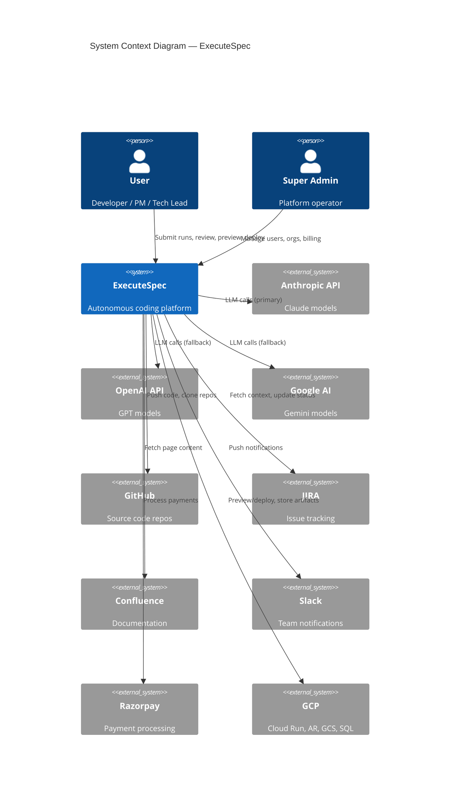
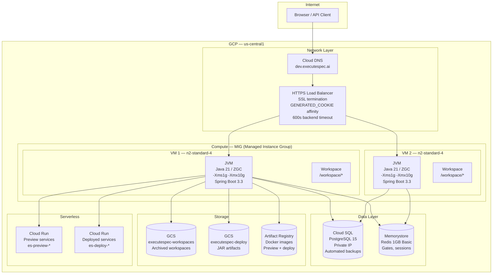
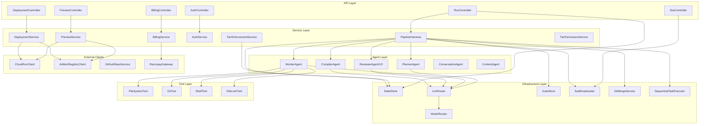
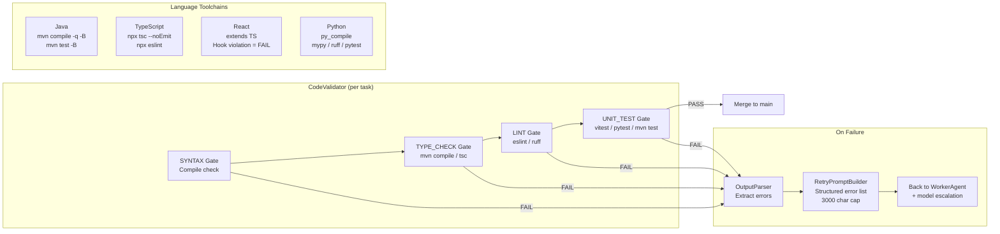
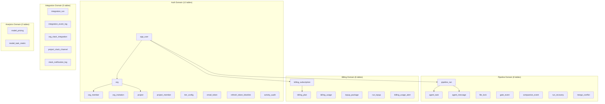
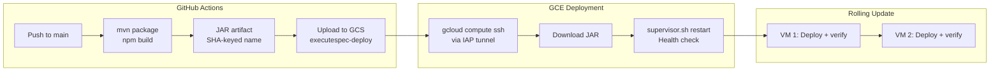
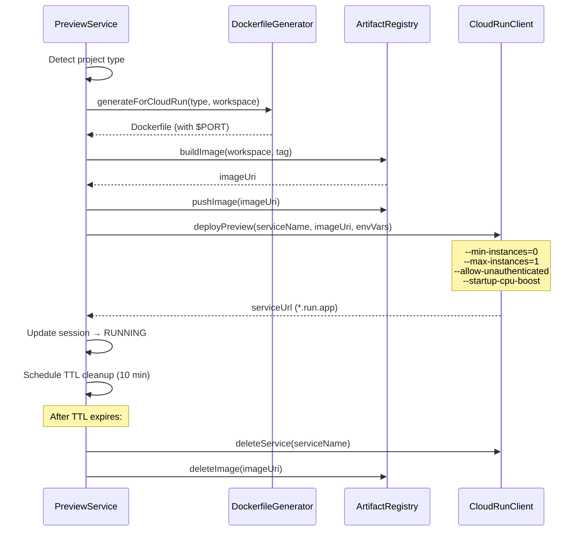

# ExecuteSpec — Architecture Document

> **Version**: 2.0
> **Date**: 2026-03-15
> **Audience**: Technical Leads, Staff Engineers, Platform Team

---

## 1. System Context



---

## 2. Infrastructure Architecture



---

## 3. Application Architecture

### 3.1 Package Dependency Map



### 3.2 Agent Architecture

```mermaid
graph TB
    subgraph "Agent Execution Model"
        direction TB

        subgraph "PlannerAgent"
            P_IN[User Goal + Context] --> P_LLM[Claude Sonnet<br/>CAPABLE_CHAIN]
            P_LLM --> P_OUT[TaskPlan<br/>1-35 tasks, sequential<br/>complexity per task]
        end

        subgraph "WorkerAgent (per task, sequential)"
            W_PROMPT[Task + Context<br/>+ Workspace State] --> W_LOOP

            subgraph "W_LOOP [15-min Time Loop]"
                W_LLM[LLM Call<br/>Claude Haiku] --> W_PARSE[Parse XML<br/>tool_call tags]
                W_PARSE --> W_DISPATCH[Dispatch Tool<br/>readFile/writeFile/<br/>editFile/run/etc.]
                W_DISPATCH --> W_RESULT[Tool Result<br/>Truncated output]
                W_RESULT --> W_CHECK{Completion?<br/>Starts with '{'}
                W_CHECK -->|No| W_LLM
                W_CHECK -->|Yes| W_DONE[WorkerReport]
            end

            W_STALL{Stall Detection<br/>5 min no writes} -->|Yes| W_ESCALATE[Model Escalation]
            W_ESCALATE --> W_LLM
        end

        subgraph "ReviewerAgentV2 (two-phase)"
            R_DIFFS[Merged code on main] --> R_INSPECT[Phase 1: Inspect<br/>Read-only tool-use analysis]
            R_INSPECT --> R_ISSUES[Issues List<br/>CRITICAL/MINOR]
            R_ISSUES --> R_FIX[Phase 2: Auto-Fix<br/>FAST → CAPABLE escalation<br/>2 attempts per issue, max 8]
            R_FIX --> R_REPORT[ReviewReportV2<br/>APPROVED/NEEDS_FIXES/REJECTED]
        end

        subgraph "ValidationReportAgent (non-fatal)"
            VR_INPUT[WorkerReports + CompileResult<br/>+ ReviewReport + TestResults] --> VR_LLM[Claude Haiku<br/>via LlmCallGuard]
            VR_LLM --> VR_OUT[Markdown Report<br/>+ Structured Issues<br/>+ PDF Download]
            VR_OUT --> VR_DB[(validation_report<br/>table)]
        end
    end
```

### 3.3 Code Validation Pipeline



---

## 4. Data Architecture

### 4.1 Database Schema Overview



### 4.2 Migration History (V1 — V37)

| Version | Description | Tables Affected |
|---------|-------------|----------------|
| V1-V3 | Core schema, tenant, cost | pipeline_run, agent_task, agent_message |
| V4-V7 | Auth, admin seed, tiers | app_user, tier_config |
| V8-V9 | GitHub, conversations | app_user, agent_message |
| V10-V14 | AI keys, GCS, merge, key source | app_user, org, merge_conflict |
| V15-V16 | Model metrics, prompt audit | model_task_metric, prompt_audit_entry |
| V17-V20 | Auto-merge, integrations, Slack | org, org_slack_integration |
| V21 | Tier permissions | tier_config, org |
| V22 | Activity audit | activity_audit |
| V23-V25 | Billing | billing_plan, billing_subscription, billing_usage |
| V26 | Run top-up | topup_package, run_topup |
| V27 | Apply suggestion | pipeline_run, tier_config |
| V28 | Invoicing & GST | billing_profile, invoice, etc. |
| V29 | Preview limits | pipeline_run, tier_config |
| V32 | Plan versions | plan_version |
| V34 | Validation report | validation_report |
| V37 | Test generation pipeline | test_plan, test_task, test_result |

---

## 5. Security Architecture

```mermaid
graph TB
    subgraph "Authentication"
        LOGIN[POST /auth/login] --> JWT_GEN[Generate JWT<br/>HS256, 24h TTL]
        JWT_GEN --> ACCESS[Access Token<br/>Header: Authorization]
        JWT_GEN --> REFRESH[Refresh Token<br/>HttpOnly Cookie, 7d]
    end

    subgraph "Authorization (per request)"
        REQ[Incoming Request] --> JF[JwtFilter<br/>Validate token]
        JF --> SC[SecurityConfig<br/>Endpoint rules]
        SC --> RVS[RunVisibilitySpec<br/>Query-level access]
        SC --> RAG[RunAccessGuard<br/>Resource-level access]
    end

    subgraph "RBAC Hierarchy"
        SUPER[SUPER_ADMIN] --> ALL[All resources]
        ORG_ADMIN[ORG_ADMIN] --> ORG_RES[Org resources]
        BILLING[BILLING_ADMIN] --> BILL_RES[Billing only]
        DEV[DEVELOPER] --> OWN_RES[Org runs read<br/>Own runs write]
        FREE[FREE User] --> SELF[Own runs only]
    end

    subgraph "Sandbox"
        FS[FileSystemTool<br/>safeResolve()] --> WS[workspace/{runId}/]
        SHELL[ShellTool] --> POLICY[ShellSandboxPolicy<br/>Allow/blocklist]
    end
```

---

## 6. Deployment Architecture

### 6.1 CI/CD Pipeline



### 6.2 Preview Deployment Flow



---

## 7. Concurrency Model

```mermaid
graph TB
    subgraph "Thread Model"
        MAIN[Main Thread<br/>Spring MVC] --> SUBMIT[submitRun()]
        SUBMIT --> SEM[Semaphore<br/>maxRuns=10]
        SEM --> POOL[CachedThreadPool<br/>Daemon threads]
        POOL --> PIPELINE[Pipeline Thread<br/>1 per run]

        PIPELINE --> VT1[Virtual Thread<br/>Preview build]
        PIPELINE --> VT2[Virtual Thread<br/>Post-merge agents]

        PIPELINE --> GATE_POLL[Gate Polling<br/>500ms interval<br/>Redis-backed]
    end

    subgraph "Shared State"
        SS_MAP[StateStore<br/>PostgreSQL]
        REDIS_G[Redis<br/>Gate keys]
        CM[ConcurrentHashMap<br/>Preview sessions]
        RKS[RunKeyStore<br/>ConcurrentHashMap]
    end

    PIPELINE --> SS_MAP
    PIPELINE --> REDIS_G
    VT1 --> CM
    PIPELINE --> RKS
```

---

## 8. Observability

### 8.1 Logging

| Component | Log Level | Key Events |
|-----------|----------|------------|
| PipelineHarness | INFO | Run lifecycle (start, complete, fail) |
| WorkerAgent | INFO/DEBUG | Iteration count, tool calls, time remaining |
| PreviewService | INFO | Preview lifecycle (start, deploy, stop) |
| LlmRouter | WARN | Provider fallback, rate limits |
| TierEnforcementService | DEBUG | Quota checks, bonus run consumption |

### 8.2 Metrics (Spring Actuator)

- `actuator/health` — Health check (public)
- `actuator/prometheus` — Prometheus metrics (internal)
- Custom: `ModelTaskMetric` — per-task execution stats

### 8.3 SSE Event Types

| Event | When |
|-------|------|
| PLANNING | Pipeline starts planning |
| PLAN_READY | Plan generated, awaiting approval |
| WORKING | Tasks executing |
| TASK_STARTED / TASK_COMPLETED | Per-task lifecycle |
| VALIDATION_PASSED / VALIDATION_FAILED | Code validation |
| MODEL_ESCALATED | Retry with upgraded model |
| REVIEWING | Review phase |
| REPORT_GENERATED | Validation report ready (non-fatal) |
| REVIEW_READY | Awaiting merge decision |
| COMPLETE / FAILED / PARTIAL | Terminal states |
| PREVIEW_ANALYZING / BUILDING / PUSHING / DEPLOYING / RUNNING | Preview phases |
| PREVIEW_STOPPED | Preview terminated |
| CLARIFICATION_NEEDED / RESOLVED | Context extraction gates |
| CONTEXT_EXTRACTED | JIRA/Confluence context enriched |

---

## 9. Technology Stack Summary

| Layer | Technology | Version |
|-------|-----------|---------|
| Language | Java | 21 (LTS) |
| Framework | Spring Boot | 3.3 |
| AI Framework | Spring AI | 1.1.0 |
| Build | Maven | 3.9+ |
| Database | PostgreSQL | 15 |
| Cache/Gates | Redis (Memorystore) | 7.x |
| Frontend | React + Vite + Tailwind | 18 / 5 / 3 |
| Container | Docker | 24+ |
| Cloud | GCP | — |
| Compute | GCE (MIG) | n2-standard-4 |
| Serverless | Cloud Run | Gen2 |
| Registry | Artifact Registry | — |
| Storage | Cloud Storage (GCS) | — |
| Database | Cloud SQL (PostgreSQL) | 15 |
| LB | HTTPS External LB | — |
| CI/CD | GitHub Actions | — |
| Payment | Razorpay | API v1 |
| JVM | ZGC (Generational) | — |

---

## 10. Key Design Decisions & Rationale

| Decision | Rationale | Alternative Considered |
|----------|-----------|----------------------|
| XML tool calls (not Spring AI native) | WorkerAgent needs `runId` injection; `@Tool` methods can't receive it | Spring AI `@Tool` annotation |
| Redis gates (not in-memory) | MIG: approval REST call may hit different instance than pipeline thread | CompletableFuture maps |
| Progressive merge (per-task) | Later tasks see previous output; reduces merge conflicts | Merge-all-at-end |
| 15-min time limit (not iteration count) | Predictable behavior; iteration count was unintuitive | Iteration-based limits |
| Cloud Run previews (not Docker on VM) | Ports not exposed through LB; Cloud Run gives public HTTPS URLs | Docker Compose on GCE |
| 3-provider fallback chains | Resilience; no single-provider dependency | Single provider |
| Embedded DB for preview | Cloud Run can't run sidecars; H2/SQLite sufficient for preview | Shared Cloud SQL instance |
| ConcurrentHashMap for preview state | In-memory is fast; orphan cleanup handles restarts | Database-backed sessions |
| FIFO bonus run consumption | Fair; oldest credits used first; prevents hoarding | LIFO or random |

---

## 11. Design Decision Details

### Tool-Call Format
WorkerAgent uses **XML tool calls**: `<tool_call>{"name":"...", "args":{...}}</tool_call>`. NOT Spring AI native tool calling. Reason: `@Tool` methods require `runId` which the model doesn't know. Dispatch is manual via `parseXmlToolCalls()` + `dispatchTool()` with `runId` injected automatically.

### Completion Detection
WorkerAgent response must START with `{` (strict JSON check via `looksLikeCompletionReport()`). Prevents false positives on prose containing field names.

### Context Window Management
- **Sliding window**: First 2 messages + last 18 kept per API call
- **Progress checkpoints**: Every 15 iterations, re-inject task ID, objective, criteria
- **Completion urgency**: At iteration 75 (5 before cap), force JSON output
- **Pre-call token estimation**: If messages > 30, estimate tokens (chars/4), compact proactively
- **Emergency compaction**: HARD_STOP tries compaction first; only truly stops if recently compacted

### Prompt Caching
Anthropic `SYSTEM_ONLY` strategy. Cache TTL = 5 min. `AnthropicChatOptions.builder().maxTokens(maxOut).cacheOptions(SYSTEM_ONLY)` — no toolCallbacks.

### API Key Resolution
Resolution: **user key → org key → system key** based on org's `keySourceMode`:
- `SYSTEM`: Force platform keys only
- `OWN_KEYS`: User/org keys required
- `HYBRID` (default): User/org first, system fallback

---

## 12. WorkerAgent Tool Dispatch

| Tool call name | Java method |
|---|---|
| readFile / read_file | `fsTool.readFile(runId, path)` |
| writeFile / write_file | `fsTool.writeFile(runId, path, content)` |
| editFile / edit_file | `fsTool.editFile(runId, path, oldStr, newStr)` |
| listFiles / list_files | `fsTool.listFiles(runId, path)` |
| searchFiles / search_files | `fsTool.searchFiles(runId, pattern, directory)` |
| run / run_command / run_build / run_tests | `shellTool.run(runId, command, timeout)` |
| status / git_status | `gitTool.status(runId)` |
| diff / git_diff | `gitTool.diff(runId)` |
| commit / git_commit | `gitTool.commit(runId, message)` |

Result truncation: readFile → 8k chars, shell → 6k chars, diff → 5k chars.

---

## 13. Known Issues & Mitigations

| Issue | Mitigation |
|-------|-----------|
| Branch retry fails | `GitTool.createBranch()` catches `RefAlreadyExistsException` → checkout fallback |
| Token cost explosion | Sliding window (first 2 + last 18) + result truncation |
| Completion false positive | `looksLikeCompletionReport()` requires response starts with `{` |
| 80-iteration cap hit | Progress checkpoints every 15 iters + urgency at iter 75 |
| Hard stop at 73% context | Pre-call estimation + emergency compaction |
| Chat has no code access | ConversationAgent injects file tree, README, context, plan, review |
| Gate lost on server restart | `approve()` → if gate missing → auto-fail with message |

---

*This architecture document is maintained alongside the codebase. Last updated: 2026-03-26.*
