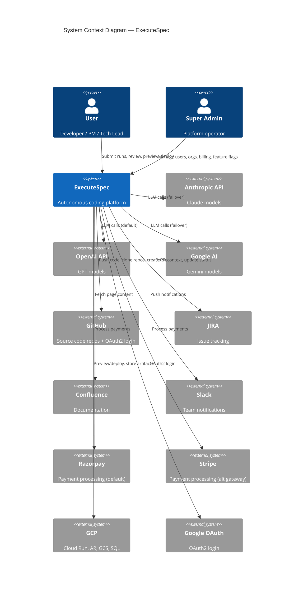
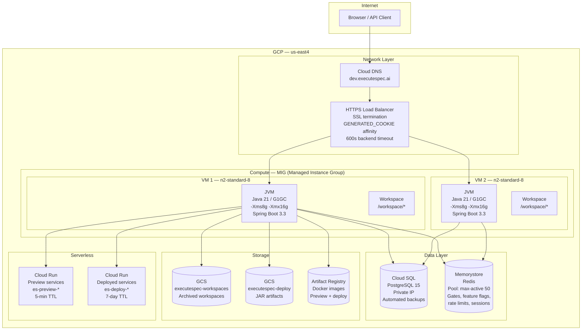
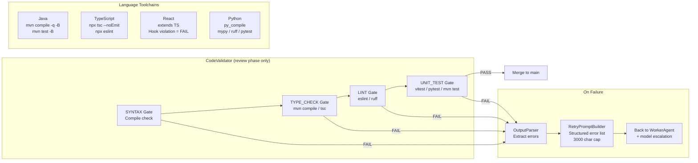
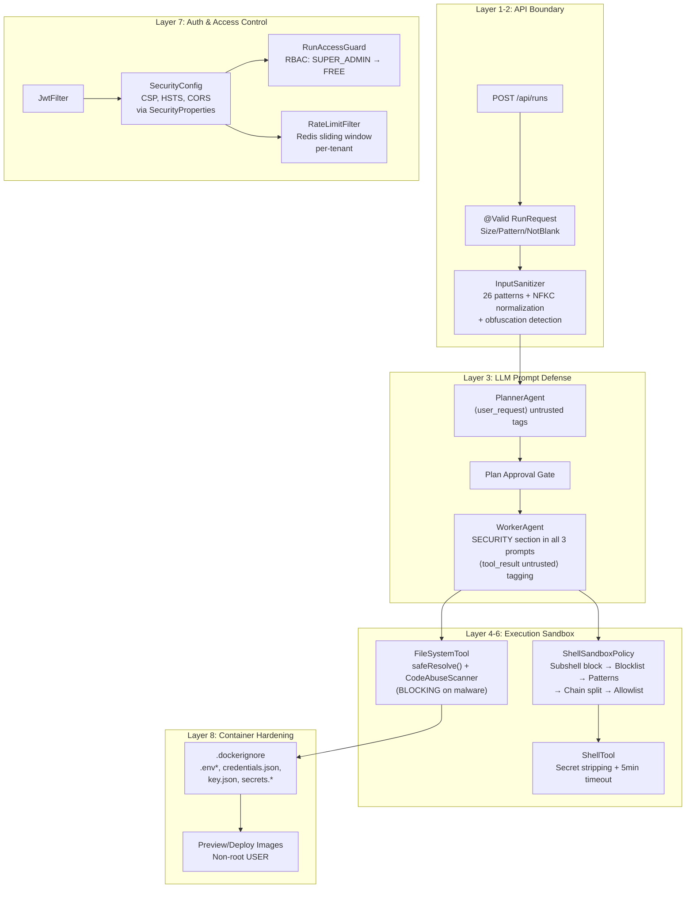
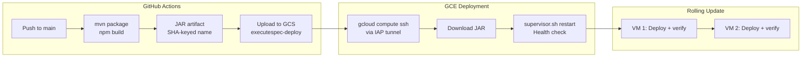
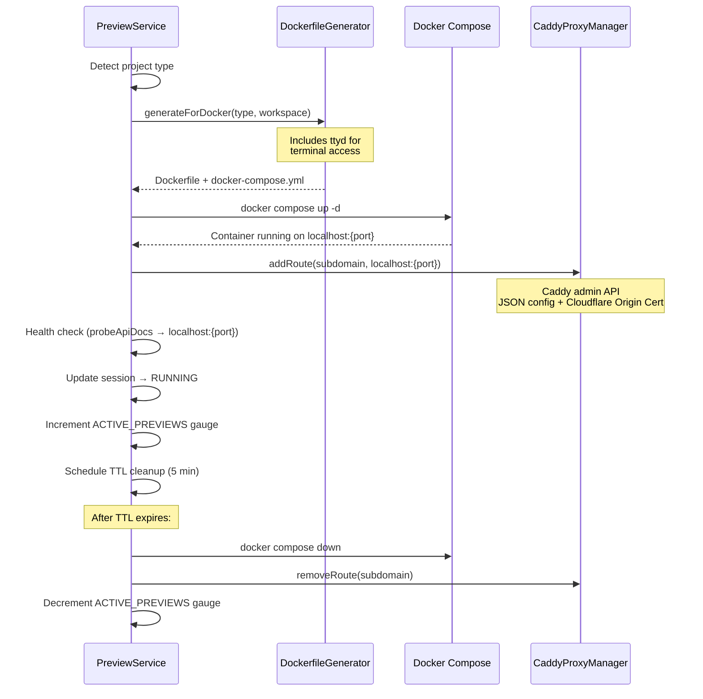
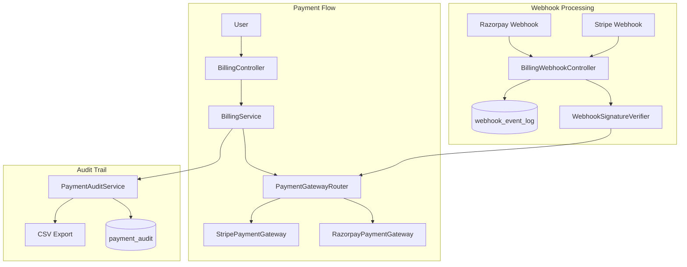
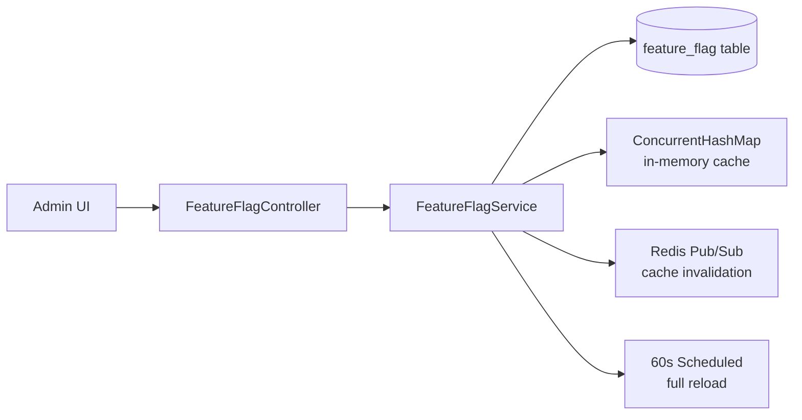

# ExecuteSpec — Architecture Document

> **Version**: 3.2
> **Date**: 2026-04-04
> **App Version**: v1.1.0
> **Audience**: Technical Leads, Staff Engineers, Platform Team

---

## 1. System Context



---

## 2. Infrastructure Architecture



---

## 3. Application Architecture

### 3.1 Package Dependency Map

```mermaid
graph TB
    subgraph "API Layer"
        RC[RunController]
        PC[PreviewController]
        DC[DeploymentController]
        AC[AuthController]
        BC[BillingController]
        SC[SseController]
        MC[ModelController]
        FFC[FeatureFlagController]
        PAC[PaymentAuditController]
    end

    subgraph "Service Layer"
        PH[PipelineHarness]
        PS[PreviewService]
        DS[DeploymentService]
        AS[AuthService]
        BS[BillingService]
        TE[TierEnforcementService]
        TP[TierPermissionService]
        FFS[FeatureFlagService]
        PAS[PaymentAuditService]
        RLF[RateLimitFilter]
    end

    subgraph "Agent Layer"
        PA[PlannerAgent]
        WA[WorkerAgent]
        RA[ReviewerAgentV2]
        CA[CompilerAgent]
        ConvA[ConversationAgent]
        CtxA[ContextAgent]
        TGO[TestGenOrchestrator]
        TWA[TestWorkerAgent]
        TPC[TestPreviewCoordinator]
        TRG[TestReportGenerator]
        RTS[RequestTriageService]
    end

    subgraph "Infrastructure Layer"
        SS[StateStore]
        LR[LlmRouter]
        MR[ModelResolver]
        PHT[ProviderHealthTracker]
        GS[GateStore]
        SB[SseBroadcaster]
        GMS[GitMergeService]
        STE[SequentialTaskExecutor]
        STD[SubtaskDecomposer]
    end

    subgraph "Security Layer"
        IS[InputSanitizer]
        CAS[CodeAbuseScanner]
        SP[SecurityProperties]
    end

    subgraph "Tool Layer"
        FST[FileSystemTool]
        GT[GitTool]
        ST[ShellTool]
    end

    subgraph "External Clients"
        CRC[CloudRunClient]
        ARC[ArtifactRegistryClient]
        GHR[GitHubRepoService]
        PGR[PaymentGatewayRouter]
        RPG[RazorpayGateway]
        SPG[StripeGateway]
    end

    RC --> PH
    RC --> SS
    PC --> PS
    DC --> DS
    AC --> AS
    BC --> BS
    SC --> SB
    MC --> MR
    FFC --> FFS
    PAC --> PAS

    PH --> PA & WA & RA & CA & TGO
    PH --> STE & GMS & GS
    PH --> SS & SB
    TGO --> TWA & TPC & TRG

    PS --> CRC & ARC
    DS --> CRC & ARC

    PA & WA & RA & CA & TGO & TWA & TRG --> LR
    LR --> MR
    MR --> PHT

    WA --> FST & GT & ST
    WA --> IS & CAS

    TE --> SS
    BS --> PGR
    PGR --> RPG & SPG
```



### 3.2 Agent Architecture

**Pipeline flow:** plan → approve → work (tiered parallel tasks, progressive merge per task) → compile → auto-merge all → **COMPLETE** → auto-preview (5-min TTL) → background validation thread: review → test gen → preview reuse → test exec → validation report. Merge is automatic (no manual gate).

**Background validation lifecycle:** After COMPLETE, `PipelineHarness` spawns a virtual thread (`bg-validation-{runId}`) tracked in `backgroundValidationRuns` ConcurrentHashSet. SSE `broadcaster.complete()`, `runKeyStore.remove()`, and `runBudgetTracker.remove()` are deferred to the background thread's `finally` block. On failure, emits `VALIDATION_FAILED` SSE event.

**Project type detection:** PlannerAgent outputs `project_type` in the plan JSON. This is written to `.agent-context/project.json` in the workspace. `DevDockerfileGenerator` and `DockerfileGenerator` read this value before falling back to file-based heuristics, preventing misdetection (e.g., static HTML being classified as NODE).

**Model Matrix:**

| Agent Tier | Agents | Anthropic | Google | OpenAI |
|------------|--------|-----------|--------|--------|
| PLANNING | PlannerAgent, ReviewerAgentV2 | `claude-sonnet-4-6` | `gemini-2.5-flash` | `gpt-5.4` |
| WORKHORSE | WorkerAgent, CompilerAgent, TestPlannerAgent, TestWorkerAgent, ApiTestSuiteAgent, ConflictResolverAgent, PromptOptimiserAgent, ValidationReportGenerator | `claude-haiku-4-5-20251001` | `gemini-2.5-flash` | `gpt-5.4-mini` |
| LIGHTWEIGHT | ConversationAgent, ContextAgent, TestReportGenerator, RequestTriageService | `claude-haiku-4-5-20251001` | `gemini-2.5-flash` | `gpt-5.4-mini` |

Default provider: **OpenAI** (user-selected per project). Failover: Anthropic→[OpenAI, Google], Google→[OpenAI, Anthropic], OpenAI→[Google, Anthropic]. Stall escalation promotes WorkerAgent from WORKHORSE → PLANNING tier.

```mermaid
graph TB
    subgraph "Agent Execution Model"
        direction TB

        subgraph "PlannerAgent"
            P_IN[User Goal + Context] --> P_LLM[LLM Call<br/>PLANNING tier]
            P_LLM --> P_OUT[TaskPlan<br/>1-35 tasks, sequential<br/>complexity per task<br/>+ project_type detection]
            P_OUT --> P_CTX[.agent-context/project.json<br/>project_type written here<br/>Read by DockerfileGenerator<br/>before file-based heuristics]
        end

        subgraph "WorkerAgent (per task, tiered parallel)"
            W_PROMPT[Task + Context<br/>+ Workspace State] --> W_LOOP

            subgraph "W_LOOP [25-min Time Loop, target 20 / hard 35 iterations]"
                W_LLM[LLM Call<br/>WORKHORSE tier] --> W_STRIP[Strip fabricated<br/>tool_result blocks<br/>Self-play prevention]
                W_STRIP --> W_PARSE[Parse XML first<br/>JSON fallback<br/>PATH B providers]
                W_PARSE --> W_DISPATCH[Dispatch Tool<br/>readFile/writeFile/<br/>editFile/run/etc.]
                W_DISPATCH --> W_RESULT[Tool Result<br/>Truncated output]
                W_RESULT --> W_CHECK{Completion?<br/>Starts with '{'}
                W_CHECK -->|No| W_BUDGET{Mid-task budget<br/>check every 5 calls}
                W_BUDGET --> W_LLM
                W_CHECK -->|Yes| W_DONE[WorkerReport]
            end

            W_STALL{Stall Detection<br/>5 min no writes} -->|Yes| W_ESCALATE[Model Escalation<br/>WORKHORSE → PLANNING]
            W_ESCALATE --> W_LLM
            W_FAIL{Provider failure<br/>mid-task} -->|Yes| W_RECOVER[Compact history +<br/>fallback provider via<br/>ModelResolver.resolveFallbackExcluding()]
            W_RECOVER --> W_LLM
        end

        subgraph "ReviewerAgentV2 (two-phase, background)"
            R_DIFFS[Merged code on main] --> R_INSPECT[Phase 1: Inspect<br/>Read-only tool-use analysis]
            R_INSPECT --> R_ISSUES[Issues List<br/>CRITICAL/MINOR<br/>README gate: taskCount ≤ 5 → MINOR]
            R_ISSUES --> R_FIX[Phase 2: Auto-Fix<br/>2 attempts per issue, max 8]
            R_FIX --> R_REPORT[ReviewReportV2<br/>PASSED/PASSED_WITH_FIXES/<br/>NEEDS_ATTENTION/FAILED]
        end

        subgraph "Test Generation Pipeline (background, after review)"
            TG_ORCH[TestGenOrchestrator<br/>Language-agnostic pipeline]
            TG_PLAN[TestPlannerAgent<br/>WORKHORSE tier] --> TG_WORKER[TestWorkerAgent<br/>WORKHORSE tier<br/>Generates test files]
            TG_WORKER --> TG_COMPILE{Tests compile?}
            TG_COMPILE -->|Yes| TG_PREVIEW[TestPreviewCoordinator<br/>Reuses existing preview<br/>or starts new one]
            TG_COMPILE -->|No| TG_RETRY[Retry compilation]
            TG_PREVIEW --> TG_EXEC[Test Execution<br/>Against live preview]
            TG_EXEC --> TG_REPORT[TestReportGenerator<br/>LIGHTWEIGHT tier]
        end

        subgraph "ValidationReportAgent (non-fatal, background)"
            VR_INPUT[WorkerReports + CompileResult<br/>+ ReviewReport + TestResults] --> VR_LLM[LLM Call<br/>WORKHORSE tier]
            VR_LLM --> VR_OUT[Markdown Report<br/>+ Structured Issues<br/>+ PDF Download]
            VR_OUT --> VR_DB[(validation_report<br/>table)]
        end
    end
```

**TokenBudgetMonitor:** Caps output tokens to model max. When model max output ≤ 8192, downgrades detail level from HIGH to MEDIUM to stay within budget.

**CompilerAgent:** Dynamic SSE error truncation — `maxErrorCharsForSse` is computed based on file count to prevent oversized SSE events.

**DevDockerfileGenerator:** Fixed shell escape in full-stack Dockerfile (prevents broken `CMD` when both frontend and backend are present).

**Planner prompts:** `planner_edit.txt` has been deleted and merged into `planner.txt` using `{{#if editMode}}` conditional templating.

### 3.3 Code Validation Pipeline



---

## 4. Data Architecture

### 4.1 Database Schema Overview

```mermaid
graph TB
    subgraph "Auth Domain (12 tables)"
        AU[app_user]
        ORG[org]
        OM[org_member]
        OI[org_invitation]
        PROJ[project]
        PM[project_member]
        TC[tier_config]
        ET[email_token]
        RTB[refresh_token_blocklist]
        AA[activity_audit]
    end

    subgraph "Pipeline Domain (8 tables)"
        PR[pipeline_run]
        AT[agent_task]
        AM[agent_message]
        FL[file_lock]
        GE[gate_event]
        CE[compaction_event]
        RR[run_recovery]
        MC[merge_conflict]
    end

    subgraph "Billing Domain (9 tables)"
        BP[billing_plan]
        BS[billing_subscription]
        BU[billing_usage]
        TP[topup_package]
        RT[run_topup]
        BA[billing_usage_alert]
        WEL[webhook_event_log]
        PAU[payment_audit]
        INV[invoice]
    end

    subgraph "Integration Domain (5 tables)"
        IR[integration_run]
        IEL[integration_event_log]
        OSI[org_slack_integration]
        PSC[project_slack_channel]
        SNL[slack_notification_log]
    end

    subgraph "Platform Domain (2 tables)"
        FF[feature_flag]
        VR[validation_report]
    end

    subgraph "Test Domain (3 tables)"
        TPL[test_plan]
        TT[test_task]
        TR[test_result]
    end

    subgraph "Analytics Domain (2 tables)"
        MP[model_pricing]
        MTM[model_task_metric]
    end

    AU --> ORG
    AU --> PR
    ORG --> OM
    ORG --> PROJ
    PR --> AT
    PR --> AM
    PR --> VR
    AU --> BS
    BS --> BP
    PR --> TPL
```



### 4.2 Migration History (V1 — V56)

| Version | Description | Tables Affected |
|---------|-------------|----------------|
| V1-V3 | Core schema, tenant, cost | pipeline_run, agent_task, agent_message |
| V4-V7 | Auth, admin seed, tiers | app_user, tier_config |
| V8-V9 | GitHub, conversations | app_user, agent_message |
| V10-V14 | AI keys, GCS, merge, key source | app_user, org, merge_conflict |
| V15-V16 | Model metrics, prompt audit | model_task_metric, prompt_audit_entry |
| V17-V20 | Auto-merge, integrations, Slack | org, org_slack_integration |
| V21-V22 | Tier permissions, activity audit | tier_config, activity_audit |
| V23-V26 | Billing, run top-up | billing_plan, billing_subscription, billing_usage, topup_package, run_topup |
| V27-V29 | Apply suggestion, invoicing, preview limits | pipeline_run, billing_profile, invoice, tier_config |
| V32 | Plan versions | plan_version |
| V34 | Validation report | validation_report |
| V35-V37 | Preview tracking, run title/summary, test gen | pipeline_run, test_plan, test_task, test_result |
| V38-V44 | Calibration, report flags, project provider, UI style | pipeline_run, validation_report, project |
| V45 | Widen plan_version columns | plan_version (VARCHAR(36) → VARCHAR(255)) |
| V46 | Stripe and payment gateway support | billing_plan, billing_subscription |
| V47 | OAuth support (GitHub, Google login) | app_user |
| V48 | View mode column | pipeline_run |
| V49 | Feature flags | feature_flag |
| V50 | Free tier restrictions | tier_config |
| V51 | Force logout flag | app_user |
| V52 | GitHub PR URL | pipeline_run (github_pr_url) |
| V53 | Archive run | pipeline_run (archived) |
| V54 | Stripe multi-currency | billing_plan, billing_subscription |
| V55 | Payment audit expansion | payment_audit |
| V56 | Deployment tracking | deployment |

---

## 5. Security Architecture

> Full requirements: [docs/requirements/security-guardrails.md](requirements/security-guardrails.md)

8-layer defense-in-depth model. No single layer failing results in full compromise.



### Authentication
- **JWT:** HS256, access 1h TTL, refresh 7d (HTTP-only cookie, rotated on refresh)
- **Scoped SSE tokens:** 5-min TTL, `scope=sse` + `runId` claim, prevents cross-run eavesdropping
- **OAuth2:** Google + GitHub login via `OAuthSuccessHandler` (creates user if new, generates JWT)
- **Force logout:** Feature flag `force_logout_epoch` invalidates all tokens issued before epoch
- **JWT secret validation:** `JwtSecretValidator` blocks startup in prod profile if dev placeholder secret is used
- **SSE streams:** `?token=` query param (EventSource limitation), uses scoped SSE tokens
- All `/api/**` require valid JWT (except auth, health, webhooks, shared reports)

### Authorization (RBAC)
| Role | Scope |
|------|-------|
| SUPER_ADMIN | All resources, feature flags, payment audit |
| ORG_ADMIN | Org resources, payment history |
| BILLING_ADMIN | Billing within org |
| PROJECT_ADMIN | Project resources |
| PROJECT_DEVELOPER | Project runs (read/write) |
| DEVELOPER | Org runs (read/write) |
| FREE User | Own runs only |

### Security Headers (Configurable via SecurityProperties)
- **CSP:** Enabled by default; allows Monaco CDN (`cdn.jsdelivr.net`) and Cloudflare Insights
- **HSTS:** Enabled (max-age 1yr, includeSubDomains)
- **X-Frame-Options:** DENY

### Agent Sandbox (defense-in-depth)
1. **InputSanitizer** — 26 regex patterns + Unicode NFKC normalization + obfuscation detection (HTTP 400)
2. **LLM prompt defense** — untrusted input tagging + tool result `untrusted="true"` wrapping
3. **CodeAbuseScanner** — blocks malware writes (mining, reverse shells, exfil, obfuscated payloads)
4. **ShellSandboxPolicy** — subshell blocking + blocklist + patterns + chained-command splitting + allowlist
5. **FileSystemTool** — path normalization + workspace boundary enforcement
6. **ShellTool** — env var stripping + 5-min timeout
7. **Rate limiting** — Redis sliding window, tier-based quotas
8. **Container hardening** — .dockerignore excludes secrets, non-root execution

---

## 6. Deployment Architecture

### 6.1 CI/CD Pipeline



### 6.2 Preview System (Dual-Mode)

The preview system operates in two modes, selected by the `executespec.preview.mode` property:

| Mode | Environment | TTL | Networking | Use Case |
|------|-------------|-----|------------|----------|
| `docker` | Local dev | 5 min | Docker Compose + Caddy reverse proxy (Cloudflare Origin Cert) | Local/VM development |
| `cloud-run` | Dev / Prod | 5 min | Cloud Run managed HTTPS (`*.run.app`) | Hosted environments |

**Concurrency limits:** FREE=1, PRO=3, ENTERPRISE=10 concurrent previews.

**Key implementation details:**
- `cloudRunServiceName` stored upfront in session (predictable `es-preview-{runIdShort}`) to prevent orphan cleanup race
- All subprocess commands enforce timeouts: `gcloud run deploy` 10 min, `gcloud run services delete` 5 min, `gcloud logging read` 2 min
- Stdout/stderr streams are read in parallel threads to prevent pipe buffer deadlock
- Virtual threads use `ContextSnapshotFactory.captureAll().wrap(runnable)` for Micrometer trace propagation
- `ACTIVE_PREVIEWS` gauge correctly decremented on all terminal states (success, failure, TTL expiry)
- `probeApiDocs()` works for both modes: Docker (`localhost:{port}`) and Cloud Run (service URL)

#### 6.2.1 Cloud Run Preview Flow


#### 6.2.2 Docker Preview Flow (Local Dev)



---

## 7. Billing Architecture

### 7.1 Multi-Gateway Payment System



**Gateway selection:** `PaymentGatewayRouter` resolves gateway per subscription. Default: Razorpay. Stripe available as alternative (configurable via `billing.default-gateway`).

**Webhook security:** Both gateways verify webhook signatures before processing. Events logged to `webhook_event_log` for auditability.

### 7.2 Feature Flag System



**Architecture:** DB-backed with Redis pub/sub for cross-instance cache invalidation. `ConcurrentHashMap` in-memory cache with two refresh mechanisms: Redis pub/sub for real-time invalidation + 60s scheduled full reload as safety net.

**Special flags:** `submissions.paused` (maintenance mode), `force_logout_epoch` (JWT invalidation).

---

## 8. Concurrency Model

```mermaid
graph TB
    subgraph "Thread Model"
        MAIN[Main Thread<br/>Spring MVC] --> SUBMIT[submitRun()]
        SUBMIT --> SEM[Semaphore<br/>maxRuns=50]
        SEM --> POOL[CachedThreadPool<br/>Daemon threads]
        POOL --> PIPELINE[Pipeline Thread<br/>1 per run]

        PIPELINE --> VT_BG[Virtual Thread<br/>bg-validation-{runId}<br/>Review + Test + Report<br/>Context-wrapped]
        PIPELINE --> VT_PV[Virtual Thread<br/>Preview build<br/>Context-wrapped]

        PIPELINE --> GATE_POLL[Gate Polling<br/>500ms interval<br/>Redis-backed]
    end

    subgraph "Shared State"
        SS_MAP[StateStore<br/>PostgreSQL]
        REDIS_G[Redis<br/>Gate keys + Feature flags<br/>+ Rate limits]
        CM[ConcurrentHashMap<br/>Preview sessions]
        RKS[RunKeyStore<br/>ConcurrentHashMap]
        BVR[backgroundValidationRuns<br/>ConcurrentHashSet]
    end

    PIPELINE --> SS_MAP
    PIPELINE --> REDIS_G
    VT_PV --> CM
    PIPELINE --> RKS
    VT_BG --> BVR
```

---

## 9. Observability

### 9.1 Logging

| Component | Log Level | Key Events |
|-----------|----------|------------|
| PipelineHarness | INFO | Run lifecycle (start, complete, fail), background validation |
| WorkerAgent | INFO/DEBUG | Iteration count, tool calls, time remaining, stall detection |
| PreviewService | INFO | Preview lifecycle (start, deploy, stop, TTL expiry) |
| LlmRouter | WARN | Provider fallback, rate limits, circuit breaker state |
| TierEnforcementService | DEBUG | Quota checks, bonus run consumption |
| FeatureFlagService | INFO | Flag updates, cache invalidation |
| PaymentGatewayRouter | INFO | Payment events, webhook processing |

### 9.2 Metrics (Spring Actuator)

- `actuator/health` — Health check (public)
- `actuator/prometheus` — Prometheus metrics (internal)
- Custom: `ModelTaskMetric` — per-task execution stats
- Custom: 30+ Micrometer gauges/timers across PipelineHarness, SequentialTaskExecutor, LlmRouter, PreviewService, DeploymentService, StuckRunMonitor, CodeValidatorImpl

### 9.3 SSE Event Types

| Event | When |
|-------|------|
| PLANNING | Pipeline starts planning |
| PLAN_READY | Plan generated, awaiting approval |
| WORKING | Tasks executing |
| TASK_STARTED / TASK_COMPLETED | Per-task lifecycle |
| COMPILING | Compilation phase |
| MERGING / AWAITING_MERGE | Merge phase |
| VALIDATION_PASSED / VALIDATION_FAILED | Code validation |
| MODEL_ESCALATED | Retry with upgraded model |
| REVIEWING | Review phase (background) |
| REPORT_GENERATED | Validation report ready |
| TEST_GENERATION_STARTED | Test generation pipeline begins |
| TEST_EXECUTION_STARTED | Tests executing against live preview |
| TEST_EXECUTION_COMPLETED | Test execution finished |
| COMPLETE / FAILED / PARTIAL | Terminal states |
| PREVIEW_ANALYZING / BUILDING / PUSHING / DEPLOYING / RUNNING | Preview phases |
| PREVIEW_STOPPED | Preview terminated |
| CLARIFICATION_NEEDED / RESOLVED | Context extraction gates |
| CONTEXT_EXTRACTED | JIRA/Confluence context enriched |

---

## 10. Technology Stack Summary

| Layer | Technology | Version |
|-------|-----------|---------|
| Language | Java | 21 (LTS) |
| Framework | Spring Boot | 3.3 |
| AI Framework | Spring AI | 1.1.0 |
| Build | Maven | 3.9+ |
| Database | PostgreSQL | 15 |
| Cache/Gates/Flags | Redis (Memorystore) | 7.x |
| Frontend | React + Vite + Tailwind + TypeScript | 18 / 5 / 3.4 / 5.3 |
| Container | Docker | 24+ |
| Cloud | GCP (us-east4) | — |
| Compute | GCE (MIG) | n2-standard-8 |
| Serverless | Cloud Run | Gen2 |
| Registry | Artifact Registry | — |
| Storage | Cloud Storage (GCS) | — |
| Database | Cloud SQL (PostgreSQL) | 15 |
| LB | HTTPS External LB | — |
| CI/CD | GitHub Actions | — |
| Payment | Razorpay + Stripe | Multi-gateway |
| Auth | JWT (JJWT 0.12.6) + OAuth2 | — |
| PDF | OpenPDF + Flying Saucer | 2.0.3 / 9.3.0 |
| JVM | G1GC | -Xms8g -Xmx16g |

---

## 11. Key Design Decisions & Rationale

| Decision | Rationale | Alternative Considered |
|----------|-----------|----------------------|
| XML tool calls (not Spring AI native) | WorkerAgent needs `runId` injection; `@Tool` methods can't receive it | Spring AI `@Tool` annotation |
| Redis gates (not in-memory) | MIG: approval REST call may hit different instance than pipeline thread | CompletableFuture maps |
| Progressive merge (per-task) | Later tasks see previous output; reduces merge conflicts | Merge-all-at-end |
| 25-min time limit (not iteration count) | Predictable behavior; iteration count was unintuitive | Iteration-based limits |
| Dual-mode previews (docker + cloud-run) | Docker Compose + Caddy for local dev; Cloud Run for hosted envs (public HTTPS) | Single-mode only |
| 3-provider fallback chains | Resilience; no single-provider dependency | Single provider |
| Multi-gateway billing (Razorpay + Stripe) | Geographic reach; Stripe for international, Razorpay for India | Single gateway |
| DB-backed feature flags with Redis pub/sub | Cross-instance consistency; admin-manageable; real-time propagation | Config files / environment variables |
| COMPLETE before review (background validation) | Fast user feedback; preview available immediately; review runs in background | Sequential review then complete |
| FIFO bonus run consumption | Fair; oldest credits used first; prevents hoarding | LIFO or random |
| Filesystem-backed design systems (GCS sync) | Decoupled from app deploys; 54 designs updated independently; Caffeine cache (30min) avoids disk I/O | Embedded in JAR / database-stored |
| 3-signal design resolution | Explicit user hint > planner ui_style > project-type heuristic; covers all input paths | Single-signal only |

---

## 12. WorkerAgent Tool Dispatch

| Tool call name | Java method |
|---|---|
| readFile / read_file | `fsTool.readFile(runId, path)` |
| writeFile / write_file | `fsTool.writeFile(runId, path, content)` |
| editFile / edit_file | `fsTool.editFile(runId, path, oldStr, newStr)` |
| listFiles / list_files | `fsTool.listFiles(runId, path)` |
| searchFiles / search_files | `fsTool.searchFiles(runId, pattern, directory)` |
| run / run_command / run_build / run_tests | `shellTool.run(runId, command, timeout)` |
| status / git_status | `gitTool.status(runId)` |
| diff / git_diff | `gitTool.diff(runId)` |
| commit / git_commit | `gitTool.commit(runId, message)` |

Result truncation: readFile → 8k chars, shell → 6k chars, diff → 5k chars.

---

## 13. Known Issues & Mitigations

| Issue | Mitigation |
|-------|-----------|
| Branch retry fails | `GitTool.createBranch()` catches `RefAlreadyExistsException` → checkout fallback |
| Token cost explosion | Sliding window (first 2 + last 18) + result truncation |
| Completion false positive | `looksLikeCompletionReport()` requires response starts with `{` |
| Hard stop at context limit | Pre-call estimation + emergency compaction |
| Chat has no code access | ConversationAgent injects file tree, README, context, plan, review |
| Gate lost on server restart | `approve()` → if gate missing → auto-fail with message |
| Background validation failure | Fire-and-forget; no retry/recovery if background thread fails silently |
| Resume/retry path stale | `doReviewAndMerge()` not updated for background validation pattern |

---

## 14. Design System Integration (v1.1.0)

Filesystem-backed design system that injects company-specific design tokens into worker prompts for visually distinct frontend output.

### Components

| Component | File | Purpose |
|-----------|------|---------|
| DesignSystemProperties | `harness/DesignSystemProperties.java` | Config: rootPath, cacheTtl, maxTokens, defaultStyle, curatedStyles |
| UiStyleResolver | `harness/UiStyleResolver.java` | Filesystem loading, Caffeine cache, fuzzy matching, token truncation, 3-signal resolution |
| TaskPlan.uiStyle | `agent/model/TaskPlan.java` | Planner output field for detected UI style |
| Planner prompt | `resources/prompts/planner.txt` | UI STYLE DETECTION instruction block |

### 3-Signal Resolution Priority

1. **Explicit hint** — user says "like Stripe" → `extractStyleHint()` → fuzzy match
2. **Planner output** — planner sets `ui_style` in plan JSON → fuzzy match
3. **Project type heuristic** — NODE_FRONTEND/STATIC_HTML/FULL_STACK → default style; backend types → null (no design injection)

### Design File Loading

- Root: `/opt/executespec/designs/design-md/` (GCS-synced on deploy + boot)
- Local: configurable via `executespec.designs.root-path`
- Cache: Caffeine, 60 entries, 30min TTL
- Token budget: 2500 tokens (~10K chars), truncated keeping sections 1-5 (theme, colors, typography, components, layout)

### GCS Sync

Design files are synced from `gs://{DEPLOY_BUCKET}/designs/design-md/` to the GCE instance:
- On every deploy (`.github/workflows/deploy.yml`)
- On every boot/reboot (`infra/scripts/startup.sh`)

---

*This architecture document is maintained alongside the codebase. Last updated: 2026-04-04.*
