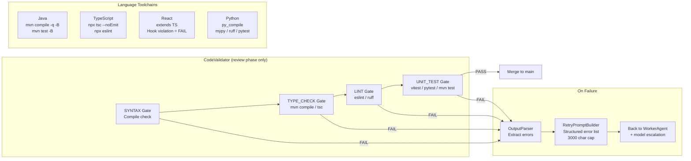
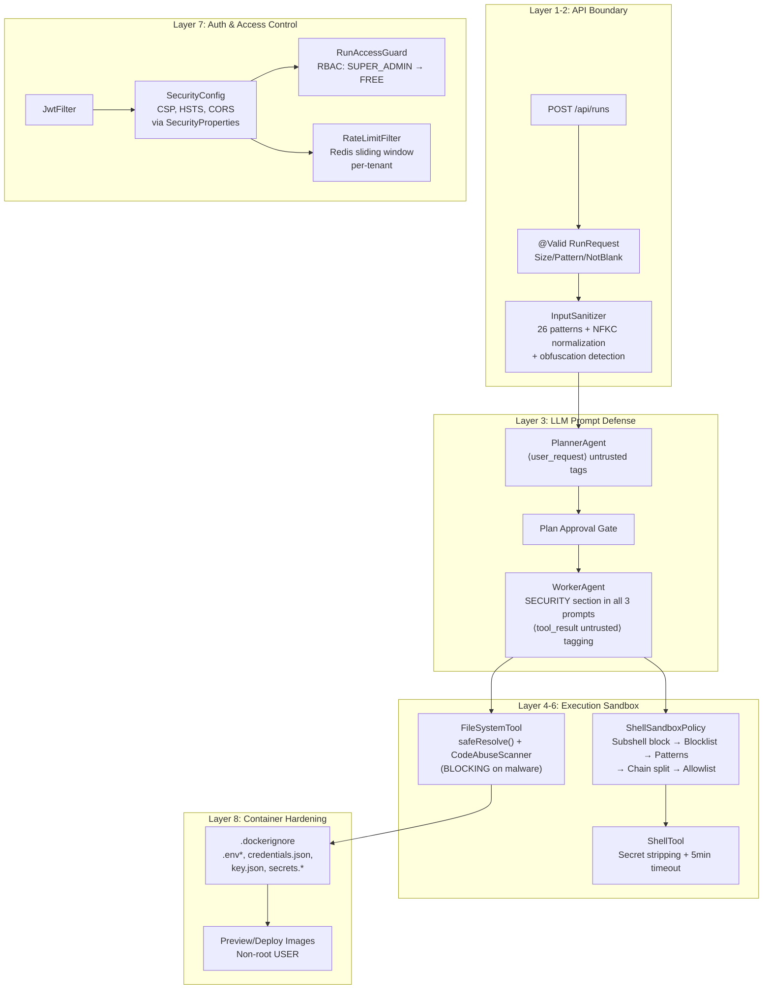
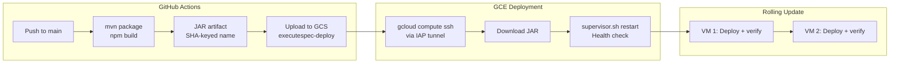
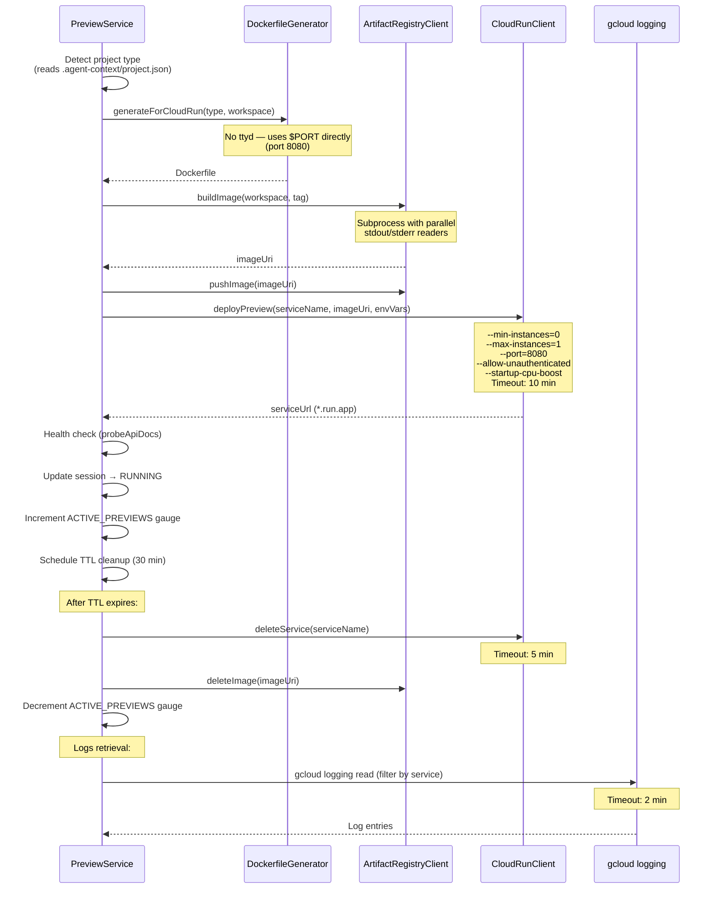
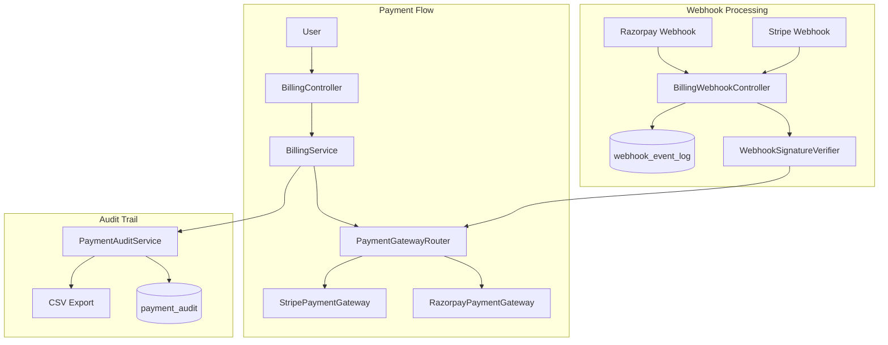
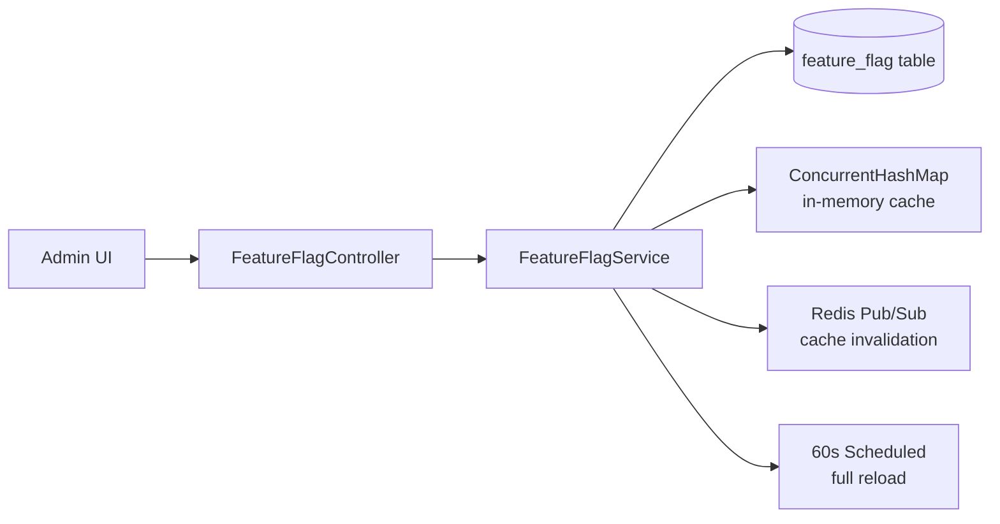

# ExecuteSpec — Architecture Document

> **Version**: 4.11
> **Date**: 2026-04-10 (full rewrite); V2-only refresh 2026-04-13; pilot v3.0 2026-04-14; project memory 2026-04-14; execution view 2026-04-14; project shell + launch 2026-04-14; project workspace + RAG 2026-04-15; Validation v3 Pillar 1 + verified-score + status_reason 2026-04-16; v2.6.0 UX v3 Graphite+Signal + LlmProvider GEMINI rename + pricing v3 + US-first pivot 2026-04-22; v2.6.1 Waves 1-6 merged + deployed 2026-04-23; v2.6.2-track hierarchical planner all 5 slices shipped on `feature/hierarchical-planner` 2026-04-25 (not yet merged); **v2.6.3-track enterprise readiness all 4 phases shipped on `feature/enterprise-readiness-eval` 2026-04-25 (not yet merged) — server-up sweep landed clean**
> **App Version**: v2.6.1 (`dev`/`main`); v2.6.2-track on `feature/hierarchical-planner`; v2.6.3-track on `feature/enterprise-readiness-eval`
> **Audience**: Technical Leads, Staff Engineers, Platform Team

## 0d. 2026-04-25 refresh — v2.6.3-track enterprise readiness (on `feature/enterprise-readiness-eval`, NOT yet merged)

Adds the customer-facing `.executespec/` folder as the single persistent surface for every artefact ExecuteSpec generates (codemaps, contracts, ADRs, standards, invariants), gates every write through one chokepoint with PR vs DIRECT_PUSH dispatch, and adds 4 new persistence stripes + an activity feed + an export bundle + per-user notification preferences. Plan + server-up sweep doc were archived in the 2026-04-26 cleanup pass; what stays canonical is this section + the per-package summaries below.

- **`.executespec/` folder write contract (E1, V131-V134, package `folder/`):** Every mutation to a customer's `.executespec/` folder routes through `ExecutespecFolderWriter#writeFiles`. Caller allowlist pinned by an ArchUnit test (`ExecutespecFolderWriterCallerAllowlistTest`) — currently 4 approved callers: `BootstrapService` (E1.5 initial scaffold), `ContractDriftController` (E2.6 contract index publish), `ContractConsumerController` (E2.7 consumer mirror), `ProjectArchitectureService` (E1.6 codemap/arch publish). Per-(project, repo) `prModeEnum()` selects PR (default — opens setup branch + PR for review) or DIRECT_PUSH (opt-in for trusted high-frequency writes like codemap regen). 4-state status machine on `project_repo`: MISSING → BOOTSTRAP_PENDING → PR_PENDING → READY. `ProjectConfigPathResolver` returns FOLDER_FLAT / FOLDER_NAMESPACED / DATABASE per (project, repo) so callers don't re-implement the multi-project namespacing decision tree.
- **Activity feed (E1, V133, package `activity/`):** Customer-facing project activity feed at `GET /api/projects/{id}/activity`. `activity_feed` partitioned-by-month with 12 partitions seeded 2026-04 → 2027-03; partition + retention jobs (`@Scheduled`, `@SchedulerLock`) keep the table bounded. `ActivityEventEmitter` is the single chokepoint that decides which surfaces (FEED only / FEED+AUDIT / AUDIT only) an event lands on; AUDIT-tagged events dual-write into the existing `activity_audit` (V22) for compliance. Hot-path indexes: `project_time`, `event_type`, `target`, `actor`.
- **Cross-repo contracts (E2, V135, package `contracts/`):** 4 contract kinds — OPENAPI / GRAPHQL / JSON_SCHEMA / PROTO. Per-kind detectors live under `contracts/detection/`; per-kind breaking-change classifiers under `contracts/breaking/` (`ProtoBreakingChangeClassifier` + 3 others; `BreakingChangeService` is the entry point). Drift detection on every commit via `ContractDriftController`; consumer pinning via `ContractConsumerController` mirrors the pinned version into `.executespec/contracts/consumed/<contract>.json` for the consumer; per-repo coverage roll-up via `ContractCoverageController`. Index hot paths: per-repo coverage lookup (E2.3), unresolved-drift triage (E2.8 partial index), per-project consumer rollup (E2.11 + E2.12).
- **Engineering standards (E3, V136, package `standards/`):** Standards are first-class binding policy — `org_standard` defines the org-level rules, `project_standard_override` allows per-project deviations (with severity escalation/de-escalation), `EffectiveStandardsResolver` merges them on every read. Two execution paths: `standards/ast/` (deterministic AST-based checks) + `standards/llmreview/` (LLM-augmented review for non-AST checks). Violation surface: `standards/override/StandardsOverrideController` for single-violation override + standing exception (both require ≥30 char rationale via `ValidationAdvice`). Read surface: `standards/report/StandardsComplianceController` returns the project's effective standards + recent violations + persistent overrides.
- **ADRs as first-class (E3.12, V137, package `adr/`):** ADRs live in customer git as `.executespec/arch/adrs/<NNNN>-<slug>.md`. `AdrFrontmatterParser` parses YAML frontmatter; `adr` table caches the parsed metadata so dashboards / planner can query by status (PROPOSED / ACCEPTED / SUPERSEDED / DEPRECATED) without GitHub round-trips. `AdrInjectionService` is where the planner pulls ADR context from (planner-side wiring deliberately bounded on this branch to avoid hierarchical-planner merge conflicts).
- **Architecture invariants (E3.14, V138, package `arch/invariants/`):** Continuous architectural properties (e.g. "only payment-service writes to the payments table" / "no module under api/ imports from internal/"). Definitions live in customer git as `.executespec/arch/invariants.yaml` per repo. `InvariantChecker` runs per-codemap-version; violations land in `arch_invariant_violation` with severity + repo coordinates. Same dashboards-versus-GitHub split as ADRs — DB cache for query speed, customer git is the source of truth.
- **Notification preferences + export (E4, V139, packages `notification/pref/` + `export/`):** `UserNotificationPref` is a per-user × event-type × channel opt-in/out matrix; `NotificationPrefService` applies sensible defaults (notify for things needing attention, don't notify for routine events). `ProjectExportController` (`POST /api/projects/{id}/export`) returns a zip bundle of every `.executespec/` artefact + DB-only counterparts when `config_storage=DATABASE`.
- **Boot fix shipped this session (2026-04-25):** `ExecutespecFolderWriter` + `BootstrapService` had two constructors (prod + test seam) but neither was annotated with `@Autowired`; Spring 6's bean-factory fell back to the no-arg constructor (which doesn't exist) and refused the bean. Fix: `@Autowired` on the prod constructor of each. Discovered when this session brought up the local stack for the deferred server-up eval — would have crashed the first dev deploy attempt.

Next refresh hooks: planner-side wiring of `{{CONTRACTS}}` / `{{ADR}}` / `{{STANDARDS}}` / `{{INVARIANTS}}` blocks, GitHub-write integration end-to-end against a sandbox repo, DIRECT_PUSH admin endpoint UI, activity-feed event-source integration into project create / run terminal / PR merge.

## 0c. 2026-04-25 refresh — v2.6.2-track hierarchical planner (on `feature/hierarchical-planner`, NOT yet merged)

Replaces the legacy single-shot `PlannerAgentV2` (deleted in slice 5b) with a 4-phase pipeline that scales beyond the 8192-token output cap that was failing on multi-repo / legacy specs. All 5 slices on the feature branch.

- **Phase 0 — `SmartClassifierAgent` (LIGHTWEIGHT, slice 1):** picks `PlanStrategy ∈ {SINGLE_SHOT, SMALL, MEDIUM, LARGE, LEGACY}` for the run. Heuristic fast path returns SINGLE_SHOT for obvious tiny specs (≤150 chars + 1 repo + no multi-feature keywords + no domain-explosive verbs) at 0ms / $0; otherwise an LLM verifier hits Haiku/Flash with the heuristic verdict as a hint. Redis cache (1h TTL) keyed by `SHA-256(spec + sortedRepos + projectId)`. Always-fall-back-to-heuristic on timeout / parse error / enum mismatch.
- **Phase 1 — `OutlinePlannerAgent` (PLANNING, slices 2-3):** two modes. `FULL_PLAN` (32k cap, single tool call) for SMALL/MEDIUM. `SKELETON_ONLY` (8k cap, id/title/complexity/repos/dependsOn/type only) for LARGE/LEGACY. SINGLE_SHOT bypasses the LLM via `synthesizeSingleShot` (migrated from the deleted PlannerAgentV2 in slice 5b — LIGHTWEIGHT title-summarizer call only). New `submitOutline` tool replaces the deleted `submitPlan`.
- **Phase 2 — `TaskExpanderAgent` (WORKHORSE, slice 3) + recursive `expandEpic` (slice 4):** N parallel `submitTaskDetail` calls — one per LEAF skeleton — fill description / touchesFiles / hardConstraints / meetsRequirements. `CompletableFuture.allOf` on the existing 4-thread pipeline pool, 20-min wall timeout. EPIC tasks (LEGACY only) recurse via depth-2 `expandEpic` — focused `OutlinePlannerAgent.SKELETON_ONLY` sub-call (Classification.MEDIUM, max 4 children) → parallel sub-LEAF expansion. Per-task / per-sub-task expansion failures fall back to title-derived LEAFs.
- **Phase 3 — `CoherencePlannerAgent` (LIGHTWEIGHT, slice 3):** `patchPlan` tool with 5 patch kinds (`ADD_MEETS_REQUIREMENT`, `ADD_DEPENDS_ON`, `REMOVE_DEPENDS_ON`, `FIX_HARD_CONSTRAINT_CONFLICT`, `MOVE_FILE_TO_REPO_SUBDIR`). Empty patches array = clean plan. Non-fatal on individual patch failure.
- **`PlanStrategyCircuitBreaker` (slice 3):** Redis-backed health tracker. 5 consecutive failures → 1h open → ladder degrade `LEGACY → LARGE → MEDIUM → SMALL → legacy`. Fail-open on Redis errors.
- **`PlannerOutputUtils` (slice 5b):** static utility class housing `parsePlanFromArgs`, `validatePlan` (Validation v3 / Pillar 1), `salvagePlanFromText` (Gemini pseudo-code recovery, tool-name-agnostic), `warnIfConstraintsUnderpropagated`, `cleanTitle`, `resolveProviderForTitle`. Both `OutlinePlannerAgent` and the validation test consume from it; no Spring injection chains.
- **Cost shape (slice 5a):** `V2RunCostTracker.estimateRunTierAware(provider, complexities, strategy)` overload computes per-strategy phase costs. Persisted on `pipeline_run.{classifier,outline,expansion,coherence}_{input,output}_tokens, _cost_usd` columns via before/after `costTracker.snapshot()` diffs in each phase helper. Run totals auto-aggregate via the in-memory accumulator. Frontend `RunDetailTabs` Overview tab shows a `PlannerPhaseBreakdown` component when `planStrategy` is set.
- **Resume awareness (slice 4 + partial 5d):** `agent_task.{task_type, expansion_status, expanded_at}` written by `persistTasks`. `StartupRunResumerV2` failure message reports `expanded=N pending=M failed=K` per interrupted run. Auto-replay re-trigger (re-run phase 2 from persisted outline) is the one open follow-up.
- **Migration V130** (additive only, all columns nullable): `pipeline_run` gets the strategy + outline JSON + per-phase cost columns; `agent_task` gets task_type + expansion_status + expanded_at + a partial index on `plan_strategy WHERE NOT NULL`.
- **Calibration methodology (slice 5e):** 4 audit SQL queries (classifier accuracy, estimate accuracy, heuristic leakage, per-phase cost), tuning targets, threshold-tuning notes for `HEURISTIC_FAST_PATH_CHAR_CAP` / `DOMAIN_EXPLOSIVE` / `MULTI_FEATURE_PHRASES`, weekly→monthly audit cadence. (The standalone plan doc was archived in the 2026-04-26 cleanup pass now that all 5 slices are shipped on the branch.)

## 0b. 2026-04-23 refresh — v2.6.1 Waves 1-6 (merged to `dev` + `main` + deployed to `dev.executespec.ai`)

- **Billing + tier lifecycle (Wave 1):** new `com.navneet.executespec.billing.lifecycle` package — `LifecycleState` enum (LISTED/HIDDEN/SUNSETTING), `TierLifecycleService` (state-machine guards + `@Transactional` transitions + SUNSETTING side-effects flag-gated by `billing.lifecycle.sunsetting.enabled`), `TierLifecycleController` (`GET/PUT /api/admin/tiers`, `PUT /api/admin/billing-plans/{id}/lifecycle`). TEAM tier row inserted by V122 (min 2 / max 20 seats, 180-day retention). PRO flipped to HIDDEN on deploy day — existing subscribers untouched. `BillingService.handleStripeCheckoutCompleted` fetches Stripe subscription post-checkout to pull `line_items[0].quantity` → syncs `BillingSubscription.totalSeats` + `Org.seat_count`. `StripePaymentGateway.createCheckoutSession(entity, planId, seats, ...)` seat-aware overload + `updateSubscriptionQuantity` for mid-cycle seat adjust. `PaymentGateway.cancelAtPeriodEnd` interface method with Stripe override (sets `cancel_at_period_end=true`) and Razorpay adapter delegating to existing `cancelAtPeriodEnd`. `InvitationService` returns 402 Payment Required on TEAM seat cap (distinct from 403 "upgrade tier").
- **Activation funnel (Wave 2):** new `com.navneet.executespec.analytics` package — `EventName` enum (6 funnel events), `UserActivationEvent` JPA entity (composite PK on `user_id`+`event_name` = idempotency guarantee), `EventTrackingService` (`@Async` fire-and-forget + `isFirstTime` probe + DataIntegrityViolationException race-handling), `PostHogClient` `@Component` wrapper (no-op when `POSTHOG_API_KEY` unset). Event firing wired at 6 code sites: SIGNUP in `AuthService.register` + `findOrCreateFromOAuth` branch 3; PROJECT_CREATED in `ProjectService.createProject`; SPEC_SUBMITTED in `V2RunOrchestrator.submitRun`; PLAN_APPROVED in `RunController.approvePlan`; RUN_COMPLETE in `V2RunOrchestrator.terminate` (COMPLETE or PARTIAL only); PR_MERGED in `PullRequestRecordService.applyWebhookUpdate`. `AsyncAllowlistTest` updated to approve `EventTrackingService#track`.
- **Sandbox onboarding (Wave 2):** new `com.navneet.executespec.onboarding` package — `SampleSpec` record + `SampleSpecRegistry` (`@PostConstruct` loader for `classpath:sample-specs/*.yml`, 3 templates shipped: web-api / frontend / cli), `SandboxProvisioningService.provisionIfNeeded(userId, sampleId)` (idempotent + honours sample's preferred provider), `SandboxCleanupJob` `@Scheduled("0 5 * * * *")` + `@SchedulerLock` (hourly, archives sandboxes idle >24h), `OnboardingController` (3 routes under `/api/onboarding`). `ProjectRepository.findByIsSandboxTrueAndStatus` + `PipelineRunRepository.countByProjectIdAndStartedAtGreaterThanEqual` added to support cleanup.
- **SSO + GitHub App + team trial (Wave 3, schema-only in this merge):** Org table gains SSO columns (provider / enforced / metadata_url / domain) + GitHub App columns (installation_id BIGINT / installed_at). New `team_trial_request` table. Controllers + SAML2 wiring deferred to Wave 3 window per `docs/plans/wave-3-sso-githubapp-procurement-plan.md`.
- **Smart provider routing (Wave 4, scaffold):** new `router.ProviderRecommendationService` — takes `userId` + `projectType` + `runtimeSurface`, returns `Optional<LlmProvider>` based on heuristic (backend → OPENAI, frontend/mobile → ANTHROPIC, static-web/marketing → GEMINI, LIBRARY → ANTHROPIC, fallback → ANTHROPIC). Gated by `provider.smart-routing.enabled` feature flag (OFF). `provider_recommendation_log` table tracks every decision for future heuristic tuning. Not yet wired into `V2RunOrchestrator.submitRun` — wiring is a follow-up when AUTO provider path ships.
- **Startup program + 14-day trial + free-org (Wave 5, schema-only):** `startup_program_application` table + `app_user.trial_tier/trial_started_at/trial_ends_at/can_invite_teammates`. Services + frontend in `docs/plans/wave-5-startup-and-polish-plan.md` Wave 5 window.
- **CLI + enterprise depth (Wave 6, docs-only):** `docs/enterprise-sla.md` (P1-P4 SLA + 99.9% uptime credit schedule + CSM engagement + after-hours P1 escalation). `docs/plans/cli-plan.md` (external-repo stub for `executespec-cli` Node CLI). Audit CSV export endpoint + customer logo page deferred.
- **Deployment status:** all 9 migrations V121-V129 applied to dev.executespec.ai on 2026-04-22 (GitHub Actions run `24797704376`). Main synced with dev on 2026-04-23 (commit `abfed9f7`). Prod deploy pending `STRIPE_*`, `POSTHOG_*`, and `ADMIN_REMINDER_TOKEN` env vars per `docs/DEPLOYMENT.md`.

## 0a. 2026-04-22 refresh — v2.6.0 (merged to `dev` + `main`)

- **UX v3 Graphite+Signal (theme + IA + a11y):** `tokens.css` palette swap `#000 → #0B0D10` graphite + Signal Blue `#5B8DEF` accent + neutralised money colour. Full `[data-theme="light"]` override ruleset enables dark/light toggle. `useUiStore` adds theme slice + `setTheme/toggleTheme` with pre-paint apply to `<html data-theme>` + `localStorage` persistence. `ProjectDashboardPage` tabs refactored from 10 flat tabs to 5 top-level groups (Overview / Work / Knowledge / Settings / Chat). New `/exec` route + `ExecSummaryPage` (Business Owner / PgM persona view: MTD spend, success rate, needs-attention count, spend-by-project bars, cross-project awaiting-approval digest — gated behind `canViewCostBreakdown` PRO/MAX/ENTERPRISE). Sidebar a11y fix: `aria-label` + `title` on every NavLink (WCAG 2.4.4/4.1.2). Dynamic Header breadcrumb per route. 17 email templates + `validation-report-pdf.html` bulk palette swap.
- **UI polish v1 (ScoreRing + 4-band graduated palette):** new `ScoreRing` (SVG stroke-dasharray, 4-band color) replaces the old text-centric `verifiedScore` hero. 4-band rule: `>=85 success` / `70-84 accent-blue` / `50-69 waiting` / `<50 error` — applied everywhere we render a 0-100 number (`ScoreRing`, `ScoreCard`, `SignalBreakdown`). Binary pass/fail at 80 was too harsh — borderline 70-79 read as failures. Single source of truth: [`docs/design/ui-tokens.md`](design/ui-tokens.md) (new).
- **Semantic-token drift fix — 50 files:** two passes (13 + 37 components) eliminated raw Tailwind colors (`bg-red-500`, `text-emerald-600`) from every user-facing component. `tailwind.config.ts` extends `colors: { muted, primary, secondary, 'status-*' }`. Rule enforced: PARTIAL is never red (it's amber `--status-partial`).
- **LlmProvider.GOOGLE → GEMINI rename:** root-cause fix for the "No enum constant LlmProvider.GOOGLE" planner crash. 12 call sites + `application.yml` `model-matrix:` `google:` → `gemini:`, `failover-order:` `google` → `gemini`, model pricing rows `provider: google` → `provider: gemini`, `provider-pool.GOOGLE` → `GEMINI`. New V120 migration `rename_provider_google_to_gemini.sql` rewrites legacy rows in `project/execution_run/pipeline_run`. `FailoverOrderEnumAlignmentTest` asserts YAML ↔ enum alignment at build time.
- **Flyway dev/prod tolerance:** V119 (`preview_platform_v2_schema.sql`) was applied on dev/prod then superseded — `spring.flyway.out-of-order=true` + `ignore-migration-patterns: repeatable:missing,versioned:missing` in `application.yml` lets boot tolerate the missing V119 row in `flyway_schema_history`.
- **Pricing v3 — $1 = 1 credit flat per band:** LOW=1, MEDIUM=1, HIGH=4, Mobile=2. Anthropic HIGH eats a `-32%` margin loss as CAC (treated as the price of the "your provider, your choice" positioning). Blended HIGH margin `+59%` across the 3-provider mix. Source of truth: `website/tier-decision.md`. Real cost data: `website/pricing-analysis.md`.
- **US-first pivot + Stripe prod default:** `PlansPage.tsx` + `website/index.html` — USD default, geo-detect flips to INR for `navigator.language` starting `en-in`/`hi` or timezone `Asia/Kolkata`. `application-prod.yml` adds `billing.default-gateway: ${BILLING_DEFAULT_GATEWAY:stripe}` + `billing.stripe.enabled: ${BILLING_STRIPE_ENABLED:true}` (env-gated — takes effect when ops wires the 5 `STRIPE_*` vars). Razorpay still the local default on dev profile. Legal copy (Terms §8, Privacy data-collection, DPA sub-processors) now reads "Stripe (US/global) · Razorpay (India)".
- **Product Hunt launch kit:** `website/product-hunt-launch.md`, `website/press-kit/README.md` + 6 screenshots + 1200×630 designed OG hero (via HTML+CSS template renderer), SEO config (`sitemap.xml`, `robots.txt`, `site.webmanifest`, `llms.txt`, `BingSiteAuth.xml`, `wrangler.toml`).

## 0. 2026-04-16 refresh — Validation v3 (in progress)

This architecture document describes the V2 pipeline as it ships on `dev` today. A 5-pillar rewrite of the validation layer is in progress — Pillar 1 (planner requirement graph) is open as PR #21. The full plan lives at `.claude/plans/immutable-painting-platypus.md`. Tracked behind the feature flag `validation.v3-strict` (default OFF in prod).

**Pillar 1 — planner requirement graph (v1.0.0-M1, open)**

The planner emits a structured requirement graph alongside the task list:

- `PlanV2.requirements: List<RequirementSpec>` — enumerated from the spec. `RequirementSpec = {id, text, kind}` where `kind ∈ {FUNCTIONAL, NON_FUNCTIONAL, TEST, CONSTRAINT}`.
- `PlannedTaskV2.meetsRequirements: List<String>` — requirement IDs this task covers.
- `PlannerOutputUtils.validatePlan(plan)` enforces: (1) non-empty requirements, (2) unique IDs, (3) valid cross-references, (4) every requirement covered by ≥1 task, (5) testable surfaces have a test task. On violation: one retry with feedback; second failure → run ends `PLAN_COVERAGE_INVALID`. (Static helper extracted in v2.6.2-track slice 5b from the deleted `PlannerAgentV2`; called from `OutlinePlannerAgent` after every plan synthesis.)
- Persisted to `pipeline_run.plan_requirements_json` + `agent_task.meets_requirements_json` (V109).
- Consumed downstream by Pillars 2 (evidence-based reviewer), 3 (sync test gate), 4 (test coverage), 5 (strict scoring formula).

**Already landed from the same effort:**

- **v2.5.10 — verified score + honest PARTIAL** (merged to `dev`): `ValidationReportService.computeVerifiedScore()` derives a score deterministically from `finalBuildPassed + round(20×testsPassed/testsTotal) + verdictBonus − 5×unfixedCritical` (cap 100, base 40). The 6 dimensions in `ReviewScoringService` anchor on `verifiedScore` when the flag is on, not the LLM `accuracyScore`. `V2RunOrchestrator.resolveTerminalStatus()` returns a `StatusAndReason` pair (status + one of CLEAN_COMPLETION / CLEAN_WITH_INTERMEDIATE_WARNINGS / FINAL_BUILD_FAILED / TESTS_FAILED:N_OF_M / REVIEWER_UNRESOLVED / REVIEWER_FAILED / ALL_TASKS_FAILED / LEGACY_UNKNOWN). `RunEvent.complete(runId, status, reason)` threads the reason to the UI. Migrations V106/V107/V108. Flag `scoring.v2-verified`.
- **v2.5.9 — cross-provider evaluation hardening** (merged to `dev`): 5 bug fixes surfaced by a 6-run cross-provider eval. `ExecutionPlannerService` now honours `run.aiProvider` (was hardcoded OPENAI) and uses `FallbackMode.NO_FALLBACK` under strict mode. `execution_solution_dependency` edge dedup + batch save. Gemini default → `gemini-3-flash-preview`. `LlmRouter` emits `RUN_PROVIDER_SWITCHED` SSE on fallback. System property `-Dexecutespec.strict-provider=true` gates strict mode in `V2RunOrchestrator.normalizeProvider`. Known remaining: Bug #1c (`ModelResolver.selectAdaptiveProvider` still bypasses strict-provider at the router level).

> **⚠️ V2-only as of 2026-04-13.** The V1 harness (`PipelineHarness`, `WorkerAgent`,
> `CompilerAgent`, `ReviewerAgentV2`, `batch/*`, `SubtaskDecomposer`, progressive
> merge, clarification / merge gates) has been deleted. Sections below that
> describe those concepts are historical.
> **Canonical current architecture:** [`CLAUDE.md`](../CLAUDE.md).
> **Open gaps:** [`docs/plans/partial-work.md`](plans/partial-work.md) §3 (consolidated 2026-04-25 from the original `harness-v2-remaining-work.md`).
> **Pilot v3.0 (commit `6bbfde9b`):** project workspace layer added on top of V2 — see
> `docs/plans/pilot-v3-plan.md`. Key additions: dual-scope
> `ProjectRepo` registry, multi-repo workspace clone + per-repo PR creation,
> per-repo `ProjectCodeMap` + project-wide `ProjectArchitectureDoc` with SHA-based
> staleness, pre-plan `FeatureAssessmentService` (heuristic by default; LLM-backed
> behind feature flag), 6-dimension `ReviewScoringService`, GitHub PR webhook,
> daily `StackRefreshJob`, optional Figma URL on the run.

---

## 1. System Context

```mermaid
C4Context
    title System Context Diagram — ExecuteSpec

    Person(user, "User", "Developer / PM / Tech Lead")
    Person(admin, "Super Admin", "Platform operator")

    System(es, "ExecuteSpec", "Autonomous coding platform")

    System_Ext(anthropic, "Anthropic API", "Claude models")
    System_Ext(openai, "OpenAI API", "GPT models")
    System_Ext(gemini, "Google AI (Gemini)", "Gemini models — LlmProvider.GEMINI")
    System_Ext(github, "GitHub", "Source code repos + OAuth2 login")
    System_Ext(jira, "JIRA", "Issue tracking")
    System_Ext(confluence, "Confluence", "Documentation")
    System_Ext(slack, "Slack", "Team notifications")
    System_Ext(razorpay, "Razorpay", "Payment processing (default)")
    System_Ext(stripe, "Stripe", "Payment processing (alt gateway)")
    System_Ext(gcp, "GCP", "Cloud Run, AR, GCS, SQL")
    System_Ext(google_oauth, "Google OAuth", "OAuth2 login")

    Rel(user, es, "Submit runs, review, preview, deploy")
    Rel(admin, es, "Manage users, orgs, billing, feature flags")
    Rel(es, anthropic, "LLM calls (failover)")
    Rel(es, openai, "LLM calls (default)")
    Rel(es, google, "LLM calls (failover)")
    Rel(es, github, "Push code, clone repos, create PRs")
    Rel(es, jira, "Fetch context, update status")
    Rel(es, confluence, "Fetch page content")
    Rel(es, slack, "Push notifications")
    Rel(es, razorpay, "Process payments")
    Rel(es, stripe, "Process payments")
    Rel(es, gcp, "Preview/deploy, store artifacts")
    Rel(es, google_oauth, "OAuth2 login")
```

---

## 2. Infrastructure Architecture


---

## 3. Application Architecture

### 3.1 Package Dependency Map

```mermaid
graph TB
    subgraph "API Layer"
        RC[RunController]
        PC[PreviewController]
        DC[DeploymentController]
        AC[AuthController]
        BC[BillingController]
        SC[SseController]
        MC[ModelController]
        FFC[FeatureFlagController]
        PAC[PaymentAuditController]
    end

    subgraph "Service Layer"
        PH[PipelineHarness]
        PRRS[PartialRunResumeService]
        PS[PreviewService]
        DS[DeploymentService]
        AS[AuthService]
        BS[BillingService]
        TE[TierEnforcementService]
        TP[TierPermissionService]
        FFS[FeatureFlagService]
        PAS[PaymentAuditService]
        RLF[RateLimitFilter]
    end

    subgraph "Agent Layer"
        PA[PlannerAgent]
        WA[WorkerAgent]
        RA[ReviewerAgentV2]
        CA[CompilerAgent]
        ConvA[ConversationAgent]
        CtxA[ContextAgent]
        TGO[TestGenOrchestrator]
        TWA[TestWorkerAgent]
        TPC[TestPreviewCoordinator]
        TRG[TestReportGenerator]
        RTS[RequestTriageService]
    end

    subgraph "Infrastructure Layer"
        SS[StateStore]
        LR[LlmRouter]
        MR[ModelResolver]
        PHT[ProviderHealthTracker]
        GS[GateStore]
        SB[SseBroadcaster]
        GMS[GitMergeService]
        STE[SequentialTaskExecutor]
        STD[SubtaskDecomposer]
    end

    subgraph "Security Layer"
        IS[InputSanitizer]
        CAS[CodeAbuseScanner]
        SP[SecurityProperties]
    end

    subgraph "Tool Layer"
        FST[FileSystemTool]
        GT[GitTool]
        ST[ShellTool]
    end

    subgraph "External Clients"
        CRC[CloudRunClient]
        ARC[ArtifactRegistryClient]
        GHR[GitHubRepoService]
        PGR[PaymentGatewayRouter]
        RPG[RazorpayGateway]
        SPG[StripeGateway]
    end

    RC --> PH
    RC --> SS
    PC --> PS
    DC --> DS
    AC --> AS
    BC --> BS
    SC --> SB
    MC --> MR
    FFC --> FFS
    PAC --> PAS

    PRRS --> PH & SS

    PH --> PA & WA & RA & CA & TGO
    PH --> STE & GMS & GS
    PH --> SS & SB
    TGO --> TWA & TPC & TRG

    PS --> CRC & ARC
    DS --> CRC & ARC

    PA & WA & RA & CA & TGO & TWA & TRG --> LR
    LR --> MR
    MR --> PHT

    WA --> FST & GT & ST
    WA --> IS & CAS

    TE --> SS
    BS --> PGR
    PGR --> RPG & SPG
```



### 3.2 Agent Architecture

**Pipeline flow:** ProviderRunPoolManager (per-provider PriorityBlockingQueue, ENTERPRISE > PRO > FREE) → plan (PlannerAgent with 3-attempt retry, 5 s / 15 s backoff) → approve (Redis + DB fallback gate) → work (tiered parallel tasks, progressive merge per task with fast syntax check, `task-max-retries=3`) → compile → auto-merge all → **COMPLETE** → auto-preview (30-min TTL, skipped for batch runs) → durable background validation (DB-tracked: review → test gen → preview reuse → test exec → validation report). Merge is automatic (no manual gate). **Batch mode:** BatchClientRouter → BatchPollService → BatchResumeService (resolves WORKHORSE model/provider) → auto-retry failed tasks in real-time → compile. **PARTIAL recovery:** `PartialRunResumeService` (`@Scheduled` every 5 min, `@SchedulerLock`) auto-resumes stale PARTIAL runs by calling `retryPartialTask()` for up to 3 failed/stuck tasks per sweep. **Distributed SSE:** Redis pub/sub (`sse:channel:{runId}`) with replay log (`sse:replay:{runId}`, 200-event cap) for Last-Event-ID reconnection.

**Background validation lifecycle:** After COMPLETE, `PipelineHarness` spawns a virtual thread (`bg-validation-{runId}`) tracked in `backgroundValidationRuns` ConcurrentHashSet. SSE `broadcaster.complete()`, `runKeyStore.remove()`, and `runBudgetTracker.remove()` are deferred to the background thread's `finally` block. On failure, emits `VALIDATION_FAILED` SSE event.

**Project type detection:** PlannerAgent outputs `project_type` in the plan JSON. This is written to `.agent-context/project.json` in the workspace. `DevDockerfileGenerator` and `DockerfileGenerator` read this value before falling back to file-based heuristics, preventing misdetection (e.g., static HTML being classified as NODE).

**Model Matrix:**

| Agent Tier | Agents | Anthropic | Google | OpenAI |
|------------|--------|-----------|--------|--------|
| PLANNING | PlannerAgent, ReviewerAgentV2 | `claude-sonnet-4-6` | `gemini-3-flash-preview` | `gpt-5.4` |
| WORKHORSE | WorkerAgent, CompilerAgent, TestPlannerAgent, TestWorkerAgent, ApiTestSuiteAgent, PromptOptimiserAgent, ValidationReportGenerator | `claude-haiku-4-5-20251001` | `gemini-3-flash-preview` | `gpt-5.4` |
| LIGHTWEIGHT | ConversationAgent, ContextAgent, TestReportGenerator, RequestTriageService | `claude-haiku-4-5-20251001` | `gemini-3-flash-preview` | `gpt-5.4` |

Default provider: **OpenAI** (user-selected per project). Failover: Anthropic→[OpenAI, Google], Google→[OpenAI, Anthropic], OpenAI→[Google, Anthropic]. Stall escalation promotes WorkerAgent from WORKHORSE → PLANNING tier.

```mermaid
graph TB
    subgraph "Agent Execution Model"
        direction TB

        subgraph "PlannerAgent"
            P_IN[User Goal + Context] --> P_LLM[LLM Call<br/>PLANNING tier]
            P_LLM --> P_OUT[TaskPlan<br/>1-35 tasks, sequential<br/>complexity per task<br/>+ project_type detection]
            P_OUT --> P_CTX[.agent-context/project.json<br/>project_type written here<br/>Read by DockerfileGenerator<br/>before file-based heuristics]
        end

        subgraph "WorkerAgent (per task, tiered parallel)"
            W_PROMPT[Task + Context<br/>+ Workspace State] --> W_LOOP

            subgraph "W_LOOP [25-min Time Loop, target 20 / hard 35 iterations]"
                W_LLM[LLM Call<br/>WORKHORSE tier] --> W_STRIP[Strip fabricated<br/>tool_result blocks<br/>Self-play prevention]
                W_STRIP --> W_PARSE[Parse XML first<br/>JSON fallback<br/>PATH B providers]
                W_PARSE --> W_DISPATCH[Dispatch Tool<br/>readFile/writeFile/<br/>editFile/run/etc.]
                W_DISPATCH --> W_RESULT[Tool Result<br/>Truncated output]
                W_RESULT --> W_CHECK{Completion?<br/>Starts with '{'}
                W_CHECK -->|No| W_BUDGET{Mid-task budget<br/>check every 5 calls}
                W_BUDGET --> W_LLM
                W_CHECK -->|Yes| W_DONE[WorkerReport]
            end

            W_STALL{Stall Detection<br/>5 min no writes} -->|Yes| W_ESCALATE[Model Escalation<br/>WORKHORSE → PLANNING]
            W_ESCALATE --> W_LLM
            W_FAIL{Provider failure<br/>mid-task} -->|Yes| W_RECOVER[Compact history +<br/>fallback provider via<br/>ModelResolver.resolveFallbackExcluding()]
            W_RECOVER --> W_LLM
        end

        subgraph "ReviewerAgentV2 (two-phase, background)"
            R_DIFFS[Merged code on main] --> R_INSPECT[Phase 1: Inspect<br/>Read-only tool-use analysis]
            R_INSPECT --> R_ISSUES[Issues List<br/>CRITICAL/MINOR<br/>README gate: taskCount ≤ 5 → MINOR]
            R_ISSUES --> R_FIX[Phase 2: Auto-Fix<br/>2 attempts per issue, max 8]
            R_FIX --> R_REPORT[ReviewReportV2<br/>PASSED/PASSED_WITH_FIXES/<br/>NEEDS_ATTENTION/FAILED]
        end

        subgraph "Test Generation Pipeline (background, after review)"
            TG_ORCH[TestGenOrchestrator<br/>Language-agnostic pipeline]
            TG_PLAN[TestPlannerAgent<br/>WORKHORSE tier] --> TG_WORKER[TestWorkerAgent<br/>WORKHORSE tier<br/>Generates test files]
            TG_WORKER --> TG_COMPILE{Tests compile?}
            TG_COMPILE -->|Yes| TG_PREVIEW[TestPreviewCoordinator<br/>Reuses existing preview<br/>or starts new one]
            TG_COMPILE -->|No| TG_RETRY[Retry compilation]
            TG_PREVIEW --> TG_EXEC[Test Execution<br/>Against live preview]
            TG_EXEC --> TG_REPORT[TestReportGenerator<br/>LIGHTWEIGHT tier]
        end

        subgraph "ValidationReportAgent (non-fatal, background)"
            VR_INPUT[WorkerReports + CompileResult<br/>+ ReviewReport + TestResults] --> VR_LLM[LLM Call<br/>WORKHORSE tier]
            VR_LLM --> VR_OUT[Markdown Report<br/>+ Structured Issues<br/>+ PDF Download]
            VR_OUT --> VR_DB[(validation_report<br/>table)]
        end
    end
```

**TokenBudgetMonitor:** Caps output tokens to model max. When model max output ≤ 8192, downgrades detail level from HIGH to MEDIUM to stay within budget.

**CompilerAgent:** Dynamic SSE error truncation — `maxErrorCharsForSse` is computed based on file count to prevent oversized SSE events.

**DevDockerfileGenerator:** Fixed shell escape in full-stack Dockerfile (prevents broken `CMD` when both frontend and backend are present).

**Planner prompts:** `planner_edit.txt` has been deleted and merged into `planner.txt` using `{{#if editMode}}` conditional templating.

### 3.3 Run Lifecycle — State Machine & Stage Reference

**State transitions:**

```
QUEUED ─(slot available)─> PLANNING
                              │
                       AWAITING_APPROVAL
                        │           │              │
                   (rejected)  (approved)   (batch approved)
                     FAILED     WORKING    QUEUED_BATCH → IN_PROGRESS_BATCH
                                                → BATCH_COMPLETE → auto-retry failed
                                                → COMPILING
                                   │
                             +─────+──────+
                         (all ok)    (some failed)
                             │              │
                         COMPILING       PARTIAL ──(PartialRunResumeService / manual retry)──> WORKING
                             │
                         MERGING
                             │
                         COMPLETE ──> auto-preview (30-min TTL) + bg-validation thread

Terminal: COMPLETE, PARTIAL, FAILED, ARCHIVED
Side paths: AWAITING_CLARIFICATION ──(reply)──> PLANNING
            AWAITING_APPROVAL ──(paused)──> PAUSED ──(resume)──> WORKING
```

**Stage-by-stage reference:**

| Stage | Name | Handler | State change | Key behaviour |
|-------|------|---------|-------------|---------------|
| 0 | Submission | `RunController` → `PipelineHarness.submitRun()` | → QUEUED or PLANNING | Pre-flight (tier, quota, API keys); stamp ownership before async thread starts; HTTP 202 |
| 1 | Workspace init | `executeRunAsync()` | PLANNING | Clone/copy/fresh workspace; language validation; JIRA/Confluence reference extraction; AWAITING_CLARIFICATION side path |
| 2 | Planning | `PlannerAgent.plan()` (3-attempt retry) | PLANNING → AWAITING_APPROVAL | Planner prompt + workspace context; async Python detection; TaskPlan → AgentTask entities; cost estimate; release compute slot at gate |
| 3 | Plan gate | `GateStore` (Redis, 500ms poll, 2h TTL) | AWAITING_APPROVAL → WORKING or FAILED | Human approve/reject or `skipApproval`; gate-loss fallback on restart; slot reacquired after approval |
| 4 | Worker execution | `SequentialTaskExecutor` → `SubtaskDecomposer` → `WorkerAgent` | WORKING | Dependency-tier parallel dispatch; 25-min wall-clock per task; progressive merge after each task; `task-max-retries=3` |
| 5 | Compilation | `CompilerAgent.runCompileAndFix()` | COMPILING | Detect build tool; up to 3 LLM-guided fix attempts; dynamic error truncation by file count; non-fatal |
| 6 | Auto-merge & complete | `PipelineHarness` → `StateStore.markComplete()` | MERGING → COMPLETE | Merge all task branches; mark COMPLETE **before** review; auto-start preview; GitHub push/PR if configured |
| 7 | Review (bg) | `ReviewerAgentV2.review()` | COMPLETE (bg thread) | Phase 1: inspect (max 10 tool calls); Phase 2: auto-fix CRITICAL issues; Phase 3: AccuracyAssessmentService |
| 8 | Test gen (bg) | `TestGenOrchestrator` | COMPLETE (bg thread) | TestPlannerAgent → TestWorkerAgent; test compilation with retry |
| 9 | Test exec (bg) | `TestPreviewCoordinator` | COMPLETE (bg thread) | Reuse auto-started preview; batch runs publish empty event to unblock report; non-fatal |
| 10 | Validation report (bg) | `ValidationReportService` | COMPLETE (bg thread) | LLM-generated report; persist with accuracy score/grade; non-fatal |
| 11 | BG cleanup | `runBackgroundValidation()` finally block | — | Publish `MergeCompleted` event (triggers JIRA/Confluence/Slack); cost calc; close SSE stream |

**Agent & Service Map:**

| Agent / Service | Stages | Responsibility |
|-----------------|--------|---------------|
| `RunController` | 0 | REST entry, tier/quota checks |
| `PipelineHarness` | 1–11 | Orchestrator, async thread, gate polling, `runBackgroundValidation()` |
| `PlannerAgent` | 2 | Task decomposition, project type, async Python detection |
| `SequentialTaskExecutor` | 4 | Dependency graph, tiered parallel dispatch, SubtaskDecomposer |
| `WorkerAgent` | 4, 7 | Agentic tool-use loop (25 min), code generation |
| `CompilerAgent` | 5 | Build detection, LLM-guided compile fixes |
| `GitMergeService` | 4, 6 | Branch merging, conflict detection |
| `ReviewerAgentV2` | 7 | Code inspection, auto-fix, accuracy assessment |
| `AccuracyAssessmentService` | 7 | Spec adherence scoring (Phase 3 of review) |
| `TestGenOrchestrator` | 8 | Orchestrates test planning + generation |
| `TestPreviewCoordinator` | 9 | Preview reuse, test execution lifecycle |
| `ValidationReportService` | 10 | Report generation & persistence |
| `PartialRunResumeService` | — | Auto-resume PARTIAL runs every 5 min |
| `GateStore` | 3 | Redis-backed gates (500ms poll, 2h TTL) |
| `StateStore` | All | Central state persistence |
| `PreviewService` | 6, 9 | Dual-mode preview lifecycle |

**Model escalation rules:**

| Trigger | Behaviour |
|---------|-----------|
| Validation retry ≥3 (LIGHTWEIGHT task) | Escalate LIGHTWEIGHT → WORKHORSE |
| Validation retry ≥3 (WORKHORSE task) | Stay WORKHORSE — never auto-escalates to PLANNING |
| No file writes for 5 min (stall) | Escalate within same provider (Haiku → Sonnet) |
| Provider circuit-breaker open (5 failures, 60s TTL) | Cross-provider fallback at same tier |
| Mid-task provider failure | Compact conversation + `resolveFallbackExcluding()` (1 attempt) |
| Manual retry via UI / `PartialRunResumeService` | Retries at whatever tier the task was at |

**Context window thresholds (WorkerAgent):**

| Threshold | Action |
|-----------|--------|
| 25% input tokens | Warn in logs |
| 35% input tokens | Compact (sliding window: first 2 + last 18 messages) |
| 55% input tokens | Hard stop — force completion report |

Tool output truncation: `readFile` 8k chars · `shell` 6k chars · `diff` 5k chars

### 3.4 Code Validation Pipeline



---

## 4. Data Architecture

### 4.1 Database Schema Overview

```mermaid
graph TB
    subgraph "Auth Domain (12 tables)"
        AU[app_user]
        ORG[org]
        OM[org_member]
        OI[org_invitation]
        PROJ[project]
        PM[project_member]
        TC[tier_config]
        ET[email_token]
        RTB[refresh_token_blocklist]
        AA[activity_audit]
    end

    subgraph "Pipeline Domain (8 tables)"
        PR[pipeline_run]
        AT[agent_task]
        AM[agent_message]
        FL[file_lock]
        GE[gate_event]
        CE[compaction_event]
        RR[run_recovery]
        MC[merge_conflict]
    end

    subgraph "Billing Domain (9 tables)"
        BP[billing_plan]
        BS[billing_subscription]
        BU[billing_usage]
        TP[topup_package]
        RT[run_topup]
        BA[billing_usage_alert]
        WEL[webhook_event_log]
        PAU[payment_audit]
        INV[invoice]
    end

    subgraph "Integration Domain (5 tables)"
        IR[integration_run]
        IEL[integration_event_log]
        OSI[org_slack_integration]
        PSC[project_slack_channel]
        SNL[slack_notification_log]
    end

    subgraph "Platform Domain (2 tables)"
        FF[feature_flag]
        VR[validation_report]
    end

    subgraph "Test Domain (3 tables)"
        TPL[test_plan]
        TT[test_task]
        TR[test_result]
    end

    subgraph "Analytics Domain (2 tables)"
        MP[model_pricing]
        MTM[model_task_metric]
    end

    AU --> ORG
    AU --> PR
    ORG --> OM
    ORG --> PROJ
    PR --> AT
    PR --> AM
    PR --> VR
    AU --> BS
    BS --> BP
    PR --> TPL
```



### 4.2 Migration History (V1 — V56)

| Version | Description | Tables Affected |
|---------|-------------|----------------|
| V1-V3 | Core schema, tenant, cost | pipeline_run, agent_task, agent_message |
| V4-V7 | Auth, admin seed, tiers | app_user, tier_config |
| V8-V9 | GitHub, conversations | app_user, agent_message |
| V10-V14 | AI keys, GCS, merge, key source | app_user, org, merge_conflict |
| V15-V16 | Model metrics, prompt audit | model_task_metric, prompt_audit_entry |
| V17-V20 | Auto-merge, integrations, Slack | org, org_slack_integration |
| V21-V22 | Tier permissions, activity audit | tier_config, activity_audit |
| V23-V26 | Billing, run top-up | billing_plan, billing_subscription, billing_usage, topup_package, run_topup |
| V27-V29 | Apply suggestion, invoicing, preview limits | pipeline_run, billing_profile, invoice, tier_config |
| V32 | Plan versions | plan_version |
| V34 | Validation report | validation_report |
| V35-V37 | Preview tracking, run title/summary, test gen | pipeline_run, test_plan, test_task, test_result |
| V38-V44 | Calibration, report flags, project provider, UI style | pipeline_run, validation_report, project |
| V45 | Widen plan_version columns | plan_version (VARCHAR(36) → VARCHAR(255)) |
| V46 | Stripe and payment gateway support | billing_plan, billing_subscription |
| V47 | OAuth support (GitHub, Google login) | app_user |
| V48 | View mode column | pipeline_run |
| V49 | Feature flags | feature_flag |
| V50 | Free tier restrictions | tier_config |
| V51 | Force logout flag | app_user |
| V52 | GitHub PR URL | pipeline_run (github_pr_url) |
| V53 | Archive run | pipeline_run (archived) |
| V54 | Stripe multi-currency | billing_plan, billing_subscription |
| V55 | Payment audit expansion | payment_audit |
| V56 | Deployment tracking | deployment |
| V57 | Task completion notes | agent_task (completion_notes TEXT) |
| V58 | Subtask support | agent_task (parent_task_id, subtask_index, subtask_total) |
| V59 | Bitbucket integration | app_user, pipeline_run (scm_pr_url, scm_provider) |
| V60-V63 | Billing plan restructure (4 plans, topup packages), prorated refund support | billing_plan, topup_package |
| V64 | Durable background validation | background_validation (stage, attempt, status) |
| V65 | DB gate fallback | gate_record (mirrors Redis gate state) |
| V66 | Per-user force-logout | app_user.token_invalidated_at |
| V67 | PostgreSQL row-level security | RLS policies on pipeline_run, agent_task, validation_report |
| V68 | Event log + execution tracking | event_log, pipeline_run.executing_instance/execution_heartbeat |
| V69 | Side-effect outbox | side_effect_outbox (type, payload, status, compensation_payload) |
| V70 | Data retention + soft-delete | deleted_at, retention_expires_at on core tables; data_retention_policy |
| V71 | Triage outcome feedback | triage_outcome (classification, escalation_reason, outcome) |
| V72 | Prompt audit + task hash | prompt_audit, agent_task.prompt_hash |
| V73 | Plan effectiveness metrics | plan_effectiveness (planned vs actual task counts, duration) |

---

## 5. Security Architecture

> Full requirements: docs/requirements/security-guardrails.md

8-layer defense-in-depth model. No single layer failing results in full compromise.



### Authentication
- **JWT:** HS256, access 1h TTL, refresh 7d (HTTP-only cookie, rotated on refresh)
- **Scoped SSE tokens:** 5-min TTL, `scope=sse` + `runId` claim, prevents cross-run eavesdropping
- **OAuth2:** Google + GitHub login via `OAuthSuccessHandler` (creates user if new, generates JWT)
- **Force logout:** Feature flag `force_logout_epoch` invalidates all tokens issued before epoch
- **JWT secret validation:** `JwtSecretValidator` blocks startup in prod profile if dev placeholder secret is used
- **SSE streams:** `?token=` query param (EventSource limitation), uses scoped SSE tokens
- All `/api/**` require valid JWT (except auth, health, webhooks, shared reports)

### Authorization (RBAC)
| Role | Scope |
|------|-------|
| SUPER_ADMIN | All resources, feature flags, payment audit |
| ORG_ADMIN | Org resources, payment history |
| BILLING_ADMIN | Billing within org |
| PROJECT_ADMIN | Project resources |
| PROJECT_DEVELOPER | Project runs (read/write) |
| DEVELOPER | Org runs (read/write) |
| FREE User | Own runs only |

### Security Headers (Configurable via SecurityProperties)
- **CSP:** Enabled by default; allows Monaco CDN (`cdn.jsdelivr.net`) and Cloudflare Insights
- **HSTS:** Enabled (max-age 1yr, includeSubDomains)
- **X-Frame-Options:** DENY

### Agent Sandbox (defense-in-depth)
1. **InputSanitizer** — 26 regex patterns + Unicode NFKC normalization + obfuscation detection (HTTP 400)
2. **LLM prompt defense** — untrusted input tagging + tool result `untrusted="true"` wrapping
3. **CodeAbuseScanner** — blocks malware writes (mining, reverse shells, exfil, obfuscated payloads)
4. **ShellSandboxPolicy** — subshell blocking + blocklist + patterns + chained-command splitting + allowlist
5. **FileSystemTool** — path normalization + workspace boundary enforcement
6. **ShellTool** — env var stripping + 5-min timeout
7. **Rate limiting** — Redis sliding window, tier-based quotas
8. **Container hardening** — .dockerignore excludes secrets, non-root execution

---

## 6. Deployment Architecture

### 6.1 CI/CD Pipeline



### 6.2 Preview System (Dual-Mode)

The preview system operates in two modes, selected by the `executespec.preview.mode` property:

| Mode | Environment | TTL | Networking | Use Case |
|------|-------------|-----|------------|----------|
| `docker` | Local dev | 30 min | Docker Compose + Caddy reverse proxy (Cloudflare Origin Cert) | Local/VM development |
| `cloud-run` | Dev / Prod | 30 min | Cloud Run managed HTTPS (`*.run.app`) | Hosted environments |

**Concurrency limits:** FREE=1, PRO=3, ENTERPRISE=10 concurrent previews.

**Key implementation details:**
- `cloudRunServiceName` stored upfront in session (predictable `es-preview-{runIdShort}`) to prevent orphan cleanup race
- All subprocess commands enforce timeouts: `gcloud run deploy` 10 min, `gcloud run services delete` 5 min, `gcloud logging read` 2 min
- Stdout/stderr streams are read in parallel threads to prevent pipe buffer deadlock
- Virtual threads use `ContextSnapshotFactory.captureAll().wrap(runnable)` for Micrometer trace propagation
- `ACTIVE_PREVIEWS` gauge correctly decremented on all terminal states (success, failure, TTL expiry)
- `probeApiDocs()` works for both modes: Docker (`localhost:{port}`) and Cloud Run (service URL)
- TTL increased from 5 min → 30 min to ensure preview outlives background validation (review + test gen)

#### 6.2.2 Container Console (Docker Mode Only)

Users can run allowlisted diagnostic commands directly inside the running preview container without SSH or terminal access. The command executes via `docker compose exec -T` from the backend — the token never reaches the browser.

```
Browser → POST /api/runs/{runId}/preview/exec
       → RunAccessGuard (JWT + run ownership)
       → PreviewService.execInContainer() — server-side allowlist check
       → ComposeExecutor.execInService() → docker compose exec -T app <cmd>
       → ExecResult { stdout, stderr, exitCode }
       → ConsolePanel (frontend)
```

**Allowlisted commands:** `ls`, `ps`, `cat`, `curl`, `env`, `df`, `free`, `netstat`, `ss`, `ping`, `whoami`, `hostname`, `date`, `uptime`, `pwd`

**Security:** Shell metacharacters (`|`, `&`, `;`, `$`, `` ` ``, `>`, `<`, `..`) rejected server-side. Container already hardened with `cap_drop: ALL` + `no-new-privileges:true`. Only available in Docker preview mode — Cloud Run and VM modes return 503.

#### 6.2.1 Cloud Run Preview Flow



#### 6.2.2 Docker Preview Flow (Local Dev)


---

## 7. Billing Architecture

### 7.1 Multi-Gateway Payment System



**Gateway selection:** `PaymentGatewayRouter` resolves gateway per subscription. Default: Razorpay. Stripe available as alternative (configurable via `billing.default-gateway`).

**Webhook security:** Both gateways verify webhook signatures before processing. Events logged to `webhook_event_log` for auditability.

### 7.2 Feature Flag System



**Architecture:** DB-backed with Redis pub/sub for cross-instance cache invalidation. `ConcurrentHashMap` in-memory cache with two refresh mechanisms: Redis pub/sub for real-time invalidation + 60s scheduled full reload as safety net.

**Special flags:** `submissions.paused` (maintenance mode), `force_logout_epoch` (JWT invalidation).

---

## 8. Concurrency Model

```mermaid
graph TB
    subgraph "Thread Model"
        MAIN[Main Thread<br/>Spring MVC] --> SUBMIT[submitRun()]
        SUBMIT --> SEM[Semaphore<br/>maxRuns=50]
        SEM --> POOL[CachedThreadPool<br/>Daemon threads]
        POOL --> PIPELINE[Pipeline Thread<br/>1 per run]

        PIPELINE --> VT_BG[Virtual Thread<br/>bg-validation-{runId}<br/>Review + Test + Report<br/>Context-wrapped]
        PIPELINE --> VT_PV[Virtual Thread<br/>Preview build<br/>Context-wrapped]

        PIPELINE --> GATE_POLL[Gate Polling<br/>500ms interval<br/>Redis-backed]
    end

    subgraph "Shared State"
        SS_MAP[StateStore<br/>PostgreSQL]
        REDIS_G[Redis<br/>Gate keys + Feature flags<br/>+ Rate limits]
        CM[ConcurrentHashMap<br/>Preview sessions]
        RKS[RunKeyStore<br/>ConcurrentHashMap]
        BVR[backgroundValidationRuns<br/>ConcurrentHashSet]
    end

    PIPELINE --> SS_MAP
    PIPELINE --> REDIS_G
    VT_PV --> CM
    PIPELINE --> RKS
    VT_BG --> BVR
```

---

## 9. Observability

### 9.1 Logging

| Component | Log Level | Key Events |
|-----------|----------|------------|
| PipelineHarness | INFO | Run lifecycle (start, complete, fail), background validation |
| WorkerAgent | INFO/DEBUG | Iteration count, tool calls, time remaining, stall detection |
| PreviewService | INFO | Preview lifecycle (start, deploy, stop, TTL expiry) |
| LlmRouter | WARN | Provider fallback, rate limits, circuit breaker state |
| TierEnforcementService | DEBUG | Quota checks, bonus run consumption |
| FeatureFlagService | INFO | Flag updates, cache invalidation |
| PaymentGatewayRouter | INFO | Payment events, webhook processing |

### 9.2 Metrics (Spring Actuator)

- `actuator/health` — Health check (public)
- `actuator/prometheus` — Prometheus metrics (internal)
- Custom: `ModelTaskMetric` — per-task execution stats
- Custom: 30+ Micrometer gauges/timers across PipelineHarness, SequentialTaskExecutor, LlmRouter, PreviewService, DeploymentService, StuckRunMonitor, CodeValidatorImpl

### 9.3 SSE Event Types

| Event | When |
|-------|------|
| PLANNING | Pipeline starts planning |
| PLAN_READY | Plan generated, awaiting approval |
| WORKING | Tasks executing |
| TASK_STARTED / TASK_COMPLETED | Per-task lifecycle |
| COMPILING | Compilation phase |
| MERGING / AWAITING_MERGE | Merge phase |
| VALIDATION_PASSED / VALIDATION_FAILED | Code validation |
| MODEL_ESCALATED | Retry with upgraded model |
| REVIEWING | Review phase (background) |
| REPORT_GENERATED | Validation report ready |
| TEST_GENERATION_STARTED | Test generation pipeline begins |
| TEST_EXECUTION_STARTED | Tests executing against live preview |
| TEST_EXECUTION_COMPLETED | Test execution finished |
| COMPLETE / FAILED / PARTIAL | Terminal states |
| PREVIEW_ANALYZING / BUILDING / PUSHING / DEPLOYING / RUNNING | Preview phases |
| PREVIEW_STOPPED | Preview terminated |
| CLARIFICATION_NEEDED / RESOLVED | Context extraction gates |
| CONTEXT_EXTRACTED | JIRA/Confluence context enriched |

---

## 10. Technology Stack Summary

| Layer | Technology | Version |
|-------|-----------|---------|
| Language | Java | 21 (LTS) |
| Framework | Spring Boot | 3.3 |
| AI Framework | Spring AI | 1.1.0 |
| Build | Maven | 3.9+ |
| Database | PostgreSQL | 15 |
| Cache/Gates/Flags | Redis (Memorystore) | 7.x |
| Frontend | React + Vite + Tailwind + TypeScript | 18 / 5 / 3.4 / 5.3 |
| Container | Docker | 24+ |
| Cloud | GCP (us-east4) | — |
| Compute | GCE (MIG) | n2-standard-8 |
| Serverless | Cloud Run | Gen2 |
| Registry | Artifact Registry | — |
| Storage | Cloud Storage (GCS) | — |
| Database | Cloud SQL (PostgreSQL) | 15 |
| LB | HTTPS External LB | — |
| CI/CD | GitHub Actions | — |
| Payment | Razorpay + Stripe | Multi-gateway |
| Auth | JWT (JJWT 0.12.6) + OAuth2 | — |
| PDF | OpenPDF + Flying Saucer | 2.0.3 / 9.3.0 |
| JVM | G1GC | -Xms8g -Xmx16g |

---

## 11. Key Design Decisions & Rationale

| Decision | Rationale | Alternative Considered |
|----------|-----------|----------------------|
| XML tool calls (not Spring AI native) | WorkerAgent needs `runId` injection; `@Tool` methods can't receive it | Spring AI `@Tool` annotation |
| Redis gates (not in-memory) | MIG: approval REST call may hit different instance than pipeline thread | CompletableFuture maps |
| Progressive merge (per-task) | Later tasks see previous output; reduces merge conflicts | Merge-all-at-end |
| 25-min time limit (not iteration count) | Predictable behavior; iteration count was unintuitive | Iteration-based limits |
| Dual-mode previews (docker + cloud-run) | Docker Compose + Caddy for local dev; Cloud Run for hosted envs (public HTTPS) | Single-mode only |
| 3-provider fallback chains | Resilience; no single-provider dependency | Single provider |
| Multi-gateway billing (Razorpay + Stripe) | Geographic reach; Stripe for international, Razorpay for India | Single gateway |
| DB-backed feature flags with Redis pub/sub | Cross-instance consistency; admin-manageable; real-time propagation | Config files / environment variables |
| COMPLETE before review (background validation) | Fast user feedback; preview available immediately; review runs in background | Sequential review then complete |
| FIFO bonus run consumption | Fair; oldest credits used first; prevents hoarding | LIFO or random |
| Filesystem-backed design systems (GCS sync) | Decoupled from app deploys; 54 designs updated independently; Caffeine cache (30min) avoids disk I/O | Embedded in JAR / database-stored |
| 3-signal design resolution | Explicit user hint > planner ui_style > project-type heuristic; covers all input paths | Single-signal only |

---

## 12. WorkerAgent Tool Dispatch

| Tool call name | Java method |
|---|---|
| readFile / read_file | `fsTool.readFile(runId, path)` |
| writeFile / write_file | `fsTool.writeFile(runId, path, content)` |
| editFile / edit_file | `fsTool.editFile(runId, path, oldStr, newStr)` |
| listFiles / list_files | `fsTool.listFiles(runId, path)` |
| searchFiles / search_files | `fsTool.searchFiles(runId, pattern, directory)` |
| run / run_command / run_build / run_tests | `shellTool.run(runId, command, timeout)` |
| status / git_status | `gitTool.status(runId)` |
| diff / git_diff | `gitTool.diff(runId)` |
| commit / git_commit | `gitTool.commit(runId, message)` |

Result truncation: readFile → 8k chars, shell → 6k chars, diff → 5k chars.

---

## 13. Known Issues & Mitigations

| Issue | Mitigation |
|-------|-----------|
| Branch retry fails | `GitTool.createBranch()` catches `RefAlreadyExistsException` → checkout fallback |
| Token cost explosion | Sliding window (first 2 + last 18) + result truncation |
| Completion false positive | `looksLikeCompletionReport()` requires response starts with `{` |
| Hard stop at context limit | Pre-call estimation + emergency compaction |
| Chat has no code access | ConversationAgent injects file tree, README, context, plan, review |
| Gate lost on server restart | `approve()` → if gate missing → auto-fail with message |
| Background validation failure | v2: `background_validation` table tracks stage + attempts; auto-retry 3x; manual retry via `POST /api/runs/{id}/retry-validation` |
| Resume/retry path stale | `doReviewAndMerge()` not updated for background validation pattern |
| Gate lost on server restart | v2: `GateStore` dual-writes to Redis + `gate_record` table; falls back to DB on Redis miss |
| PlannerAgent transient LLM failure kills pipeline thread at 0/0 tasks | Inline 3-attempt retry (5 s / 15 s backoff) in `PipelineHarness.executeRunAsync()` before propagating to `markFailed` |
| PARTIAL runs require manual retry | `PartialRunResumeService` auto-resumes stale PARTIAL runs every 5 min (up to 3 tasks per sweep) |

---

## 14. Design System Integration (v1.1.0)

Filesystem-backed design system that injects company-specific design tokens into worker prompts for visually distinct frontend output.

### Components

| Component | File | Purpose |
|-----------|------|---------|
| DesignSystemProperties | `harness/DesignSystemProperties.java` | Config: rootPath, cacheTtl, maxTokens, defaultStyle, curatedStyles |
| UiStyleResolver | `harness/UiStyleResolver.java` | Filesystem loading, Caffeine cache, fuzzy matching, token truncation, 3-signal resolution |
| TaskPlan.uiStyle | `agent/model/TaskPlan.java` | Planner output field for detected UI style |
| Planner prompt | `resources/prompts/planner.txt` | UI STYLE DETECTION instruction block |

### 3-Signal Resolution Priority

1. **Explicit hint** — user says "like Stripe" → `extractStyleHint()` → fuzzy match
2. **Planner output** — planner sets `ui_style` in plan JSON → fuzzy match
3. **Project type heuristic** — NODE_FRONTEND/STATIC_HTML/FULL_STACK → default style; backend types → null (no design injection)

### Design File Loading

- Root: `/opt/executespec/designs/design-md/` (GCS-synced on deploy + boot)
- Local: configurable via `executespec.designs.root-path`
- Cache: Caffeine, 60 entries, 30min TTL
- Token budget: 2500 tokens (~10K chars), truncated keeping sections 1-5 (theme, colors, typography, components, layout)

---

## 15. v2.0.0 Architecture Additions

### 15.1 Per-Provider Run Pool

`ProviderRunPoolManager` replaces the single global semaphore with three isolated thread pools — one per LLM provider. Each pool has its own `PriorityBlockingQueue` and semaphore, preventing a degraded provider from consuming thread budget allocated to healthy providers.

```
agent:
  provider-pools:
    anthropic:
      max-concurrent: 10
      queue-capacity: 50
    openai:
      max-concurrent: 10
      queue-capacity: 50
    google:
      max-concurrent: 10
      queue-capacity: 50
```

Priority levels: ENTERPRISE=10, PRO=5, FREE=1. Runs are enqueued as `PriorityRunRequest` records and dispatched FIFO within the same priority level. If a provider's queue is at capacity, `POST /api/runs` returns HTTP 429 immediately.

Thread naming: `provider-pool-ANTHROPIC-1`, `provider-pool-OPENAI-1`, etc.

### 15.2 Distributed SSE (Issue #3)

SSE events are now distributed via Redis Pub/Sub channel `sse:channel:{runId}`. Any MIG instance can publish events; all instances subscribed to that channel deliver them to connected clients.

**Replay log:** `sse:replay:{runId}` is a Redis list capped at 200 entries. On reconnect, clients send `Last-Event-ID`; `SseBroadcaster` replays all events with IDs greater than the provided ID.

**Emitter bounds (Issue #15):** Maximum 5 emitters per run, 500 global. Excess registration attempts return HTTP 429. Metrics `executespec.sse.emitters.active` and `executespec.sse.emitters.rejected` expose pressure.

This eliminates the requirement for LB cookie affinity for SSE correctness (affinity is still recommended for performance but is no longer required for correctness).

### 15.3 Encrypted RunKeyStore (Issue #3)

API keys are encrypted with AES-256-GCM via `KeyEncryptor` before being written to Redis. The encryption key is derived from `app.jwt.secret`. TTL is extended to cover the background validation phase (2h from run start). Accessing a key when none is present in OWN_KEYS mode throws `KeyResolutionException` instead of returning null.

```
app:
  run-key-store:
    ttl-minutes: 120
```

### 15.4 Durable Background Validation (Issue #1)

Background validation state is persisted to the `background_validation` table (V64). Fields: `run_id`, `stage` (REVIEW / TEST_GEN / TEST_EXEC / REPORT), `attempt`, `last_attempt_at`, `status` (IN_PROGRESS / COMPLETE / FAILED).

`BackgroundValidationMonitor` runs every 5 minutes and detects stalled validations (no heartbeat for >10 minutes). Stalled validations are retried up to 3 times. Manual retry: `POST /api/runs/{id}/retry-validation` (requires DEVELOPER role or higher).

### 15.5 DB Gate Fallback (Issue #2)

`GateStore` now performs dual-write on all state changes: Redis (primary) and `gate_record` table (V65, fallback). On a Redis cache miss during `await()`, `GateStore` falls back to a DB read before auto-failing. This eliminates run auto-failure caused by Redis restarts during long-running plan approval waits.

### 15.6 Per-Run Provider Pinning (Issue #4)

`RunProviderPinStore` stores `sse:provider-pin:{runId}` in Redis with a 2h TTL. After the first successful LLM call for a run, the responding provider is pinned. Subsequent tasks in the same run use the pinned provider as primary, even if the circuit breaker state changes mid-run.

Provider pinning is bypassed only when:
- The pinned provider's circuit is OPEN AND no key is available for it, OR
- The run explicitly requests a provider switch via the retry endpoint

### 15.7 Progressive Merge Validation (Issue #5)

`ProgressiveMergeValidator` runs immediately after each task branch is merged to main, before the next task begins. Validates by language:
- Java: `mvn compile -q -pl <module>`
- TypeScript/React: `npx tsc --noEmit`
- Python: `python3 -m py_compile <changed_files>`

Merge-breaking syntax errors cause the current task to be marked PARTIAL and the remaining tasks proceed with the error flagged. The error is injected into subsequent task prompts as context.

### 15.8 Coherence-Aware Subtask Decomposition (Issue #7)

`CoherenceGroupAnalyzer` analyzes file relationships before `SubtaskDecomposer` splits tasks:
- Interface + implementation pairs (e.g., `UserService.java` + `UserServiceImpl.java`) are kept together
- Test files are kept with the file they test
- Files in the same Java package or Node.js module are grouped

Decomposition respects coherence groups, ensuring each subtask receives all files it depends on in a single `writeFile` operation chain.

### 15.9 Side-Effect Outbox (Issue #10)

All external side effects — GitHub PR creation, Slack notifications, JIRA comments, Confluence child pages — are written to `side_effect_outbox` (V69) before being dispatched. A `SideEffectDispatcher` scheduled every 30 seconds retries pending and failed outbox entries with exponential backoff (1s, 5s, 30s, 5m, 30m max).

Saga compensation: the `compensation_payload` column stores the undo operation (e.g., delete the GitHub PR if the run is cancelled). `SagaCompensator` executes compensations on run cancellation.

### 15.10 Row-Level Security (Issue #26/RLS)

PostgreSQL RLS policies (V67) on `pipeline_run`, `agent_task`, `agent_message`, `validation_report`, and `test_plan` tables:

```sql
CREATE POLICY org_isolation ON pipeline_run
    USING (org_id = current_setting('app.current_org_id')::uuid);
```

`DataSourceOrganizationFilter` (Spring `OncePerRequestFilter`) executes `SET LOCAL app.current_org_id = '{orgId}'` on every DB connection checkout from the pool. SUPER_ADMIN requests set `app.current_org_id = 'BYPASS_RLS'`, which is matched by a bypass policy.

### 15.11 Data Retention & GDPR (Issue #19)

Nightly scheduled job (`RetentionPolicyEnforcer`) soft-deletes runs whose `retention_expires_at` has passed. Soft-delete sets `deleted_at = NOW()` and excludes rows from all queries via `@Where(clause = "deleted_at IS NULL")` on JPA entities.

Retention periods (configurable via `data-retention-policy` table):
- FREE: 30 days
- PRO: 90 days
- ENTERPRISE: 365 days

GDPR erasure endpoint: `DELETE /api/users/me/data` — anonymizes personal data fields on `app_user`, soft-deletes all associated runs, and removes API keys from `RunKeyStore`.

### 15.12 Updated Concurrency Model

```mermaid
graph TB
    subgraph "v2.0 Thread Model"
        MAIN[Main Thread] --> SUBMIT[submitRun()]
        SUBMIT --> PPM[ProviderRunPoolManager]
        PPM --> |ANTHROPIC pool| AP[provider-pool-ANTHROPIC-n]
        PPM --> |OPENAI pool| OP[provider-pool-OPENAI-n]
        PPM --> |GEMINI pool| GP[provider-pool-GEMINI-n]

        AP & OP & GP --> PIPELINE[Pipeline Thread]

        PIPELINE --> VT_BG[Virtual Thread<br/>bg-validation-{runId}]
        PIPELINE --> GATE_POLL[Gate Polling<br/>Redis + DB fallback<br/>500ms interval]
    end

    subgraph "v2.0 Shared State"
        SS_MAP[StateStore<br/>PostgreSQL + RLS]
        REDIS_G[Redis<br/>Gates + Feature flags<br/>+ Rate limits + SSE pub/sub<br/>+ Provider pins]
        RKS[RunKeyStore<br/>AES-256-GCM encrypted<br/>Redis, 2h TTL]
        BVT[background_validation<br/>table — durable stage tracking]
        OUT[side_effect_outbox<br/>table — async dispatch]
    end
```

### 15.13 v2.0 Design Decisions

| Decision | Rationale |
|----------|-----------|
| Per-provider pools instead of single semaphore | Provider degradation must not starve other providers |
| Redis pub/sub for SSE instead of in-memory broadcaster | MIG: pipeline thread and SSE client may be on different VMs |
| AES-256-GCM for RunKeyStore at rest | API keys should never be stored plaintext in Redis, even on private network |
| DB gate fallback | Approval wait can be hours; Redis restart should not auto-fail the run |
| RLS at DB level | Defense-in-depth; application-level RBAC is the primary guard, RLS is the safety net |
| Outbox pattern for side effects | Prevents silent notification/PR-creation failures with no retry |
| Per-run provider pinning | Mid-run provider switch causes context drift; model changes break compiled dependencies |

### GCS Sync

Design files are synced from `gs://{DEPLOY_BUCKET}/designs/design-md/` to the GCE instance:
- On every deploy (`.github/workflows/deploy.yml`)
- On every boot/reboot (`infra/scripts/startup.sh`)

---

*This architecture document is maintained alongside the codebase. Last updated: 2026-04-15.*

## v2.5.0 — Project workspace + RAG (addendum)

- **Per-project workspace** at `workspace/projects/<projectId>/` owned by `ProjectWorkspaceService` (`project/workspace/`). Contains `codemaps/<repo-short-name>.md`, `architecture.md`, `summary.md`, `docs/<filename>`, plus a `.git/` history. Atomic writes via os-level rename + Redis-backed per-project lock (`project:ws-lock:<id>`).
- **Disk vs DB** — DB stays authoritative (Cloud Run / GCE disk is ephemeral). `ProjectArchitectureService.generate()` writes to both; `ReadFileTool`'s `project:` prefix falls back to DB blobs when the disk cache is missing (`readFromDbFallback`).
- **Project brief** — `ProjectBriefService.summarise()` makes one LIGHTWEIGHT-tier LLM call per `generate()` to produce 2-4 sentences; `buildBrief()` returns an ~800-token block (summary + arch headings) injected as `{{PROJECT_BRIEF}}` in the planner system prompt.
- **Pre-execution refresh** — `V2RunOrchestrator` calls `StalenessService.report()` before planning; if any linked repo is stale, `ProjectArchitectureService.generate()` runs synchronously so the planner sees current codemaps. Post-success: staleness cache invalidated.
- **RAG pipeline** (`project/rag/`) — `DocumentExtractor` (Tika `AutoDetectParser`) → `ChunkingService` (500-token windows, 50-token overlap, code-fence aware) → `EmbeddingService` (Spring AI OpenAI text-embedding-3-small, batch 100) → `ChunkStore` (JDBC `INSERT ... ?::vector` against `project_document_chunk`). `ProjectDocumentService` runs the index loop async (`@Async`).
- **Retrieval** — `RetrievalService.retrieve(projectId, query, k=3, cap=1500 tokens)` runs `ORDER BY embedding <=> ?::vector` against pgvector; assembles a `## REFERENCE DOCS` block with `[S1] filename (chunk N)` headers. Wired into `OutlinePlannerAgent` as `{{REFERENCE_DOCS}}` (was `PlannerAgentV2` until slice 5b deletion) and into `ProjectChatService` (using last user turn as the query). Empty string when no documents are READY for the project.
- **Architecture diff** — frontend renders an LCS line diff of `architecture.md` vN vs vN-1.
- **Auto-push** — `project.runs.auto-push` flipped ON via V96/V97. Every successful project-scoped V2 run runs `pushToGitHubIfConfigured()` automatically.
- **Memory budget** — `ProjectMemoryProvider.MAX_MEMORY_TOKENS` 8K → 12K. Vector spill-over for snapshots > 12K is on the backlog.
- **Schema** — V95 (`pgvector` + `project_document` + `project_document_chunk` with `vector(1536)` + ivfflat cosine), V96 + V97 (auto-push flag).
- **New dependency** — Apache Tika 2.9.2 (`tika-core` + `tika-parsers-standard-package`).
