# ExecuteSpec — Product Requirements Document (PRD)

> **Version**: 2.0
> **Date**: 2026-03-15
> **Status**: Living Document
> **Audience**: Product Managers, SEMs, TLs, Business Stakeholders

---

## Table of Contents

1. [Product Vision](#1-product-vision)
2. [Problem Statement](#2-problem-statement)
3. [Target Users & Personas](#3-target-users--personas)
4. [Feature Overview](#4-feature-overview)
5. [User Journeys](#5-user-journeys)
6. [System Architecture](#6-system-architecture)
7. [Data Model](#7-data-model)
8. [API Surface](#8-api-surface)
9. [Non-Functional Requirements](#9-non-functional-requirements)
10. [Monetization & Tiers](#10-monetization--tiers)
11. [Success Metrics](#11-success-metrics)
12. [Risks & Mitigations](#12-risks--mitigations)

---

## 1. Product Vision

**ExecuteSpec** is an autonomous software engineering platform that transforms natural language specifications into production-ready code. Users describe what they want to build; ExecuteSpec plans, implements, validates, reviews, and deploys — all autonomously.

**One-liner**: *"Describe it. We build it."*

### Value Proposition

| For | Who | ExecuteSpec |
|-----|-----|-------------|
| Solo developers | Want to prototype fast | Generates full-stack apps from a description |
| Engineering teams | Need to reduce boilerplate work | Handles implementation of well-defined tasks |
| Product managers | Have specs but no bandwidth | Converts PRDs into working code |
| CTOs / Tech leads | Want to evaluate AI coding | Provides governed, auditable AI coding with org controls |

---

## 2. Problem Statement

### Current State
- Developers spend 60-70% of time on boilerplate, scaffolding, and well-understood patterns
- AI coding assistants (Copilot, Cursor) require developer-in-the-loop for every decision
- No existing product handles end-to-end: plan → code → validate → review → deploy

### Desired State
- Users submit a natural language goal and receive working, reviewed, deployable code
- The system autonomously handles planning, multi-file implementation, code validation, review, and conflict resolution
- Users maintain control via approval gates (plan review, merge review) without micromanaging

---

## 3. Target Users & Personas

### Persona 1: Solo Developer ("Alex")
- **Tier**: FREE → PRO
- **Goal**: Rapid prototyping, learning, building side projects
- **Usage pattern**: 3-5 runs/week, simple single-service apps
- **Key feature**: Instant preview, GitHub push

### Persona 2: Engineering Lead ("Priya")
- **Tier**: PRO (Org Admin)
- **Goal**: Accelerate team's development velocity on defined tasks
- **Usage pattern**: 50-100 runs/month across team, complex multi-file changes
- **Key feature**: Org management, project grouping, JIRA/Confluence integration, Slack notifications

### Persona 3: Enterprise Architect ("James")
- **Tier**: ENTERPRISE
- **Goal**: Evaluate and govern AI-assisted development at scale
- **Usage pattern**: Unlimited runs, BYOK (bring your own keys), SSO integration
- **Key feature**: Audit trail, domain enforcement, custom API keys, cost control

---

## 4. Feature Overview

### 4.1 Core Pipeline

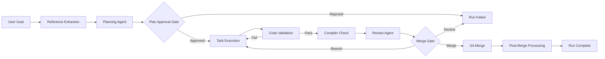

### 4.2 Feature Matrix

| Feature | FREE | PRO | ENTERPRISE |
|---------|------|-----|------------|
| Runs per month | 5 | 100 | Unlimited* |
| Concurrent runs | 1 | 3 | 10 |
| Preview deployments | 3/run | 10/run | Unlimited |
| Concurrent previews | 1 | 3 | 10 |
| Chat copilot | - | Yes | Yes |
| Apply suggestions | 2/run | 10/run | Unlimited |
| Organization | - | Yes (10 members) | Yes (unlimited) |
| Projects | - | Yes | Yes |
| JIRA/Confluence | - | Yes (admin) | Yes |
| Slack notifications | - | Yes | Yes |
| Audit trail | - | - | Yes |
| BYOK (API keys) | - | Admin only | Yes |
| GitHub integration | Yes | Yes | Yes |
| Instant preview | Yes | Yes | Yes |
| Cloud Run deployment | Yes | Yes | Yes |

*Unlimited requires BYOK (`apiKeysProvided=true`)

---

## 5. User Journeys

### Journey 1: First Run (New User Onboarding)

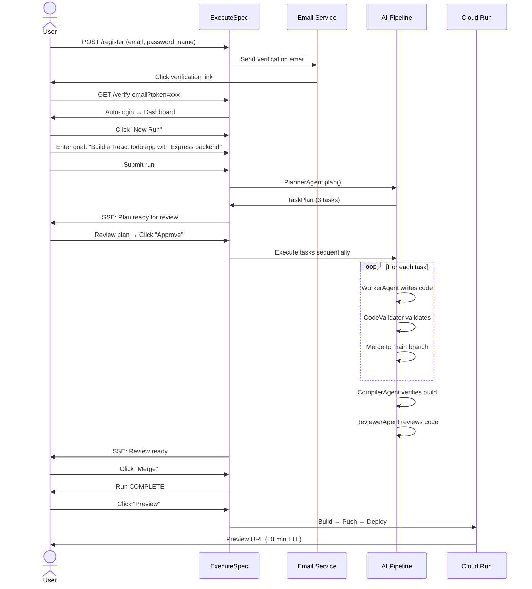

### Journey 2: Team Workflow (Org User with JIRA)

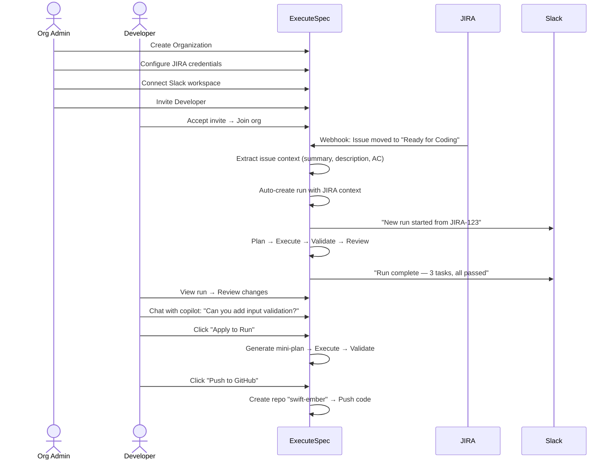

### Journey 3: Post-Completion Iteration

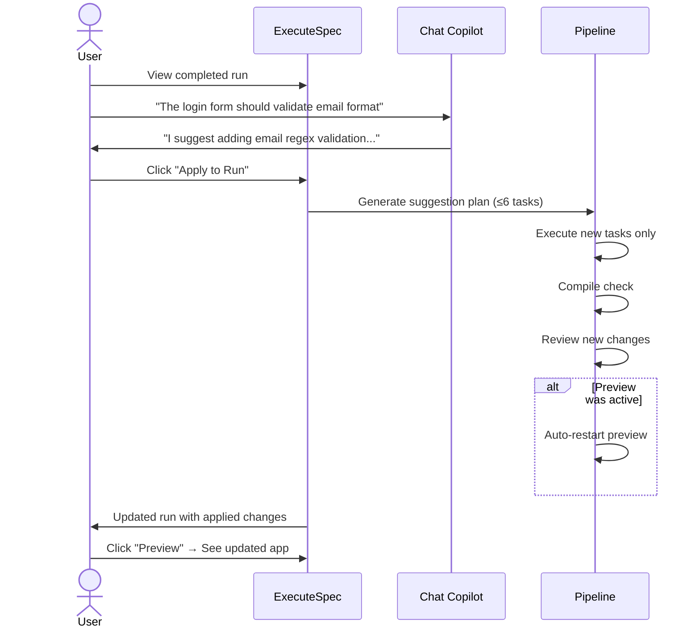

### Journey 4: Billing & Top-Up

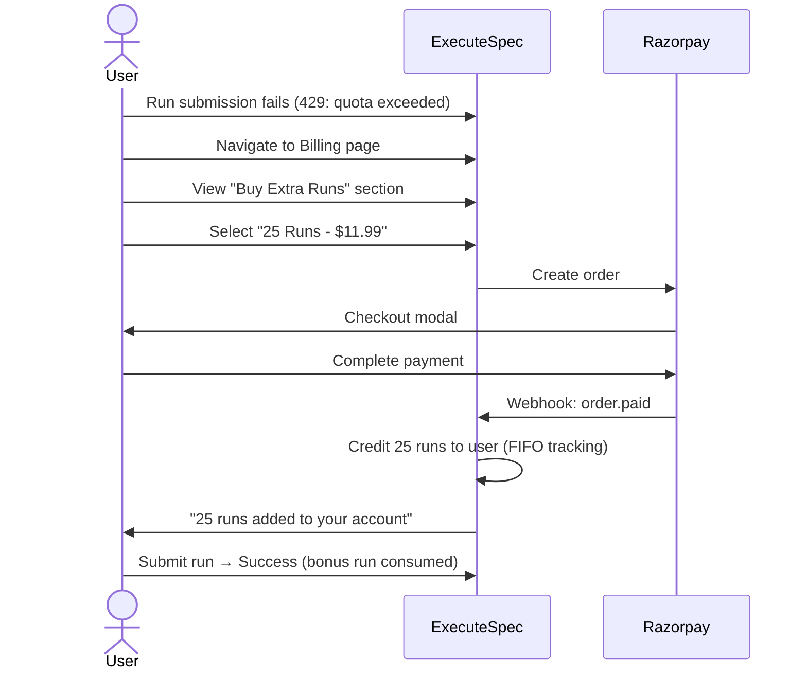

### Journey 5: Preview Lifecycle

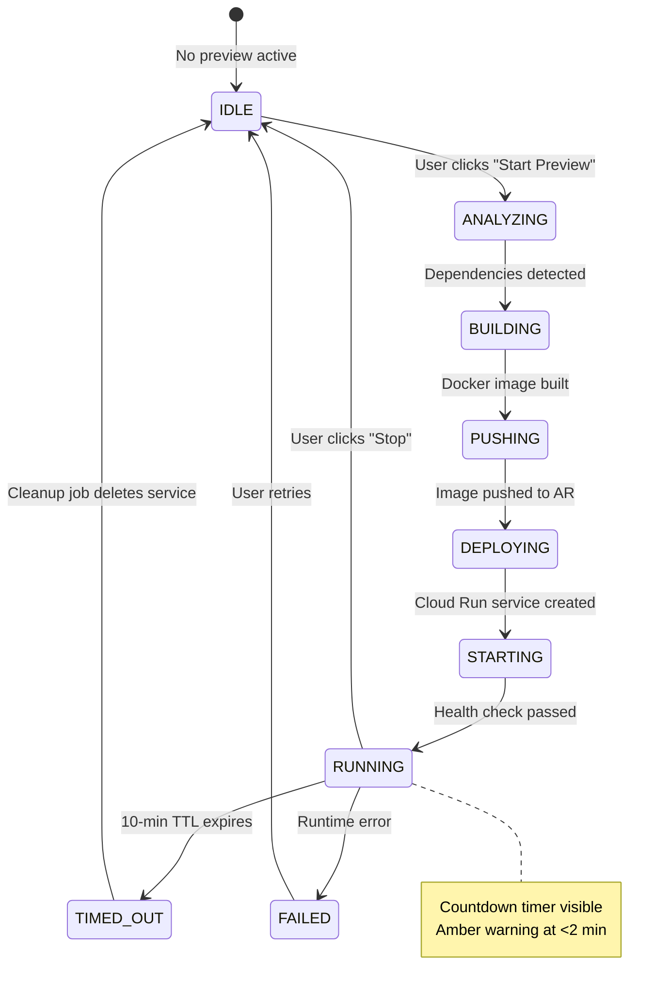

---

## 6. System Architecture

### 6.1 High-Level Architecture

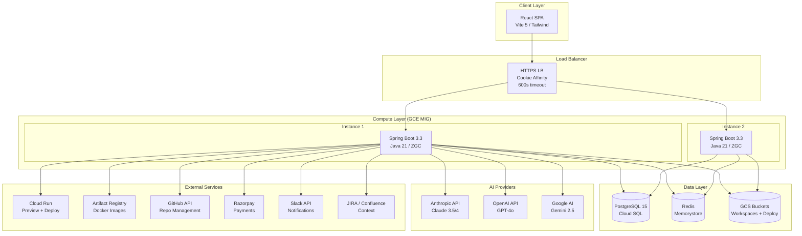

### 6.2 Pipeline Architecture

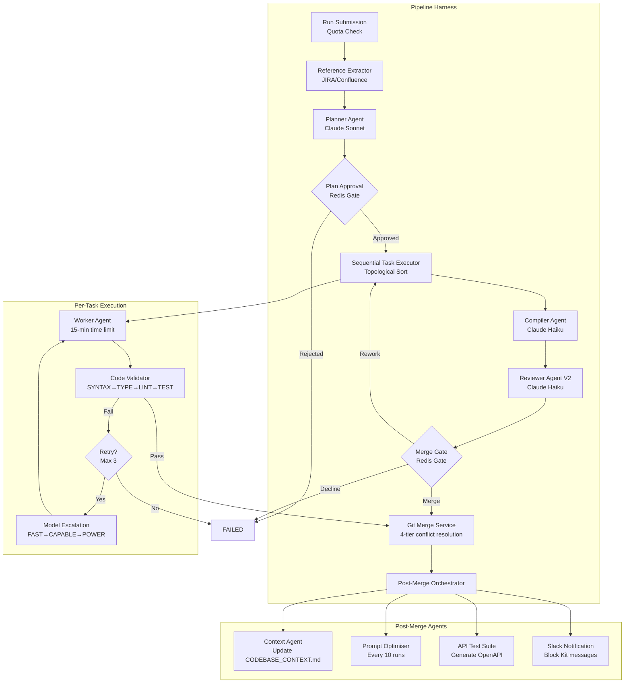

### 6.3 LLM Provider Routing

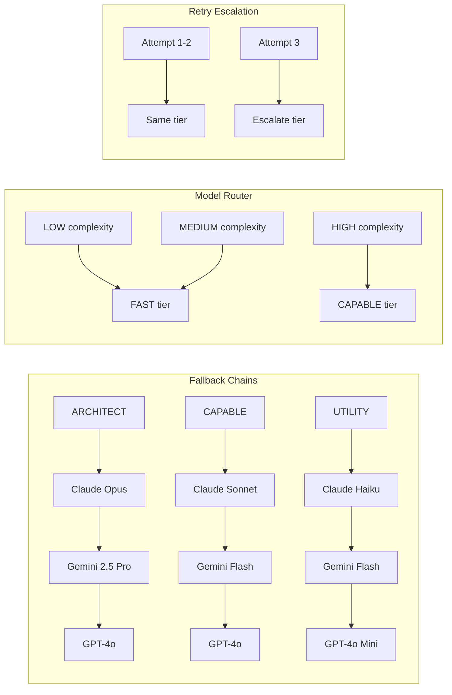

---

## 7. Data Model

### 7.1 Core Entity Relationships

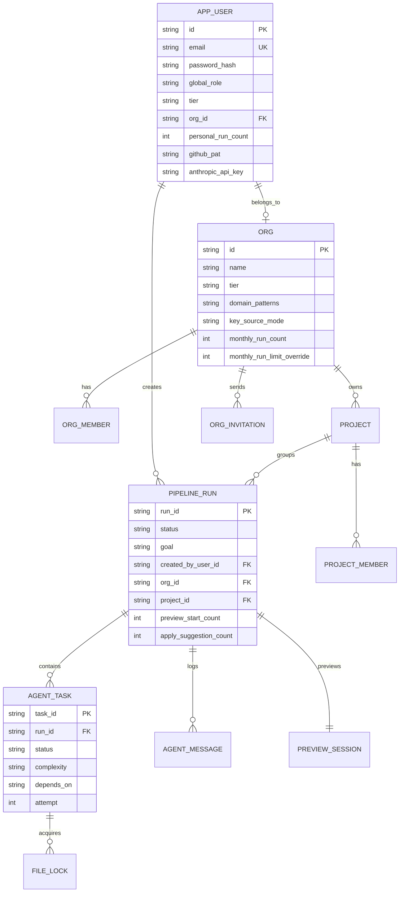

### 7.2 Billing Entity Relationships

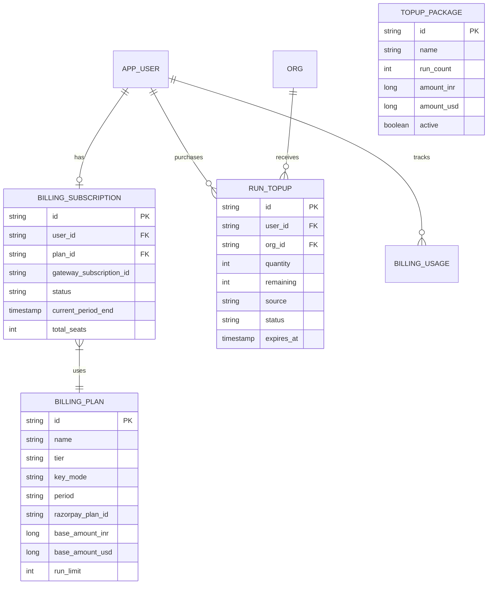

---

## 8. API Surface

### 8.1 API Categories

| Category | Endpoints | Auth Required |
|----------|-----------|---------------|
| Run Lifecycle | 11 | Yes (JWT) |
| Run Data | 9 | Yes |
| Preview & Deploy | 8 | Yes |
| Chat & Apply | 3 | Yes |
| Auth & Settings | 16 | Partial |
| Organization | 12 | Yes (ORG_ADMIN) |
| Projects | 7 | Yes |
| Billing | 10 | Yes |
| Integrations | 12 | Yes |
| Admin | 16 | Yes (SUPER_ADMIN) |
| **Total** | **~104** | |

### 8.2 Core Run API Flow

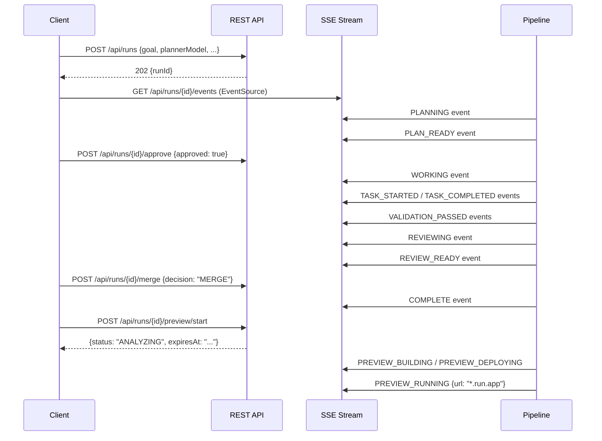

---

## 9. Non-Functional Requirements

### 9.1 Performance

| Metric | Target | Current |
|--------|--------|---------|
| Run submission latency | < 2s | ~1s |
| Plan generation (Sonnet) | < 30s | 10-25s |
| Task execution (per task) | < 15 min | 2-12 min |
| Preview deploy time | < 5 min | 2-4 min |
| SSE event latency | < 500ms | ~200ms |
| API response (p95) | < 200ms | ~100ms |

### 9.2 Scalability

| Dimension | Current | Design Limit |
|-----------|---------|--------------|
| Concurrent runs | 10 (per instance) | 20 (2x MIG) |
| Active previews | 20 | 50 (Cloud Run) |
| Users | ~100 | ~10,000 |
| Runs/day | ~200 | ~2,000 |
| Workspace size | < 100MB | GCS archive |

### 9.3 Reliability

| Metric | Target |
|--------|--------|
| Uptime SLA | 99.5% |
| Data durability | 99.99% (Cloud SQL + GCS) |
| Recovery time (RTO) | < 15 min (MIG auto-heal) |
| Stuck run detection | < 30 min |

### 9.4 Security

- JWT (HS256) with 24h access / 7d refresh tokens
- RBAC: SUPER_ADMIN, ORG_ADMIN, BILLING_ADMIN, DEVELOPER
- Workspace sandbox: `safeResolve()` prevents path traversal
- Shell sandbox: configurable command allow/blocklist
- API keys: encrypted at rest (application.yml env vars)
- Domain enforcement: ENTERPRISE mandatory, PRO optional

---

## 10. Monetization & Tiers

### 10.1 Tier Comparison

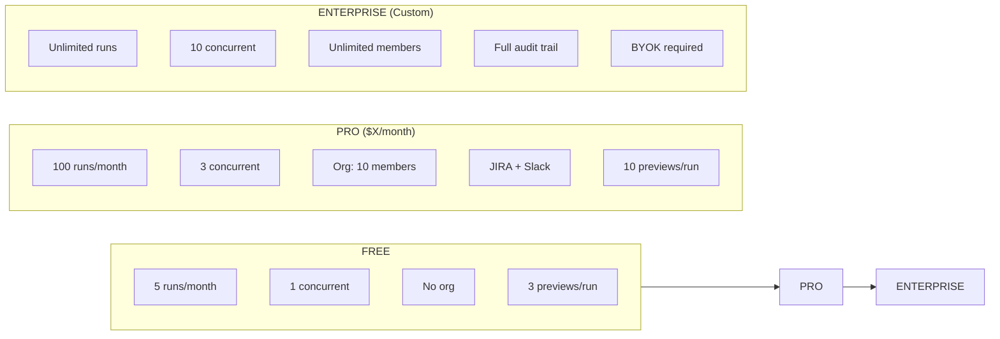

### 10.2 Revenue Streams

1. **Subscriptions**: Monthly/annual plans via Razorpay
2. **Top-up credits**: One-time run pack purchases (10/25/50 runs)
3. **Seat licenses**: Per-seat pricing for PRO tier
4. **Enterprise contracts**: Custom pricing with SLAs

### 10.3 Cost Structure (Per Run)

| Component | Estimated Cost |
|-----------|---------------|
| Planner (Sonnet) | $0.05 - $0.15 |
| Workers (Haiku × 3-6) | $0.10 - $0.40 |
| Reviewer (Haiku) | $0.02 - $0.05 |
| Compiler (Haiku) | $0.01 - $0.03 |
| Preview (Cloud Run, 10 min) | $0.014 |
| **Total per run** | **$0.18 - $0.63** |

---

## 11. Success Metrics

### 11.1 North Star Metric
**Successful runs per week** — runs that reach COMPLETE status without user intervention (auto-merge enabled).

### 11.2 Key Metrics

| Metric | Definition | Target |
|--------|-----------|--------|
| Run success rate | COMPLETE / total runs | > 75% |
| First-try pass rate | COMPLETE without retries | > 50% |
| Preview adoption | Runs with preview started | > 40% |
| Apply adoption | Runs with applied suggestions | > 20% |
| Time to first preview | Submit → preview URL | < 10 min |
| User retention (7-day) | Return within 7 days | > 60% |
| Free → PRO conversion | Monthly conversion rate | > 5% |
| NPS | Net Promoter Score | > 40 |

### 11.3 Operational Metrics

| Metric | Monitor | Alert Threshold |
|--------|---------|----------------|
| Stuck runs | StuckRunMonitor (2 min cycle) | > 5 concurrent |
| LLM error rate | ProviderHealthTracker | > 10% (5 min window) |
| Preview failure rate | PreviewService | > 30% |
| Orphaned Cloud Run services | Cleanup job (30 min) | > 10 |
| API latency (p99) | Actuator metrics | > 5s |

---

## 12. Risks & Mitigations

### 12.1 Technical Risks

| Risk | Impact | Probability | Mitigation |
|------|--------|-------------|------------|
| LLM API outage | All runs fail | Medium | 3-provider fallback chains |
| LLM cost spike | Margin erosion | Medium | Token budgets, cache-aware pricing |
| Prompt injection | Unexpected code | Low | Workspace sandbox, shell policy |
| Cloud Run quota | No previews | Low | Service cleanup, per-user limits |
| PostgreSQL failure | Total outage | Very Low | Cloud SQL HA, automated backups |

### 12.2 Business Risks

| Risk | Impact | Probability | Mitigation |
|------|--------|-------------|------------|
| Low code quality | User churn | Medium | Multi-stage validation (4 gates), model escalation |
| Competitor entry | Market share loss | High | Focus on end-to-end value (plan → deploy) |
| API key abuse | Financial loss | Low | Tier limits, rate limiting, BYOK option |
| Compliance (GDPR) | Legal exposure | Medium | Data residency controls, audit trail |

### 12.3 Known Limitations (v2.0)

1. **Single org per user** — users can only belong to one organization
2. **No real-time collaboration** — only one user can approve/review a run
3. **No IDE integration** — web-only interface (no VS Code extension yet)
4. **Preview logs are placeholder** — real Cloud Run logs not yet fetched
5. **No SSR/SSG preview** — static builds only for frontend previews
6. **English-only** — prompts and UI are English; no i18n support

---

## Appendix A: Run State Machine

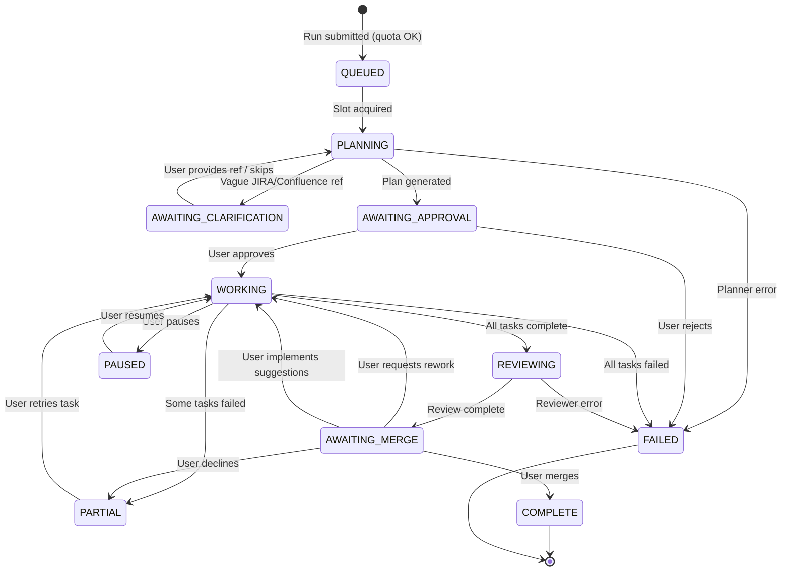

## Appendix B: RBAC Permission Matrix

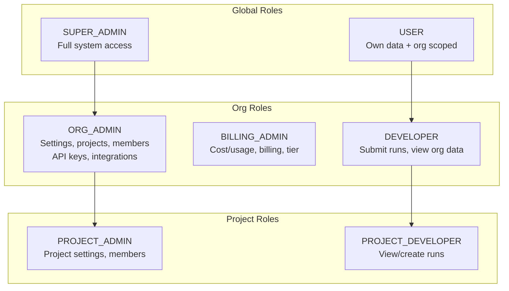

## Appendix C: Integration Architecture

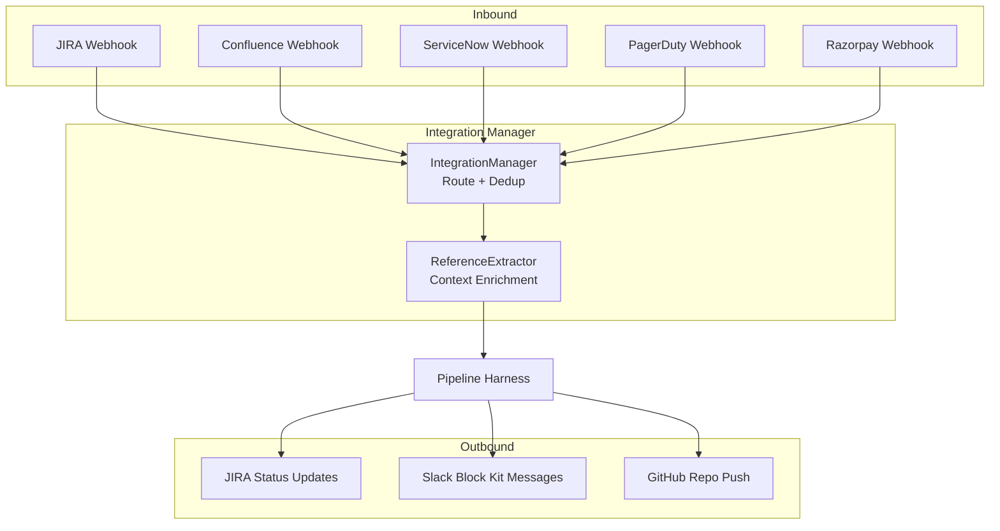

---

*This PRD is a living document. Last updated: 2026-03-15.*
