# ExecuteSpec — Feature Workflow Diagrams

> **User journey diagrams** for every major feature flow, rendered with Mermaid.

> **⚠️ V2-only as of 2026-04-13.** Diagrams below referencing `PipelineHarness`,
> `CompilerAgent`, `ReviewerAgentV2`, `SubtaskDecomposer`, batch flows
> (`QUEUED_BATCH` → `BATCH_COMPLETE`), or merge / clarification gates describe
> the retired V1 pipeline. The current V2 flow is:
> **PLANNING → AWAITING_APPROVAL → WORKING → REVIEWING → COMPLETE** (no batch,
> no compile, no merge gate, no clarification gate). See
> [`docs/user-journeys.md`](user-journeys.md) and [`CLAUDE.md`](../CLAUDE.md)
> for the canonical V2 flow.

---

## Table of Contents

1. [Pipeline Run — End-to-End](#1-pipeline-run--end-to-end)
2. [Background Validation](#2-background-validation)
3. [User Registration & Login](#3-user-registration--login)
4. [OAuth2 Login Flow](#4-oauth2-login-flow)
5. [Organization Creation](#5-organization-creation)
6. [Organization Member Invitation](#6-organization-member-invitation)
7. [Integration Setup (JIRA / Confluence)](#7-integration-setup-jira--confluence)
8. [Integration-Triggered Run](#8-integration-triggered-run)
9. [Post-Run Conversation & Iteration](#9-post-run-conversation--iteration)
10. [Task Retry & Recovery](#10-task-retry--recovery)
11. [API Key Management](#11-api-key-management)
12. [Deployment & Preview](#12-deployment--preview)
13. [GitHub PR Creation](#13-github-pr-creation)
14. [Run Pause, Edit & Restart](#14-run-pause-edit--restart)
15. [Run Archive Flow](#15-run-archive-flow)
16. [Admin — User & Org Management](#16-admin--user--org-management)
17. [Slack Integration Setup](#17-slack-integration-setup)
18. [Stripe Payment Flow](#18-stripe-payment-flow)
19. [Feature Flag Toggle](#19-feature-flag-toggle)
20. [JIRA/Confluence Context Extraction & Clarification](#20-jiraconfluence-context-extraction--clarification)

---

## 1. Pipeline Run — End-to-End

The core user journey from submitting a natural-language goal to merged, reviewed code. Run is marked **COMPLETE** before background validation begins --- the user can preview and interact immediately.

```mermaid
flowchart TD
    A([User opens Dashboard]) --> B[Click 'New Run']
    B --> C[Enter goal in natural language]
    C --> D{Org member?}
    D -->|Yes| E[Select Project from dropdown]
    D -->|No| F[No project selection needed]
    E --> G[Choose options: provider — default OpenAI, skipApproval]
    F --> G
    G --> H[POST /api/runs — Submit]
    H --> I[TierEnforcementService checks tier quota — FREE 5/PRO 100/ENTERPRISE unlimited]
    I -->|Quota exceeded| J[HTTP 429 — Upgrade tier]
    I -->|OK| K[PipelineHarness starts]

    K --> K1[ReferenceExtractor scans for JIRA/Confluence refs]
    K1 --> K2{References found?}
    K2 -->|Concrete refs| K3[Fetch JIRA issues / Confluence pages]
    K3 --> K4[Enrich request with extracted context]
    K2 -->|Vague mentions| K5[Clarification Gate — ask user for specifics]
    K5 -->|User provides ref| K3
    K5 -->|User skips| L
    K2 -->|No refs| L
    K4 --> L

    L[PlannerAgent — PLANNING tier — decomposes goal, declares project_type]
    L --> M{skipApproval?}
    M -->|Yes| N[Auto-approve plan]
    M -->|No| O[Plan Approval Gate — Redis-backed, 500ms polling, 2h TTL, 24h max wait]
    O -->|Approve| N
    O -->|Reject| P[Run cancelled]
    N --> N1[initAgentContext — writes .agent-context/ files including project.json]
    N1 --> Q[SequentialTaskExecutor begins]

    Q --> R[Tasks run in tiered parallel groups — 25 min max per task]
    R --> S[Create git worktree per task]
    S --> T[WorkerAgent — WORKHORSE tier — writes code, target 20 iterations, hard limit 35 tool calls]
    T -->|Provider failure mid-task| T2[Compact conversation + switch to fallback provider + retry]
    T2 --> T
    T --> U[Merge task branch to main — progressive merge]
    U --> V{More task groups?}
    V -->|Yes| R
    V -->|No| W[CompilerAgent — WORKHORSE tier — fixes compilation errors, dynamic error truncation by file count]

    W --> X[Auto-merge all task branches to main]
    X --> ZF([Run COMPLETE — code ready])
    ZF --> ZG[Auto-start preview — 5-min TTL]
    ZG --> ZH[Background validation thread starts — see section 2]

    ZH --> ZI[MergeCompleted event fires]
    ZI --> ZJ{GitHub repo configured?}
    ZJ -->|Yes| ZK[Create branch executespec/runIdShort + open PR]
    ZJ -->|No| ZL[Integration outbound: JIRA comment / Confluence page]

    style A fill:#6366f1,color:#fff
    style ZF fill:#22c55e,color:#fff
    style J fill:#ef4444,color:#fff
    style P fill:#ef4444,color:#fff
```

### Pipeline SSE Events (Real-Time)

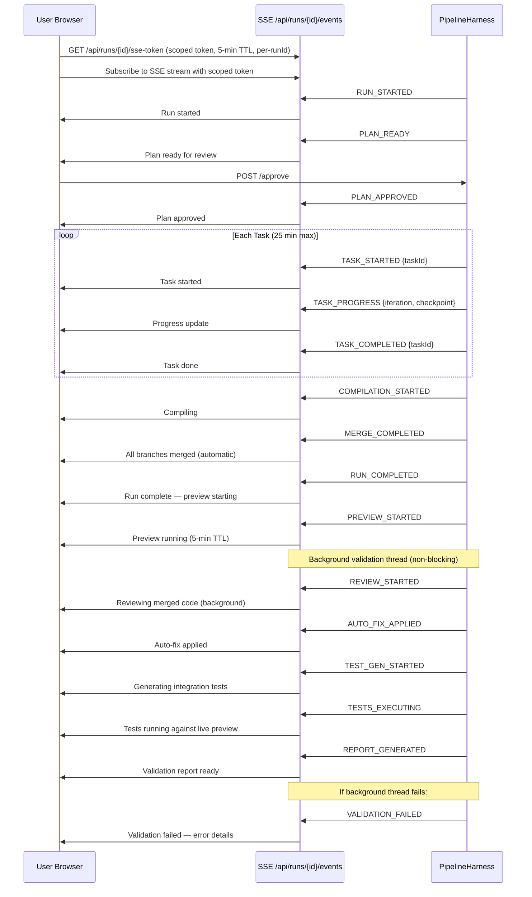

---

## 2. Background Validation

After the run is marked COMPLETE and the preview is started, a background virtual thread (`bg-validation-{runId}`) performs review, test generation, test execution, and report generation. The user can chat, submit changes, and use the preview while this runs.

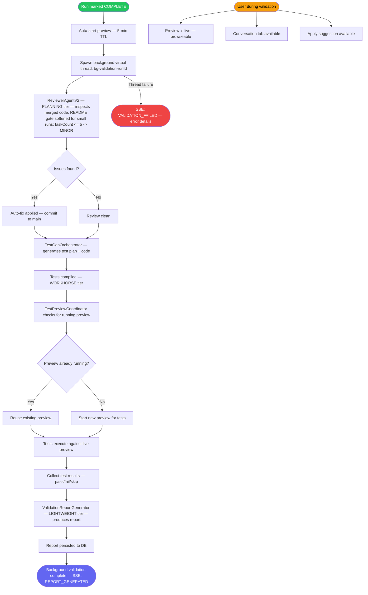

### Background Validation Sequence

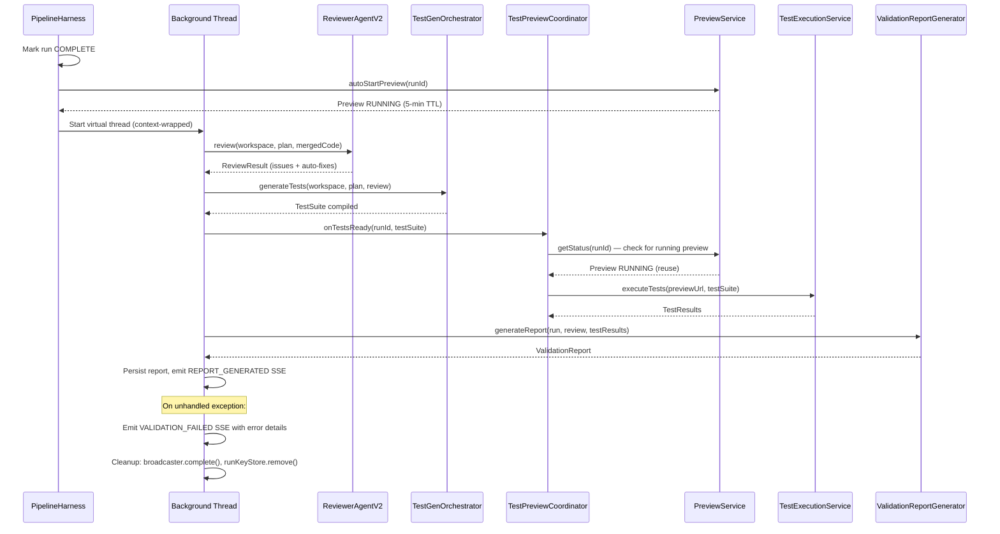

---

## 3. User Registration & Login

### Self-Registration (FREE Tier)

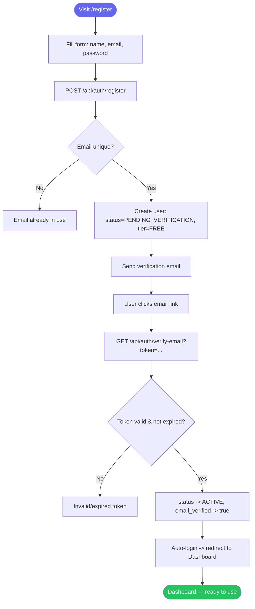

### Login Flow (Email + Password)

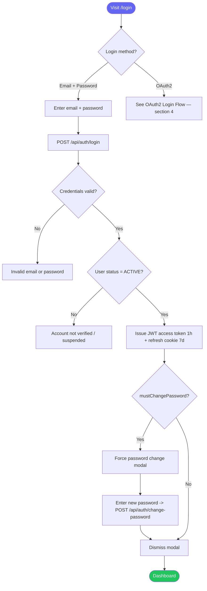

---

## 4. OAuth2 Login Flow

Supports Google and GitHub. The OAuth callback creates or links a user account and issues JWT tokens.

```mermaid
flowchart TD
    A([Visit /login]) --> B[Click 'Sign in with Google' or 'Sign in with GitHub']
    B --> C[GET /api/auth/oauth2/authorize?provider=google|github]
    C --> D[Redirect to provider consent screen]
    D --> E[User approves permissions]
    E --> F[Provider redirects to /api/auth/oauth2/callback/provider?code=...]
    F --> G[OAuthSuccessHandler receives callback]
    G --> H[Exchange authorization code for access token]
    H --> I[Fetch user profile from provider API]
    I --> J{User with this email exists?}
    J -->|Yes — has OAuth link| K[Login existing account]
    J -->|Yes — no OAuth link| L[Link OAuth provider to existing account]
    J -->|No| M[Create new user: status=ACTIVE, email_verified=true, tier=FREE]
    L --> K
    M --> K
    K --> N[Issue JWT access token 1h + refresh cookie 7d]
    N --> O[Redirect to frontend with token]
    O --> P([Dashboard — logged in via OAuth2])

    style A fill:#6366f1,color:#fff
    style P fill:#22c55e,color:#fff
```

### OAuth2 Sequence (Backend)

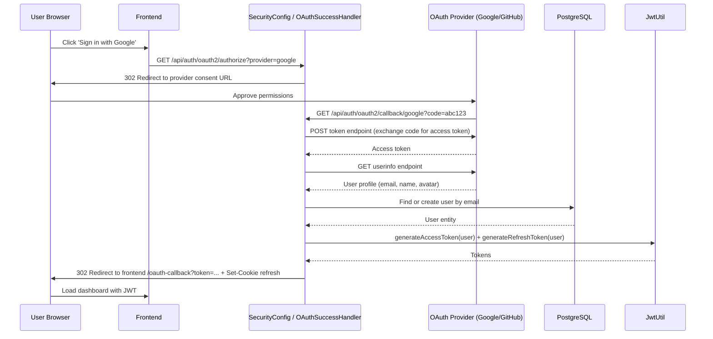

---

## 5. Organization Creation

Only **PRO** or **ENTERPRISE** users can create an organization.

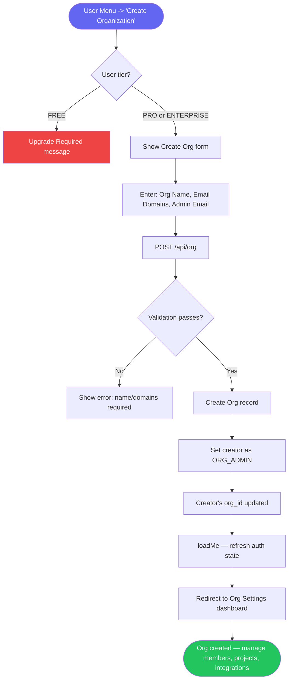

### Org Settings Dashboard (Post-Creation)

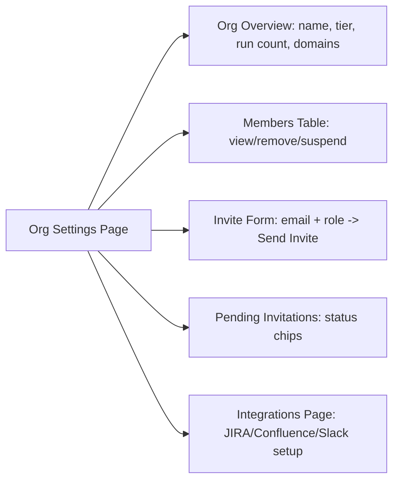

---

## 6. Organization Member Invitation

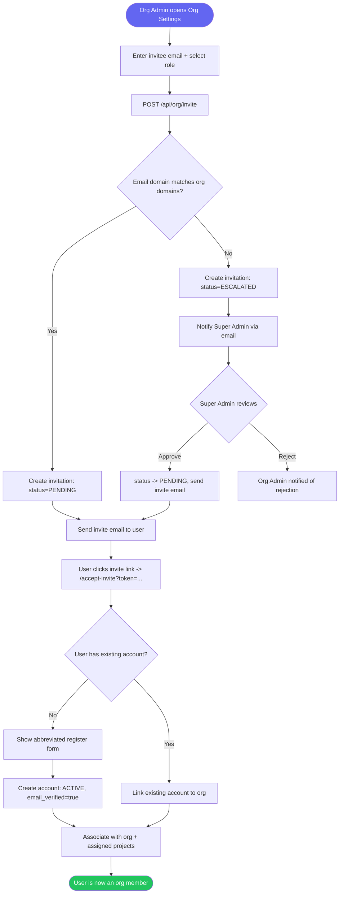

---

## 7. Integration Setup (JIRA / Confluence)

Org-level integration management --- credentials managed by Org Admins on the Integrations page.

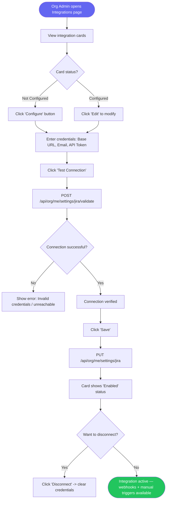

### Integration Credential Flow (Backend)

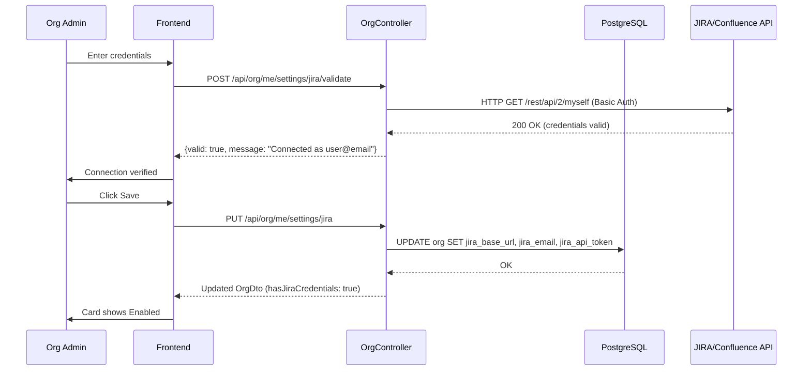

---

## 8. Integration-Triggered Run

Integration outbound events use `MergeCompleted` (not `RunCompleted`) to avoid the race condition where review report is null.

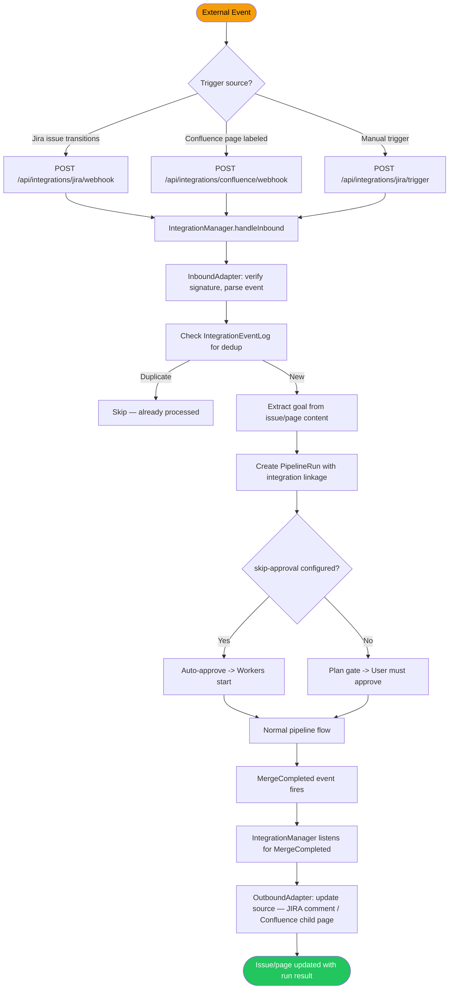

---

## 9. Post-Run Conversation & Iteration

```mermaid
flowchart TD
    A([Run completes — status: COMPLETE]) --> B[User opens Conversation tab]
    B --> C[ConversationAgent — LIGHTWEIGHT tier — loads workspace context]
    C --> D[System prompt: file tree + README + plan + review]
    D --> E[User types question about the code]
    E --> F[POST /api/runs/{id}/conversation]
    F --> G{Message count < 10?}
    G -->|No| H[HTTP 429 — message limit reached]
    G -->|Yes| I[ConversationAgent responds]
    I --> J[Response displayed in chat UI]
    J --> K{User wants to iterate?}
    K -->|No| L[Continue chatting or close]
    K -->|Yes| M[Click 'Implement as New Run']
    M --> N[Enter change description]
    N --> O[POST /api/runs/{id}/iterate]
    O --> P[New run created with copied workspace]
    P --> Q[PipelineHarness starts new run]
    Q --> R([Iteration run — builds on previous code])

    style A fill:#6366f1,color:#fff
    style R fill:#22c55e,color:#fff
```

---

## 10. Task Retry & Recovery

### Manual Task Retry

```mermaid
flowchart TD
    A([Run has PARTIAL/FAILED tasks]) --> B[User views task list]
    B --> C[Click 'Retry' on failed task]
    C --> D[POST /api/runs/{id}/tasks/{taskId}/retry]
    D --> E[Task reset to PENDING]
    E --> F[WorkerAgent — WORKHORSE tier — re-executes task, 25 min max]
    F --> G[Merge task branch — progressive merge]
    G --> H{All sibling tasks complete?}
    H -->|No| I[Auto-pick up remaining incomplete tasks]
    I --> F
    H -->|Yes| J[CompilerAgent fixes compilation errors]
    J --> K[Auto-merge all branches]
    K --> L([Run COMPLETE])
    L --> M[Background validation starts — see section 2]

    style A fill:#f59e0b,color:#000
    style L fill:#22c55e,color:#fff
```

### Automatic PARTIAL Run Recovery (PartialRunResumeService)

```mermaid
flowchart TD
    A([PartialRunResumeService — every 5 min]) --> B{Any runs with status = PARTIAL\nand completedAt > 10 min ago?}
    B -->|No| C[Sleep until next check]
    B -->|Yes| D{harness.isRunActive\(runId\)?}
    D -->|Yes — already processing| C
    D -->|No| E[Find up to 3 FAILED or STUCK tasks per run]
    E --> F[StateStore.markWorking\(runId\)]
    F --> G[harness.retryPartialTask\(runId, taskId\) — up to 3 tasks]
    G --> H[Task reset to PENDING — same flow as manual retry]
    H --> I{All tasks complete?}
    I -->|No| J[Remaining tasks picked up by SequentialTaskExecutor]
    I -->|Yes| K[CompilerAgent → auto-merge → COMPLETE]
    K --> L([Background validation starts])

    style A fill:#8b5cf6,color:#fff
    style K fill:#22c55e,color:#fff
    style L fill:#22c55e,color:#fff
```

**Trigger conditions:**
- Run status is `PARTIAL` (some tasks completed, at least one failed/stuck)
- `completedAt` is more than 10 minutes ago (debounce for runs still wrapping up)
- Run is not currently active in any pipeline thread

**Safety limits:**
- Max 3 tasks retried per run per sweep (avoids thundering herd)
- `@SchedulerLock(name = "partial-run-resume", lockAtMostFor = "4m")` prevents concurrent sweeps in multi-instance deployments
- Tasks already at `task-max-retries` (3) are skipped — bubble up as truly failed

### Automatic Recovery (StuckRunMonitor)

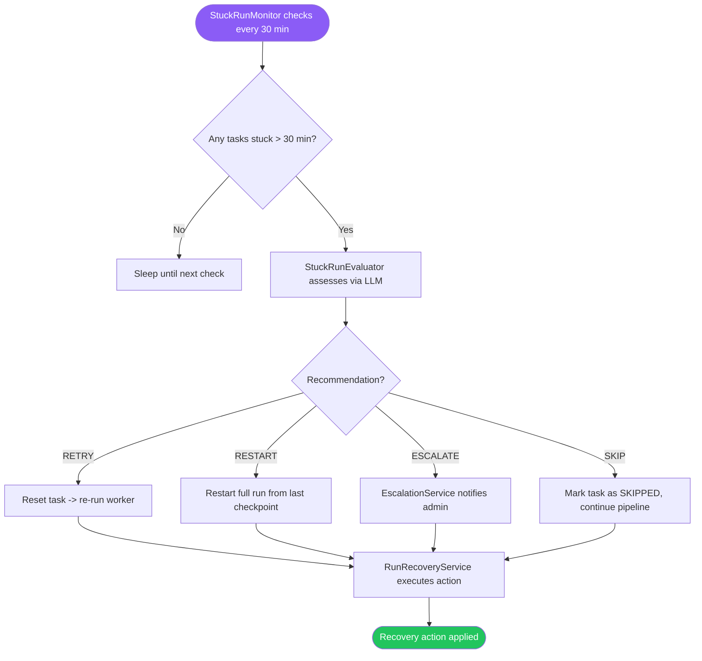

---

## 11. API Key Management

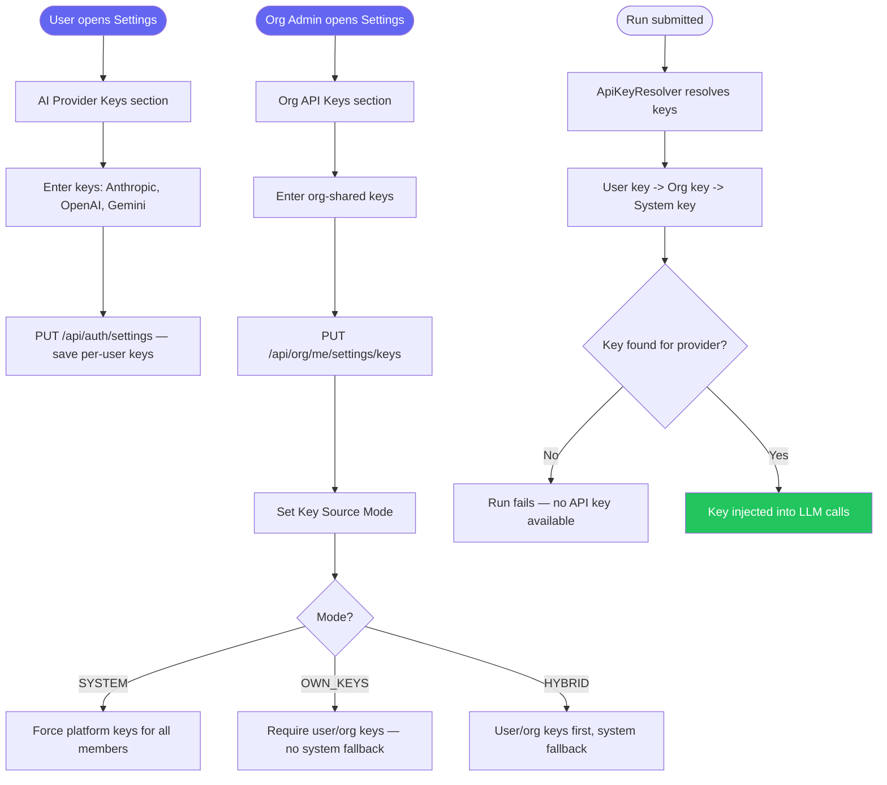

---

## 12. Deployment & Preview

### Preview (Dual-Mode)

Preview supports two modes, configured via `preview.mode` in application properties:

| Mode | Environment | Stack | TTL | URL format |
|------|-------------|-------|-----|------------|
| `docker` | Local dev | Docker Compose + optional Caddy proxy | 5 min | `https://{subdomain}.preview.local` (Caddy) or `http://localhost:{port}` |
| `cloud-run` | Dev / Prod | Artifact Registry + Cloud Run | 5 min | `https://*.run.app` (managed HTTPS) |

Preview is started in two ways:
1. **Pipeline-automated:** PipelineHarness auto-starts preview immediately after marking run COMPLETE (for PROTOTYPE and real-time PRODUCTION modes). Batch runs skip auto-preview; `TestPreviewCoordinator` publishes empty `TestExecutionCompletedEvent` to unblock validation report. Preview stays running for full 5-min TTL. TestPreviewCoordinator reuses the existing preview for test execution without stopping it.
   - **Manual test execution (Beta):** For batch runs, users can manually start a preview, then click "Run Tests" (calls `POST /api/runs/{runId}/run-tests`) to trigger `TestPreviewCoordinator.triggerManualExecution()`.
2. **User-initiated:** User clicks 'Start Preview' in the UI (idempotent --- returns existing session if running).

```mermaid
flowchart TD
    A([Run COMPLETE or User clicks Start Preview]) --> B{Trigger source?}
    B -->|Pipeline automated| D[PipelineHarness calls PreviewService]
    B -->|User manual| C[Click 'Start Preview' -> POST /api/runs/{id}/preview/start]
    C --> E[PreviewService detects project type from .agent-context/project.json]
    D --> E
    E --> F{preview.mode?}

    %% Docker mode (local dev)
    F -->|docker| G[DockerfileGenerator.generate — includes ttyd for terminal]
    G --> H[docker compose up — build + start]
    H --> I{Caddy proxy configured?}
    I -->|Yes| J[CaddyProxyManager registers route via admin API]
    J --> K[HTTPS URL via Caddy reverse proxy]
    I -->|No| L[Direct localhost:port URL]
    K --> M[Preview status: RUNNING]
    L --> M

    %% Cloud Run mode (dev/prod)
    F -->|cloud-run| N[DockerfileGenerator.generateForCloudRun — no ttyd]
    N --> O[docker build — 10 min timeout]
    O --> P[docker push to Artifact Registry — 10 min timeout]
    P --> Q[gcloud run deploy — 10 min timeout]
    Q --> R[Health check against Cloud Run URL]
    R --> S[HTTPS URL returned — *.run.app]
    S --> M

    M --> T[User views logs in real-time]
    T --> U[User clicks preview URL]
    U --> V([Application running in browser])

    V --> W{Done previewing?}
    W -->|Yes| X[Click 'Stop Preview']
    X --> Y[DELETE /api/runs/{id}/preview/stop]
    Y --> Z{Mode?}
    Z -->|docker| AA[docker compose down, Caddy route removed]
    Z -->|cloud-run| AB[Cloud Run service deleted]
    W -->|No action| AC[Auto-deleted after 5-min TTL]

    style A fill:#6366f1,color:#fff
    style V fill:#22c55e,color:#fff
```

### Preview Sequence — Cloud Run Mode

```mermaid
sequenceDiagram
    participant U as User Browser
    participant FE as Frontend
    participant BE as PreviewService
    participant DG as DockerfileGenerator
    participant AR as Artifact Registry
    participant CR as Cloud Run

    U->>FE: Click 'Start Preview'
    FE->>BE: POST /api/runs/{id}/preview/start
    BE->>BE: Store cloudRunServiceName upfront (es-preview-{runIdShort})
    BE->>BE: Detect project type from .agent-context/project.json
    BE->>DG: generateForCloudRun(workspace, projectType)
    DG-->>BE: Dockerfile (no ttyd)
    BE->>BE: docker build (10 min timeout)
    BE->>AR: docker push image (10 min timeout)
    AR-->>BE: Push complete
    BE->>CR: gcloud run deploy (10 min timeout)
    CR-->>BE: Service URL (*.run.app)
    BE->>BE: Health check against URL
    BE-->>FE: Preview RUNNING — HTTPS URL
    FE-->>U: Preview link available

    Note over BE,CR: Auto-delete after 5-min TTL
    BE->>CR: Delete Cloud Run service
    CR-->>BE: Service deleted
```

### Preview Sequence — Docker Mode (Local)

```mermaid
sequenceDiagram
    participant U as User Browser
    participant FE as Frontend
    participant BE as PreviewService
    participant DG as DockerfileGenerator
    participant DC as Docker Compose
    participant CD as Caddy Proxy

    U->>FE: Click 'Start Preview'
    FE->>BE: POST /api/runs/{id}/preview/start
    BE->>BE: Detect project type from .agent-context/project.json
    BE->>DG: generate(workspace, projectType)
    DG-->>BE: Dockerfile (with ttyd)
    BE->>DC: docker compose up -d --build
    DC-->>BE: Container running on allocated port
    BE->>CD: Register route via Caddy admin API
    CD-->>BE: Route active
    BE-->>FE: Preview RUNNING — HTTPS URL
    FE-->>U: Preview link available

    Note over BE,DC: Auto-delete after 5-min TTL
    BE->>DC: docker compose down
    BE->>CD: Remove route
```

### Cloud Run Deployment (Permanent)

```mermaid
flowchart TD
    A([Run with merged code]) --> B[User clicks 'Deploy']
    B --> C[POST /api/runs/{id}/deploy]
    C --> D[DockerfileGenerator creates Dockerfile]
    D --> E[DeploymentStrategy selected by language]
    E --> F[Build container image]
    F --> G[Push to Artifact Registry]
    G --> H[Deploy to Cloud Run]
    H --> I[Service URL returned]
    I --> J([Application live on Cloud Run — permanent])

    style A fill:#6366f1,color:#fff
    style J fill:#22c55e,color:#fff
```

---

## 13. GitHub PR Creation

For runs linked to an existing GitHub repository, the pipeline automatically creates a branch and opens a pull request after merge completes.

```mermaid
flowchart TD
    A([MergeCompleted event fires]) --> B{Run has GitHub repo configured?}
    B -->|No| C[Skip — no GitHub push]
    B -->|Yes| D[PipelineHarness.pushToGitHubIfConfigured]
    D --> E[GitHubRepoService.getDefaultBranch — fetch base branch]
    E --> F[GitTool.pushToBranch — push to executespec/runIdShort]
    F --> G[GitHubRepoService.createPullRequest]
    G --> H[PR title: run goal summary]
    H --> I[PR body: plan summary + task list]
    I --> J[Store githubPrUrl in PipelineRun]
    J --> K[SSE: GITHUB_PR_CREATED]
    K --> L([PR visible in RunDetail overview tab])

    style A fill:#6366f1,color:#fff
    style L fill:#22c55e,color:#fff
```

### GitHub PR Sequence (Backend)

```mermaid
sequenceDiagram
    participant PH as PipelineHarness
    participant GR as GitHubRepoService
    participant GT as GitTool
    participant GH as GitHub API
    participant DB as PostgreSQL

    PH->>PH: MergeCompleted — check githubRepoUrl
    PH->>GR: getDefaultBranch(owner, repo)
    GR->>GH: GET /repos/{owner}/{repo}
    GH-->>GR: default_branch: "main"
    PH->>GT: pushToBranch(workspace, "executespec/{runIdShort}")
    GT->>GH: git push origin executespec/{runIdShort}
    GH-->>GT: Push complete
    PH->>GR: createPullRequest(owner, repo, branch, base, title, body)
    GR->>GH: POST /repos/{owner}/{repo}/pulls
    GH-->>GR: PR #42 URL
    GR-->>PH: PR URL
    PH->>DB: UPDATE pipeline_run SET github_pr_url = PR URL
    PH->>PH: Emit GITHUB_PR_CREATED SSE
```

---

## 14. Run Pause, Edit & Restart

```mermaid
flowchart TD
    A([Run is ACTIVE]) --> B[User clicks 'Pause']
    B --> C[POST /api/runs/{id}/pause]
    C --> D[Cancel working tasks]
    D --> E[Signal open gates as rejected]
    E --> F[Status -> PAUSED]

    F --> G{User wants to edit?}
    G -->|Yes| H[Click 'Edit & Restart']
    H --> I[Modify goal text]
    I --> J[POST /api/runs/{id}/edit-and-restart]
    J --> K[New run created with edited goal]
    K --> L[Carries forward: credentials, org, project]
    L --> M[PipelineHarness starts fresh run]
    M --> N([New run with revised goal])

    G -->|No| O[Run stays PAUSED for reference]

    style A fill:#f59e0b,color:#000
    style N fill:#22c55e,color:#fff
```

---

## 15. Run Archive Flow

Users can archive completed runs to declutter the dashboard. Archived runs are hidden from the default list but remain accessible via filter.

```mermaid
flowchart TD
    A([Run in COMPLETE or FAILED state]) --> B[User clicks 'Archive' in run list or detail]
    B --> C[POST /api/runs/{id}/archive]
    C --> D{Run in terminal state?}
    D -->|No — still active| E[HTTP 409 — Cannot archive active run]
    D -->|Yes| F[Set archived=true on PipelineRun]
    F --> G[Run hidden from default GET /api/runs list]
    G --> H{User wants to view archived?}
    H -->|Yes| I[Toggle 'Show Archived' filter in dashboard]
    I --> J[GET /api/runs?archived=true]
    J --> K[Archived runs displayed with archive badge]
    H -->|No| L([Dashboard shows only active/recent runs])

    style A fill:#6366f1,color:#fff
    style L fill:#22c55e,color:#fff
```

---

## 16. Admin — User & Org Management

### Super Admin Workflows

```mermaid
flowchart TD
    A([Super Admin opens Admin Panel]) --> B{Action?}
    B -->|Manage Users| C[GET /api/admin/users — paginated list]
    C --> D[View/edit user: tier, status, role]
    D --> E{Action?}
    E -->|Suspend| F[PUT /api/admin/users/{id}/status -> SUSPENDED]
    E -->|Change tier| G[PUT /api/admin/users/{id}/tier -> PRO/ENTERPRISE]
    E -->|Promote| H[PUT /api/admin/users/{id}/role -> SUPER_ADMIN]

    B -->|Manage Orgs| I[GET /api/admin/orgs — list all]
    I --> J[View org: members, run count, tier]
    J --> K{Action?}
    K -->|Suspend org| L[PUT /api/admin/orgs/{id}/status -> SUSPENDED]
    K -->|Change plan| M[PUT /api/admin/orgs/{id}/tier -> ENTERPRISE]

    B -->|Review Escalations| N[GET /api/admin/invitations/escalated]
    N --> O[Cross-domain invite: user -> org]
    O --> P{Decision?}
    P -->|Approve| Q[POST /api/admin/invitations/{id}/approve -> send invite]
    P -->|Reject| R[POST /api/admin/invitations/{id}/reject -> notify org admin]

    B -->|Payment Audit| S[GET /api/admin/payment-audit — paginated log]
    S --> T[View payment details, export CSV]
    B -->|Webhook Events| U[GET /api/admin/webhook-events — filterable log]

    style A fill:#f59e0b,color:#000
```

---

## Role-Based Access Summary

```mermaid
flowchart LR
    subgraph "SUPER_ADMIN"
        SA1[All runs across all orgs]
        SA2[All user/org management]
        SA3[Cross-domain invite approval]
        SA4[System configuration]
        SA5[Feature flag management]
        SA6[Payment audit + webhook log]
    end

    subgraph "ORG_ADMIN"
        OA1[Org settings & members]
        OA2[All org runs]
        OA3[Project CRUD]
        OA4[Integration setup]
        OA5[Invite members]
    end

    subgraph "DEVELOPER"
        D1[Submit runs in assigned projects]
        D2[View runs in assigned projects]
        D3[Approve plans for own runs]
    end

    subgraph "BILLING_ADMIN"
        BA1[View org cost/usage]
        BA2[Manage org plan]
        BA3[View payment history]
    end

    subgraph "FREE User"
        F1[Submit personal runs]
        F2[View own runs only]
        F3[5 runs/month limit]
    end
```

---

## 17. Slack Integration Setup

Org admin connects Slack workspace via OAuth and configures per-project channel routing.

```mermaid
flowchart TD
    A([Org Admin opens Integrations page]) --> B[View Slack card]
    B --> C{Already connected?}
    C -->|No| D[Click 'Connect to Slack']
    D --> E[Redirect to Slack OAuth consent screen]
    E --> F[Admin approves bot permissions]
    F --> G[OAuth callback with code + HMAC state]
    G --> H{State valid? HMAC + TTL check}
    H -->|Invalid| I[Error: invalid or expired state]
    H -->|Valid| J[Exchange code for access token]
    J --> K[Save OrgSlackIntegration: team_id, token, bot_user_id]
    K --> L[Redirect to Integrations page with success banner]

    C -->|Yes| M[View connection: workspace name, default channel]
    M --> N{Action?}
    N -->|Send Test| O[POST /api/integrations/slack/test]
    O --> P[Block Kit message sent to selected channel]
    N -->|Configure Channels| Q[Select project -> assign Slack channel]
    Q --> R[PUT /api/integrations/slack/channels/project/{id}]
    N -->|Disconnect| S[Confirm dialog -> DELETE /api/integrations/slack/disconnect]
    S --> T[Token revoked, integration removed]

    style A fill:#6366f1,color:#fff
    style L fill:#22c55e,color:#fff
    style I fill:#ef4444,color:#fff
```

### Slack Notification Flow

```mermaid
sequenceDiagram
    participant P as PipelineHarness
    participant SSE as SseBroadcaster
    participant SN as SlackNotificationService
    participant RL as SlackRateLimiter
    participant SC as SlackClient
    participant S as Slack API

    P->>SSE: emit(RunEvent)
    SSE->>SN: @EventListener(RunEvent)
    SN->>SN: Check verbosity filter
    SN->>SN: Resolve channel (project -> default -> skip)
    SN->>RL: acquireSlot(teamId)
    RL-->>SN: OK (or wait 1.1s)
    SN->>SC: postMessage(channel, blocks)
    SC->>S: POST chat.postMessage
    S-->>SC: 200 OK
    SC-->>SN: Success
    SN->>SN: Log to slack_notification_log
```

---

## 18. Stripe Payment Flow

Multi-gateway billing via `PaymentGatewayRouter`. Stripe handles subscription creation, webhook verification, and payment audit logging.

```mermaid
flowchart TD
    A([User clicks 'Upgrade' or 'Buy Credits']) --> B{Action type?}
    B -->|Subscribe| C[Select plan: PRO or ENTERPRISE]
    B -->|Top-up| D[Select credit pack]
    C --> E[POST /api/billing/subscribe]
    D --> F[POST /api/billing/topup/purchase]
    E --> G[BillingService -> PaymentGatewayRouter]
    F --> G
    G --> H{Which gateway?}
    H -->|Stripe| I[StripePaymentGateway.createSubscription or createPayment]
    H -->|Razorpay| J[RazorpayPaymentGateway — existing flow]
    I --> K[Stripe API: create Customer + Subscription/PaymentIntent]
    K --> L[Return client_secret to frontend]
    L --> M[Frontend: Stripe.js confirms payment]
    M --> N[Stripe sends webhook: invoice.paid / checkout.session.completed]
    N --> O[POST /api/webhooks/stripe]
    O --> P{Stripe-Signature valid?}
    P -->|No| Q[HTTP 400 — signature mismatch]
    P -->|Yes| R[Process event: activate subscription / add credits]
    R --> S[PaymentAuditService logs transaction]
    S --> T[InvoiceService generates invoice with GST]
    T --> U([Subscription active / credits added])

    style A fill:#6366f1,color:#fff
    style U fill:#22c55e,color:#fff
    style Q fill:#ef4444,color:#fff
```

### Stripe Webhook Sequence

```mermaid
sequenceDiagram
    participant S as Stripe
    participant WH as WebhookController
    participant BL as BillingService
    participant PA as PaymentAuditService
    participant IV as InvoiceService
    participant DB as PostgreSQL

    S->>WH: POST /api/webhooks/stripe (Stripe-Signature header)
    WH->>WH: Verify Stripe-Signature with webhook secret
    WH->>BL: processStripeEvent(event)
    BL->>BL: Parse event type (invoice.paid, customer.subscription.updated, etc.)
    BL->>DB: Update subscription status / add top-up credits
    BL->>PA: logPayment(orgId, amount, gateway=STRIPE, eventType)
    PA->>DB: INSERT INTO payment_audit_log
    BL->>IV: generateInvoice(orgId, payment)
    IV->>DB: INSERT INTO invoice (with GST calculation)
    BL-->>WH: 200 OK
```

---

## 19. Feature Flag Toggle

DB-backed feature flags with Redis pub/sub cache invalidation. Admin-manageable via `FeatureFlagController`.

```mermaid
flowchart TD
    A([Super Admin opens Feature Flags page]) --> B[GET /api/feature-flags — list all flags]
    B --> C[View flags table: key, enabled, description, updated_at]
    C --> D[Toggle flag or update value]
    D --> E[POST /api/feature-flags/{key}]
    E --> F[FeatureFlagController validates request]
    F --> G[FeatureFlagService.updateFlag — write to DB]
    G --> H[Publish invalidation message to Redis pub/sub channel]
    H --> I[All app instances receive pub/sub message]
    I --> J[Each instance reloads flag from DB into local cache]
    J --> K([Flag change effective across all instances])

    L([Application code checks flag]) --> M[FeatureFlagService.isEnabled key]
    M --> N{Flag in local cache?}
    N -->|Yes| O[Return cached value]
    N -->|No| P[Load from DB, cache locally]
    P --> O

    Q([Scheduled reload — every 60s]) --> R[FeatureFlagService reloads all flags from DB]
    R --> S[Update local cache — safety net for missed pub/sub]

    style A fill:#f59e0b,color:#000
    style K fill:#22c55e,color:#fff
```

### Feature Flag Sequence

```mermaid
sequenceDiagram
    participant Admin as Super Admin
    participant FE as Frontend
    participant BE as FeatureFlagController
    participant FS as FeatureFlagService
    participant DB as PostgreSQL
    participant RD as Redis Pub/Sub
    participant I1 as App Instance 1
    participant I2 as App Instance 2

    Admin->>FE: Toggle flag 'enable-stripe'
    FE->>BE: POST /api/feature-flags/enable-stripe {enabled: true}
    BE->>FS: updateFlag("enable-stripe", true)
    FS->>DB: UPDATE feature_flag SET enabled=true WHERE key='enable-stripe'
    DB-->>FS: OK
    FS->>RD: PUBLISH feature-flag-invalidation "enable-stripe"
    RD-->>I1: Message received
    RD-->>I2: Message received
    I1->>DB: SELECT * FROM feature_flag WHERE key='enable-stripe'
    I2->>DB: SELECT * FROM feature_flag WHERE key='enable-stripe'
    I1->>I1: Update local cache
    I2->>I2: Update local cache
    FS-->>BE: Updated flag
    BE-->>FE: 200 OK
    FE-->>Admin: Flag toggled
```

---

## 20. JIRA/Confluence Context Extraction & Clarification

When a user mentions JIRA tickets or Confluence pages in a run request, the system fetches content before planning.

```mermaid
flowchart TD
    A([User submits run with JIRA/Confluence references]) --> B[ReferenceExtractorService scans request]
    B --> C{What was detected?}
    C -->|JIRA key: PROJ-123| D[Fetch JIRA issue via org credentials]
    C -->|Confluence URL with page ID| E[Fetch Confluence page via org credentials]
    C -->|Vague: 'jira ticket' / 'confluence page'| F[Open Clarification Gate]
    C -->|No references| G[Continue with original request]

    D --> H[Extract: summary, description, status, acceptance criteria]
    E --> I[Extract: page title + body text, truncate to 4000 chars]
    H --> J[Append extracted context to request]
    I --> J
    J --> K[Pass enriched request to PlannerAgent]

    F --> L[SSE: CLARIFICATION_NEEDED]
    L --> M[ClarificationBanner shown in UI]
    M --> N{User action?}
    N -->|Provides specific reference| O[POST /api/runs/{id}/clarify]
    O --> P[Re-extract from clarification input]
    P --> D
    P --> E
    N -->|Clicks 'Skip'| Q[POST /api/runs/{id}/clarify with empty response]
    Q --> G

    K --> R([PlannerAgent plans with full context])

    style A fill:#6366f1,color:#fff
    style R fill:#22c55e,color:#fff
```

### Clarification Gate Sequence

```mermaid
sequenceDiagram
    participant U as User Browser
    participant FE as RunDetail UI
    participant BE as RunController
    participant PH as PipelineHarness
    participant GS as GateStore
    participant RE as ReferenceExtractor

    PH->>RE: extractAndEnrich(request, orgId)
    RE-->>PH: needsClarification("Please provide JIRA key...")
    PH->>GS: setClarificationGate(runId)
    PH->>PH: emit CLARIFICATION_NEEDED SSE
    PH->>PH: awaitClarificationGate(runId) [blocks]

    U->>FE: Sees ClarificationBanner with prompt
    U->>FE: Types "PROJ-456" and clicks Submit
    FE->>BE: POST /api/runs/{runId}/clarify {response: "PROJ-456"}
    BE->>PH: resolveClarificationGate(runId, "PROJ-456")
    PH->>GS: setClarificationGate(runId, "PROJ-456")
    GS-->>PH: Gate resolved

    PH->>RE: extractFromClarification(original, "PROJ-456", orgId)
    RE-->>PH: enriched request with JIRA context
    PH->>PH: emit CLARIFICATION_RESOLVED + CONTEXT_EXTRACTED
    PH->>PH: Continue to PlannerAgent with enriched request
```

---

## Model Tier Reference

| Tier | Purpose | Agents | OpenAI | Anthropic | Google |
|------|---------|--------|--------|-----------|--------|
| PLANNING | Strategic reasoning, complex review | PlannerAgent, ReviewerAgentV2 | `gpt-5.4` | `claude-sonnet-4-6` | `gemini-3-flash-preview` |
| WORKHORSE | Code generation, compilation, testing | WorkerAgent, CompilerAgent, TestPlannerAgent, TestWorkerAgent, ApiTestSuiteAgent, ConflictResolverAgent, PromptOptimiserAgent, ValidationReportGenerator | `gpt-5.4` | `claude-haiku-4-5-20251001` | `gemini-3-flash-preview` |
| LIGHTWEIGHT | Conversation, context, reporting | ConversationAgent, ContextAgent, TestReportGenerator, RequestTriageService | `gpt-5.4` | `claude-haiku-4-5-20251001` | `gemini-3-flash-preview` |

Default provider: **OpenAI** (user-selected per project). Failover order varies by starting provider. Stall escalation promotes WorkerAgent from WORKHORSE to PLANNING tier.

---

*Updated: 2026-04-04*
*Covers: Pipeline execution (with background validation + VALIDATION_FAILED SSE), auth (JWT 1h access + 7d refresh + scoped SSE tokens, OAuth2), org management, integrations (JIRA/Confluence/Slack), GitHub PR creation, post-run features, deployment (dual-mode preview), test generation, mid-task provider failure recovery, recovery, billing (Stripe + Razorpay), feature flags, run archive, admin workflows.*
