# ExecuteSpec — Feature Workflow Diagrams

> **User journey diagrams** for every major feature flow, rendered with Mermaid.

---

## Table of Contents

1. [Pipeline Run — End-to-End](#1-pipeline-run--end-to-end)
2. [User Registration & Login](#2-user-registration--login)
3. [Organization Creation](#3-organization-creation)
4. [Organization Member Invitation](#4-organization-member-invitation)
5. [Integration Setup (JIRA / Confluence)](#5-integration-setup-jira--confluence)
6. [Integration-Triggered Run](#6-integration-triggered-run)
7. [Post-Run Conversation & Iteration](#7-post-run-conversation--iteration)
8. [Task Retry & Recovery](#8-task-retry--recovery)
9. [API Key Management](#9-api-key-management)
10. [Deployment & Preview](#10-deployment--preview)
11. [Run Pause, Edit & Restart](#11-run-pause-edit--restart)
12. [Admin — User & Org Management](#12-admin--user--org-management)
13. [Slack Integration Setup](#13-slack-integration-setup)
14. [JIRA/Confluence Context Extraction & Clarification](#14-jiraconfluence-context-extraction--clarification)

---

## 1. Pipeline Run — End-to-End

The core user journey from submitting a natural-language goal to merged, reviewed code.

```mermaid
flowchart TD
    A([User opens Dashboard]) --> B[Click 'New Run']
    B --> C[Enter goal in natural language]
    C --> D{Org member?}
    D -->|Yes| E[Select Project from dropdown]
    D -->|No| F[No project selection needed]
    E --> G[Choose options: model, skipApproval, autoMerge]
    F --> G
    G --> H[POST /api/runs — Submit]
    H --> I[TierEnforcementService checks quota]
    I -->|Quota exceeded| J[❌ HTTP 429 — Upgrade tier]
    I -->|OK| K[PipelineHarness starts]

    K --> K1[ReferenceExtractor scans for JIRA/Confluence refs]
    K1 --> K2{References found?}
    K2 -->|Concrete refs| K3[Fetch JIRA issues / Confluence pages]
    K3 --> K4[Enrich request with extracted context]
    K2 -->|Vague mentions| K5[Clarification Gate — ask user for specifics]
    K5 -->|User provides ref| K3
    K5 -->|User skips| L
    K2 -->|No refs| L
    K4 --> L

    L[PlannerAgent decomposes goal into tasks]
    L --> M{skipApproval?}
    M -->|Yes| N[Auto-approve plan]
    M -->|No| O[Plan Approval Gate — User reviews]
    O -->|Approve| N
    O -->|Reject| P[❌ Run cancelled]
    N --> Q[SequentialTaskExecutor begins]

    Q --> R[For each task:]
    R --> S[Create git worktree]
    S --> T[WorkerAgent writes code]
    T --> U[CodeValidator runs gate chain]
    U -->|Pass| V[Merge task branch to main]
    U -->|Fail| W[Retry with error feedback + model escalation]
    W -->|Max retries| X[Task marked PARTIAL]
    W -->|Pass| V

    V --> Y{More tasks?}
    Y -->|Yes| R
    Y -->|No| Z[CompilerAgent — full project build]
    X --> Y

    Z --> AA[ReviewerAgent — code review]
    AA --> AB{autoMerge?}
    AB -->|Yes| AC[Auto-approve merge]
    AB -->|No| AD[Merge Approval Gate — User reviews]
    AD -->|Approve| AC
    AD -->|Reject| AE[❌ Run stays in REVIEW]
    AC --> AF[GitMergeService — final merge to main]
    AF --> AG[Post-merge agents run]
    AG --> AH([✅ Run COMPLETE — code ready])

    style A fill:#6366f1,color:#fff
    style AH fill:#22c55e,color:#fff
    style J fill:#ef4444,color:#fff
    style P fill:#ef4444,color:#fff
```

### Pipeline SSE Events (Real-Time)

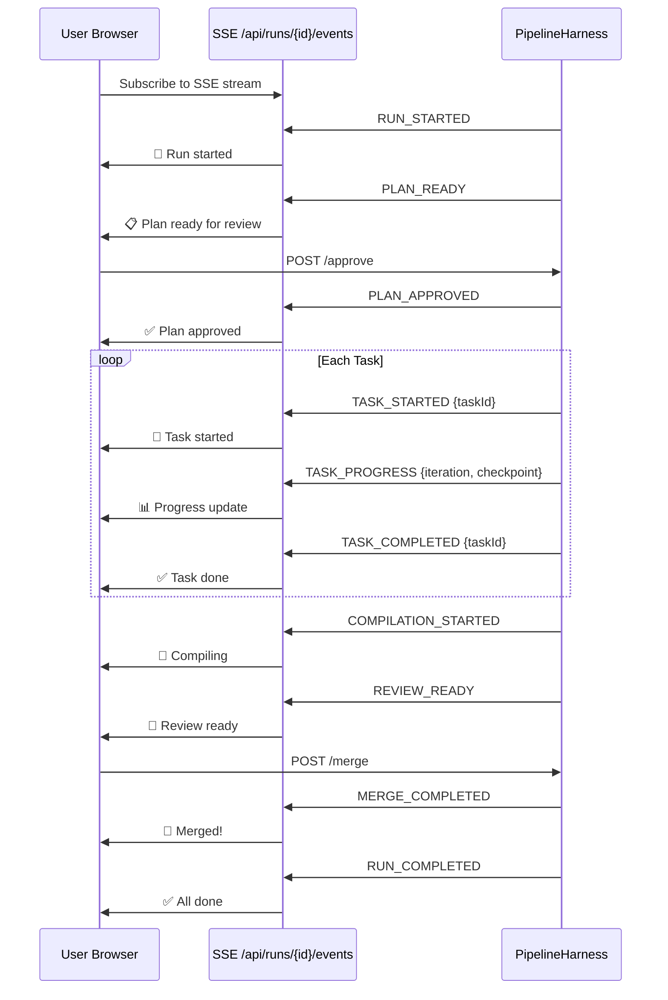

---

## 2. User Registration & Login

### Self-Registration (FREE Tier)

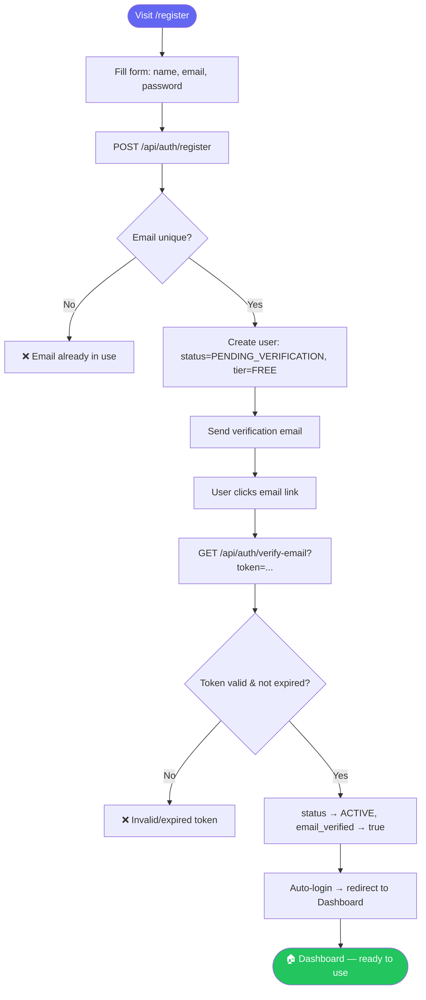

### Login Flow

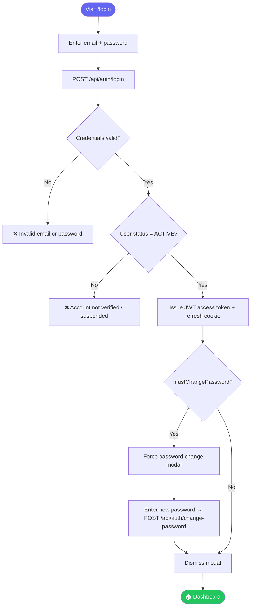

---

## 3. Organization Creation

Only **PRO** or **ENTERPRISE** users can create an organization.

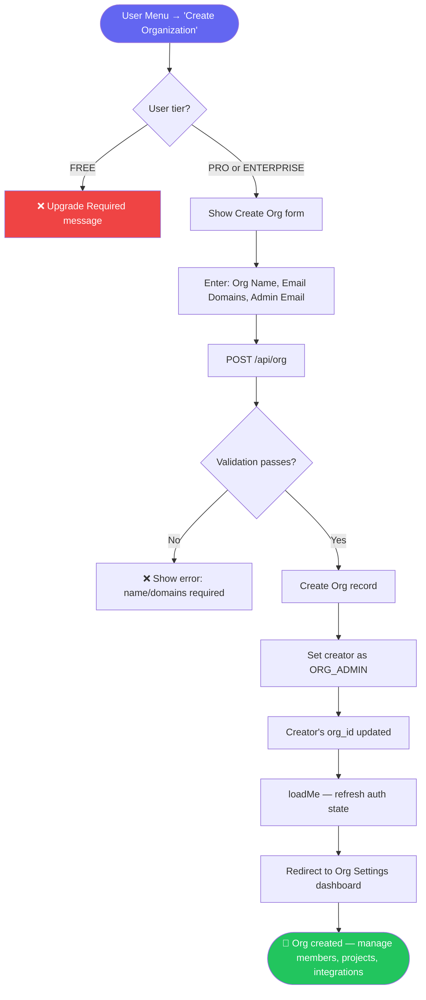

### Org Settings Dashboard (Post-Creation)

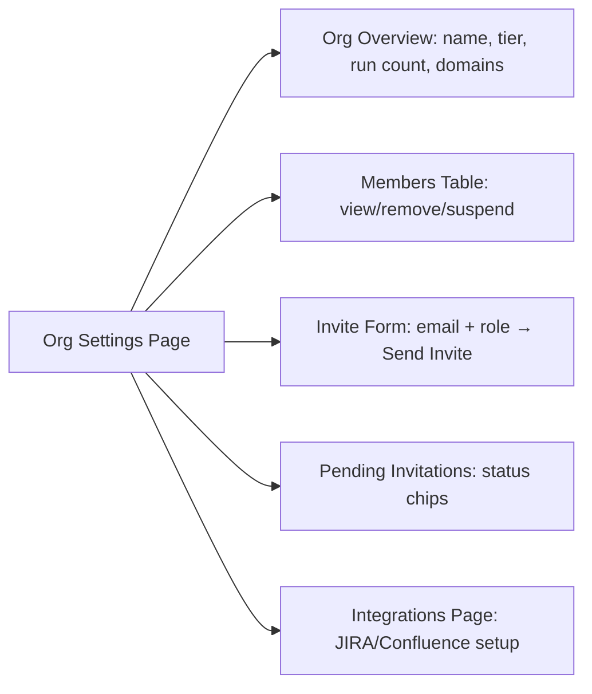

---

## 4. Organization Member Invitation

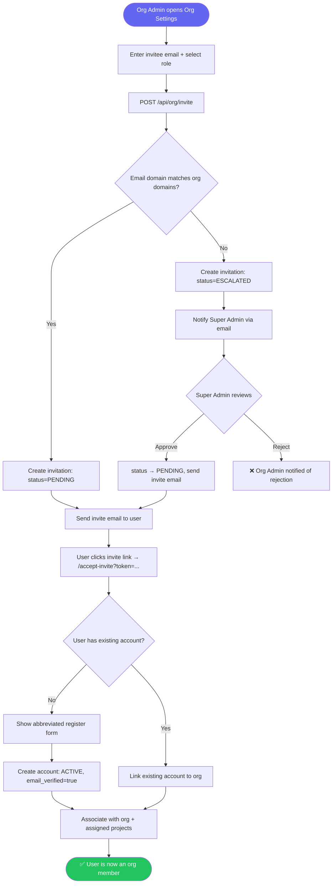

---

## 5. Integration Setup (JIRA / Confluence)

Org-level integration management — credentials managed by Org Admins on the Integrations page.

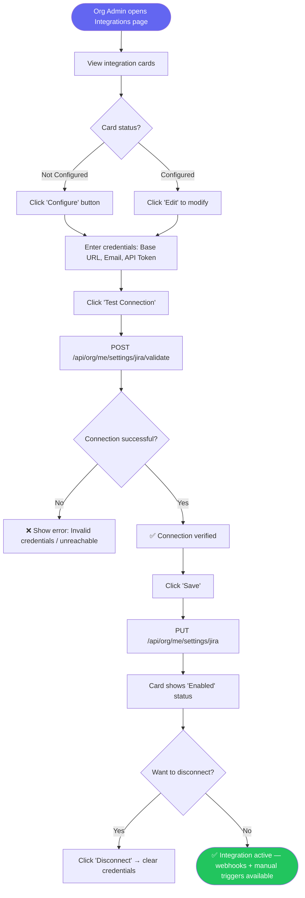

### Integration Credential Flow (Backend)

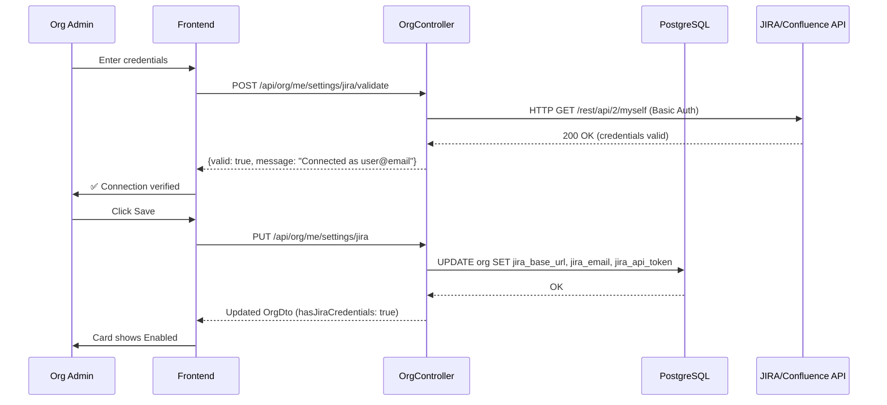

---

## 6. Integration-Triggered Run

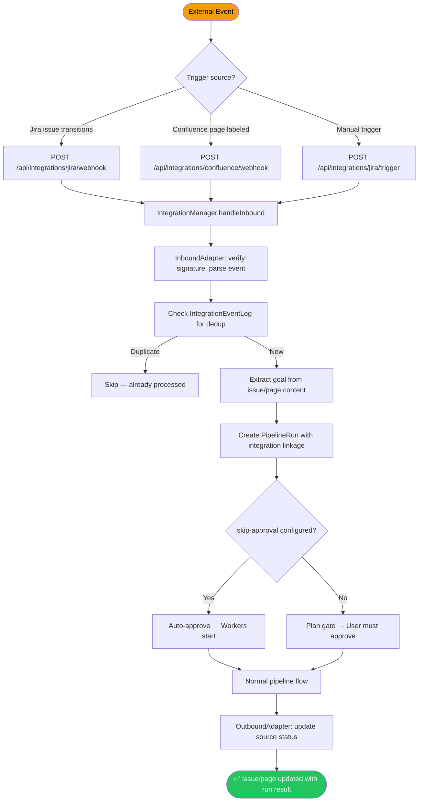

---

## 7. Post-Run Conversation & Iteration

```mermaid
flowchart TD
    A([Run completes — status: COMPLETE]) --> B[User opens Conversation tab]
    B --> C[ConversationAgent loads workspace context]
    C --> D[System prompt: file tree + README + plan + review]
    D --> E[User types question about the code]
    E --> F[POST /api/runs/{id}/conversation]
    F --> G{Message count < 10?}
    G -->|No| H[❌ HTTP 429 — message limit reached]
    G -->|Yes| I[ConversationAgent responds via Haiku]
    I --> J[Response displayed in chat UI]
    J --> K{User wants to iterate?}
    K -->|No| L[Continue chatting or close]
    K -->|Yes| M[Click 'Implement as New Run']
    M --> N[Enter change description]
    N --> O[POST /api/runs/{id}/iterate]
    O --> P[New run created with copied workspace]
    P --> Q[PipelineHarness starts new run]
    Q --> R([🔄 Iteration run — builds on previous code])

    style A fill:#6366f1,color:#fff
    style R fill:#22c55e,color:#fff
```

---

## 8. Task Retry & Recovery

### Manual Task Retry

```mermaid
flowchart TD
    A([Run has PARTIAL/FAILED tasks]) --> B[User views task list]
    B --> C[Click 'Retry' on failed task]
    C --> D[POST /api/runs/{id}/tasks/{taskId}/retry]
    D --> E[Task reset to PENDING]
    E --> F[WorkerAgent re-executes task]
    F --> G[CodeValidator validates]
    G -->|Pass| H[Merge task branch]
    G -->|Fail| I[Retry with model escalation]
    H --> J{All sibling tasks complete?}
    I -->|Max retries| K[Task remains PARTIAL]
    I -->|Pass| H
    J -->|No| L[Auto-pick up remaining incomplete tasks]
    L --> F
    J -->|Yes| M[ReviewerAgent reviews all code]
    M --> N[Merge Gate opens]
    N --> O([✅ Merge and complete])

    style A fill:#f59e0b,color:#000
    style O fill:#22c55e,color:#fff
```

### Automatic Recovery (StuckRunMonitor)


---

## 9. API Key Management

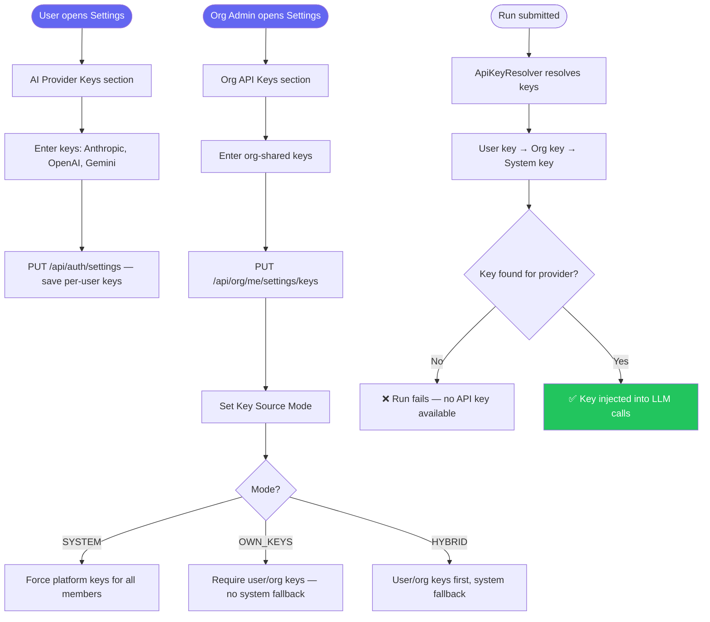

---

## 10. Deployment & Preview

### Local Preview

```mermaid
flowchart TD
    A([Run completes]) --> B[User opens Preview tab]
    B --> C[Click 'Start Preview']
    C --> D[POST /api/runs/{id}/preview/start]
    D --> E[LocalPreviewService detects project type]
    E --> F{Project type?}
    F -->|SPRING_BOOT| G[mvn spring-boot:run]
    F -->|FRONTEND| H[npm run dev]
    F -->|PYTHON| I[uvicorn / flask run]
    F -->|FULLSTACK| J[Backend + Frontend in parallel]
    G --> K[Process started — port allocated]
    H --> K
    I --> K
    J --> K
    K --> L[Preview status: RUNNING]
    L --> M[User views logs in real-time]
    M --> N[User clicks preview URL]
    N --> O([🌐 Application running in browser])

    O --> P{Done previewing?}
    P -->|Yes| Q[Click 'Stop Preview']
    Q --> R[DELETE /api/runs/{id}/preview/stop]
    R --> S[Process killed, resources freed]

    style A fill:#6366f1,color:#fff
    style O fill:#22c55e,color:#fff
```

### Cloud Run Deployment

```mermaid
flowchart TD
    A([Run with merged code]) --> B[User clicks 'Deploy']
    B --> C[POST /api/runs/{id}/deploy]
    C --> D[DockerfileGenerator creates Dockerfile]
    D --> E[DeploymentStrategy selected by language]
    E --> F[Build container image]
    F --> G[Push to Artifact Registry]
    G --> H[Deploy to Cloud Run]
    H --> I[Service URL returned]
    I --> J([🚀 Application live on Cloud Run])

    style A fill:#6366f1,color:#fff
    style J fill:#22c55e,color:#fff
```

---

## 11. Run Pause, Edit & Restart

```mermaid
flowchart TD
    A([Run is ACTIVE]) --> B[User clicks 'Pause']
    B --> C[POST /api/runs/{id}/pause]
    C --> D[Cancel working tasks]
    D --> E[Signal open gates as rejected]
    E --> F[Status → PAUSED]

    F --> G{User wants to edit?}
    G -->|Yes| H[Click 'Edit & Restart']
    H --> I[Modify goal text]
    I --> J[POST /api/runs/{id}/edit-and-restart]
    J --> K[New run created with edited goal]
    K --> L[Carries forward: credentials, org, project]
    L --> M[PipelineHarness starts fresh run]
    M --> N([🔄 New run with revised goal])

    G -->|No| O[Run stays PAUSED for reference]

    style A fill:#f59e0b,color:#000
    style N fill:#22c55e,color:#fff
```

---

## 12. Admin — User & Org Management

### Super Admin Workflows

```mermaid
flowchart TD
    A([Super Admin opens Admin Panel]) --> B{Action?}
    B -->|Manage Users| C[GET /api/admin/users — paginated list]
    C --> D[View/edit user: tier, status, role]
    D --> E{Action?}
    E -->|Suspend| F[PUT /api/admin/users/{id}/status → SUSPENDED]
    E -->|Change tier| G[PUT /api/admin/users/{id}/tier → PRO/ENTERPRISE]
    E -->|Promote| H[PUT /api/admin/users/{id}/role → SUPER_ADMIN]

    B -->|Manage Orgs| I[GET /api/admin/orgs — list all]
    I --> J[View org: members, run count, tier]
    J --> K{Action?}
    K -->|Suspend org| L[PUT /api/admin/orgs/{id}/status → SUSPENDED]
    K -->|Change plan| M[PUT /api/admin/orgs/{id}/tier → ENTERPRISE]

    B -->|Review Escalations| N[GET /api/admin/invitations/escalated]
    N --> O[Cross-domain invite: [user] → [org]]
    O --> P{Decision?}
    P -->|Approve| Q[POST /api/admin/invitations/{id}/approve → send invite]
    P -->|Reject| R[POST /api/admin/invitations/{id}/reject → notify org admin]

    style A fill:#f59e0b,color:#000
```

---

## Role-Based Access Summary

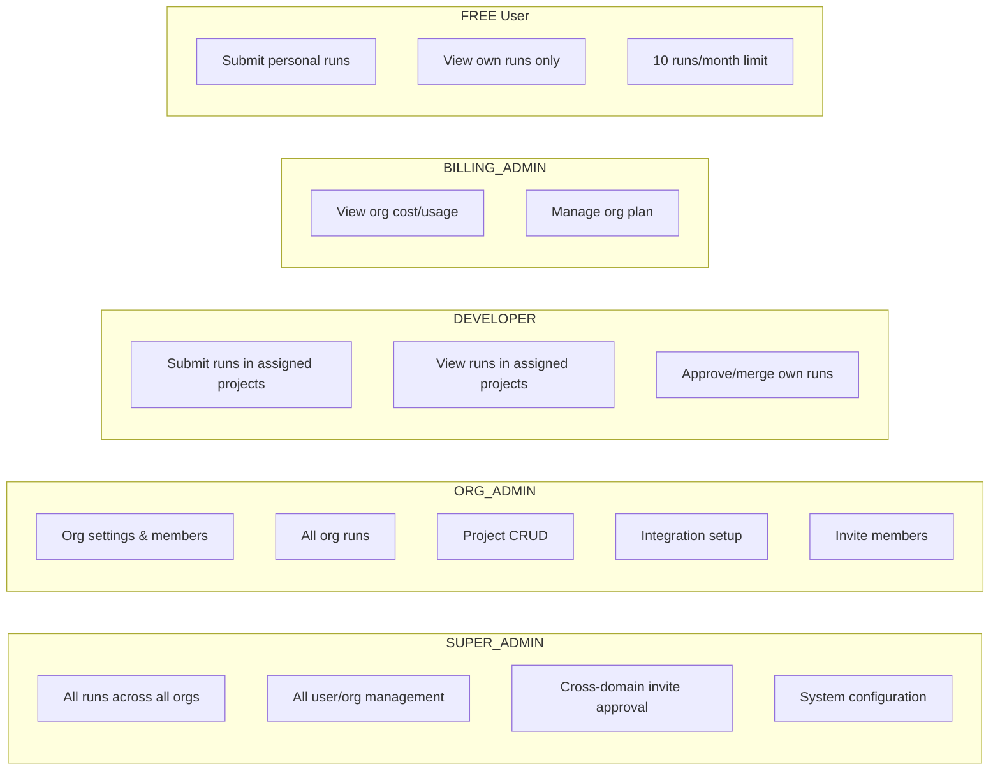

---

## 13. Slack Integration Setup

Org admin connects Slack workspace via OAuth and configures per-project channel routing.

```mermaid
flowchart TD
    A([Org Admin opens Integrations page]) --> B[View Slack card]
    B --> C{Already connected?}
    C -->|No| D[Click 'Connect to Slack']
    D --> E[Redirect to Slack OAuth consent screen]
    E --> F[Admin approves bot permissions]
    F --> G[OAuth callback with code + HMAC state]
    G --> H{State valid? HMAC + TTL check}
    H -->|Invalid| I[❌ Error: invalid or expired state]
    H -->|Valid| J[Exchange code for access token]
    J --> K[Save OrgSlackIntegration: team_id, token, bot_user_id]
    K --> L[Redirect to Integrations page with success banner]

    C -->|Yes| M[View connection: workspace name, default channel]
    M --> N{Action?}
    N -->|Send Test| O[POST /api/integrations/slack/test]
    O --> P[Block Kit message sent to selected channel]
    N -->|Configure Channels| Q[Select project → assign Slack channel]
    Q --> R[PUT /api/integrations/slack/channels/project/{id}]
    N -->|Disconnect| S[Confirm dialog → DELETE /api/integrations/slack/disconnect]
    S --> T[Token revoked, integration removed]

    style A fill:#6366f1,color:#fff
    style L fill:#22c55e,color:#fff
    style I fill:#ef4444,color:#fff
```

### Slack Notification Flow

```mermaid
sequenceDiagram
    participant P as PipelineHarness
    participant SSE as SseBroadcaster
    participant SN as SlackNotificationService
    participant RL as SlackRateLimiter
    participant SC as SlackClient
    participant S as Slack API

    P->>SSE: emit(RunEvent)
    SSE->>SN: @EventListener(RunEvent)
    SN->>SN: Check verbosity filter
    SN->>SN: Resolve channel (project → default → skip)
    SN->>RL: acquireSlot(teamId)
    RL-->>SN: OK (or wait 1.1s)
    SN->>SC: postMessage(channel, blocks)
    SC->>S: POST chat.postMessage
    S-->>SC: 200 OK
    SC-->>SN: Success
    SN->>SN: Log to slack_notification_log
```

---

## 14. JIRA/Confluence Context Extraction & Clarification

When a user mentions JIRA tickets or Confluence pages in a run request, the system fetches content before planning.

```mermaid
flowchart TD
    A([User submits run with JIRA/Confluence references]) --> B[ReferenceExtractorService scans request]
    B --> C{What was detected?}
    C -->|JIRA key: PROJ-123| D[Fetch JIRA issue via org credentials]
    C -->|Confluence URL with page ID| E[Fetch Confluence page via org credentials]
    C -->|Vague: 'jira ticket' / 'confluence page'| F[Open Clarification Gate]
    C -->|No references| G[Continue with original request]

    D --> H[Extract: summary, description, status, acceptance criteria]
    E --> I[Extract: page title + body text, truncate to 4000 chars]
    H --> J[Append extracted context to request]
    I --> J
    J --> K[Pass enriched request to PlannerAgent]

    F --> L[SSE: CLARIFICATION_NEEDED]
    L --> M[ClarificationBanner shown in UI]
    M --> N{User action?}
    N -->|Provides specific reference| O[POST /api/runs/{id}/clarify]
    O --> P[Re-extract from clarification input]
    P --> D
    P --> E
    N -->|Clicks 'Skip'| Q[POST /api/runs/{id}/clarify with empty response]
    Q --> G

    K --> R([PlannerAgent plans with full context])

    style A fill:#6366f1,color:#fff
    style R fill:#22c55e,color:#fff
```

### Clarification Gate Sequence

```mermaid
sequenceDiagram
    participant U as User Browser
    participant FE as RunDetail UI
    participant BE as RunController
    participant PH as PipelineHarness
    participant GS as GateStore
    participant RE as ReferenceExtractor

    PH->>RE: extractAndEnrich(request, orgId)
    RE-->>PH: needsClarification("Please provide JIRA key...")
    PH->>GS: setClarificationGate(runId)
    PH->>PH: emit CLARIFICATION_NEEDED SSE
    PH->>PH: awaitClarificationGate(runId) [blocks]

    U->>FE: Sees ClarificationBanner with prompt
    U->>FE: Types "PROJ-456" and clicks Submit
    FE->>BE: POST /api/runs/{runId}/clarify {response: "PROJ-456"}
    BE->>PH: resolveClarificationGate(runId, "PROJ-456")
    PH->>GS: setClarificationGate(runId, "PROJ-456")
    GS-->>PH: Gate resolved

    PH->>RE: extractFromClarification(original, "PROJ-456", orgId)
    RE-->>PH: enriched request with JIRA context
    PH->>PH: emit CLARIFICATION_RESOLVED + CONTEXT_EXTRACTED
    PH->>PH: Continue to PlannerAgent with enriched request
```

---

*Generated: 2026-03-11*
*Covers: Pipeline execution, auth, org management, integrations, Slack notifications, JIRA/Confluence context extraction, post-run features, deployment, recovery, admin workflows.*
