# ExecuteSpec — Feature Workflow Diagrams

> **Last updated:** 2026-05-12 (1.0.0-M1 · migration head V186).
> **Audience:** engineers + product + QA.
> User journeys per tier and per persona live in [`user-journeys.md`](user-journeys.md) + [`project-user-journeys.md`](project-user-journeys.md). This doc is the **Mermaid diagram surface** for every end-to-end workflow.

## 1. V2 BUILD-mode pipeline

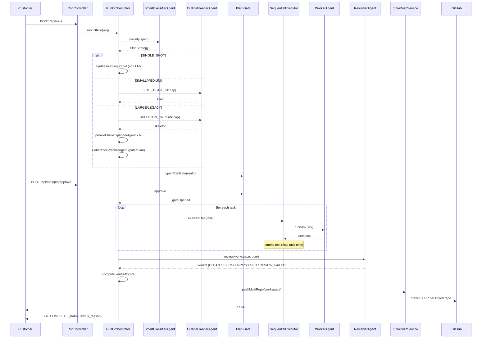

## 2. V2 PATCH-mode pipeline (4 autofix surfaces + SWE-bench / ProgramBench)

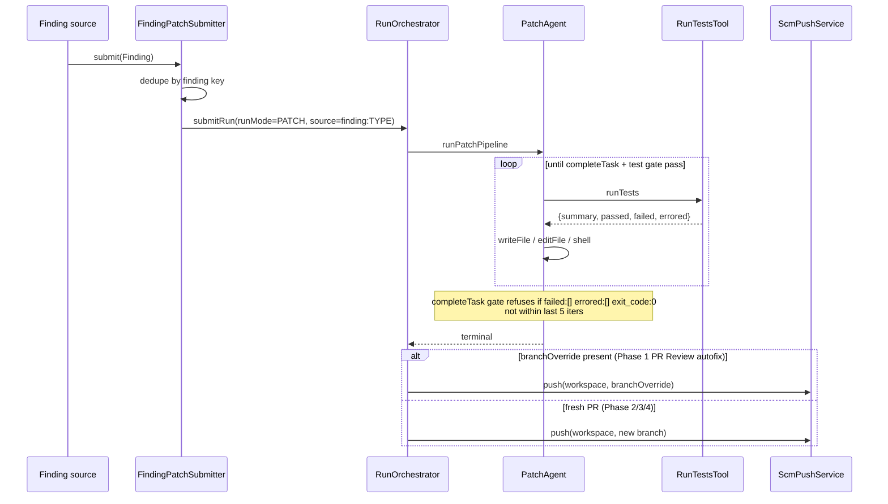

### Autofix sources

| Phase | Trigger | Source class |
|-------|---------|--------------|
| 1 | PR Review verdict popover → "Autofix N comments" | `prreview/PrReviewAutofixService` |
| 2 | TechDebtPanel category row → "Fix" | `project/techdebt/TechDebtFixService` |
| 3 | GitHub `check_run` webhook (flag-gated `ci.autofix.enabled`) | `project/pr/CiFailureAutoFixService` |
| 4 | CodeQualityPanel severity chip → "N CRITICAL" / "N MAJOR" | `codereview/CodeReviewAutofixService` |

## 3. Run status state machine

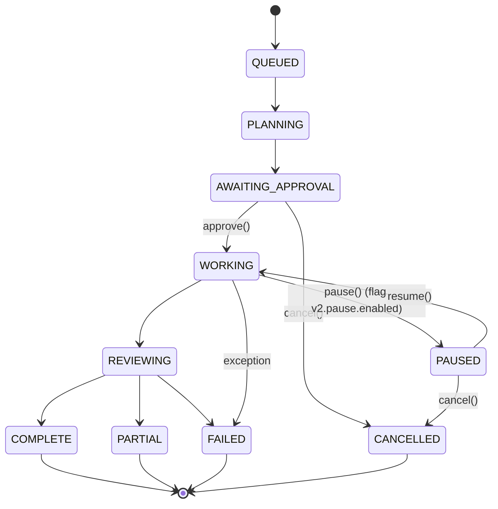

PARTIAL terminals carry one of these `status_reason` values: `CLEAN_COMPLETION` / `CLEAN_WITH_INTERMEDIATE_WARNINGS` / `FINAL_BUILD_FAILED` / `TESTS_FAILED:N_OF_M` / `REVIEWER_UNRESOLVED` / `REVIEWER_FAILED` / `ALL_TASKS_FAILED`. The `StatusBadge` tooltip surfaces a human-friendly version.

## 4. Multi-repo PR flow

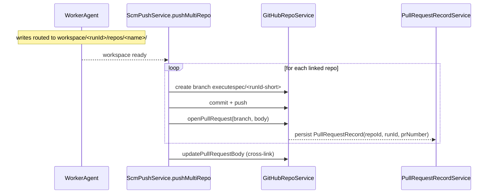

GitHub webhook flips status:

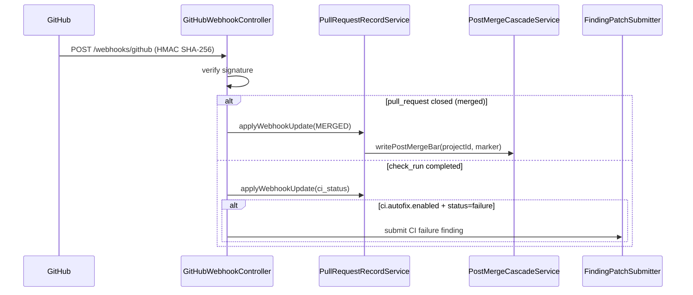

## 5. Cost + credit lifecycle

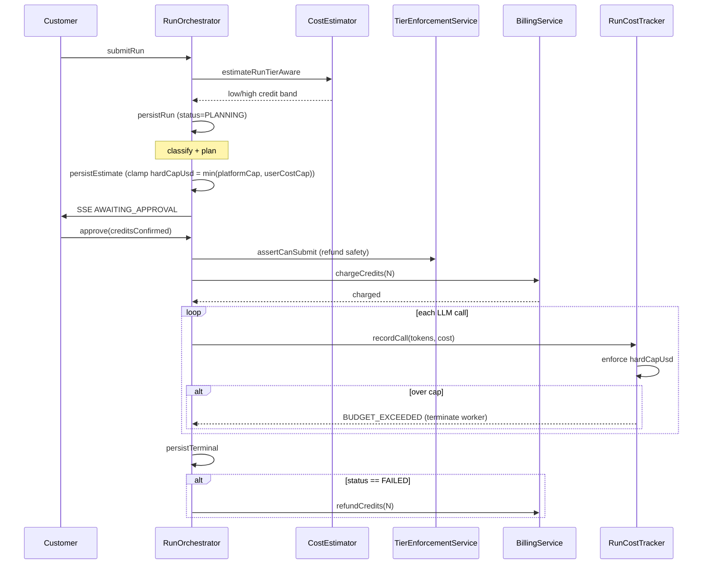

## 6. Project architecture pipeline (3-step)

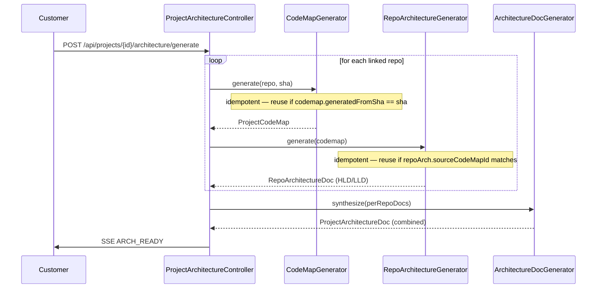

## 7. RAG indexing flow

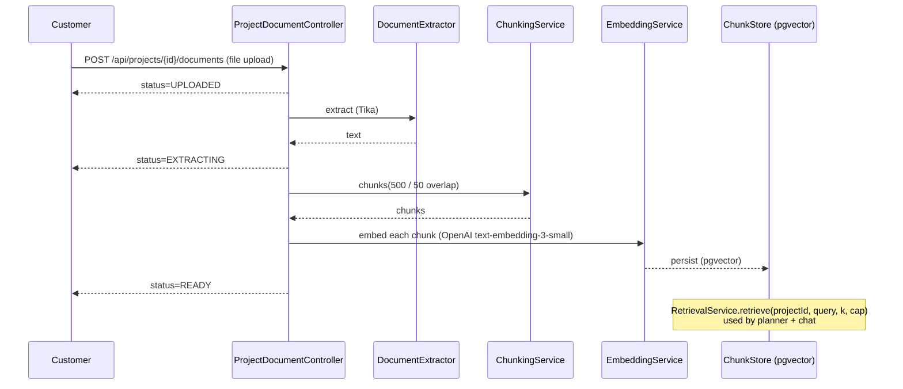

## 8. External project sharing (V175)

```mermaid
flowchart TB
  A[Project owner] -->|POST /api/projects/{id}/invites| B(ProjectInvite)
  B -->|email link| C[Invitee]
  C -->|GET /api/invites/preview?token=| D{Preview}
  D -->|POST /api/invites/accept| E[ProjectMember<br/>is_external=true<br/>role=PROJECT_VIEWER]
  E --> F[ProjectAccessGuard<br/>now allows cross-org read]
  G[Project owner] -->|POST /api/projects/{id}/share-links| H(ProjectShareLink<br/>surface, expiresAt)
  H -->|tokenised URL| I[Anonymous reader]
  I -->|GET /api/shared/{token}/...| J[Public read endpoint<br/>tier-gated active cap]
```

## 9. PR Review agent (V172, PRO+)

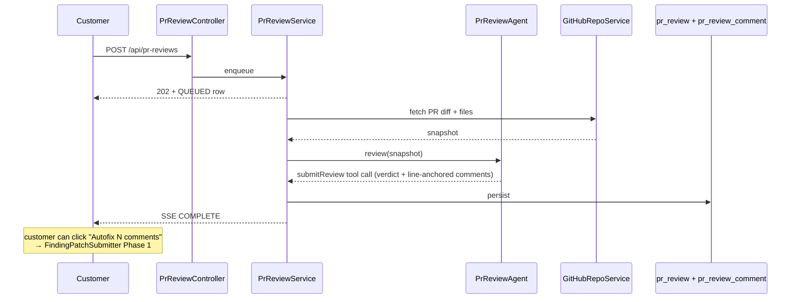

## 10. Code Review agent (V172, PRO+)

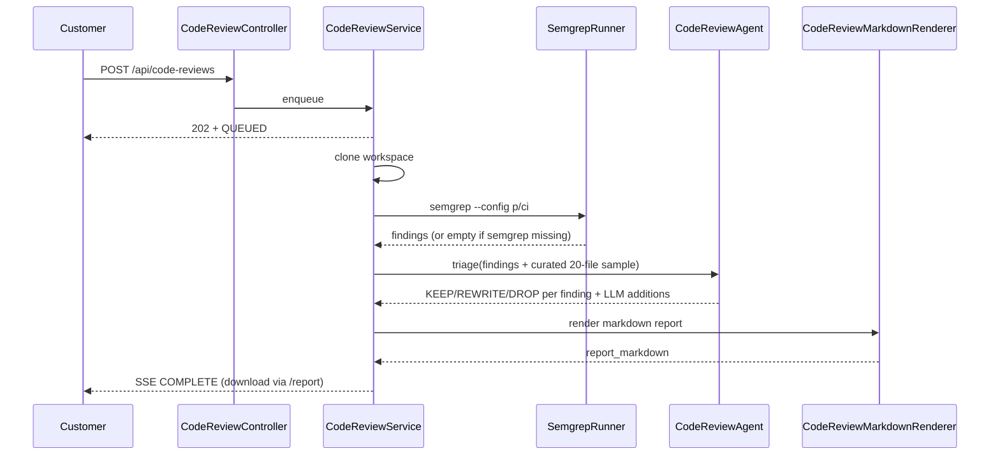

## 11. Plan-gate auto-cancel on JVM restart

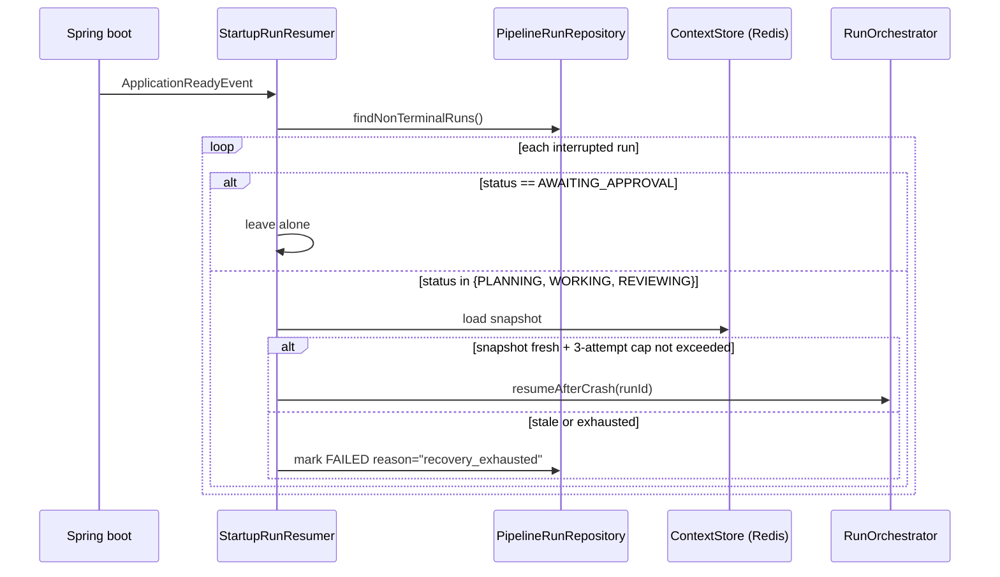

## 12. Preview lifecycle

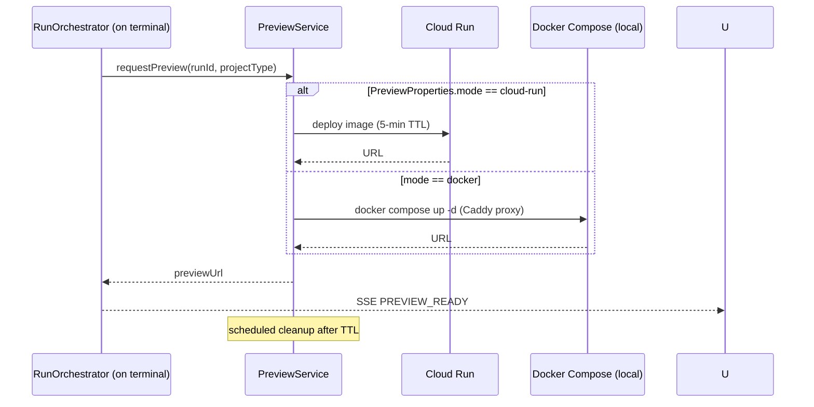

## 13. Cancel rollback

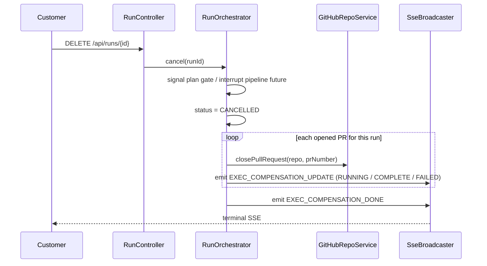

## 14. Slack run-completion notification

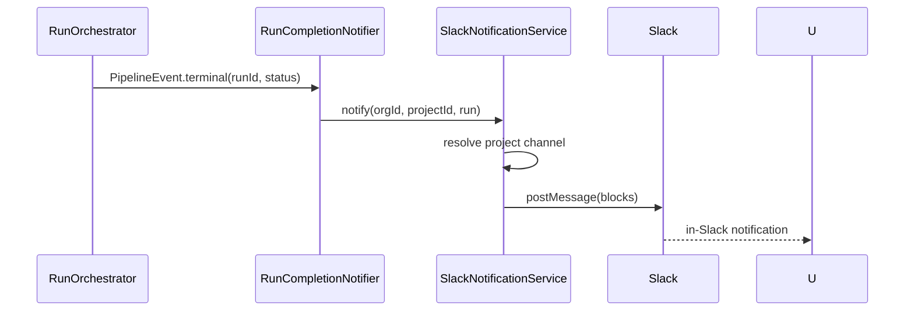

## 15. SSE event stream

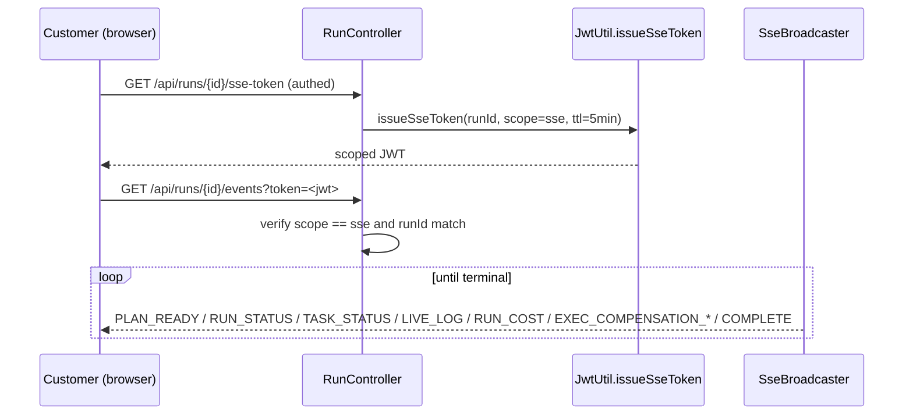

## 16. Per-task retry (manual)

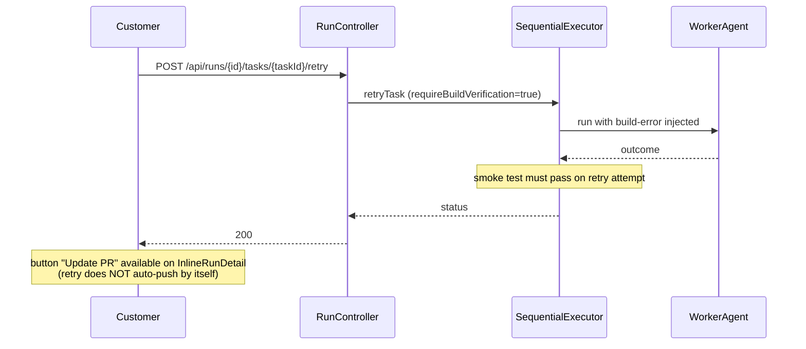

## References

- Architecture: [`docs/ARCHITECTURE.md`](ARCHITECTURE.md).
- User flows: [`docs/USER_MANUAL.md`](USER_MANUAL.md) + [`docs/user-journeys.md`](user-journeys.md) + [`docs/project-user-journeys.md`](project-user-journeys.md).
- API surface: [`docs/openapi.yaml`](openapi.yaml).
