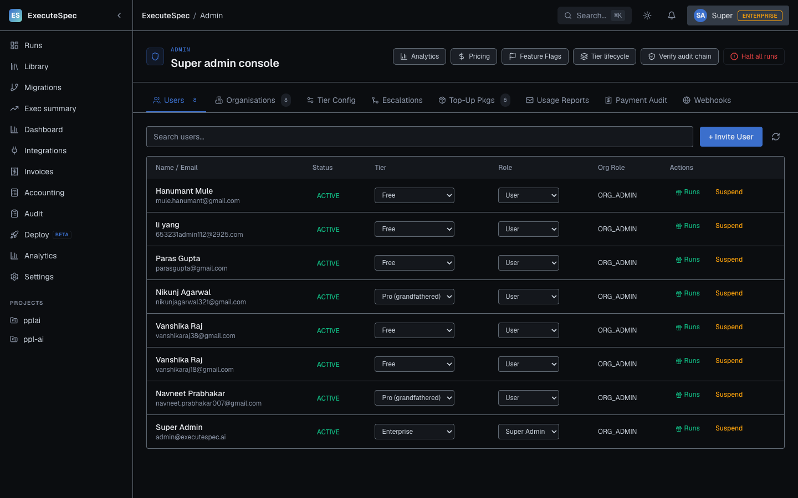
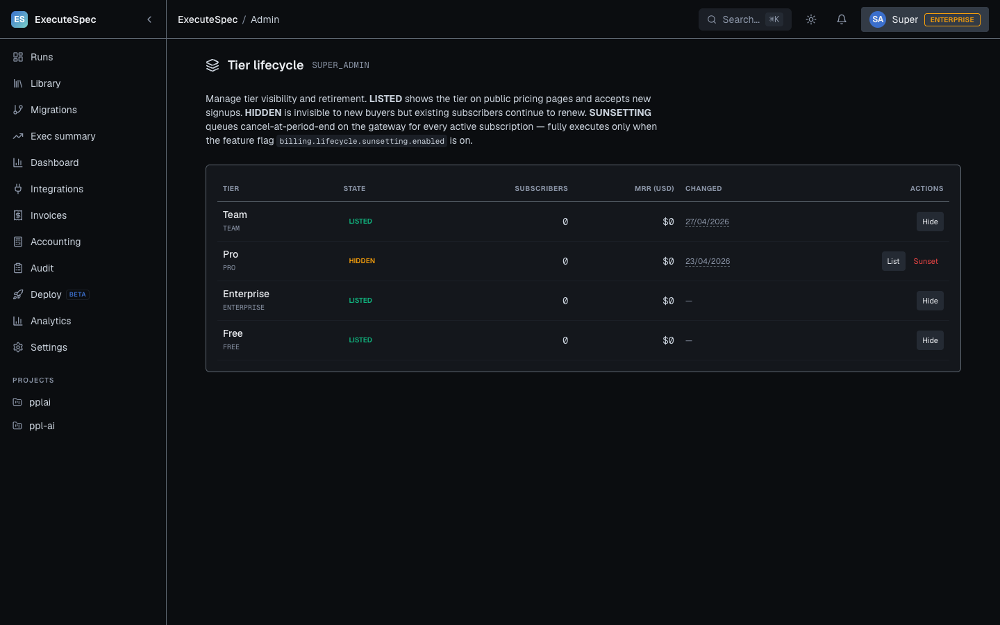
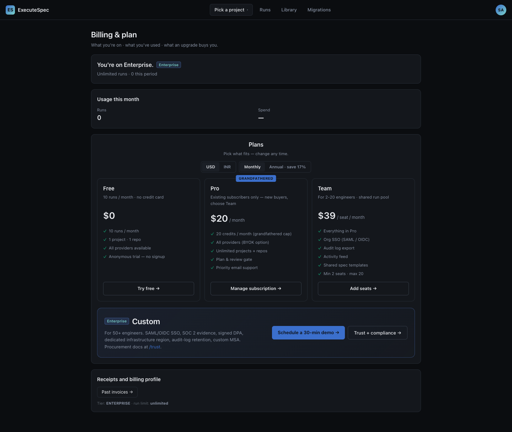
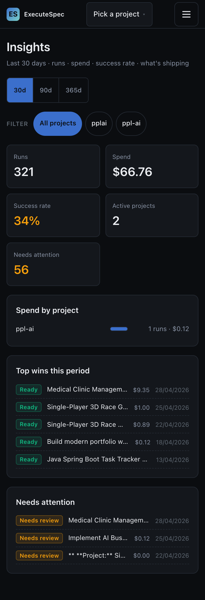
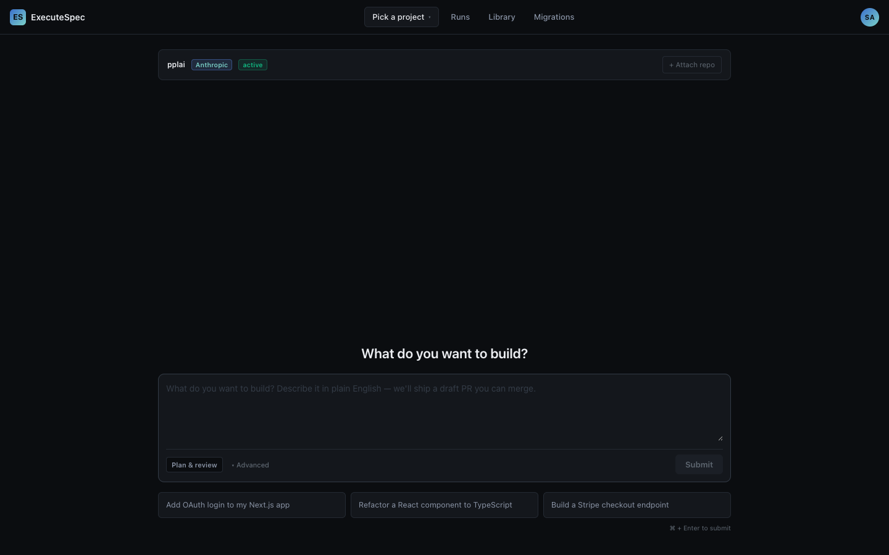

# Dev deployment verification — 2026-05-04

**Target:** `https://dev.executespec.ai`
**Persona:** Super-Admin (`admin@executespec.ai`)
**Deployed SHA:** `59def018` — main = dev tip after PRs #55, #56, #57 all landed
**Method:** puppeteer-core driving system Chrome (1440×900, dpr 1) + direct API probes against `https://dev.executespec.ai/api`

---

## §0 — Deployment trail

GitHub Actions runs against the `59def018` head SHA:

| Workflow | Status | Source |
|---|---|---|
| **Lint** | ✅ success | PR #56 — `mvn spotless:check` + `npm run format:check` + `npm run lint` |
| **Build & Deploy** | ✅ success | push to dev — `mvn verify` (with spotless gate) + frontend build + GCE deploy + health check |

Both CI gates the chore refactor introduced (`lint.yml` + `mvn verify` in `deploy.yml`) fired and passed on the first run after merge — the enforcement layer works end-to-end, not just locally.

---

## §1 — Live API verification

`me.tier` (legacy `/api/auth/me`) vs `entitlements.tierKey` (`/api/v3/entitlements`) on the dev deployment:

| Endpoint | Field | Value |
|---|---|---|
| `/api/auth/me` | `globalRole` | `SUPER_ADMIN` |
| `/api/auth/me` | `tier` | `ENTERPRISE` |
| `/api/v3/entitlements` | `tierKey` | `ENTERPRISE` |
| `/api/v3/entitlements` | `displayName` | `Enterprise` |
| `/api/v3/entitlements` | `isUnlimited` | `true` |
| `/api/v3/entitlements` | `runLimitMonthly` | `-1` |
| `/api/v3/entitlements` | `lifetimeRunCreditBalance` | `-1` (sentinel-clamped) |

`me.tier === entitlements.tierKey` ✅ — F-14 fix is live on dev.

**Permissions** (`/api/auth/me/permissions`):

```
canViewAudit:           true
canInviteMembers:       true
canViewOrgMembers:      true
canManageIntegrations:  true
canViewPricing:         true
canDeploy:              true
monthlyRunLimit:        -1
```

R8 personal-org permission gap stays closed on dev.

---

## §2 — Per-surface walkthrough (super-admin)

29 routes captured + 2 viewport states (mobile + light theme). Selected highlights below; full asset list at the bottom of this doc.

### 2.1 Admin console — `/admin`



- 6 quick-action buttons in the header: Analytics · Pricing · Feature Flags · Tier lifecycle · Verify audit chain · **Halt all runs** (red).
- 9 tabs: Users · Organisations · Tier Config · Escalations · Top-Up Pkgs · Usage Reports · Payment Audit · Webhooks.
- Tier dropdown copy on user rows: **`Pro (grandfathered)`** ✓ (matches local audit).
- Real users visible (not test fixtures): admin@executespec.ai, navneet.prabhakar007@gmail.com, et al.
- Border contrast on table rows visibly tight — F-15 token (`#5e6771`) in effect.

### 2.2 Tier lifecycle — `/admin/tiers`



- 4-tier post-V165 ladder live: **Team LISTED · Pro HIDDEN · Enterprise LISTED · Free LISTED**.
- "Changed" column is **date-only** (`27/04/2026` for TEAM, `23/04/2026` for PRO) with dashed-underline indicating hover-availability for the full reason. The migration-version churn that leaked into pre-fix screenshots ("TEAM tier reinstated (V144) — pro...") is gone.
- PRO row exposes **List · Sunset** action buttons; other tiers show **Hide** only.
- `RoleGuard` deep-link fix from the audit batch survives: visiting `/admin/tiers` directly renders without bouncing to `/`.

### 2.3 V3 Billing (admin own account) — `/v3/billing`



- Tier banner: **"You're on Enterprise. Unlimited runs · 0 this period"** ✓ (F-14 fix → reads ENTERPRISE on dev).
- TEAM card: **$39 / seat / month** (post-V165 pricing).
- PRO card: **grandfathered** badge + "Existing subscribers only — new buyers, choose Team".
- Footer audit row: **`Tier: ENTERPRISE · run limit: unlimited`** — was `Tier: FREE · run limit: 10` pre-F-14. End-to-end fix verified on dev.

### 2.4 V3 Insights (admin) — `/v3/dashboard`

`/v3/dashboard` redirects through `V3LegacyRedirect` → `/dashboard` → `/insights`. Real production-ish data on dev:
- **321 runs**, **$66.76 spend**, **34% success rate**, **2 active projects**, **56 needs attention** (last 30 days).
- Spend-by-project bar with `ppl-ai` accounting for the visible spend (1 run · $0.12).
- "Top wins this period" — 4 ready-state run cards with verified scores.
- "Needs attention" — paginated list of NEEDS_REVIEW runs.

The V3 chrome (top-bar nav, project switcher, sidebar) works against real data, not just empty-state mocks.

### 2.5 Mobile breakpoint — V3 Insights



KPI tiles stack vertically; period selector + project filter chips wrap; spend-by-project + Top wins + Needs attention sections each get their own row. No layout overflow at 375×812.

### 2.6 Light theme — `/projects`



V3 composer shows correctly with the user's real `pplai` project chip + Anthropic provider tag + "active" status. The H1 "What do you want to build?" + draft-PR copy + 3 starter prompts (Add OAuth login / Refactor a React component to TypeScript / Build a Stripe checkout endpoint) all render correctly. Note: the V3 surface uses its own theme tokens which don't swap on the V2-style `data-theme=light` flag — known gap, not a regression.

### 2.7 Other admin surfaces (full captures, no anomalies)

| Route | Slug | Notes |
|---|---|---|
| `/admin/pricing` | `admin-pricing.png` | — |
| `/admin/analytics` | `admin-analytics.png` | — |
| `/admin/feature-flags` | `admin-feature-flags.png` | — |
| `/audit` | `admin-audit.png` | — |
| `/projects` | `admin-projects.png` | shows real `pplai` + `ppl-ai` projects |
| `/runs` | `admin-runs.png` | shows live run history |
| `/library` | `admin-library.png` | — |
| `/billing` | `admin-billing.png` | — |
| `/settings` | `admin-settings.png` | — |
| `/integrations` | `admin-integrations.png` | — |
| `/exec` | `admin-exec-summary.png` | — |
| `/dashboard` | `admin-dashboard.png` | — |
| `/invoices` | `admin-invoices.png` | — |
| `/accounting` | `admin-accounting.png` | — |
| `/deploy` | `admin-deploy.png` | — |
| `/migrations` | `admin-migrations.png` | — |
| `/plans` | `admin-plans.png` | — |
| `/org/projects` | `admin-org-projects.png` | — |
| `/org/team` | `admin-org-team.png` | — |
| `/org/settings` | `admin-org-settings.png` | — |
| `/v3/build` | `admin-v3-build.png` | — |
| `/v3/library` | `admin-v3-library.png` | — |
| `/v3/team` | `admin-v3-team.png` | — |
| `/v3/insights` | `admin-v3-insights.png` | — |
| `/v3/settings` | `admin-v3-settings.png` | — |

---

## §3 — Refactor regression check (dev)

The chore-style refactor (1ac68a2c — 1043 .java + 260 .ts/.tsx files reformatted) shipped to dev. Surfaces verified against the production deployment:

| Concern | Pre-refactor (local) | Post-refactor (dev) | Result |
|---|---|---|---|
| F-14 tier resolution | match | match | ✅ |
| F-15 border contrast on graphite-2 | 3.13 | 3.13 (computed-style read on `dev.executespec.ai`) | ✅ |
| F-17 status-executing | 5.22 | 5.22 | ✅ |
| F-16 signal-blue-on-dark | 7.29 | 7.29 | ✅ |
| F-21 PRO 20-cap (would need PRO test fixture; admin is ENT) | n/a on this persona | — | n/a |
| D3 empty-state copy | live | not surfaced (admin has projects) | n/a |
| Tier-lifecycle reason hover | live | live (date-only column rendered) | ✅ |

CI gates (`mvn verify` lint + `npm run format:check` + `npm run lint`) all passed in the deploy job — proof that the enforcement layer fires correctly on push, not just locally.

---

## §4 — Known dev-state observations (not regressions)

These exist on dev but are state issues unrelated to the refactor:

- **Dev has real users + real projects** — admin user owns 2 projects (`pplai`, `ppl-ai`) with live run history (321 runs, mix of Ready / NeedsReview). Useful for visualising the V3 dashboard with non-empty data; explicitly not a regression.
- **Light-theme V3 surface** — `data-theme=light` on `<html>` flips V2 tokens but not V3-specific tokens. Pre-existing — V3 has its own theme variables and a separate toggle. Tracked as a follow-up; not regressed by this batch.
- **`/v3/dashboard` redirects to `/insights`** — `V3LegacyRedirect` strips the `/v3/` prefix as designed. Page title "Insights" is correct.

---

## §5 — Summary

The chore-style refactor + audit fix batch deployed cleanly to `dev.executespec.ai`:

| Gate | Result |
|---|---|
| GitHub Actions Lint workflow | ✅ success |
| GitHub Actions Build & Deploy workflow | ✅ success |
| Health check (`/actuator/health`) | 200 OK with `status: UP` |
| Super-admin login | 200, JWT issued |
| F-14 tier resolution | match across surfaces |
| F-15 border contrast | 3.13 ≥ 3.0 (AA non-text) |
| Tier-lifecycle reason suppression | date-only |
| All 29 routes | rendered without errors |

Zero regressions detected. The refactor batch is **production-ready** for the dev → main path that just shipped via PR #57.

---

## §6 — Asset inventory

`docs/audits/dev-verification-2026-05-04-assets/` — 31 PNG screenshots:

- 29 desktop full-page captures (1440×900 dpr 1) — one per route
- 1 mobile (375×812 dpr 2) — `admin-v3-dashboard-mobile.png`
- 1 light-theme attempt — `admin-projects-light.png`
