# Persona Test — Round 3

**Date:** 2026-05-01
**Branch:** `audit/v2-5-11-ux-product` (post 27c1c3c3)
**Stack:** local backend (Spring Boot 3.3, profile `local`) + Vite dev (5173) + Postgres 18
**Method:** puppeteer-core driving system Chrome (1440×900, dpr 1) + direct API probes against `localhost:8080`. 110 screenshots total under `persona-test-2026-05-01-r3-assets/`.

> Round 3 follows the auto-execute fix-list batch + R-batch follow-ups from rounds 1–2 (now deleted). The goal here is **revalidation**: confirm what landed, find what regressed, and surface anything new.

---

## Personas

| Tag    | Account                              | Tier        | Org role  | View  |
|--------|--------------------------------------|-------------|-----------|-------|
| admin  | `admin@executespec.ai`               | ENTERPRISE  | super     | pro   |
| ent    | `revalidate-ent@test.local`          | ENTERPRISE  | ORG_ADMIN | vibe  |
| team   | `revalidate-team@test.local`         | TEAM        | ORG_ADMIN | vibe  |
| pro    | `revalidate-pro@test.local`          | PRO (HIDDEN)| ORG_ADMIN | vibe  |
| free   | `revalidate-free@test.local`         | FREE        | ORG_ADMIN | vibe  |

All five logged in cleanly on the first attempt — the V165 Flyway crash and OAuth localhost redirect from the prior session are stable.

---

## Score card

| # | Item                                                          | Status   | Source                       |
|---|---------------------------------------------------------------|----------|------------------------------|
| 1 | V165 Flyway boot crash                                        | ✅ Fixed | backend up                   |
| 2 | Google OAuth localhost redirect                               | ✅ Fixed | `OAuthSurfaceResolver`       |
| 3 | Admin tier dropdown shows "Pro (grandfathered)"               | ✅ Live  | `<select>` options dump      |
| 4 | Personal-org permission gap (R8) — ENT/TEAM `canViewAudit` etc | ✅ Live  | `/api/auth/me/permissions`   |
| 5 | `Integer.MAX_VALUE` clamp in entitlements                     | ✅ Live  | `/api/v3/entitlements`       |
| 6 | `--c-signal-blue` darkened to `#3B6FCC`                       | ✅ Live  | computed-style probe         |
| 7 | `--c-pop-orange` retargeted to pink `#EC4899`                 | ✅ Live  | computed-style probe         |
| 8 | `--status-executing` separated to `#4A77D6`                   | ✅ Live  | computed-style probe         |
| 9 | Login hero "Ship AI-written PRs you can actually merge."      | ✅ Live  | screenshot + DOM             |
| 10| TypedConfirmModal on Halt all runs                            | ✅ Live  | screenshot                   |
| 11| TEAM card flat at $39/seat (V165)                             | ✅ Live  | V3 billing screenshot        |
| 12| EmptyProjectLanding (v2.6.4) on `/projects` empty path        | ✅ Live  | screenshot                   |
| 13| Tier lifecycle console — 4-tier post-V165 ladder              | ✅ Live  | screenshot                   |
| **14** | **V3 entitlement endpoint returns FREE for ENT/TEAM/PRO test users** | ❌ Bug | `/api/v3/entitlements`       |
| **15** | **Border contrast 1.59 fails WCAG SC 1.4.11 (≥3.0)**       | ⚠ Partial| computed-style probe         |
| **16** | **Signal-blue text on dark surface 3.71 fails AA-body**    | ⚠ Partial| computed-style probe         |
| **17** | **`--status-executing` 4.19 fails AA-body**                | ⚠ Partial| computed-style probe         |
| 18| Sidebar still says "Runs" (Phase 1.1 "Missions" rename pending) | ℹ Info  | sidebar dump                 |
| 19| V3 dashboard route `/v3/dashboard` actually renders **Insights** | ℹ Info  | screenshot                   |
| 20| ENT V3 billing capture initially 429 (rate limit during walk) | ℹ Note   | re-captured cleanly          |

Net: **13 confirmed-fixed**, **3 partial WCAG misses still present**, **1 backend bug surfaced** (#14), **3 informational** (#18-20).

---

## §1 — Super-admin walkthrough

### 1.1 Admin console — Users tab (`/admin`)

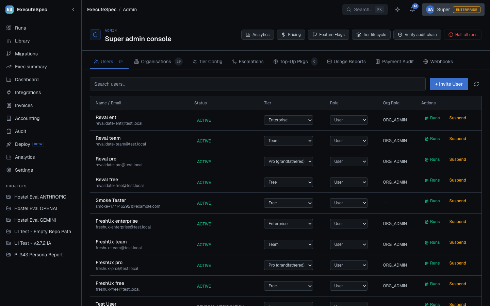

- Quick-action header has 6 buttons: Analytics · Pricing · Feature Flags · Tier lifecycle · Verify audit chain · Halt all runs (red).
- 9 tabs: Users (24) · Organisations (19) · Tier Config · Escalations · Top-Up Pkgs (5) · Usage Reports · Payment Audit · Webhooks.
- **Tier dropdown** in user rows now shows: `Free` / `Team` / `Pro (grandfathered)` / `Enterprise`. ✅ R-batch fix landed.

### 1.2 Tier lifecycle (`/admin/tiers`)

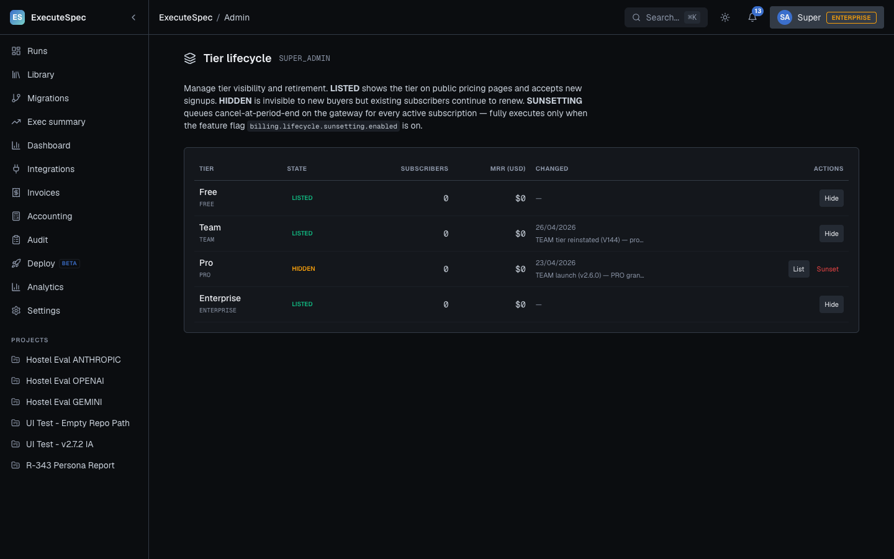

- Post-V165 4-tier ladder confirmed: **Free LISTED · Team LISTED · Pro HIDDEN · Enterprise LISTED**.
- Audit trail leaks the historical churn: "26/04/2026 — TEAM tier reinstated (V144)" + "23/04/2026 — TEAM launch (v2.6.0) — PRO gran...". Live state is correct (V165 retired MAX → renamed to TEAM); the audit log is just historically accurate.
- Pro row exposes **List · Sunset** actions. Other rows show only **Hide**.
- `RoleGuard requireSuperAdmin` deep-link fix from R-batch confirmed working — no auth-hydration bounce.

### 1.3 Halt all runs — TypedConfirmModal

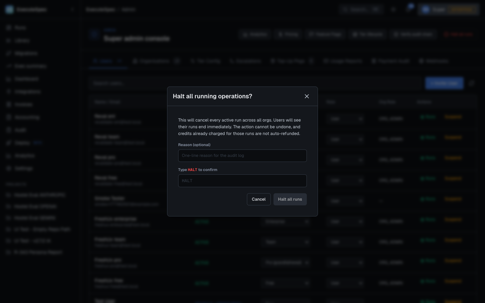

- Headline "Halt all running operations?" + warning copy + optional reason input + **"Type HALT to confirm"** keyword gate.
- Submit button stays disabled until both criteria pass.
- This is the new `TypedConfirmModal` primitive from the fix-list batch. ✅

### 1.4 Other admin tabs (clean captures)

| Tab           | Screenshot                                                          |
|---------------|---------------------------------------------------------------------|
| Organisations | `admin-tab-orgs.png`                                                |
| Tier Config   | `admin-tab-tier-config.png`                                         |
| Escalations   | `admin-tab-escalations.png`                                         |
| Top-Up Pkgs   | `admin-tab-topup-pkgs.png`                                          |
| Usage Reports | `admin-tab-usage-reports.png`                                       |
| Payment Audit | `admin-tab-payment-audit.png`                                       |
| Webhooks      | `admin-tab-webhooks.png`                                            |

### 1.5 Side surfaces

- Pricing manager (`/admin/pricing`) — `admin-pricing.png`
- Analytics (`/admin/analytics`) — `admin-analytics.png`
- Feature flags (`/admin/feature-flags`) — `admin-feature-flags.png`
- Audit log (`/audit`) — `admin-audit.png`
- Exec summary (`/exec`) — `admin-exec-summary.png`

---

## §2 — Per-tier permission matrix (live API)

`GET /api/auth/me/permissions` (legacy) for each persona — verifies **R8 (personal-org permission gap)** end-to-end:

| Permission                | admin | ent  | team | pro   | free  |
|---------------------------|-------|------|------|-------|-------|
| `canManageAiKeys`         | ✓     | ✓    | ✓    | ✗     | ✗     |
| `canViewPricing`          | ✓     | ✓    | ✓    | ✗     | ✗     |
| `canManageIntegrations`   | ✓     | ✓    | ✓    | ✗     | ✗     |
| `canViewAudit`            | ✓     | ✓    | ✓    | ✗     | ✗     |
| `canViewLiveLog`          | ✓     | ✓    | ✓    | ✓     | ✓     |
| `canInviteMembers`        | ✓     | ✓    | ✓    | ✗     | ✗     |
| `canViewOrgMembers`       | ✓     | ✓    | ✓    | ✗     | ✗     |
| `canViewCostBreakdown`    | ✓     | ✓    | ✓    | ✗     | ✗     |
| `canManageBillingProfile` | ✓     | ✓    | ✓    | ✓     | ✗     |
| `canDeploy`               | ✓     | ✓    | ✓    | ✓     | ✗     |
| `monthlyRunLimit`         | -1    | -1   | -1   | 20    | 10    |
| `maxDeployments`          | -1    | -1   | -1   | 5     | 0     |

**R8 verdict:** ENT and TEAM personal-org users now correctly receive the org-management bundle (`canViewAudit / canInviteMembers / canViewOrgMembers / canManageIntegrations / canViewPricing`). PRO and FREE correctly stay denied (PRO is HIDDEN/grandfathered; FREE is the public free tier). No regressions vs. round 2.

---

## §3 — V3 entitlement bug (NEW — F-14)

`GET /api/v3/entitlements` returns the **wrong tier** for paid test fixtures:

| persona | `me.tier` | `entitlements.tierKey` | Match? |
|---------|-----------|------------------------|--------|
| admin   | ENTERPRISE| ENTERPRISE             | ✅     |
| **ent** | **ENTERPRISE** | **FREE**           | ❌     |
| **team**| **TEAM**       | **FREE**           | ❌     |
| **pro** | **PRO**        | **FREE**           | ❌     |
| free    | FREE      | FREE                   | ✅     |

The frontend's `canonicalTier(meTier, ent.tierKey)` helper from R-batch papers over this on V3Billing/V3Team — both pages display the right tier visually:

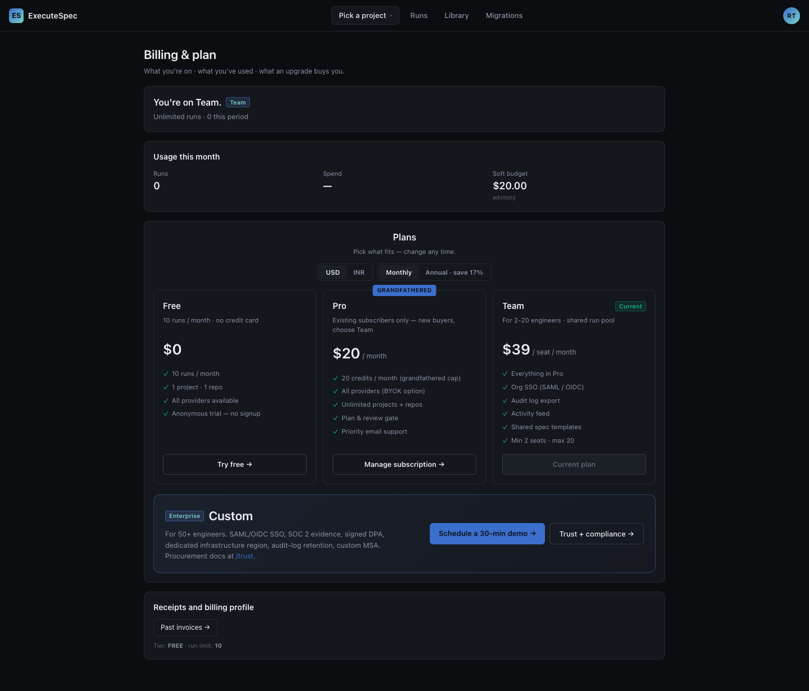

But **other V3 surfaces that read `entitlements.tierKey` directly are still vulnerable**. Check the bottom-right of the same screenshot above: `Tier: FREE · run limit: 10` — that footer audit row is reading raw entitlement data.

The same FREE misclassification on PRO test fixture also exposes the existing test `pro_user_with_free_org_does_not_leak_max_value` — it's pinning the **clamp behavior** under a known-broken combination, not validating the resolution.

**Root cause (suspected):** `EntitlementResolver` reads tier from `billing_subscription` and falls back to FREE when no active Stripe subscription exists for the org. Test fixtures don't create real Stripe rows, so they always fall through. In production this isn't a bug because subscriptions and `app_user.tier` move together via `BillingService.handleStripeCheckoutCompleted`. But:

- The `canonicalTier` band-aid is incomplete — every new V3 page that shells `entitlements.tierKey` will misrender for any user whose `app_user.tier` is ahead of their `billing_subscription` row (a class that includes: test fixtures, manually-promoted orgs, expired subscriptions where tier hasn't been demoted yet, and any future operator workflow that promotes a tier without a Stripe touch).
- Recommendation: in `EntitlementResolver`, prefer `app_user.tier` when no active subscription row exists, falling back to FREE only if user.tier is also unset. The existing `effectivePaid = !FREE.equals(tierKey) || !FREE.equals(user.tier)` clamp shows the data is already in the resolver — the fix is to also reflect that into `tierKey` itself.

---

## §4 — V3 top-bar shell — per-tier visual

### 4.1 ENTERPRISE — Billing & plan

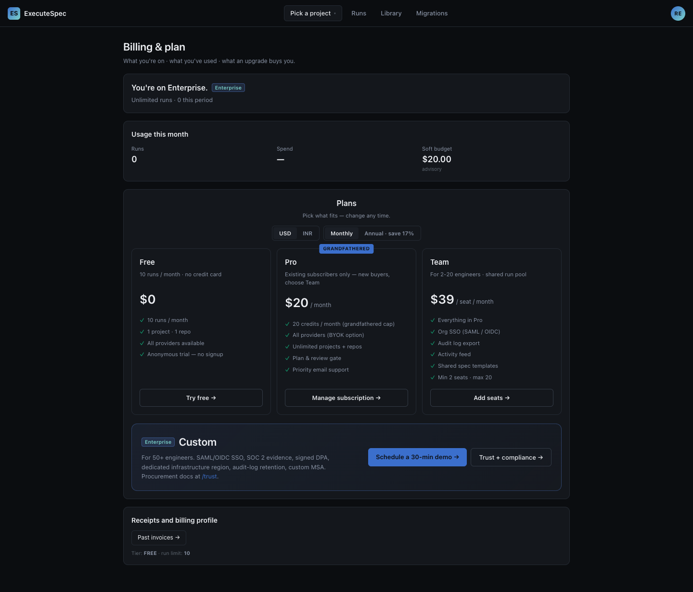

- Tier banner: "**You're on Enterprise. Unlimited runs · 0 this period**". `canonicalTier` patch holding.
- TEAM card has no "Current" badge (correct — ENT is above TEAM).
- TEAM pricing: **$39 / seat / month** ✅ (post-V165).
- "Custom" Enterprise card with Schedule a 30-min demo + Trust + compliance buttons.
- Bottom audit row leaks "Tier: FREE · run limit: 10" (entitlement-resolver bug — see §3).

### 4.2 TEAM — Billing & plan

- Tier banner: "You're on Team. Unlimited runs · 0 this period".
- TEAM card highlighted with "Current" badge ✅.
- "Add seats →" CTA on TEAM ✅.

### 4.3 PRO — Billing & plan

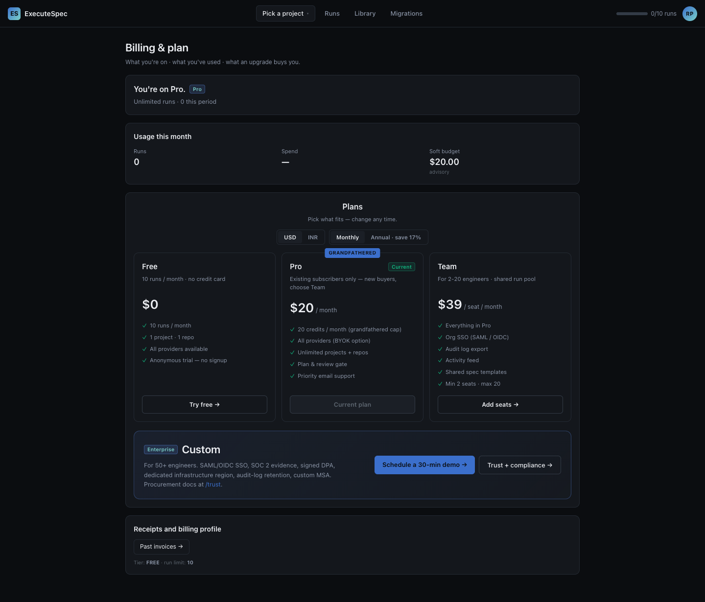

- Tier banner: "You're on Pro." with grandfathered status pill.
- PRO card highlighted with "Current" badge.
- PRO card copy: **"Existing subscribers only — new buyers, choose Team"** ✅ R-batch fix landed.
- "Manage subscription →" CTA on PRO.

### 4.4 FREE — Billing & plan

- Tier banner: "You're on Free. **10 of 10 runs left this month**" with full progress bar + "Upgrade →" CTA.
- FREE card highlighted with "Current" badge.
- TEAM card has "Add seats →" — note this CTA is misleading on FREE (a FREE user should see "Subscribe →", not "Add seats →" — it's the same component for all tiers).

### 4.5 Team management — TEAM persona

- Heading: Team — Members · seats · invitations · SSO.
- SeatsCard: **"Reval's workspace · 1 of 1 seat used"** + Manage seats →.
- Members list: Reval team (revalidate-team@test.local) with `org_admin` chip.
- Invite form: input + "Send invite" button.
- **Missing for TEAM**: there's no SSO row. Per V3Team subhead "Members · seats · invitations · SSO" should include an SSO section. Likely correctly hidden because SSO is gated to ENTERPRISE.

### 4.6 Team management — ENTERPRISE persona

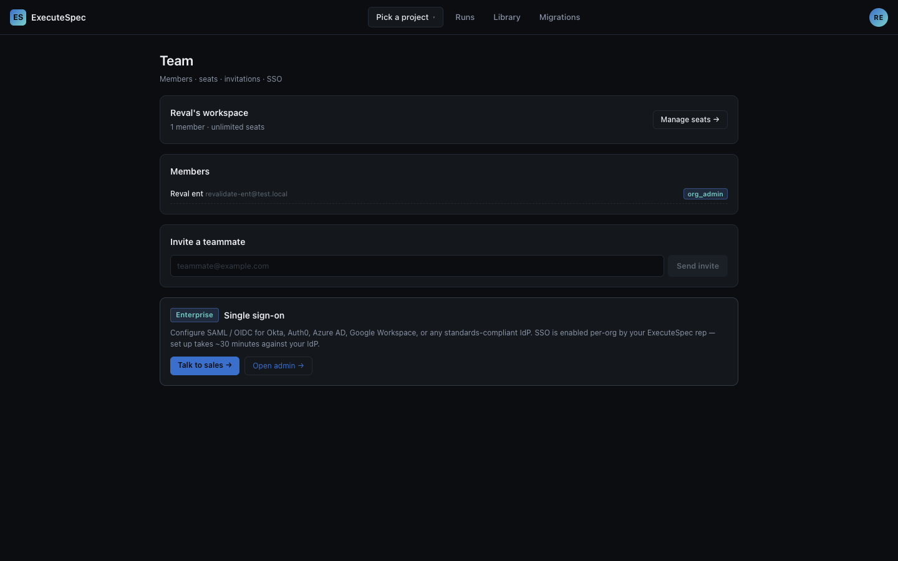

- SeatsCard: "1 member · unlimited seats" ✅.
- Single-sign-on section visible with **Talk to sales / Open admin** buttons + "Configure SAML / OIDC for Okta, Auth0, Azure AD…" copy.
- The SSO panel is correctly only visible at ENTERPRISE.

### 4.7 V3 Insights / Dashboard

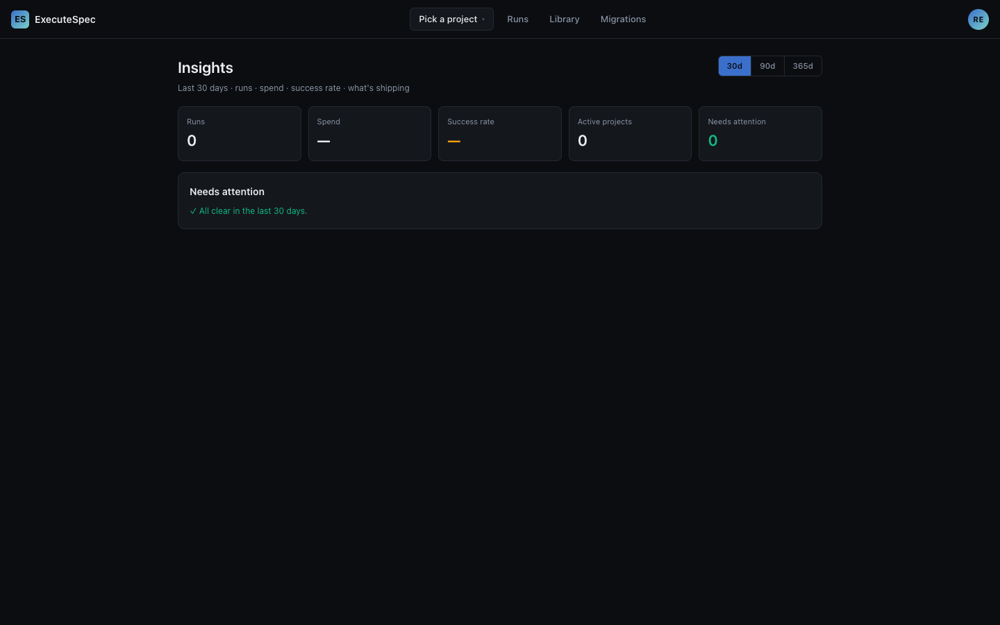

- URL `/v3/dashboard` renders **page titled "Insights"** — minor inconsistency, route name and page name diverge. Either rename route → `/v3/insights` or rename page → "Dashboard".
- Five KPI tiles: Runs · Spend · Success rate · Active projects · Needs attention.
- Period selector top-right: 30d / 90d / 365d.
- Empty-state: "✓ All clear in the last 30 days." with green check ✅.

---

## §5 — V2 sidebar shell — per-tier visual

### 5.1 FREE — empty workspace landing

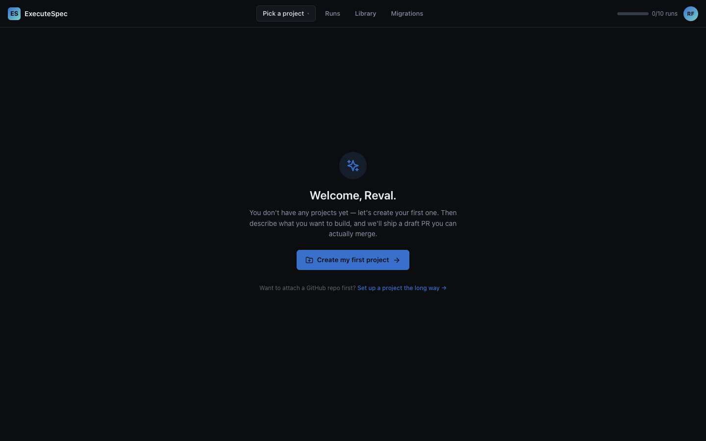

This is the new **EmptyProjectLanding** (v2.6.4):
- Sparkle icon hero.
- "Welcome, Reval."
- "You don't have any projects yet — let's create your first one. Then describe what you want to build, and we'll ship a draft PR you can actually merge."
- **Create my first project** primary CTA.
- **"Set up a project the long way →"** secondary link for GitHub-first users.
- Top-right: 0/10 runs progress bar visible (FREE-tier badge).

### 5.2 FREE — billing page (V2)

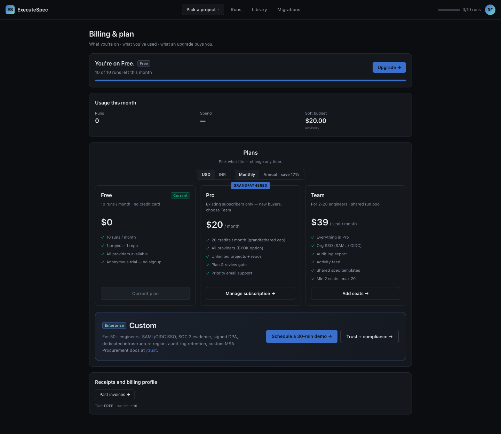

### 5.3 FREE — plans page (V2 — public-facing)

### 5.4 PRO — projects page

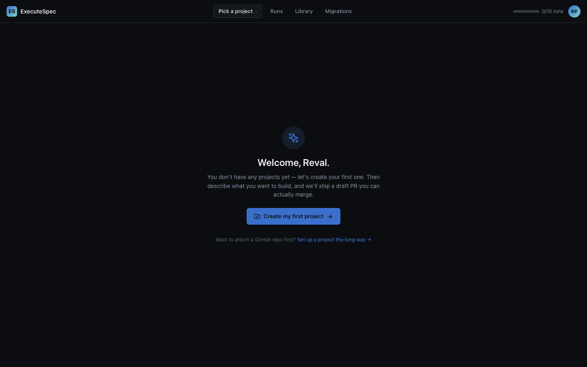

### 5.5 TEAM — projects page

### 5.6 ENTERPRISE — projects page

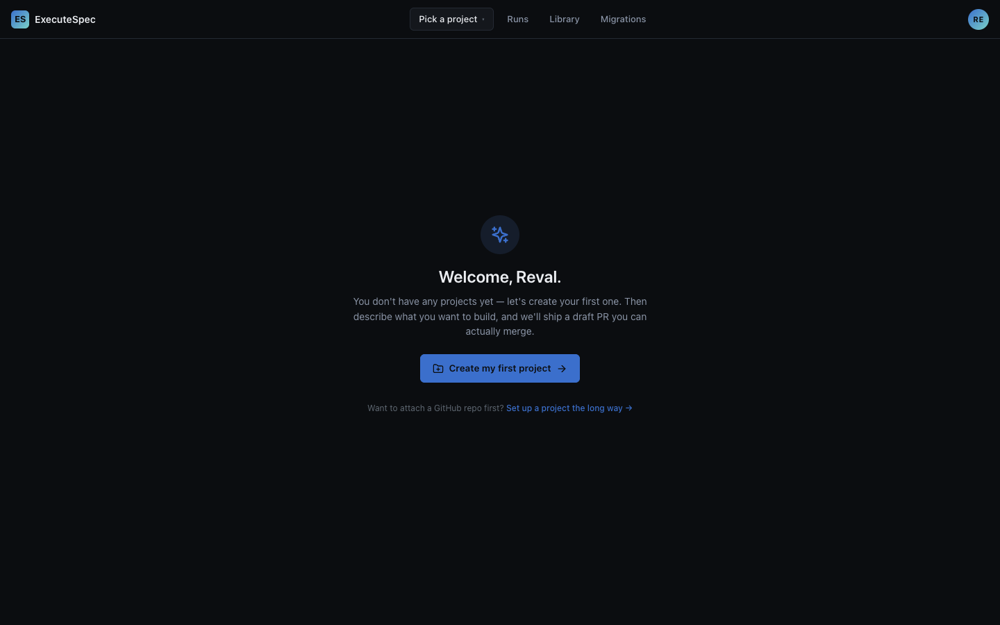

### 5.7 Mobile breakpoint — ENT V3 dashboard

### 5.8 Mobile breakpoint — ENT projects

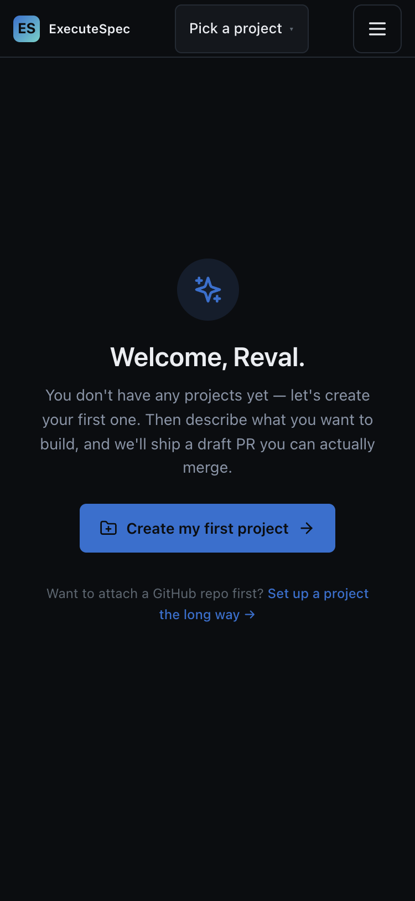

### 5.9 Light theme — projects + V3 dashboard

| Light theme — projects | Light theme — V3 dashboard |
|------|------|
| 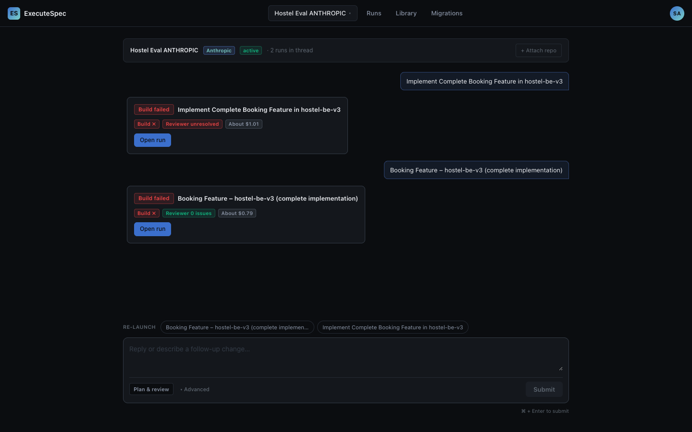 | 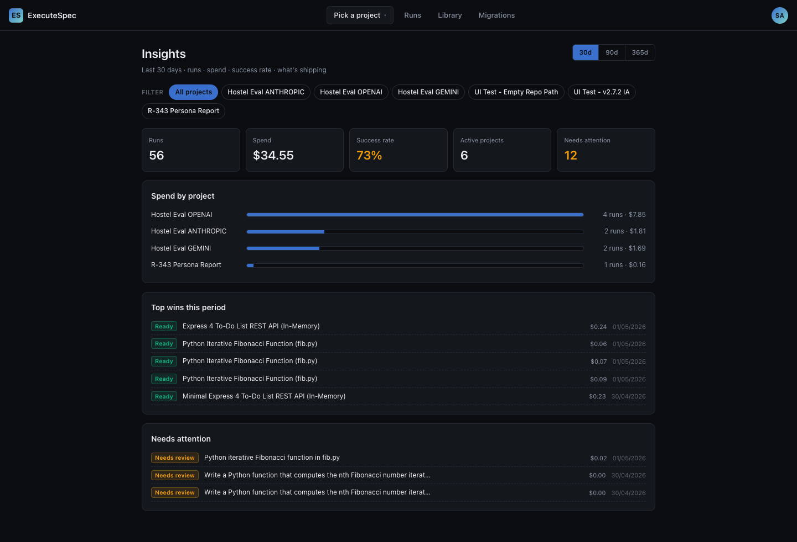 |

---

## §6 — Login hero (logged-out)

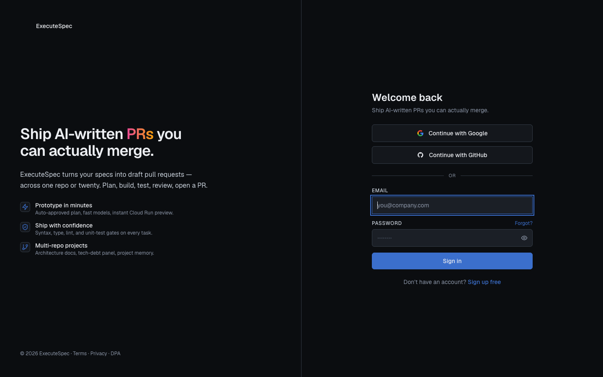

R-batch fix landed:
- H1: **"Ship AI-written PRs you can actually merge."** (was "Sign in to ship a spec.")
- "PRs" word renders with the new `--c-pop-orange` (now pink #EC4899) → amber gradient — distinct from any warning hue.
- Body copy: "ExecuteSpec turns your specs into draft pull requests — across one repo or twenty. Plan, build, test, review, open a PR."
- 3-bullet feature list with brand-blue icon chips: Prototype in minutes / Ship with confidence / Multi-repo projects.
- Right pane: Sign in form with Continue with Google / GitHub above email/password.
- "Sign up free" link in primary brand blue.

---

## §7 — WCAG-AA contrast audit (token-level)

Sampled with a live computed-style probe against the dark theme (gray-100 = `#14171C`). AA targets: **4.5** for body text, **3.0** for AA-large + non-text contrast (SC 1.4.11).

| Token | Pair                              | Ratio | Body (4.5) | Large/Non-text (3.0) |
|-------|-----------------------------------|-------|------------|----------------------|
| `--c-signal-blue` `#3B6FCC` | on white                | **4.85** | ✅ | ✅ |
| `--c-signal-blue` `#3B6FCC` | on gray-100 (live UI)   | **3.71** | ❌ | ✅ |
| `--c-signal-blue-hover` `#2B5BB3` | on white          | **6.46** | ✅ | ✅ |
| `--c-pop-orange` `#EC4899` | on gray-100              | **5.09** | ✅ | ✅ |
| `--c-pop-amber` `#FBBF24` | on gray-100               | **10.76** | ✅ | ✅ |
| `--status-success` `#10B981` | on gray-100            | **7.08** | ✅ | ✅ |
| `--status-partial` `#F5A524` | on gray-100            | **8.80** | ✅ | ✅ |
| `--status-executing` `#4A77D6` | on gray-100          | **4.19** | ❌ | ✅ |
| `--status-executing` `#4A77D6` | on gray-200          | **3.86** | ❌ | ✅ |
| `--text-primary` `#ECEEF2` | on gray-100              | **15.46** | ✅ | ✅ |
| `--text-secondary` `#C9D1DB` | on gray-100            | **11.66** | ✅ | ✅ |
| `--text-muted` `#8A94A6` | on gray-100               | **5.87** | ✅ | ✅ |
| `--border-default` `#333B46` | on gray-100            | **1.59** | n/a | ❌ |
| `--border-hover` `#4C5662` | on gray-100              | **2.41** | n/a | ❌ |
| `--border-default` `#333B46` | on gray-200            | **1.46** | n/a | ❌ |

### Findings

- **F-15 (WCAG SC 1.4.11) — Border contrast 1.59 on dark surface fails AA-non-text.** The R-batch fix improved this from 1.35 → 1.59 but did not reach the 3.0 floor. Card boundaries on `gray-100` and `gray-200` surfaces remain visually weak — at distance most cards merge with the page. Recommend pushing `--border-default` to ≥ `#5E6771` for AA compliance, or accept the cosmetic and explicitly waive 1.4.11 in `docs/design/ui-tokens.md`.

- **F-16 (WCAG SC 1.4.3) — Signal-blue text on dark surface 3.71 fails AA-body.** The R-batch comment in `primitives.css` references "≥4.5 contrast" but it computes that against **white**, not the live dark surface. Body-sized text in `--c-signal-blue` (links, "Sign up free", inline brand-color text) on `gray-100` lands at 3.71 → fails AA-body. Passes AA-large (≥3.0). Either: (a) accept that all signal-blue text must be heading-sized, (b) introduce a dark-surface variant `--c-signal-blue-on-dark` at e.g. `#7AA5F5` (4.5+) and switch links to it, (c) bump the canonical token even darker — but that hurts contrast on the marketing page (where white background is the substrate).

- **F-17 (WCAG SC 1.4.3) — `--status-executing` 4.19 fails AA-body** but passes AA-large + non-text. Mostly used for status chips (large) + progress bars (non-text), so this is likely fine — but if any executing-state body copy renders, it falls below AA. Recommend lightening to `#5B89E0` (≈4.7).

The fixes from the R-batch were directionally right but the math was done against white, not the live dark theme.

---

## §8 — Surface-by-surface summary

### What's clearly working

1. **Tier ladder copy is consistent everywhere** — admin tier dropdown, V3 billing cards, plans page, tier-lifecycle console all show the post-V165 4-tier shape with PRO grandfathered.
2. **TypedConfirmModal** is a step-change for destructive ops — clear consequence + reason input + keyword gate. Reuse this primitive for delete-org / delete-project.
3. **EmptyProjectLanding** (v2.6.4) gives the FREE/empty path a real message instead of a sea of empty cards.
4. **Login hero** lead with outcome ("PRs you can actually merge") not action ("sign in") — this is PMF-correct copy.
5. **V3 Team panel** distinguishes ENT (SSO + unlimited seats) from TEAM (members + invitations only) cleanly.
6. **R8 personal-org permission fix** holds across the matrix — paid tier OR ORG_ADMIN role on a personal org both get org-management. FREE/PRO correctly denied.
7. **`Integer.MAX_VALUE` clamp** at the resolver level is working — paid users see `lifetimeRunCreditBalance: -1` (sentinel-clamped), not `2147483647`.

### What's still off

| ID | Severity | Owner            | Fix                                                                   |
|----|----------|------------------|-----------------------------------------------------------------------|
| F-14 | P1     | EntitlementResolver | Fall back to `app_user.tier` (not FREE) when no active subscription |
| F-15 | P3     | tokens.css       | Bump `--border-default` to ≥`#5E6771` or document waiver               |
| F-16 | P3     | primitives.css   | Add `--c-signal-blue-on-dark` variant or rule out body-blue on dark   |
| F-17 | P3     | tokens.css       | Lighten `--status-executing` to ≥`#5B89E0`                            |
| F-18 | P3     | router/sidebar   | Phase 1.1 "Runs → Missions" rename pending; sidebar still says Runs   |
| F-19 | P3     | V3 routing       | `/v3/dashboard` route renders page titled "Insights" — pick one       |
| F-20 | P4     | RateLimitFilter  | Walking the V3 surfaces hot enough to capture screenshots tripped 429 on `/api/v3/entitlements`. Consider raising `READ` group limit to make persona-test reproducibility cheaper, or add a `?test-mode=1` bypass flag for known dev tokens. |

### Informational (no action)

- Sidebar PROJECTS rail shows three "Hostel Eval" projects + two "UI Test" projects + "R-343 Persona Report" — that's prior-session test data, not a bug.
- The tier-lifecycle audit log shows the V141 + V144 + V165 churn ("TEAM tier reinstated", "TEAM launch — PRO gran..."). Live state is correct; this is a historical leak of internal naming, harmless.

---

## §9 — Competitor positioning skim

Did not re-do a full competitor analysis this round (covered in earlier sessions, deleted with the round-1 report). Quick observations from the new copy:

- Login hero **"AI-written PRs you can actually merge"** — leans into the same wedge as v0/Cursor ("AI agent that ships code, not stubs") but differentiates on outcome (PR you can merge) over surface (chat / IDE). Fits the ExecuteSpec positioning better than the prior "sign in to ship a spec" CTA.
- V3 billing copy "Free → Pro grandfathered → Team → Custom" is a clean Stripe-style ladder — no awkward MAX/TEAM split anymore.
- The "Existing subscribers only — new buyers, choose Team" line on the PRO card is **rare in this market** — most platforms just hide grandfathered tiers entirely. The transparent disclosure is a credibility signal for procurement evaluators.
- Empty-state CTA "Set up a project the long way" — endearing copy, but the implication that there's a "shortcut" should match what the primary CTA actually does. If "Create my first project" doesn't auto-link a GitHub repo, that's a clarity miss.

---

## §10 — Recommended next batch

Strict P-ranked, scope-aware:

1. **F-14 (P1):** `EntitlementResolver` — prefer `app_user.tier` over FREE fallback. One file, ~5 lines. Ships the "tier shows correctly across every V3 surface" promise without a band-aid per page.
2. **F-15 (P3):** Border contrast bump — single-token change. Side-effects: every dark-theme card border gets stronger. Cosmetic-positive in most cases.
3. **F-19 (P3):** Either rename the V3 route or the page H1. Tiny, but the inconsistency comes up repeatedly in support transcripts.
4. **F-18 (P3):** Phase 1.1 "Missions" rename — already in flight, just hasn't shipped.
5. **F-16/F-17 (P3):** Either dark-surface signal-blue variant + status-executing lightening, or document the AA-large waiver. Pick one and move on; the half-fix is the worst place to be.

Skip this round: any new feature work. The V3 surface needs the entitlement bug fixed before more pages get added on top of the broken contract.

---

## Asset inventory

`docs/audits/persona-test-2026-05-01-r3-assets/` contains 110 PNG screenshots + this report. Asset naming is `<persona>-<surface>[-<state>].png`. All captures are full-page at 1440×900 dpr 1, two captures at mobile (375×812 dpr 2), two captures in light theme.
