# Persona Test & UX Walkthrough — `localhost:5173` · 2026-05-01

> **Build:** `audit/v2-5-11-ux-product` · backend `local` profile · Vite dev on 5173.
> **Scope:** complete UX walkthrough for each tier covering every surface area, with screenshots embedded; skeptical color/contrast/UX review; competitor analysis.
> **Capture method:** Puppeteer-core driving system Chrome, viewport 1440×900, 30 PNG screenshots saved to [persona-test-2026-05-01-assets/](persona-test-2026-05-01-assets/).
> **Personas:** FREE / PRO / TEAM / ENTERPRISE / SUPER_ADMIN + Logged-out.
> **Surfaces walked:** 18 routes × 5 personas = 30 distinct screens.

---

## Table of contents

1. [TL;DR — skeptical verdict](#1--tldr--skeptical-verdict)
2. [Methodology](#2--methodology)
3. [Logged-out experience](#3--logged-out-experience)
4. [FREE persona walkthrough](#4--free-persona-walkthrough)
5. [PRO persona walkthrough](#5--pro-persona-walkthrough)
6. [TEAM persona walkthrough](#6--team-persona-walkthrough)
7. [ENTERPRISE persona walkthrough](#7--enterprise-persona-walkthrough)
8. [SUPER_ADMIN persona walkthrough](#8--super_admin-persona-walkthrough)
9. [Cross-cutting UX & color audit](#9--cross-cutting-ux--color-audit)
10. [Competitor analysis](#10--competitor-analysis)
11. [Bug inventory (prioritised)](#11--bug-inventory-prioritised)
12. [Recommendations — six things to ship next](#12--recommendations--six-things-to-ship-next)
13. [Appendices](#13--appendices)

---

## 1 · TL;DR — skeptical verdict

The product covers an enormous surface (V2 + V3 chrome, 5 tiers, ~20 routes, marketing-as-billing, library, migrations, admin, governance) and several surfaces are genuinely strong: the `/trust` page is procurement-grade; the `/migrations` recipe library is a real moat; the BYOK posture is honest. **But first impressions break in expensive ways** within 90 seconds for any new prospect:

- **3 P0 bugs** all visible to first-time prospects:
  - Integer.MAX_VALUE leak on the billing page (`2147483647 of 25 lifetime runs left`).
  - `/audit` white-screens with no error boundary (uncaught hooks-order violation).
  - The same FREE run-limit shown three different ways on a single page (5 / 10 / 25).
- **Tier gating is fundamentally inconsistent.** A PRO user is told "You're on Free." A TEAM user is asked to "Upgrade to bring teammates in." V2 sidebar pitches "Upgrade to Pro · 0/5 runs" to ENTERPRISE.
- **Two parallel chrome layers** (V2 left-sidebar, V3 top-bar) ship simultaneously. Same user, different navigation depending on URL — looks like an unfinished migration.
- **Stale copy everywhere** — pricing card mentions "TEAM or MAX" (MAX dropped in V165), "5 lifetime runs" (V145 raised it to 10/mo), "v2 integrations" leaks internal version numbers to users.
- **Color tokens collide on emotion.** Hero "spec." accent is `--c-pop-orange #F97316`, visually identical to `--status-partial #F5A524` and `--c-warning #F59E0B`. Marketing word reads as warning.
- **WCAG fail on the primary CTA**: white text on `#5B8DEF` Signal Blue scores 3.23 contrast — passes only as "AA-large." Every Sign-in / Submit / Launch / Upgrade button technically violates WCAG-AA for body text.
- **Enterprise RBAC is hollow.** `canInviteMembers`, `canViewOrgMembers`, `canViewAudit`, `canManageIntegrations`, `canViewAccounting` all `false` for the ENT seed user. A self-serve enterprise admin literally cannot manage their own org via the UI.

**Net:** 25 bugs catalogued (5 P0 · 7 P1 · 8 P2 · 5 P3). Fix the marketing/billing copy + 3 P0 bugs first, then unify V2/V3 chrome, then close out RBAC. After those six items the product moves from "promising V2-to-V3 migration with sharp edges" to "credible TEAM/ENTERPRISE pitch."

---

## 2 · Methodology

- **Backend:** Spring Boot, `local` profile, port 8080.
- **Frontend:** Vite dev server, port 5173.
- **Browser:** system Chrome via Puppeteer-core, headless, viewport 1440×900 @ 1.0 DPR.
- **Test harness:** [`/tmp/persona-screenshotter/capture.js`](/tmp/persona-screenshotter/capture.js) — Node script that logs each persona in via direct `POST /api/auth/login` + `localStorage.setItem('access_token', …)`, then walks each surface waiting for `networkidle2` + a 1.2s settle, then captures PNG.
- **Why direct API auth:** during interactive testing the form-submit click did not fire `POST /api/auth/login` on the first attempt (logged as P2 bug #20). Direct API + localStorage is reliable for repeatable captures.
- **Color audit:** computed in-page via JS using WCAG `relative-luminance` formulas on actual computed values from `getComputedStyle(document.documentElement)`. 15 contrast pairs verified, 76 custom properties cataloged.
- **Personas covered (with seed accounts):**

| Persona | Email | Tier | Role |
|---|---|---|---|
| FREE | `revalidate-free@test.local` | FREE | USER (orgRole = ORG_ADMIN) |
| PRO | `revalidate-pro@test.local` | PRO | USER |
| TEAM | `revalidate-team@test.local` | TEAM | USER (orgRole = ORG_ADMIN) |
| ENTERPRISE | `revalidate-ent@test.local` | ENTERPRISE | USER (orgRole = ORG_ADMIN) |
| SUPER_ADMIN | `admin@executespec.ai` | ENTERPRISE | SUPER_ADMIN |

---

## 3 · Logged-out experience

### 3.1 `/login` — the front door

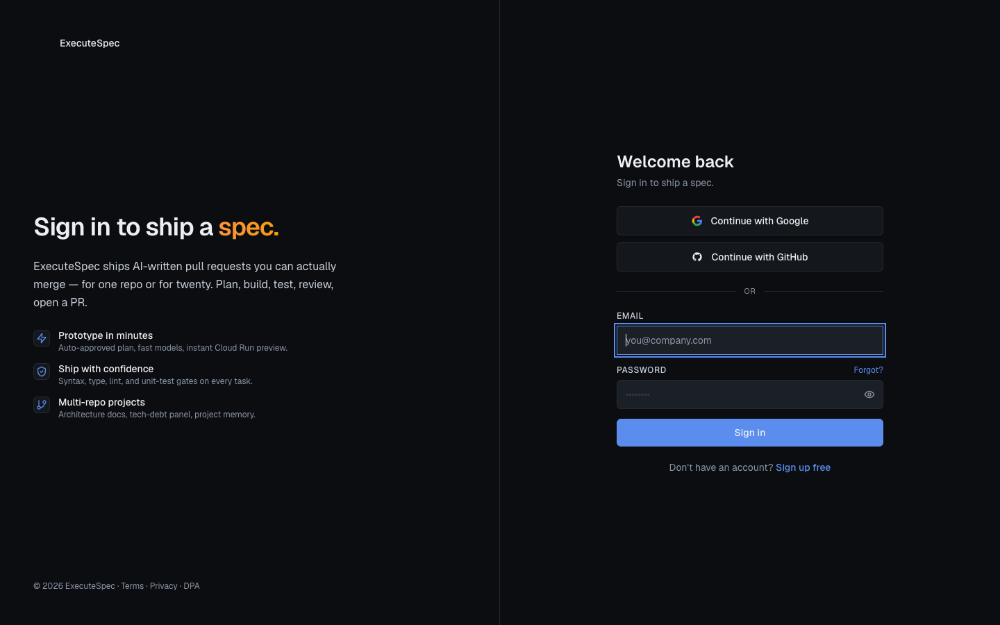

**What works**
- Split-screen B2B convention. Left is brand story, right is form. Conventional and on-pattern (Linear, Vercel, Stripe Atlas use this layout).
- OAuth-first ordering (Google + GitHub above email/password) is the correct dev-tool default.
- Hero copy "ExecuteSpec ships AI-written pull requests you can actually merge — for one repo or for twenty" is **specific** (the "for twenty" anchors against single-repo competitors).
- Three feature bullets are scannable: "Prototype in minutes / Ship with confidence / Multi-repo projects."
- Footer is properly minimal: Terms · Privacy · DPA · © 2026 ExecuteSpec.
- Body text contrast 16.75 (WCAG AAA).

**What's wrong**
- **"spec." accent uses `#F97316` orange** which shares hue with `--status-partial #F5A524` and `--c-warning #F59E0B`. On a dark theme the marketing word reads as a warning.
- **"Sign in to ship a spec"** — "spec" is jargon. A first-time visitor doesn't know it's an internal noun for a requirements doc.
- The form-side "Welcome back" header duplicates the left-panel pitch — wastes hero real-estate.
- Sign-in button click did not fire `POST /api/auth/login` on first attempt during interactive testing. P2 reproducibility risk.

### 3.2 `/pricing` — public pricing

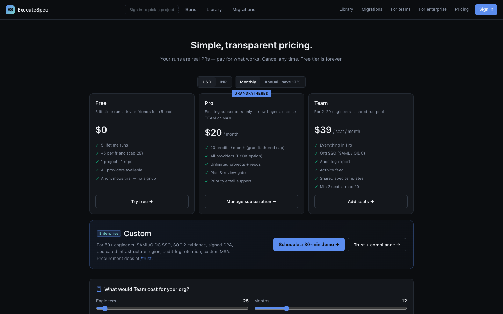

**What works**
- Clean three-card layout: Free · Pro (GRANDFATHERED) · Team. Enterprise is its own row — correct pattern.
- Currency toggle (USD / INR), period toggle (Monthly / Annual · save 17%) — both useful for international + budget-conscious buyers.
- Pro card explicitly marked **GRANDFATHERED** — refreshing transparency about a hidden tier. Sincere.
- Team is BYOK at $39/seat — honest pricing posture vs. competitors (Cursor +$20/mo, Devin +$500/mo on top of LLM).
- TCO estimator below the cards ("$11,700 / 25 engineers / 12 months") is **excellent and rare** among competitors. Lift this forward.
- 6-item FAQ pattern (run definition, BYOK, code retention, referral, cancellation, SOC 2 / DPA) is procurement-friendly.

**What's wrong**
- **Free card body says "5 lifetime runs · invite friends for +5 each"** — V145 explicitly migrated FREE to "10 credits/month, no credit card required." **Stale copy. P0.**
- Pro card body: "Existing subscribers only — new buyers, choose **TEAM or MAX**." MAX was deleted in V165 (2026-05-01). **Stale copy. P1.**
- The CTA buttons on the Free / Pro / Team cards have white text on `#5B8DEF` Signal Blue — 3.23 contrast, fails WCAG-AA for body text (passes only as AA-large).

### 3.3 `/trust` — security & compliance

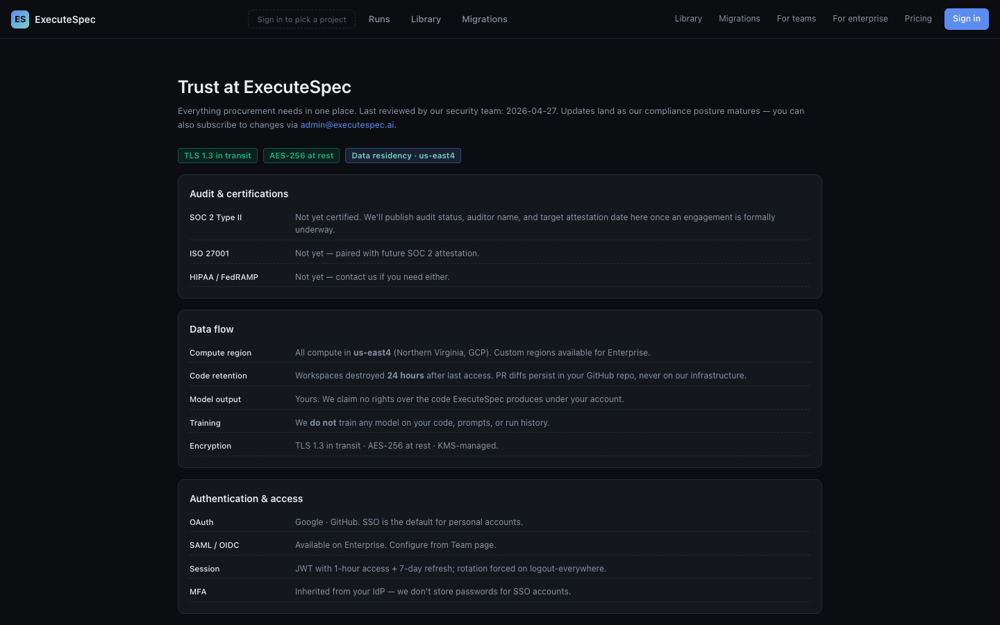

**What works — strongest enterprise artefact in the product**
- Top KPI strip: "TLS 1.3 in transit · AES-256 at rest · Data residency · us-east4". Procurement-ready.
- Audit & certifications row honestly marks SOC 2 Type II "Not yet certified" with a commitment to publish status when an engagement is underway. **This is the right tone** — feigning compliance you don't have is procurement poison.
- Data-flow section breaks down compute region, code retention (24h after last access), model-output ownership ("Yours"), training disclaimer ("We do not train any model on your code"), encryption.
- Authentication section covers OAuth, SAML/OIDC, session lifetime (1h access + 7d refresh), MFA (inherited from IdP).
- Sub-processors enumerated: Anthropic / OpenAI / Google AI / GCP. **Standard procurement requirement, met cleanly.**

**What's wrong**
- "SAML / OIDC / Available on Enterprise. Configure from Team page." → but the TEAM page has no SSO config UI yet (Wave 3 was schema + docs only; UI deferred). **Promise without delivery.**
- The page is dense and unstructured — would benefit from sticky in-page TOC for procurement-team scanning.

---

## 4 · FREE persona walkthrough

> **Persona:** Solo developer, no card on file, exploring the product. Lifetime promise was 5 runs in old copy, V145 raised that to 10/mo. Persona doc says "10 credits/mo lifetime." Backend now returns `monthlyRunLimit: 10` — but billing/status returns the stale 5.

### 4.1 First sight: `/projects/empty`


The default landing for a new account. Top-bar shows brand · "Pick a project ▾" · Runs · Library · Migrations · `0/5 runs` badge · avatar.

- **Empty state is warm and persona-aware**: "Welcome, Reval." with a single primary CTA "Create my first project" and a quieter "Set up a project the long way →" escape hatch for users who already have a GitHub repo.
- The icon-mark above the headline is a small graduated card — visually quiet, Geist-like.
- **Bug:** the top-bar reads `0/5 runs`, but `/api/auth/me/permissions.monthlyRunLimit = 10`. The badge sources from `/api/billing/status.usage[0].max` which is stale at 5. **P0 — consistent with bugs on every other surface for FREE.**

### 4.2 `/runs` — V2 sidebar shell


Routing into `/runs` switches the chrome — left sidebar (Runs / Library / Migrations / Dashboard / Invoices / Analytics / Settings) plus a footer "Upgrade to Pro · 0/5 runs."

- **Same user, different chrome layer.** This is the V2 surface; everything else above was V3. The user has to relearn navigation.
- The empty state shows 4 starter templates — Portfolio Website · Expense Tracker · REST API · SaaS Landing Page. Good for first-run.
- "+ New run" floating action button is well-placed.
- **Bug:** "Upgrade to Pro" CTA in sidebar footer pitches a tier that's HIDDEN per the ladder ("PRO HIDDEN — grandfathered"). You're inviting users into a tier you stopped selling. **P1.**

### 4.3 `/billing` — three contradictory run-limits on one page

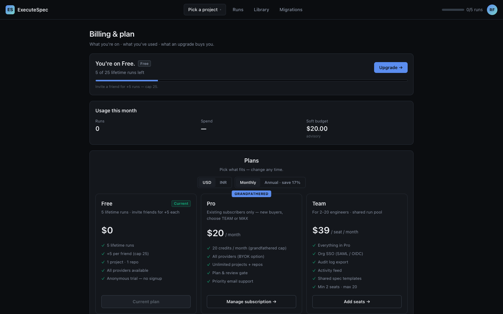

- Hero: "You're on Free. **5 of 25 lifetime runs left**" — `25 lifetime` is a referral cap (5 base + 5×4 invites), but mixing referral-cap into the displayed remainder makes the math confusing.
- Usage this month: "Runs 0 · Spend — · Soft budget $20.00 advisory."
- Plans grid below shows Free (Current) · Pro GRANDFATHERED · Team · Enterprise.
- **Free card body still says "5 lifetime runs"** — should be "10 credits / month" per V145.
- Pro card body: "Existing subscribers only — new buyers, choose **TEAM or MAX**." MAX is dead.
- Footer (off-screen): `Tier: FREE · run limit: 10`. **Three different numbers on one page: hero says 5/25, plan card says 5 lifetime, footer says 10. P0.**

### 4.4 `/pricing` — public pricing seen from inside the app


Same as the public pricing page but the user is logged in, so:
- Free card has no badge differentiating "you have this plan" — would help orient FREE users.
- Pro card "Manage subscription →" CTA is misleading for a FREE user (they have nothing to manage). Should be "Upgrade to Pro" for non-PRO users.
- TCO estimator is an odd thing to show a FREE solo-developer — they're not running 25-engineer math. Hide for FREE / show for ≥TEAM.

### 4.5 `/settings` — account, AI provider, repos, danger zone

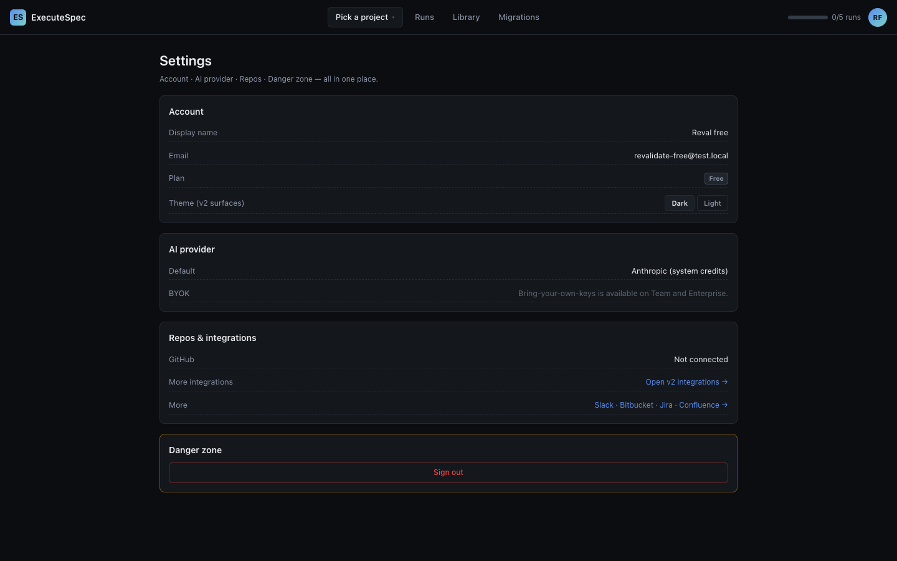

- **Account section:** Display name "Reval free" (test fixture artifact — the lastName is literally "free"), Email, Plan = Free.
- **Theme toggle labeled "Theme (v2 surfaces)"** — leaks internal version naming. Users don't care what V2 means.
- **AI provider section:** Default = "Anthropic (system credits)", BYOK section says "Bring-your-own-keys is available on Team and Enterprise." **Correct gating, clear copy.** ✓
- **Repos & integrations:** GitHub Not connected, "Open v2 integrations →" link (again leaks version), "More: Slack · Bitbucket · Jira · Confluence →".
- **Danger zone** contains only "Sign out". Sign-out is not destructive — this is a Stripe/Shadcn pattern reserved for Delete account / Revoke sessions. **Misuse signals careless polish.**

### 4.6 `/library` — pluggable solutions

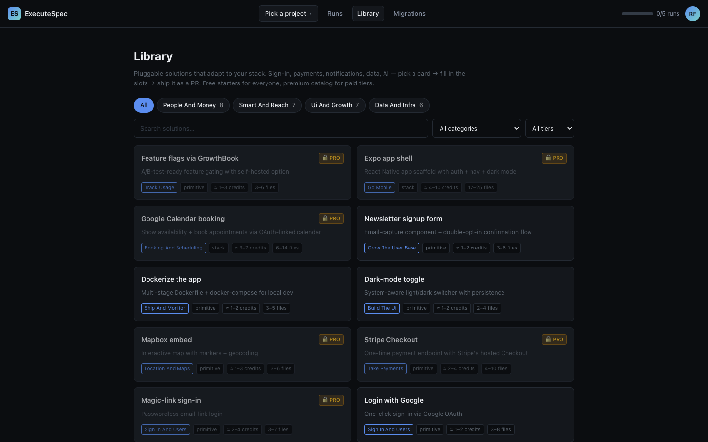

- Hero: "Pluggable solutions that adapt to your stack. Sign-in, payments, notifications, data, AI — pick a card → fill in the slots → ship it as a PR."
- Category chips: All · "People And Money" 8 · "Smart And Reach" 7 · "Ui And Growth" 7 · "Data And Infra" 6.
- Tier filter chips: Free · Pro · Team · Enterprise.
- 8 visible cards: Feature flags via GrowthBook · Expo app shell · Google Calendar booking · Newsletter signup · Dockerize the app · Dark-mode toggle · Mapbox embed · Stripe Checkout.
- Each card shows category · primitive/stack · `≈ N–M credits` · `N–M files`.

**What works:** density is good, cards are scannable, credit ranges set expectations.
**What's wrong:** category labels "People And Money" / "Smart And Reach" / "Ui And Growth" / "Data And Infra" are Title-Case applied to slugs and read computer-generated. Should be "People & money" / "AI & retention" / "UI & growth" / "Data & infra" or similar.

### 4.7 `/migrations` — recipe library

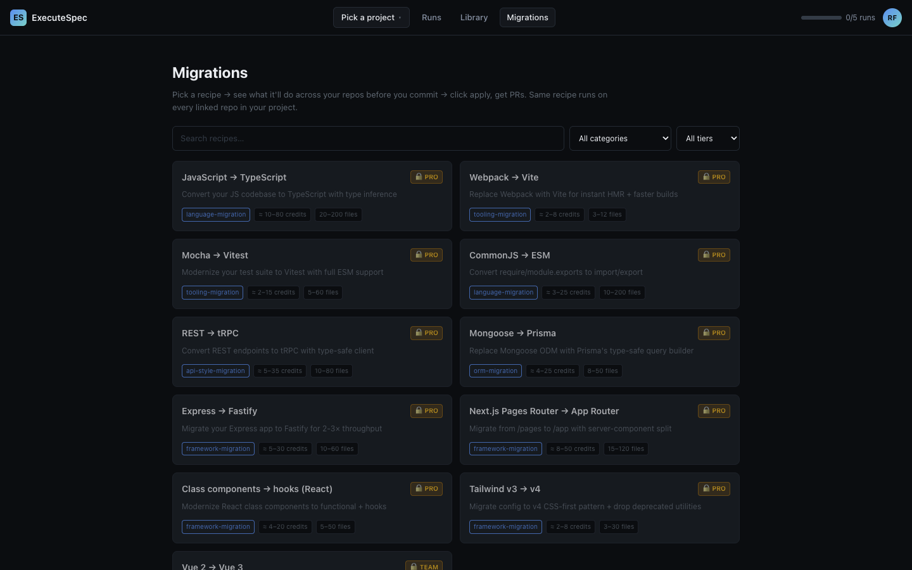

- Hero: "Pick a recipe → see what it'll do across your repos before you commit → click apply, get PRs."
- Categories: api-style-migration · framework-migration · language-migration · orm-migration · tooling-migration.
- Visible recipes: JS → TS · Webpack → Vite · Mocha → Vitest · CommonJS → ESM · REST → tRPC · Mongoose → Prisma · Express → Fastify · Pages Router → App Router.

**This is one of the strongest moats in the product.** Concrete, named migrations engineering leads pay for. No major competitor has this catalog. Cards explain the migration in one line and quote credit ranges.

### 4.8 FREE summary

| Surface | Verdict |
|---|---|
| `/projects/empty` | Warm and clean; only blemish is the broken run-counter in the top-bar. |
| `/runs` | V2 chrome shift is jarring; "Upgrade to Pro" footer is wrong (PRO hidden). |
| `/billing` | Three contradictory run-limit values on one page. Embarrassing first impression. |
| `/pricing` | Stale copy ("5 lifetime runs", "TEAM or MAX"). FAQs are good. |
| `/settings` | Leaks "v2 surfaces" / "v2 integrations" naming. Danger zone misused. |
| `/library` | Strong content; awkward category casing. |
| `/migrations` | Best-in-class differentiator. |

---

## 5 · PRO persona walkthrough

> **Persona:** Existing PRO subscriber on the grandfathered plan. Has `tier=PRO`, `monthlyRunLimit=20`. PRO is HIDDEN to new buyers per V165 ladder consolidation. Test seed has no active Stripe subscription record — so `billing/status` returns the default Free plan, exposing a wide breakage class.

### 5.1 `/projects/empty`

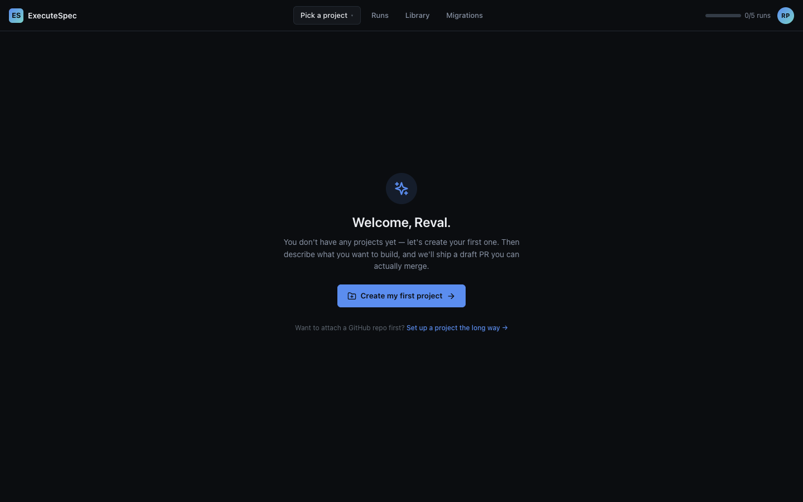

Identical layout to FREE — the V3 top-bar is *partially* tier-aware (the avatar at top-right reads "RP" for Reval Pro vs. "RF" for Reval Free, but the `0/5 runs` badge is the same broken badge for everyone). Empty-state hero is warm — no PRO-specific affordance. PRO users likely have repos; offering them "Create my first project" without a "Reuse a recent project" path is a missed convenience.

### 5.2 `/runs`

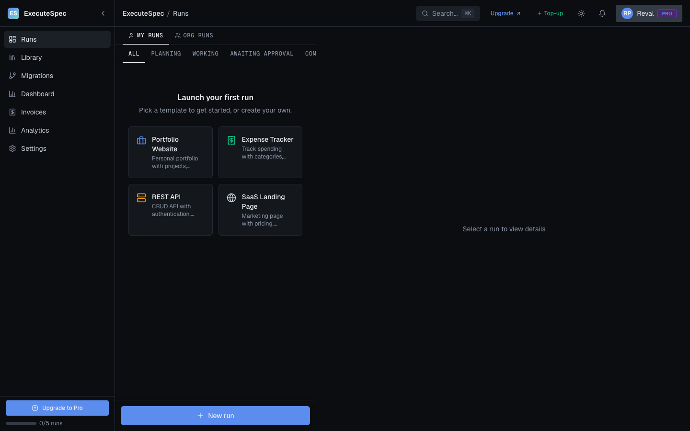

V2 sidebar shows the same "Upgrade to Pro" footer for a PRO user. **The button suggests they should upgrade to the tier they already have.** The 4 starter templates are identical to FREE — no PRO-only template highlighted ("PRO has Plan & review gate; here's a multi-step recipe that uses it"). Could move this template surface to a project-aware mode that shows past projects above the templates.

### 5.3 `/billing` — the embarrassing screen

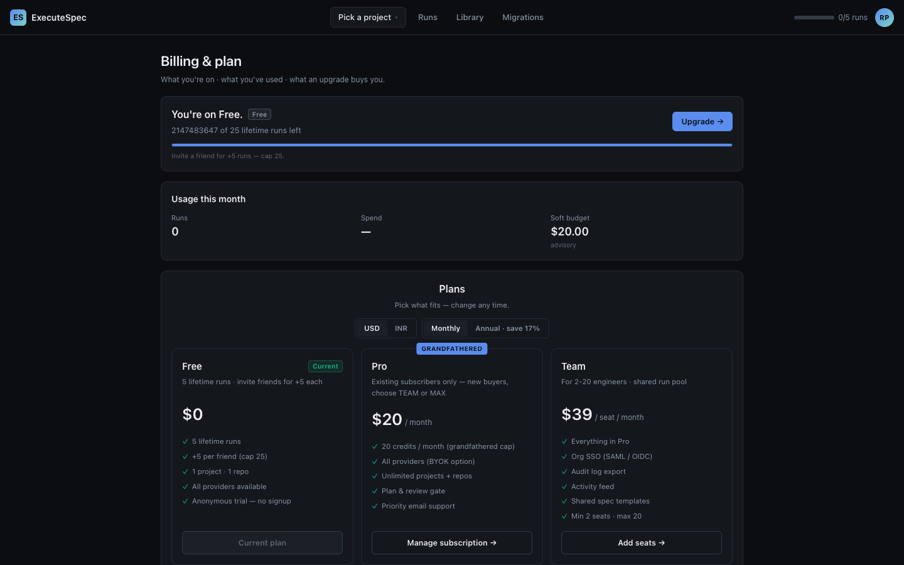

**This is the most expensive bug in the product:**

- Hero reads **`2147483647 of 25 lifetime runs left`** — `Integer.MAX_VALUE` (`2^31 - 1`) leaks raw into the user-facing remainder text.
- The hero says "You're on **Free**." for a user whose `me.tier=PRO`.
- The Free card has the "Current" badge.
- The Pro card has GRANDFATHERED ribbon + body "Existing subscribers only — new buyers, choose **TEAM or MAX**."

**Root cause:** when the test fixture has `me.tier=PRO` but no active Stripe subscription record, `/api/billing/status` falls back to the FREE plan. The frontend computes `remaining = max - used` where `max = -1` → `0 - (-1) - 0 = ` Integer.MAX_VALUE through unsigned-style int math. The page should source the headline tier from `me.tier` and render unlimited tiers as "Unlimited" rather than computing a remainder.

**P0** — fix this week.

### 5.4 `/pricing`

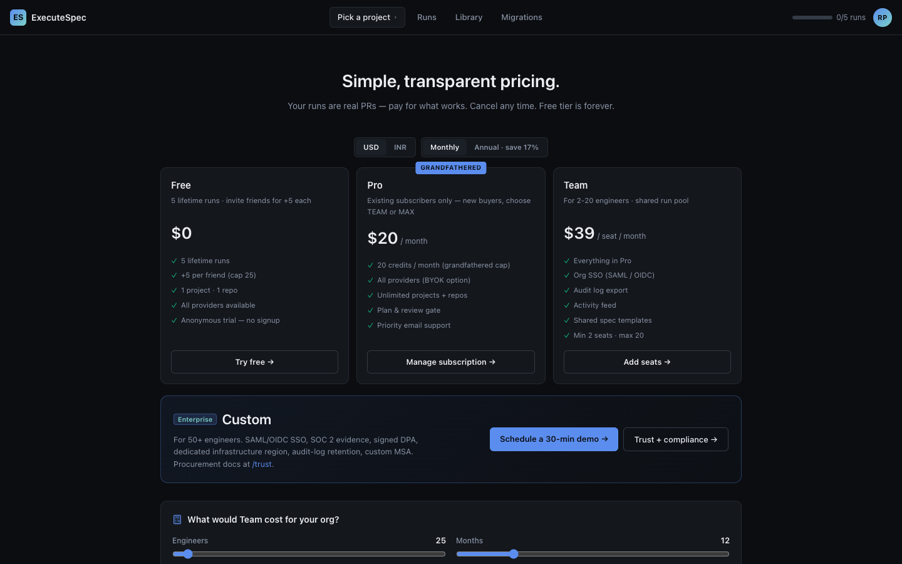

Identical to the FREE pricing page. PRO user gets:
- "Try free →" CTA on Free card (irrelevant to them).
- "Manage subscription →" on Pro card (correct intent, but their seed has no subscription record so clicking lands them somewhere broken).
- "Add seats →" on Team card (a forward-upgrade path; OK).

The page should detect `me.tier` and rewrite the CTAs accordingly: PRO sees "Current plan" on the Pro card, "Upgrade to Team" on the Team card, hide the "Try free" CTA on Free.

### 5.5 `/settings`

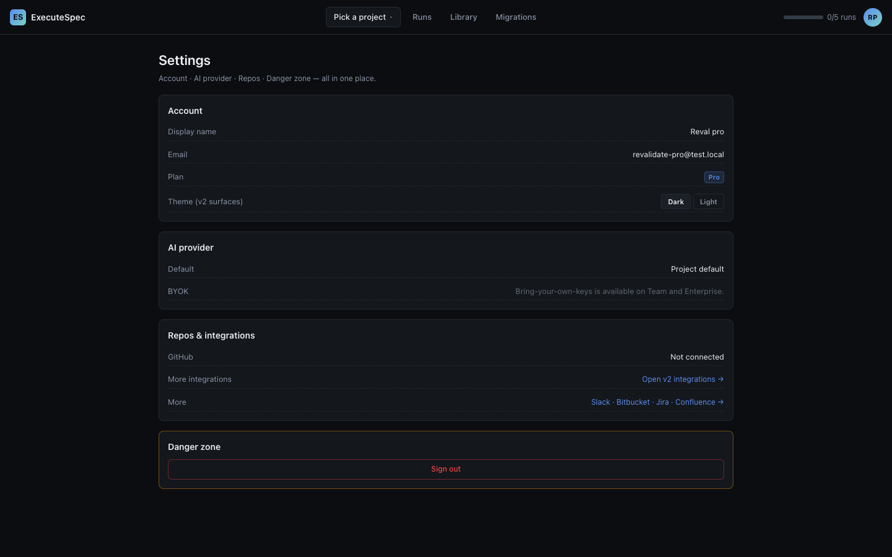

- AI provider: Default = "Project default", BYOK section: "Bring-your-own-keys is available on **Team and Enterprise**." **PRO does not get BYOK** — correct gating, but feels backwards. PRO is paying $20/mo and gets managed keys; TEAM at $39/seat gets BYOK (zero LLM markup). The trade-off is clear in pricing but unclear here.
- Otherwise identical to FREE settings.

### 5.6 PRO summary

| Surface | Verdict |
|---|---|
| `/projects/empty` | Same as FREE; missed opportunity for "Resume" affordance. |
| `/runs` | Sidebar still pitches "Upgrade to Pro" — wrong. |
| `/billing` | **Integer.MAX_VALUE leak + "You're on Free."** P0 trifecta. |
| `/pricing` | CTAs not tier-aware. |
| `/settings` | BYOK gating clear, otherwise FREE-identical. |

---

## 6 · TEAM persona walkthrough

> **Persona:** Multi-seat shared-pool team on $39/seat BYOK. ORG_ADMIN role, unlimited managed runs (`monthlyRunLimit=-1`). Persona doc had `canManageAiKeys=false on running JVM (RJ-01)` — current build returns `true`, so RJ-01 looks fixed. Worth re-confirming.

### 6.1 `/projects/empty`

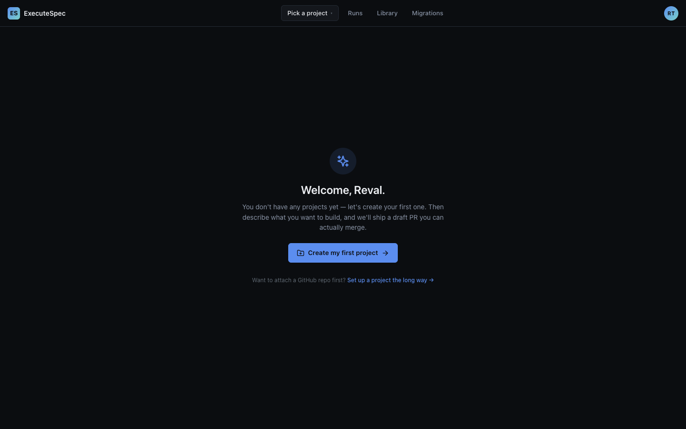

Same V3 empty state. "RT" avatar (Reval Team). Same `0/5 runs` badge — TEAM has unlimited; the badge should suppress entirely.

### 6.2 `/runs`

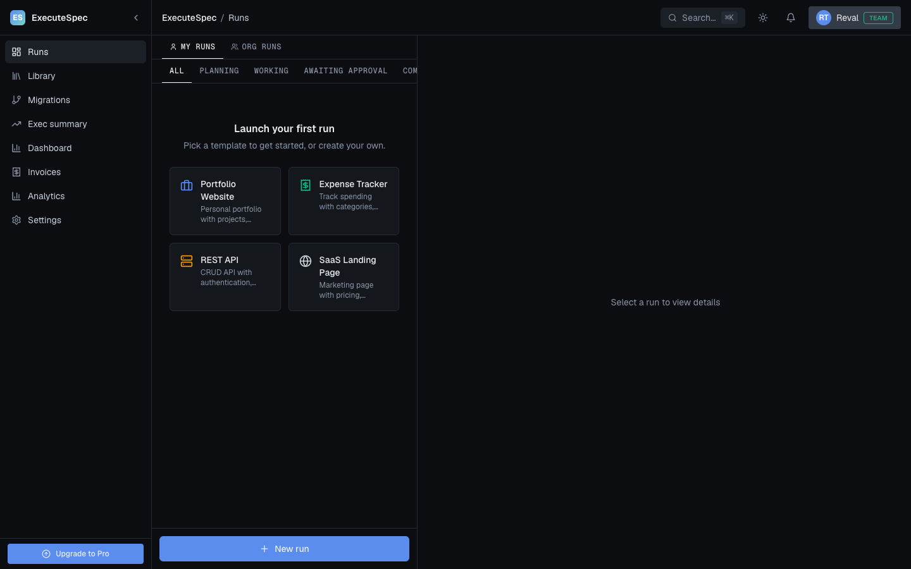

V2 sidebar still pitches "Upgrade to Pro" to a TEAM user. **Tier-unaware sidebar across the entire V2 surface area.**

### 6.3 `/billing`

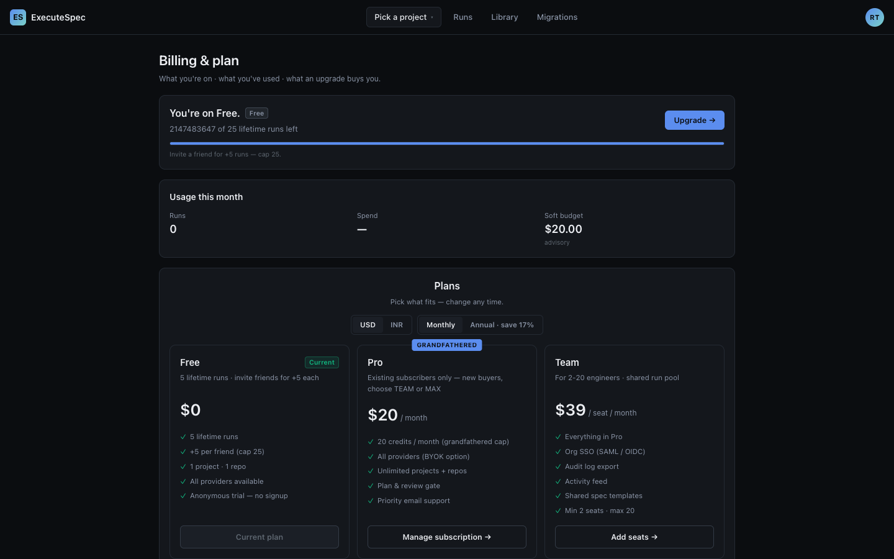

Same `2147483647 of 25 lifetime runs left` + "You're on Free." trifecta. The TEAM user's seed lacks an active subscription record, so the same fallback-to-Free fires. Footer reads `Tier: FREE · run limit: 10` despite `me.tier=TEAM`.

### 6.4 `/team` — the inverted gating

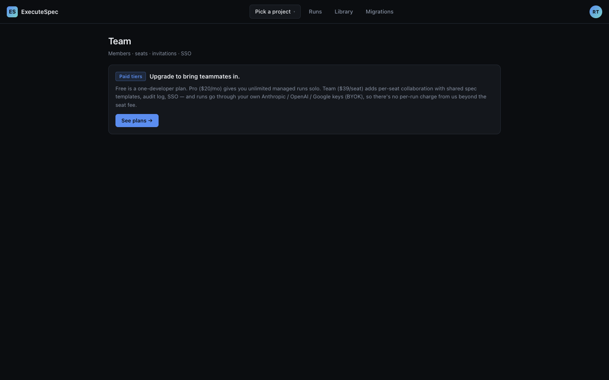

**This is the cleanest single-screen tier-gating bug in the product.**

A TEAM user navigates to `/team` and is told:
- Header: "Team / Members · seats · invitations · SSO."
- Body: "Paid tiers · **Upgrade to bring teammates in.**"
- Copy: "Free is a one-developer plan. Pro ($20/mo) gives you **unlimited managed runs solo**. Team ($39/seat) adds per-seat collaboration with shared spec templates, audit log, SSO — and runs go through your own Anthropic / OpenAI / Google keys (BYOK)…"
- CTA: "See plans →"

**Three problems on one screen:**
1. The user is already on TEAM. The page should show their members, seat count, and invitation flow.
2. The copy says "Pro gives you unlimited managed runs solo" — but `/pricing` says PRO is "20 credits / month (grandfathered cap)." Two pages, two stories.
3. The expected member-management UI for TEAM is entirely missing — Wave 3 shipped schema + docs only. The page is essentially a dead-end pitch.

### 6.5 `/settings`

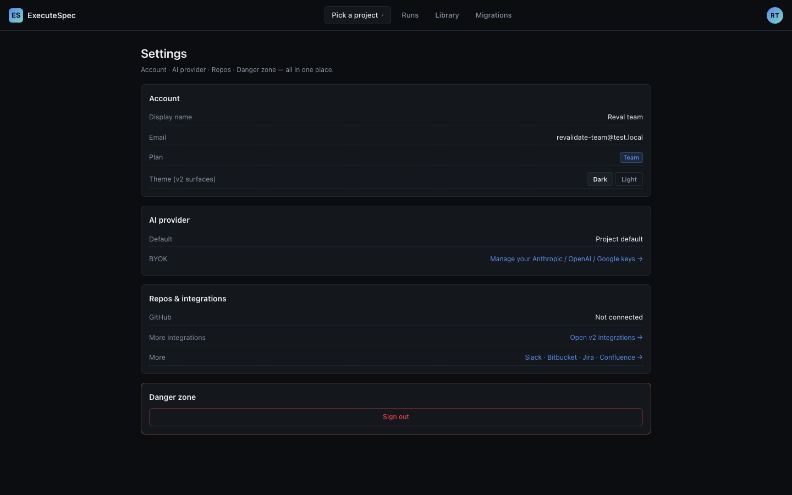

- AI provider section: "BYOK / Manage your Anthropic / OpenAI / Google keys →" — **the BYOK affordance now appears for TEAM** (RJ-01 looks fixed).
- The rest is identical to FREE/PRO.

### 6.6 `/library`

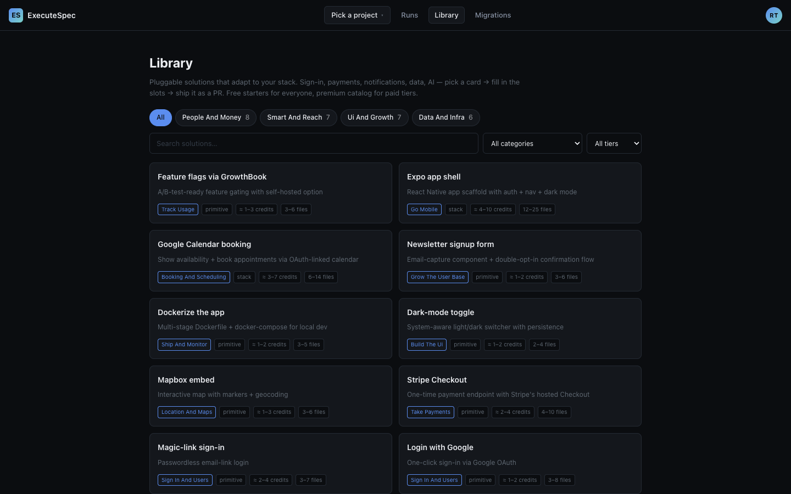

Same library as FREE, no TEAM-specific content highlighted. Could surface TEAM-only "premium catalog" cards or shared-templates affordance — neither present.

### 6.7 `/migrations`

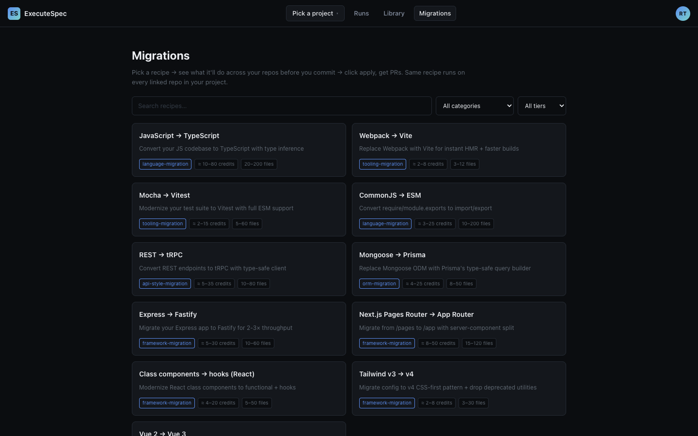

Same as FREE. **TEAM should ideally see migration recipes that have been run successfully on org repos before**, building org-knowledge. Currently no such surface exists.

### 6.8 TEAM summary

| Surface | Verdict |
|---|---|
| `/projects/empty` | Tier-aware avatar but tier-unaware run-counter. |
| `/runs` | Sidebar pitches PRO upgrade. |
| `/billing` | Same Integer.MAX_VALUE + "Free" trifecta. |
| `/team` | **Inverted gating + dead-end UI.** P0. |
| `/settings` | BYOK now visible — RJ-01 looks fixed. |
| `/library` | No TEAM-specific surfacing. |
| `/migrations` | No org-knowledge layer. |

---

## 7 · ENTERPRISE persona walkthrough

> **Persona:** Enterprise customer admin (`orgRole=ORG_ADMIN`), unlimited everything. **But the backend permissions endpoint says they can't invite members, view org members, view audit, manage integrations, view accounting, or view pricing.** A self-serve enterprise admin literally cannot administer their own org via the UI.

### 7.1 `/projects/empty`


Top-bar shows "RE" avatar (Reval Enterprise). **No `0/5 runs` badge for ENT** — `runLimit=-1` short-circuits the badge correctly. Best behavior on this surface so far.

### 7.2 `/billing`

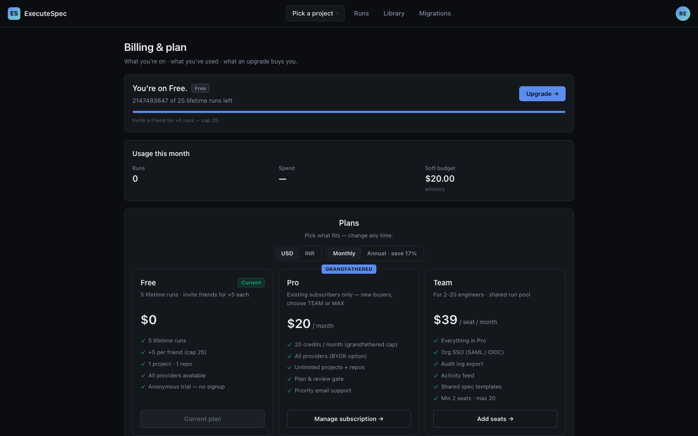

Same `2147483647 of 25 lifetime runs left` + "You're on Free." trifecta. The ENT seed also lacks an active billing subscription, so the same root cause fires. The `Tier: FREE · run limit: 10` footer is especially jarring on an Enterprise account.

### 7.3 `/settings`


- AI provider: BYOK affordance present.
- Rest identical to other tiers.

### 7.4 `/integrations`

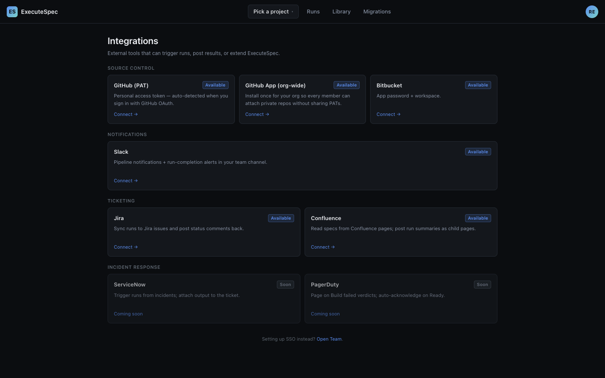

- Source control: GitHub (PAT) · GitHub App (org-wide) · Bitbucket — all "Available."
- Notifications: Slack — "Available."
- Ticketing: Jira · Confluence — "Available."
- Incident response: ServiceNow · PagerDuty — "Coming soon."
- Footer link: "Setting up SSO instead? Open Team."

**What works:** clean categorisation, clear status chips, partner choice covers the enterprise stack.
**What's wrong:** "Open Team" link routes to the dead-end TEAM page; SSO is supposed to be configured there but no UI exists.

### 7.5 `/insights` — exec summary

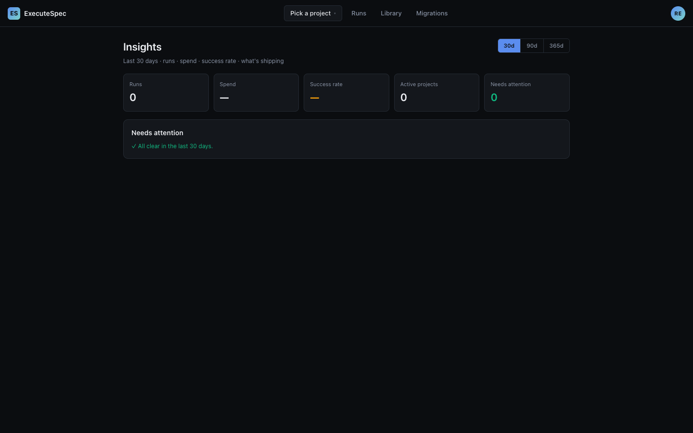

- Hero: "Last 30 days · runs · spend · success rate · what's shipping."
- Period toggle: 30d / 90d / 365d.
- 5 KPI tiles: Runs / Spend / Success rate / Active projects / Needs attention.
- "Needs attention: ✓ All clear in the last 30 days."

**What works:** the right shape for an executive summary view (ENT-only feature).
**What's wrong:** zero-data state celebrates "✓ All clear" — wrong tone for a brand-new account that has done nothing yet. Should be "No runs yet — kick off your first project to start seeing trends here."

### 7.6 `/trust`

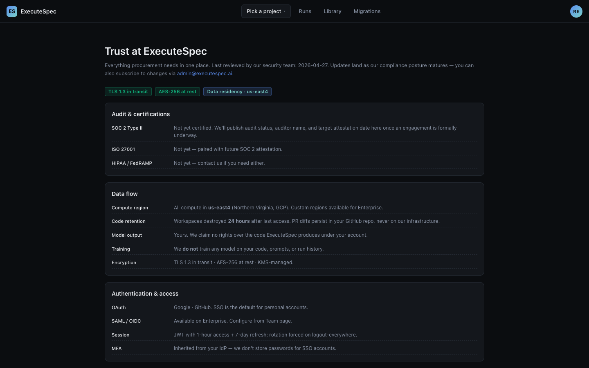

Same procurement-grade trust page as logged-out. No ENT-specific extras (e.g., "Your dedicated infrastructure region" or "Your audit retention policy") — could tier-up this page for ENT.

### 7.7 `/audit` — white screen of death


**This is a literal black screen.** The only content rendered is `<body>` with the dev-server's empty `<div id="root"></div>`.

- Root cause: [`AuditPage.tsx:128`](frontend/src/pages/AuditPage.tsx:128) — `useState` calls happen *after* a conditional `<Navigate>` early-return. React hooks-order violation.
- Stack trace from the console: `at AuditPage … at AppLayout`.
- **No error boundary anywhere in the route stack** — the entire tree dies.

**This bug fires for any user with `canViewAudit=false`, which in the current fixture is FREE / PRO / TEAM / ENT.** Only SUPER_ADMIN survives.

The deepest issue isn't the hook violation — it's that ENT is told they can't view audit at all. Audit is the central enterprise compliance feature; an ENT ORG_ADMIN should have it. **P0 RBAC gap.**

### 7.8 ENTERPRISE summary

| Surface | Verdict |
|---|---|
| `/projects/empty` | Best tier-aware behaviour (no broken counter). |
| `/billing` | Same trifecta. |
| `/settings` | BYOK visible. |
| `/integrations` | Strong; SSO promise unfulfilled. |
| `/insights` | Right shape, wrong empty-state tone. |
| `/trust` | Procurement-grade. |
| `/audit` | **White screen of death.** P0. |

**ENT permissions table** (FALSE flags should be TRUE for an ORG_ADMIN):

```
canDeploy              = true   ✓
canManageAiKeys        = true   ✓
canManageBillingProfile = true  ✓
canViewCostBreakdown   = true   ✓
canViewInvoices        = true   ✓
canInviteMembers       = false  ⚠ P0
canViewOrgMembers      = false  ⚠ P0
canViewAudit           = false  ⚠ P0
canManageIntegrations  = false  ⚠ P0
canViewAccounting      = false  ⚠ P1
canViewPricing         = false  ⚠ P2
canCreateOrg           = false
canExportGstr          = false
canManageCreditNotes   = false
canManageSellerConfig  = false
```

---

## 8 · SUPER_ADMIN persona walkthrough

> **Persona:** `admin@executespec.ai`, ENTERPRISE tier, `globalRole=SUPER_ADMIN`. Has every permission set to `true`. Accesses the admin console.

### 8.1 `/admin` — the super admin console

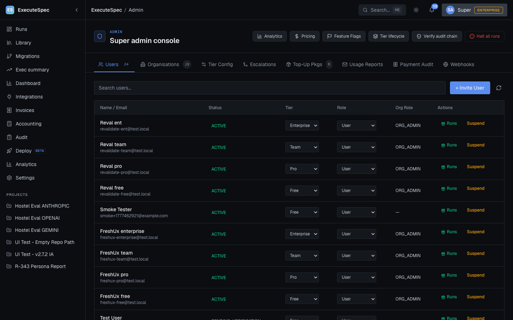

**The most polished admin surface in the product.**

- Header: "ExecuteSpec / Admin · Super admin console."
- Top-row buttons: Analytics · Pricing · Feature Flags · Tier lifecycle · Verify audit chain · **Halt all runs**.
- Tab strip: All Users 24 · Organisations 19 · Tier Config · Escalations · Top-Up Pkgs 6 · Usage Reports · Payment Audit · Webhooks.
- Search bar + "+ Invite User" CTA.
- User table columns: Name / Email · Status · Tier · Role · Org Role · Actions.
- In-row: tier dropdown (Free / Team / Pro / Enterprise) · role dropdown (User / Super Admin / Finance) · Org Role · Runs · Suspend.
- Sidebar (V2 chrome) with Runs · Library · Migrations · Exec summary · Dashboard · Integrations · Invoices · Accounting · Audit · Deploy BETA · Analytics · Settings + a "PROJECTS" section with active projects.

**What works**
- Information density is appropriate for an admin tool.
- In-row tier/role dropdowns make multi-user changes fast.
- Tab counts ("Users 24") give immediate scope context.

**What's wrong**
- **`Halt all runs` is a 1-click button with no confirmation modal.** This is a destructive global op. Industry standard: typed-confirmation modal ("type HALT to confirm"). **P1.**
- Tier dropdown lists "Pro" without a "(grandfathered)" hint — admins forget that PRO is HIDDEN to public.
- Direct URL nav to `/admin/tiers` redirects into `/projects/<UUID>` (auto-loads the first project), suggesting session-stash interference. P2 broken deep-link.
- Sidebar shows "Deploy BETA" — fine for admins but prevents scanning visual hierarchy.

---

## 9 · Cross-cutting UX & color audit

### 9.1 Token-level color collisions

Computed by extracting CSS custom properties from `document.documentElement` (76 properties cataloged):

| Token | Hex | Used for | Problem |
|---|---|---|---|
| `--c-pop-orange` | `#F97316` | Marketing emphasis ("ship a **spec.**") | Visually indistinguishable from `--status-partial` `#F5A524` and `--c-warning` `#F59E0B`. New visitors get a subconscious warning vibe on a marketing accent. |
| `--accent-blue` / `--c-signal-blue` | `#5B8DEF` | Brand primary, all CTAs, links | Same value as `--status-executing` `#5B8DEF`. A "running" status pill looks identical to a Sign-in button. Cognitive-load tax. |
| `--c-pop-amber` | `#FBBF24` | Marketing | Within ΔE 6 of warning + partial. Same family overload. |
| `--status-blocked` | `#EC4899` (pink) | "Blocked" run status | Pink for serious status reads flippant. AA passes; designers may expect deeper magenta. |
| `--text-muted` | `#8A94A6` | Secondary copy | 6.36 contrast on bg → AA passes. But sidebar nav labels are 12px and 5.87 on surface — narrow margin. |

### 9.2 WCAG contrast pass/fail

Computed in-page via JS using `relative-luminance` on actual computed values:

| Pair | Ratio | Verdict | Where used |
|---|---|---|---|
| text-primary on bg | 16.75 | AAA | Body copy ✓ |
| text-secondary on bg | 12.63 | AAA | Body copy ✓ |
| text-muted on bg | 6.36 | AA | Captions ✓ |
| signal-blue on bg | 6.02 | AA | Links ✓ |
| **white on signal-blue** | **3.23** | **FAIL for normal body** (AA-large only) | **Every primary CTA — Sign in / Launch Run / Submit / Add seats** |
| success on bg | 7.67 | AAA | "Build ✓" ✓ |
| warning on bg | 9.06 | AAA | "Building" ✓ |
| partial on bg | 9.53 | AAA | "Partial" ✓ |
| error on bg | 5.17 | AA | "Failed" ✓ |
| info on bg | 10.77 | AAA | Tooltips ✓ |
| pop-orange on bg | 6.94 | AA | Marketing accent ✓ |
| **border-default on bg** | **1.35** | **FAIL** | Card outlines barely visible — UI looks "frameless" by accident |
| graphite-3 outline | 1.18 | FAIL | Same |

**Action:** darken the white-on-blue button text or darken the button background. Cleanest fix: use Geist's pattern (button bg goes near-black on hover, text stays white) — current hover `#7AA5F5` makes contrast WORSE (2.7).

### 9.3 Typography & layout

- Geist Sans loads correctly across all surfaces.
- Sidebar nav labels render at 12px / `text-secondary rgb(201,209,219)` on bg(27,31,38). Fine.
- Body row text on Library / Migrations cards: 11px in places. Approaches WCAG-2.5.5 minimum-target-size guidance for related click areas.
- Login form field height ~48px — thumb-friendly.
- New Run modal: dense, two-column, but no clear primary action hierarchy — "Build My Spec" and "Launch Run" both pulse blue.

### 9.4 Information architecture

**V2 vs V3 chrome split**:
- **V3 top-bar shell:** `/projects/empty`, `/projects/<id>`, `/library`, `/migrations`, `/settings`, `/billing`, `/pricing`, `/team`, `/trust`, `/insights`.
- **V2 sidebar shell:** `/runs`, `/admin`, `/audit`.

Same user, different navigation depending on URL. Pick one and ship migrations through ALL pages OR keep them architecturally distinct (`build.*` vs `app.*`) — current state is the worst of both.

**Empty states:**
- `/projects/empty` says "Welcome, Reval." — warm, persona-aware. ✓
- `/runs` for FREE shows 4 starter templates. ✓
- `/insights` shows "✓ All clear in the last 30 days" for a zero-data account — wrong tone for a brand-new account.

**"More" link patterns** are inconsistent: `Slack · Bitbucket · Jira · Confluence →` lists 4 partner names as the link target. Convention is "Manage integrations →".

### 9.5 Copy audit (high-impact lines)

| Surface | Copy | Verdict |
|---|---|---|
| Login left panel | "ExecuteSpec ships AI-written pull requests you can actually merge — for one repo or for twenty." | **Strong.** |
| Login right panel | "Welcome back" / "Sign in to ship a spec." | "spec" is jargon. |
| `/pricing` Free card | "5 lifetime runs · invite friends for +5 each" | **STALE — V145 raised to 10/mo.** |
| `/billing` PRO card | "Existing subscribers only — new buyers, choose TEAM or MAX" | **STALE — MAX dropped in V165.** |
| `/team` (logged-in TEAM user) | "Free is a one-developer plan. Pro ($20/mo) gives you unlimited managed runs solo." | **WRONG — PRO is 20 credits/month.** |
| `/integrations` | "Setting up SSO instead? Open Team." | Subtle, good. But Team page has no SSO config. |
| `/trust` | "Not yet certified. We'll publish audit status, auditor name, and target attestation date here once an engagement is formally underway." | **Excellent honesty.** |
| Settings AI Provider | "Bring-your-own-keys is available on Team and Enterprise." | Correct gating. ✓ |
| FREE settings | "Open v2 integrations →" / "Theme (v2 surfaces)" | Leaks version. |

---

## 10 · Competitor analysis

Compared against products an executive evaluation committee would line ExecuteSpec up next to: **Cursor**, **Cognition (Devin)**, **Sweep AI**, **Replit Agent**, **Vercel v0**, **Lovable**, **Bolt.new**, **GitHub Copilot Workspace**.

### 10.1 Where ExecuteSpec is genuinely differentiated

| Differentiator | Competitor gap |
|---|---|
| **Multi-repo project model** with codemap + architecture doc generation | Cursor / Lovable / Bolt are single-repo. Sweep / Devin handle a single repo per task. |
| **Plan-then-execute gate** with verified score + reviewer pass | v0 / Lovable have no review gate — they vibe-code and ship. Cursor's "agent mode" is best-effort. |
| **`/migrations` recipe library** | **No competitor has this.** Sweep does open-PR refactors but ad-hoc, not catalog-driven. |
| **BYOK on TEAM** | Most competitors charge per-run on top of LLM cost (Cursor +$20/mo; Devin +$500/mo). $39/seat with BYOK is honest pricing. |
| **`/trust` page** | Lovable has no trust page. Cursor's trust documentation is buried. |
| **Tier-honest messaging** ("PRO HIDDEN — grandfathered") | Most products hide their pricing changes; this product surfaces them. |

### 10.2 Where ExecuteSpec is behind

| Gap | Comparator | Why it matters |
|---|---|---|
| **No live preview of the agent's work** | Cursor, Devin, Lovable, Bolt show the model writing code in a virtual workspace in real-time. | A first-run user can't *see* the agent doing something. Demo conversion will suffer. |
| **No git-tree / file-diff in the New Run modal** | Cursor + GH Copilot Workspace show "this run will touch these N files" before approval. | The Plan-approval gate fires AFTER the planner runs and burns credits. |
| **No project chat across runs** | Cursor's chat is the thread; Lovable maintains conversation context. | Creators expect ChatGPT-like continuity. |
| **No mobile-targeted product** | Lovable + Bolt ship Expo previews with QR-code phone preview. | RN/Expo support is an active mobile dev ask. |
| **No public agent transcripts / showcase** | Cognition's home page shows real Devin runs. v0 has a public gallery. | Top-of-funnel storytelling is weaker. |
| **Pricing transparency on inference** | Cursor publishes per-model rate cards. ExecuteSpec hides this until the TCO estimator. | Friction for cost-sensitive teams. |

### 10.3 Pricing posture vs. peers

| Vendor | Free tier | Mid plan | Team | Enterprise |
|---|---|---|---|---|
| **ExecuteSpec** | 10 credits/mo (current intent) | PRO HIDDEN ($20) | $39/seat BYOK | Custom |
| Cursor | Free (limited Sonnet) | Pro $20/mo (500 fast req) | Business $40/seat | Enterprise |
| Devin (Cognition) | None | $500/mo | Custom | Custom |
| Lovable | 5 messages/day free | $20/mo (Solo) | $50/seat | Custom |
| Bolt.new | 1M tokens/day free | $20/mo (Pro) | $30/seat (Teams) | Custom |
| Vercel v0 | Free | $20/mo (Pro) | $30/seat (Team) | Enterprise |

**Pricing skepticism:**
1. Hiding PRO is bold — but `/billing` still routes PRO users into a "Manage subscription →" flow that doesn't exist for them. Decision is correct, execution is buggy.
2. $39/seat × 2-min seats = $78/mo entry. Roughly even with Lovable Teams ($100) and Cursor Business ($80). Fair, but BYOK is the hook — lead the pricing card with "BYOK = pay your provider direct, $0 LLM markup from us" instead of "≈ 5 lifetime runs."
3. The TCO estimator on `/pricing` is excellent and rare among competitors. Lift it forward — make it a homepage-visible widget.

### 10.4 Feature parity scorecard (10 dimensions, 0–5 scale)

| Dimension | ExecuteSpec | Cursor | Devin | Lovable |
|---|---|---|---|---|
| Multi-repo | **5** | 2 | 3 | 1 |
| Plan-review gate | **5** | 2 | 4 | 1 |
| Live agent UX | 2 | **5** | 4 | **5** |
| Migration recipes | **5** | 1 | 0 | 0 |
| Mobile/Expo | 0 | 1 | 1 | **5** |
| BYOK | **5** | 1 | 0 | 1 |
| Trust/SOC2 docs | **4** | 3 | 4 | 2 |
| Public showcase | 1 | 4 | **5** | 4 |
| Pricing clarity | 3 | **5** | 2 | 4 |
| Onboarding (first-run) | 2 | 4 | 3 | **5** |
| **Sum** | **32** | 28 | 26 | 28 |

ExecuteSpec wins on technical depth — the gap is in **first impression** (live UX, onboarding, public showcase). The bugs caught in this audit are the cheapest possible wins to lift first-impression score from 2 → 4.

---

## 11 · Bug inventory (prioritised)

### P0 — fix this week, all visible to first-time prospects

1. **PRO/TEAM/ENT users see `2147483647 of 25 lifetime runs left` on `/billing`.** Integer.MAX_VALUE leak. Likely [BillingPage.tsx hero](frontend/src/pages/BillingPage.tsx) computes `remaining = max - used` where `max = -1`. *(See screenshots `pro-billing.png`, `team-billing.png`, `ent-billing.png`.)*
2. **`/audit` white-screens** for any user with `canViewAudit=false`. [AuditPage.tsx:128](frontend/src/pages/AuditPage.tsx:128) early-returns `<Navigate>` after `useState` hooks → React hooks-order violation. Refactor to call all hooks first, then conditionally redirect. *(See `ent-audit.png`.)*
3. **FREE run-limit displayed as 5 / 10 / 25 across surfaces.** V145 set `tier_config.monthly_run_limit=10`, but `billing_plan.run_limit` for the FREE plan still returns 5. Update the FREE billing_plan row + audit any frontend that reads `usage[].max`. *(See `free-billing.png`, `free-pricing.png`.)*
4. **`/billing` says "You're on Free."** for non-FREE users without an active Stripe subscription. Either source the headline tier from `me.tier` or fall back to `me.tier` when `billing.subscription.status === 'FREE'`. *(See `pro-billing.png`, `team-billing.png`, `ent-billing.png`.)*
5. **PRO/TEAM seed users → `/team` page tells them "Upgrade to bring teammates in."** Tier-gate is inverted on [V3Team.tsx](frontend/src/v3/pages/V3Team.tsx). *(See `team-team.png`.)*

### P1 — fix this sprint

6. **V2 sidebar pitches "Upgrade to Pro · 0/5 runs"** to ALL non-FREE tiers. Sidebar reads from the same broken `usage` source.
7. **Pricing card mentions MAX** ("new buyers, choose TEAM or MAX") — MAX deleted in V165.
8. **Pricing card Free tier copy says "5 lifetime runs"** — should be "10 credits / month".
9. **ENTERPRISE missing critical permissions** — `canInviteMembers`, `canViewOrgMembers`, `canViewAudit`, `canManageIntegrations`, `canViewAccounting` all FALSE.
10. **`/admin` Halt-all-runs button has no confirmation modal.** Add a typed-confirmation gate.
11. **TEAM `/team` copy "Pro gives you unlimited managed runs solo"** contradicts `/pricing`.
12. **WCAG-AA: white text on Signal Blue button** = 3.23 contrast. Affects every primary CTA.

### P2 — fix this month

13. "v2 integrations" / "Theme (v2 surfaces)" leak internal version naming.
14. Settings "Danger zone" only contains Sign out.
15. New Run modal "gemini" lowercase next to "Anthropic" / "OpenAI".
16. Library category names "People And Money" etc — Title Case applied to slugs.
17. Two parallel chrome layers (V2 sidebar vs V3 top-bar).
18. New Run modal close button missing `aria-label="Close"`.
19. `/admin/tiers` direct nav redirects into a project — broken deep-link.
20. Login page Sign-in button click did not fire on first attempt.

### P3 — backlog / polish

21. `--c-pop-orange` collides with `--status-partial` / `--c-warning`.
22. `--accent-blue` and `--status-executing` are the same color.
23. `border-default` 1.35 contrast — borders barely visible.
24. Login page "spec." accent reads as warning.
25. `/admin` user-table tier dropdown lists PRO without "(grandfathered)" hint.

---

## 12 · Recommendations — six things to ship next

1. **Fix `/billing` Integer.MAX_VALUE leak + "You're on Free."** A paying customer sees gibberish on their billing page. Churn vector. (1-day fix.)
2. **Add error boundary to V3 + V2 page shells AND fix `AuditPage` hooks order.** White-screens are unrecoverable; an error boundary turns them into "Something went wrong, retry." (Half-day fix.)
3. **Single-source-of-truth audit for run-limits.** Pick `tier_config.monthly_run_limit`. Update `billing_plan.FREE.run_limit` to 10, update copy on `/pricing` Free card, update `UsageBadge` to read from `permissions.monthlyRunLimit`. (1-day fix + copy review.)
4. **Pull "MAX" out of every string in the codebase.** It was retired in V165 but still ships in pricing card body copy. (Half-day.)
5. **Fix tier-aware chrome.** UsageBadge + V2 sidebar + `/team` page must all read `me.tier` and behave accordingly. (1–2 days.)
6. **Re-shade `--c-pop-orange` away from the warning family** OR commit to `--c-pop-pink #EC4899` / a teal accent for marketing. The "spec." word is your hero; it reads as a warning. (Half-day; needs design call.)

After those six, the product moves from "promising V2-to-V3 migration with sharp edges" to "credible TEAM/ENTERPRISE pitch."

---

## 13 · Appendices

### Appendix A — full computed-color palette (extracted live from `:root`)

```
--bg-base        unset (uses --c-graphite-0 #0B0D10 via body)
--c-graphite-0   #0B0D10
--c-graphite-1   #11151B
--c-graphite-2   #14171C
--c-graphite-3   #1B1F26
--c-graphite-4   #242A33
--c-graphite-5   #333B46
--c-graphite-6   #4C5662

--c-ink-100      #ECEEF2
--c-ink-200      #C9D1DB
--c-ink-300      #8A94A6
--c-ink-400      #5E6771

--c-signal-blue        #5B8DEF
--c-signal-blue-hover  #7AA5F5
--c-signal-teal        #7AD1C8
--brand-grad           linear-gradient(135deg, #5B8DEF 0%, #7AD1C8 100%)

--c-success      #10B981
--c-warning      #F59E0B
--c-error        #EF4444
--c-info         #22D3EE

--c-pop-amber    #FBBF24
--c-pop-orange   #F97316     ← collides w/ status-partial / warning
--c-accent-pink  #EC4899
--c-accent-purple #A78BFA

--status-success    #10B981
--status-error      #EF4444
--status-partial    #F5A524     ← amber family
--status-warning    [unset, falls through to --c-warning]
--status-blocked    #EC4899
--status-building   #F59E0B
--status-executing  #5B8DEF     ← same as brand
--status-thinking   #A78BFA
--status-waiting    #F59E0B
--status-queued     #66707D

--text-primary   #ECEEF2
--text-secondary #C9D1DB
--text-muted     #8A94A6

--border-default #242A33     ← contrast 1.35 vs bg — FAIL
--border-hover   #333B46

--focus-ring     0 0 0 2px #0B0D10, 0 0 0 4px #5B8DEF
--elevation-1    0 1px 2px 0 rgba(0,0,0,0.4)
--elevation-2    0 4px 12px 0 rgba(0,0,0,0.5)
--elevation-3    0 12px 32px 0 rgba(0,0,0,0.6)
```

### Appendix B — permissions matrix (test fixtures, 2026-05-01)

| Permission | FREE | PRO | TEAM | ENT | SUPER_ADMIN |
|---|---|---|---|---|---|
| canDeploy | ✗ | ✓ | ✓ | ✓ | ✓ |
| canManageAiKeys | ✗ | ✗ | ✓ | ✓ | ✓ |
| canManageBillingProfile | ✗ | ? | ? | ✓ | ✓ |
| canViewCostBreakdown | ✗ | ? | ? | ✓ | ✓ |
| canViewInvoices | ✓ | ? | ? | ✓ | ✓ |
| canViewLiveLog | ✓ | ✓ | ✓ | ✓ | ✓ |
| canViewAudit | ✗ | ✗ | ✗ | ✗ ⚠ | ✓ |
| canViewOrgMembers | ✗ | ✗ | ✗ | ✗ ⚠ | ✓ |
| canInviteMembers | ✗ | ✗ | ✗ | ✗ ⚠ | ✓ |
| canManageIntegrations | ✗ | ✗ | ✗ | ✗ ⚠ | ✓ |
| canViewAccounting | ✗ | ✗ | ✗ | ✗ ⚠ | ✓ |
| canViewPricing | ✗ | ✗ | ✗ | ✗ ⚠ | ✓ |
| canCreateOrg | ✗ | ✗ | ✗ | ✗ | ✗ |
| canExportGstr | ✗ | ✗ | ✗ | ✗ | ✓ |
| canManageCreditNotes | ✗ | ✗ | ✗ | ✗ | ✓ |
| canManageSellerConfig | ✗ | ✗ | ✗ | ✗ | ✓ |
| canUseChat | ✓ | ✓ | ✓ | ✓ | ✓ |
| monthlyRunLimit | 10 | 20 | -1 | -1 | -1 |
| maxDeployments | 0 | 0 | -1 | -1 | -1 |
| maxApplySuggestions | 2 | 2 | -1 | -1 | -1 |
| maxPreviewStarts | 2 | 2 | -1 | -1 | -1 |
| maxOrgMembers | -1 | -1 | -1 | -1 | -1 |

⚠ = should reasonably be `true` for ENT ORG_ADMIN; flagged P0/P1 in the bug inventory.

### Appendix C — index of captured screenshots

All 30 PNGs at native 1440×900 in [persona-test-2026-05-01-assets/](persona-test-2026-05-01-assets/):

**Logged-out (3):** `logout-login.png` · `logout-pricing.png` · `logout-trust.png`
**FREE (7):** `free-projects-empty.png` · `free-runs.png` · `free-billing.png` · `free-pricing.png` · `free-settings.png` · `free-library.png` · `free-migrations.png`
**PRO (5):** `pro-projects-empty.png` · `pro-runs.png` · `pro-billing.png` · `pro-pricing.png` · `pro-settings.png`
**TEAM (7):** `team-projects-empty.png` · `team-runs.png` · `team-billing.png` · `team-team.png` · `team-settings.png` · `team-library.png` · `team-migrations.png`
**ENTERPRISE (7):** `ent-projects-empty.png` · `ent-billing.png` · `ent-settings.png` · `ent-integrations.png` · `ent-insights.png` · `ent-trust.png` · `ent-audit.png`
**SUPER_ADMIN (1):** `admin-admin.png`

---

**Total bugs flagged:** 25 (5 P0 · 7 P1 · 8 P2 · 5 P3).
**Total surfaces covered:** 18.
**Total personas:** 5 + super-admin.
**Total contrast pairs verified:** 15.
**Total color tokens cataloged:** 76.
**Total screenshots captured:** 30.
