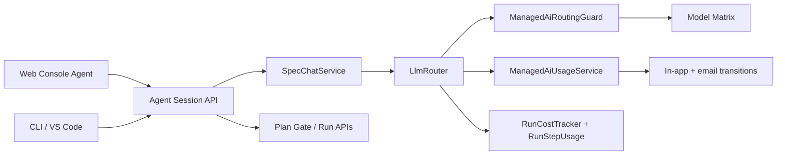

# Agent Control Plane + Managed AI Launch Plan

> Status: execution plan, branch `codex/agent-control-plane-managed-ai-plan`.
> Created from the current worktree plus the June 19 attached research/plans for web agent, managed AI metering, CLI terminal shell, and the external terminal-agent research packet.

## Goal

Ship one coherent agent control plane across web, CLI, and VS Code while adding managed-AI economics that protect unit margin.

The launch target is not three unrelated features. It is one system:

```text
Agent-session protocol
  -> web control-plane agent
  -> CLI / VS Code local-hands clients
  -> managed-AI per-call metering and dynamic routing
```

Hard rules:

```text
Web is a control plane. CLI / VS Code are local hands.
Every managed model call is independently authorized against current ES AI budget.
The model can propose mutations; product surfaces must require explicit user confirmation.
```

## Audit Tags

Detailed terminal audit register:

[`terminal-audit-register-2026-06-20.md`](terminal-audit-register-2026-06-20.md)

Use these exact tags in issues, PR descriptions, commits, test reports, and follow-up docs. They make terminal work grep-able and auditable without mixing it into web-agent or billing scope.

| Tag                               | Scope                                                                           | Owner repo        | Audit question                                                                             |
| --------------------------------- | ------------------------------------------------------------------------------- | ----------------- | ------------------------------------------------------------------------------------------ |
| `TERM-AUDIT-SERVER-CONTRACT`      | Agent-session APIs consumed by terminal clients                                 | `executespec`     | Did the server preserve a stable stream/history/capability contract for CLI and VS Code?   |
| `TERM-AUDIT-SERVER-LOCAL-HANDS`   | Browser/JWT vs PAT/client-only local execution boundary                         | `executespec`     | Can WEB accidentally receive or execute local shell/git/file capabilities?                 |
| `TERM-AUDIT-SERVER-BILLING-VIEW`  | Managed-AI balance/state endpoints consumed by terminal clients                 | `executespec`     | Can the terminal display managed-AI state without owning billing enforcement?              |
| `TERM-AUDIT-CLIENT-TUI`           | Terminal state machine, transcript, footer, command palette, permission prompts | `executespec-cli` | Is terminal UX implemented as a real agent workspace shell rather than an output renderer? |
| `TERM-AUDIT-CLIENT-LOCAL-ACTIONS` | Commit/push/diff/revert/shell/file execution in terminal client                 | `executespec-cli` | Do local actions stay local and auditable instead of being submitted as remote runs?       |
| `TERM-AUDIT-CLIENT-STREAMING`     | Terminal progress rendering for model/tool/run events                           | `executespec-cli` | Does the terminal show useful progress while backend turns are non-token or slow?          |

Audit grouping rule:

```text
Any CLI, terminal UI, VS Code local-hands, local git/shell/file, command-palette,
permission-prompt, or terminal streaming item must carry one of the TERM-AUDIT-* tags.
Do not hide terminal follow-ups inside WEB, MANAGED-AI, or generic agent work.
```

## Source Inputs Reviewed

These are mandatory scope inputs, not optional background references. After the backend
orchestrator requirements are finished and tested, execution continues through the web-agent plan
and then the managed-AI plan.

| Input                                                                         | What was used                                                                                                                                                                      |
| ----------------------------------------------------------------------------- | ---------------------------------------------------------------------------------------------------------------------------------------------------------------------------------- |
| `/Users/navneetprabhakar/Downloads/executespec-web-agent-plan.md`             | Web agent route, action cards, session stream, project/run chat migration                                                                                                          |
| `/Users/navneetprabhakar/Downloads/executespec-managed-ai-post-merge-plan.md` | ES AI credits, raw COGS caps, step-up/down, per-call ledger                                                                                                                        |
| `/Users/navneetprabhakar/Downloads/executespec-cli-terminal-plan.md`          | `TERM-AUDIT-CLIENT-TUI`, `TERM-AUDIT-CLIENT-LOCAL-ACTIONS`, `TERM-AUDIT-CLIENT-STREAMING`: CLI state machine, local/remote separation, permissions, terminal progress expectations |
| `/Users/navneetprabhakar/Downloads/dayton-replication-combined.md`            | `TERM-AUDIT-CLIENT-TUI`, `TERM-AUDIT-SERVER-CONTRACT`: effects-bridge lesson; terminal visual grammar; avoid unstable terminal-renderer dependency churn                           |
| Current code                                                                  | `agentsession`, `specchat`, `cost`, `router`, `billing`, `notification`, `frontend/src/console`, `frontend/src/ide`                                                                |

## Current Code Findings

| Area                    | Current evidence                                                                                                                                                                                                                | Launch gap                                                                                                |
| ----------------------- | ------------------------------------------------------------------------------------------------------------------------------------------------------------------------------------------------------------------------------- | --------------------------------------------------------------------------------------------------------- |
| Durable agent sessions  | `agentsession/AgentSessionController`, `AgentSessionService`, `AgentTurn`, `AgentActionEvent`, `AgentUsageLedger` exist; this branch adds `/agent` as the first web consumer and durable run scoping via `agent_session.run_id` | Legacy project/run chat history remains read-only continuity; new sends use scoped WEB agent sessions     |
| Streaming turn endpoint | `POST /api/agent/sessions/{id}/turns/stream` exists and records `STREAM_STARTED` / `STREAM_COMPLETED`; this branch adds `frontend/src/lib/api/agent.ts` with a POST-SSE parser and `/agent` composer                            | Live provider prompt-eval execution remains operator-triggered and credentialed                           |
| Transcript read model   | Turns are persisted; this branch adds `GET /api/agent/sessions/{id}/turns?limit=&before=` and renders it in `/agent`                                                                                                            | Legacy project/run chat reads are retained for continuity; agent-session history is the new write path    |
| Action catalog          | `AgentActionCatalog` advertises WEB capabilities; this branch makes `create_cloud_run` the public run-creation action and leaves `submit_run` as an internal chat tool                                                          | Existing chat-run tool name remains internal for compatibility                                            |
| Common chat loop        | `SpecChatService` binds run-control tools and project tools when session has `projectId`; this branch makes its prompt surface-neutral                                                                                          | Tool calls can still propose mutations before web confirmation UI exists                                  |
| Web shell               | `ConsoleShell` is the protected route chrome; this branch adds `/agent`, `/projects/:id/agent`, and `/runs/:id/agent` as route-level web-agent surfaces                                                                         | Scoped agent routes are the primary control-plane surfaces                                                |
| Existing web chat       | Project chat and run chat exist as separate surfaces                                                                                                                                                                            | New project/run chat sends now use project/run-scoped WEB agent sessions; legacy rows stay visible        |
| Model matrix            | `application.yml model-matrix` owns model ids, providers, pricing, context, tier routing, plus managed-AI cost/quality classes and same-provider cheap fallback metadata                                                        | Launch policy remains YAML-configured/read-only rather than a mutable admin policy store                  |
| Cost tracking           | `RunCostTracker` + `RunStepUsageRecorder` record every successful `LlmRouter` call; V245 adds ES AI credit ledger, raw COGS period caps, and per-call dynamic budget authorization                                              | Deployed/live usage still needs operational monitoring after launch                                       |
| Notifications           | In-app notification service, notification prefs, mail services, managed-AI transition dedupe, and the managed-AI billing email smoke endpoint exist                                                                             | Deployed Gmail OAuth delivery smoke remains pending                                                       |
| CLI split               | `TERM-AUDIT-SERVER-CONTRACT`: CLI and VS Code live in the standalone `executespec-cli` repo; this repo owns server APIs                                                                                                         | Server changes must keep CLI contracts stable and coordinate through API shape, not client implementation |

## Product Definitions

### ES AI Credits

```text
$1 = 100 ES AI credits
1 ES AI credit = $0.01 customer-facing managed AI allowance
```

Charge credits from actual raw provider cost:

```text
es_ai_credits_charged = ceil(raw_provider_cost_usd * retail_multiplier * 100)
```

Initial Pro launch policy:

```text
Pro price: $20/month
Included allowance: 2,000 ES AI credits
Internal raw LLM COGS cap: $16
Retail multiplier: 1.25x
```

### Managed-AI Routing States

| State             | Trigger                                              | Behavior                                                                    |
| ----------------- | ---------------------------------------------------- | --------------------------------------------------------------------------- |
| `FULL`            | User/org is below value-mode and frontier thresholds | Normal model matrix                                                         |
| `VALUE_MODE`      | Raw spend crosses value-mode threshold               | Prefer balanced/cheap; frontier only for high-value planner/reviewer rescue |
| `FRONTIER_LOCKED` | Frontier raw cap is exhausted                        | No frontier models on managed keys                                          |
| `CHEAP_ONLY`      | Raw spend crosses cheap-only threshold               | Cheapest benchmarked managed models only                                    |
| `EXHAUSTED`       | Raw hard cap or ES AI credits exhausted              | Stop managed-key calls; allow BYOK/top-up/reset                             |

Initial Pro thresholds:

| Raw spend | Routing                                                      |
| --------: | ------------------------------------------------------------ |
|   `$0-$4` | Full model set                                               |
|  `$4-$12` | Frontier restricted to planner/reviewer/high-risk escalation |
| `$12-$16` | Cheap/balanced models only                                   |
|    `$16+` | Managed-key calls stop                                       |

## Unified Architecture



Key design point from the terminal-agent research: keep a single effects/API bridge per surface. UI code should call a typed agent client, not import or scatter individual backend routes throughout components.

## Execution Plan

### Execution Order Gate

Do not jump between tracks opportunistically. Finish each item with tests and documentation before
starting the next item.

| Order | Track                                                                                                                                            | Required completion signal                                                                                                                                                            |
| ----: | ------------------------------------------------------------------------------------------------------------------------------------------------ | ------------------------------------------------------------------------------------------------------------------------------------------------------------------------------------- |
|     1 | Backend orchestrator requirements from `/Users/navneetprabhakar/Documents/antigravity/executespec-cli/docs/BACKEND_ORCHESTRATOR_REQUIREMENTS.md` | route-gated server contract implemented, golden corpus green, focused backend tests green, docs refreshed                                                                             |
|     2 | Web agent plan from `/Users/navneetprabhakar/Downloads/executespec-web-agent-plan.md`                                                            | `/agent` and scoped routes, reducer/state machine, action cards, gate rail, local handoff cards, ES AI state display, frontend/backend tests + browser smoke                          |
|     3 | Managed-AI post-merge plan from `/Users/navneetprabhakar/Downloads/executespec-managed-ai-post-merge-plan.md`                                    | ledger tables/services, model-matrix economic metadata, per-call routing guard, post-call debit, notifications, balance APIs, billing/run/model-picker/agent UI updates, tests        |
|     4 | Project documentation sweep                                                                                                                      | root/package `CLAUDE.md`, `docs/CODEMAP.md`, `docs/document_map.md`, `docs/reason-log/2026-06.md`, `docs/openapi.yaml`, `docs/frontend-api-usage.md`, README/design docs when touched |

Per-item rule:

```text
Implement item -> run focused tests -> update affected docs -> record reason-log/status -> then pick the next item.
```

The web-agent plan and managed-AI plan are both required launch scope. If backend work completes
inside this branch before merge, continue into web-agent work first. Managed-AI follows after the
web agent control-plane path is coherent enough to display usage/routing state.

### Branch Implementation Status

Implemented in this branch:

- Public action contract cleanup: `create_cloud_run` is the action-catalog and intent output name.
- Surface-neutral `SpecChatService` prompt language.
- Reloadable turn transcript endpoint: `GET /api/agent/sessions/{sessionId}/turns?limit=&before=`.
- Frontend agent API module: `frontend/src/lib/api/agent.ts`.
- POST-SSE parser and callback dispatcher for agent turn streaming.
- Protected `/agent`, `/projects/:projectId/agent`, and `/runs/:runId/agent` routes under
  `ConsoleShell`: reducer state machine, transcript, route/proposal/tool/usage stream events,
  mutation action cards, local-hands handoff cards, pending gate rail, WEB capabilities, and
  streaming composer.
- Route-gated orchestrator decision endpoint and stream pre-router.
- 450-row deterministic routing corpus covering read-only, plan/review, code-change, lifecycle,
  ambiguous, and unsafe prompts.
- Model-specific orchestrator routing prompt resources, optional live prompt-eval endpoint/script,
  backend-generated Markdown eval reports, and a confirmed run-submission gate that links
  `agent_turn` to the created run.
- Project chat and run result chat new sends now stream through project/run-scoped WEB agent
  sessions while preserving legacy chat history for read continuity.
- Focused backend/frontend tests for the above seams.
- Component-level `/agent` UI smoke covering managed-AI state, pending gates, WEB capability rails,
  command-palette submit, streamed route decisions, and cloud-run proposal cards.
- Local deterministic adversarial smoke and local authenticated browser/runtime smoke were
  completed on 2026-06-20. `scripts/web-agent-browser-smoke.mjs` now regenerates the browser proof
  against `localhost:8080` plus the normal Vite dev origins (`localhost:5173/5174`). Latest evidence:
  `scripts/web-agent-browser-smoke-results/web-agent-browser-smoke-20260620T170006.md` and `.png`
  show `/agent` rendering rails, WEB-only capabilities, `LOCAL_TOOL_ACTION` for commit/push,
  local-hands handoff, Run API blocked, and no browser console/network failures.
- `scripts/agent-control-plane-adversarial-smoke.sh` regenerates the authenticated API contract
  proof. Latest evidence:
  `scripts/agent-control-plane-smoke-results/agent-control-plane-smoke-20260620-222958.md` shows
  24/24 passing across WEB/CLI capabilities, managed-AI balance/policy/events, orchestrator
  no-run route matrix, POST-SSE `LOCAL_TOOL_ACTION` parity, `/turn/confirm` rejection for a local
  git action, turn/event replay, and action lifecycle readback.
- `docs/openapi.yaml` now documents the same public server contract consumed by web/CLI/VS Code:
  capabilities, agent sessions, turn history, streaming turns, action plan/event/result, no-op
  summary email compatibility, orchestrator turn/confirm, managed-AI balance/events/policy, and
  operator smoke endpoints. `AgentApiOpenApiCoverageTest` pins this coverage so the OpenAPI
  contract cannot silently drift behind the controllers again.
- Focused router/service proof for managed-AI economics now covers both policy and per-call
  attribution. `ManagedAiUsageServiceTest` proves platform-key debit, BYOK analytics/no-debit,
  transition notification, cheap-only next-call step-down, value-mode planner step-up, worker
  no-step-up, and exhausted hard block. The value-mode proof now includes an integrated lifecycle:
  a platform-key call crosses `FULL -> VALUE_MODE`, charges 13 ES AI credits, persists the event
  with before/after routing state, sends the transition notification, and the next
  `OutlinePlannerAgent` authorization rewrites the balanced model to the same-provider frontier
  model. The cheap-only proof covers the other mid-run edge: a platform-key call crosses
  `VALUE_MODE -> CHEAP_ONLY`, charges 13 ES AI credits, persists the event with before/after
  routing state, sends the transition notification, and the next `WorkerAgent` authorization
  rewrites the balanced DeepSeek model to the same-provider cheap model. `LlmRouterTest` also
  proves that when managed-AI authorization changes the model before dispatch, `RunCostTracker`,
  `RunStepUsageRecorder`, and `ManagedAiUsageService.recordSuccessfulCall` all receive the adjusted
  model for both primary calls and failover targets. Current focused validation:
  `JAVA_HOME=/opt/homebrew/opt/openjdk@21 mvn -Dtest=ManagedAiUsageServiceTest,ManagedAiRoutingPolicyTest,ManagedAiNotificationServiceTest,ManagedAiNotificationPolicyTest,ManagedAiUsagePeriodServiceTest,ManagedAiControllerTest,BillingNotificationAdminControllerTest,LlmRouterTest test -q`.

Still pending in this branch:

- Deployed Gmail OAuth smoke for managed-AI transition emails.
  - 2026-06-20 local SUPER_ADMIN smoke reached `/api/admin/test-managed-ai-email` and returned
    dispatch accepted for `CHEAP_ONLY`. The local environment has no working Gmail OAuth token, so
    `BillingNotificationService` logged the fallback message instead of proving external delivery.
  - This means the code path and admin endpoint are verified locally; deployed delivery remains an
    environment smoke after Gmail credentials are present.

Completed operator checks:

- Live provider prompt-eval execution is no longer blocked locally.
  - 2026-06-20: the routing corpus was moved from test-only resources into
    `src/main/resources/orchestrator/routing-corpus.jsonl` so the running backend can load the
    same corpus as `AgentRoutingCorpusTest`.
  - `BASE_URL=http://localhost:8080 ./scripts/orchestrator-routing-eval.sh --providers deepseek
--limit 5` produced `scripts/orchestrator-routing-eval-results/eval-20260620-194055.md`:
    5/5 rows, 0 schema failures, 0 run false positives, 100.0% accuracy.
  - 2026-06-20: the provider routing prompts now explicitly classify summarize/explain/show/read/
    search/inspect requests over repo, project, or workspace surfaces as `READ_ONLY_CODE_HELP`,
    not `CHAT_ONLY`. This closed the local DeepSeek miss on project-dashboard summaries without
    weakening the no-run policy.
  - The local SUPER_ADMIN credential repair was a local database fixture change only; no repo code
    embeds that credential.
  - 2026-06-20: `POST /api/admin/test-managed-ai-email` now dispatches through the same
    `BillingNotificationService.sendManagedAiRoutingStateChanged` path as managed-AI transition
    emails without creating usage ledger or notification-dedupe records. The remaining work is to
    run `BASE_URL=https://dev.executespec.ai TOKEN=<super-admin-token> TO=<recipient>
./scripts/managed-ai-email-smoke.sh --state CHEAP_ONLY` against the deployed Gmail OAuth
    environment and confirm actual delivery/logs.
  - 2026-06-20 local retry after repairing the local SUPER_ADMIN fixture: `BASE_URL=http://localhost:8080
TO=admin@executespec.ai ./scripts/managed-ai-email-smoke.sh --state CHEAP_ONLY` returned dispatch accepted.
    The foreground local backend log shows `BillingNotificationService` invoked the notification path and logged
    the expected Gmail-unavailable fallback because Gmail OAuth is unavailable in this environment. The remaining blocker
    is deployed Gmail delivery confirmation, not local API/auth behavior.
  - 2026-06-20 current smoke artifact: `scripts/managed-ai-email-smoke-results/managed-ai-email-smoke-20260620-223052.md`
    and `.json` record `deliveryProof=not_proven_local_environment`, so the local report cannot be confused with
    deployed Gmail inbox proof.
  - 2026-06-20 current routing eval artifact:
    `scripts/orchestrator-routing-eval-results/eval-20260620-223022.md` records DeepSeek `--limit 5`
    at 5/5 rows, 0 schema failures, 0 run false positives, and 100.0% accuracy against the restarted local backend.

### Phase 1 - Contract Cleanup

Backend:

- Normalize public action naming:
  - canonical public action: `create_cloud_run`
  - keep `submit_run` only as internal LLM tool alias if needed
  - remove `create_run` from intent output
- Make `SpecChatService` prompt surface-neutral.
- `TERM-AUDIT-SERVER-LOCAL-HANDS`: exclude local-only actions from `WEB` capability results:
  - `local_code_task`
  - local git status/diff
  - local shell/file mutations
- Add explicit mutation-confirmation contract to web action planning responses.

Acceptance:

- `GET /api/agent/v2/capabilities?surface=WEB` never returns local-only capabilities.
- Intent interpretation for a code-change request produces `create_cloud_run`.
- `TERM-AUDIT-SERVER-CONTRACT`: existing CLI/VS Code clients remain compatible through alias handling.

### Phase 2 - Agent Session Read Model

Add:

```text
GET /api/agent/sessions/{sessionId}/turns
GET /api/agent/sessions/{sessionId}/turns?limit=50&before=<turnId>
```

Return:

```text
turnId
sequence
userMessage
assistantSummary
status
intentType
actionType
proposedActionJson
inputTokens
outputTokens
reasoningTokens
costUsd
createdAt
```

Acceptance:

- A web client can reload an agent session without reconstructing transcript from raw events.
- Access control matches existing session ownership checks.

### Phase 3 - Web Agent Client And Route

Add frontend API module:

```text
frontend/src/lib/api/agent.ts
```

Functions:

```text
createAgentSession
listAgentSessions
getAgentSession
getAgentTurns
streamAgentTurn
getAgentCapabilities
resolveAgentContext
getAgentGates
getAgentGate
planAction
recordActionEvent
recordActionResult
```

Add protected routes:

```text
/agent
/projects/:projectId/agent
/runs/:runId/agent
```

Mount under `ConsoleShell`.

POST-SSE note:

```text
Use fetch + ReadableStream SSE parsing.
Native EventSource cannot send the POST body.
```

Acceptance:

- `/agent` can create/load a session and stream a turn.
- Project/run scoped routes create sessions with `projectId` / `runId` context.
- Browser smoke proves WEB commit/push prompts do not submit a cloud run: the route is
  `LOCAL_TOOL_ACTION`, the card says "Continue with local hands", and the routing rail keeps
  `Run API` blocked.

### Phase 4 - Web Agent State Machine

Frontend reducer states:

```text
idle
loadingSession
composing
streaming
toolRunning
actionProposed
confirmationRequired
gateDecision
runStreaming
error
reconnecting
```

State shape:

```text
session
turns
streamEvents
pendingAction
activeGate
activeRun
context
capabilities
usageBalance
routingState
```

Acceptance:

- No action confirmation, stream progress, or gate flow is represented by ad hoc `busy` booleans alone.
- Reducer tests cover transition paths.

### Phase 5 - Web Action Cards

All mutations render as typed cards before execution:

| Action                       | Required UI                                            |
| ---------------------------- | ------------------------------------------------------ |
| `create_cloud_run`           | spec, project, provider/model, estimated ES AI credits |
| `approve_run`                | gate summary, tasks, risk, credits, approve button     |
| `reject_run`                 | optional feedback field                                |
| `cancel_run`                 | phase and consequence summary                          |
| `generate_architecture_doc`  | project/repo scope                                     |
| `run_code_review`            | subscription/billing impact                            |
| `manage_org_model_overrides` | enterprise-only confirmation                           |

Acceptance:

- The model can propose, but web user confirmation executes.
- The web app does not silently approve/reject/cancel/create runs from an LLM tool call.

### Phase 6 - Managed AI Ledger

Status 2026-06-20: implemented in V245. The migration creates all three managed-AI ledger tables, including period threshold snapshots for value mode, cheap-only, and hard-stop boundaries.

Add Flyway migration for:

```text
managed_ai_usage_period
managed_ai_usage_event
managed_ai_state_notification
```

`managed_ai_usage_period`:

```text
id
user_id
org_id
tier
period_start
period_end
included_ai_credits
ai_credits_used
raw_cogs_cap_usd
raw_cogs_used_usd
frontier_raw_cap_usd
frontier_raw_used_usd
cheap_only_after_raw_usd
routing_state
created_at
updated_at
version
```

`managed_ai_usage_event`:

```text
id
period_id
user_id
org_id
run_id
agent_session_id
source_type
provider
model
model_class
agent_role
step_id
input_tokens
output_tokens
cache_read_tokens
cache_write_tokens
reasoning_tokens
raw_cost_usd
retail_multiplier
ai_credits_charged
routing_state_before
routing_state_after
created_at
```

`managed_ai_state_notification`:

```text
id
period_id
user_id
org_id
from_state
to_state
channel
sent_at
```

Acceptance:

- Usage period updates are concurrency-safe through row locking or optimistic versioning.
- Failed provider calls do not debit ES AI credits.
- Existing `run_step_usage` remains the per-call technical ledger; managed AI event is the billing/routing ledger.

### Phase 7 - Managed AI Services

Status 2026-06-20: implemented under the existing `billing/service`, `billing/entity`, `billing/repository`, `billing/config`, and `billing/controller` packages rather than a new `billing/managedai` package, to stay consistent with the current billing module layout. `ManagedAiUsageService` owns the period/debit/state path; `ManagedAiModelClassifier`, `ManagedAiCreditCalculator`, and `ManagedAiNotificationService` provide the support boundary.

Add package:

```text
src/main/java/com/navneet/executespec/billing/managedai/
```

Services:

| Service                        | Responsibility                                   |
| ------------------------------ | ------------------------------------------------ |
| `ManagedAiPolicyService`       | Resolve tier policy and launch thresholds        |
| `ManagedAiUsageService`        | Current period, debit, state recompute           |
| `ManagedAiModelClassifier`     | Model -> CHEAP/BALANCED/FRONTIER + quality class |
| `ManagedAiRoutingGuard`        | Per-call authorize/step-down/step-up decision    |
| `ManagedAiCreditCalculator`    | Raw COGS -> ES AI credits                        |
| `ManagedAiNotificationService` | In-app/email transition notifications            |

Acceptance:

- Unit tests prove Pro thresholds and ES credit math.
- BYOK/system/hybrid behavior is explicit.

### Phase 8 - Model Matrix Economic Metadata

Status 2026-06-20: implemented. `ModelMatrixProperties.ModelConfig` binds `cost-class`, `quality-class`, `managed-ai-enabled`, and `step-down-priority`; the primary routed launch models have explicit metadata and the classifier fails to deterministic defaults from `chain-tier` for older rows.

Extend `ModelMatrixProperties.ModelConfig` and `application.yml` model rows:

```yaml
cost-class: CHEAP | BALANCED | FRONTIER
quality-class: BASIC | STANDARD | HIGH | PREMIUM
managed-ai-enabled: true
step-down-priority: 10
```

Do not classify by provider alone. DeepSeek, GLM, MiniMax, OpenRouter, and Fireworks can host both cheap and balanced routes depending on model.

Acceptance:

- YAML binding boots.
- Model registry exposes economic metadata to backend services.
- Missing metadata fails safe for managed-key routing.

### Phase 9 - Per-Call Dynamic Routing

Status 2026-06-20: implemented for same-provider step-down, same-provider value-mode step-up, and hard block. `LlmRouter` authorizes before dispatch, records after successful `RunCostTracker.CallUsage`, and also applies the guard to provider failover targets. `CHEAP_ONLY`, `FRONTIER_LOCKED`, and `EXHAUSTED` remain spend-protection states; `VALUE_MODE` can upgrade critical planner/reviewer calls to a same-provider frontier model while frontier budget remains. Focused tests now assert the adjusted model is used consistently for provider dispatch, cost tracking, per-step usage recording, and managed-AI debit on both primary and failover calls.

Hook pre-call authorization into `LlmRouter` before provider dispatch:

```text
1. Resolve user/org/key-source context.
2. Load managed-AI usage state.
3. If BYOK, bypass managed debit but record analytics.
4. If managed and state is VALUE_MODE, step critical planner/reviewer calls up to same-provider frontier when budget remains.
5. If managed and state disallows requested cost class, step down.
6. If exhausted, reject with BYOK/top-up/reset guidance.
```

After successful dispatch:

```text
1. Use RunCostTracker.CallUsage raw cost.
2. Debit managed-AI period.
3. Write managed_ai_usage_event.
4. Recompute state.
5. Emit transition notification if state changed.
```

Acceptance:

- Model selection is not frozen at run start.
- A worker loop can step down mid-run on the next LLM iteration.
- A planner/reviewer quality-rescue step-up is allowed only in VALUE_MODE and only while frontier budget permits.

### Phase 10 - Managed AI API And UI

Status 2026-06-20: API implemented and wired into the web agent right rail/header, billing page, run plan gate, compose/provider-model picker, and org settings policy panel. Policy is launch-configured through YAML and shown read-only in org settings; a persistent SUPER_ADMIN editor would require a separate policy store and is intentionally outside the V245 slice.

Add API:

```text
GET /api/billing/managed-ai/balance
GET /api/billing/managed-ai/events?period=current
GET /api/billing/managed-ai/policy
```

UI surfaces:

```text
billing page: implemented
run plan gate: implemented
model picker: implemented in compose run setup
web agent header/right rail: implemented
admin tier config: implemented as read-only effective policy visibility in org settings
```

User-facing fields:

```text
ES AI credits used / included
routing state
estimated ES AI credits for a run
frontier unavailable state
efficient mode active notice
BYOK/top-up/wait CTA when exhausted
```

Acceptance:

- Normal users do not see raw provider COGS.
- Admins can inspect enough ledger detail to debug margin/routing.

### Phase 11 - Notifications

Trigger on state transitions:

| Transition                             | In-app |           Email |
| -------------------------------------- | -----: | --------------: |
| `FULL -> VALUE_MODE`                   |    yes | optional/digest |
| `VALUE_MODE -> FRONTIER_LOCKED`        |    yes |             yes |
| `FRONTIER_LOCKED -> CHEAP_ONLY`        |    yes |             yes |
| `CHEAP_ONLY -> EXHAUSTED`              |    yes |             yes |
| any state -> `FULL` after reset/top-up |    yes |        optional |

Throttle:

```text
max 1 email per state transition per billing period
max 1 managed-AI warning email per user per 24h
always send EXHAUSTED
```

Acceptance:

- Notification is emitted after the call that crossed the threshold completes.
- The next call sees the new state.

### Phase 12 - Existing Chat Migration

Do not delete the existing chat paths first.

| Current surface               | Migration                                 |
| ----------------------------- | ----------------------------------------- |
| `/projects/:projectId/chat`   | Wrap with agent session using `projectId` |
| Run result Chat tab           | Wrap with agent session using `runId`     |
| Legacy request chat component | Retire or keep only as compatibility      |
| `/api/projects/{id}/chat`     | Keep until agent-session parity           |
| `/api/runs/{id}/chat`         | Keep until agent-session parity           |

Acceptance:

- One durable agent-session protocol becomes the primary path.
- Existing customers do not lose chat history abruptly.

Status 2026-06-20: migrated for new traffic. Project chat preserves legacy
`/api/projects/{id}/chat` history but sends new turns through project-scoped agent sessions
(`projectId`, WEB, confirm mutations). The Run result Chat tab preserves legacy
`/api/runs/{id}/chat` history but sends new turns through run-scoped agent sessions (`runId`, WEB,
confirm mutations). `agent_session.run_id` (V246) makes `/runs/:runId/agent` durable and
reloadable; the web route selects/creates sessions by exact run scope, and `SpecChatService`
receives the scoped run id as model context. Compile/compact/backfill from legacy chat stores can
be handled later without blocking the primary agent-session path.

### Phase 13 - Terminal / CLI / VS Code Audit Group

Canonical terminal audit register:

[`terminal-audit-register-2026-06-20.md`](terminal-audit-register-2026-06-20.md)

Audit tags:

```text
TERM-AUDIT-SERVER-CONTRACT
TERM-AUDIT-SERVER-LOCAL-HANDS
TERM-AUDIT-SERVER-BILLING-VIEW
TERM-AUDIT-CLIENT-TUI
TERM-AUDIT-CLIENT-LOCAL-ACTIONS
TERM-AUDIT-CLIENT-STREAMING
```

This repo owns server contracts only. The split client repo owns terminal UI and VS Code code.

Server-side commitments:

| Tag                              | Commitment                                            | Audit evidence                                                                                                                         |
| -------------------------------- | ----------------------------------------------------- | -------------------------------------------------------------------------------------------------------------------------------------- |
| `TERM-AUDIT-SERVER-CONTRACT`     | stable agent-session stream contract                  | API tests plus authenticated smoke for `POST /api/agent/sessions/{id}/turns/stream`; no breaking event rename without client migration |
| `TERM-AUDIT-SERVER-CONTRACT`     | turn-history read endpoint                            | `GET /api/agent/sessions/{id}/turns?limit=&before=` with ownership checks                                                              |
| `TERM-AUDIT-SERVER-CONTRACT`     | surface-specific capabilities                         | `GET /api/agent/v2/capabilities?surface=...` tests for WEB/CLI/VSCODE                                                                  |
| `TERM-AUDIT-SERVER-LOCAL-HANDS`  | local-only actions excluded from WEB                  | WEB capability test excludes `local_code_task`, `local_git_status`, `local_git_diff`, shell/file mutation actions                      |
| `TERM-AUDIT-SERVER-LOCAL-HANDS`  | local-hands remains PAT/client-only                   | browser/JWT local execution rejection stays covered by backend tests                                                                   |
| `TERM-AUDIT-SERVER-BILLING-VIEW` | managed-AI balance endpoint usable by CLI and VS Code | client-visible balance/state endpoint, read-only display contract, backend-owned enforcement                                           |

Client-side expectations for the other session:

| Tag                               | Expectation                                                     | Audit evidence                                                                                                  |
| --------------------------------- | --------------------------------------------------------------- | --------------------------------------------------------------------------------------------------------------- |
| `TERM-AUDIT-CLIENT-LOCAL-ACTIONS` | CLI keeps local git/shell/file work local                       | commit/push/diff/revert do not submit remote runs                                                               |
| `TERM-AUDIT-CLIENT-LOCAL-ACTIONS` | CLI routes commit/push/diff/revert to local actions             | command-router tests classify these as local actions                                                            |
| `TERM-AUDIT-CLIENT-TUI`           | terminal state machine is explicit                              | states include idle, composing, palette, permissionPrompt, remoteTurn, localTask, runStreaming, planGate, error |
| `TERM-AUDIT-CLIENT-TUI`           | command palette and permission prompts are visible              | screenshot/pty tests cover palette open, permission prompt, footer, sidebar behavior                            |
| `TERM-AUDIT-CLIENT-STREAMING`     | terminal shows model/tool/run progress                          | terminal renders model-call started, tool pending, elapsed time, last event, cost/tokens on completion          |
| `TERM-AUDIT-SERVER-BILLING-VIEW`  | CLI shows managed-AI state but does not own billing enforcement | terminal displays state from server; server still blocks/steps down calls                                       |
| `TERM-AUDIT-SERVER-CONTRACT`      | VS Code follows same action/capability contract                 | VS Code consumes same capability/action names as CLI and web                                                    |

## Adversarial Test Plan

The final verification pass must use `~/Desktop/local_creds.txt` only after confirming the file exists and without printing secrets.

### Static / Unit

```text
Agent action naming normalization
WEB capability exclusion of local-only actions
Agent turn history authorization
POST-SSE parser
Managed AI credit calculation
Managed AI period rollover
Managed AI state transitions
BYOK bypass
Failed provider call not charged
Retry success charged once
Notification once per transition
Model matrix metadata binding
```

### Backend Integration

```text
Create WEB agent session
Stream a turn
Reload turns
List gates
Approve/reject gate via existing guarded path
Cross-user session access denied
Local-only request from WEB returns handoff/action proposal, not local execution
Managed-key call debits ES AI credits
BYOK call bypasses ES AI credits
Threshold crossing steps down next call
Exhausted state rejects managed-key call
```

### Frontend / Browser

```text
/agent loads under ConsoleShell
New session can send a message
Stream events render transcript/tool/result cards
Action proposal renders confirmation card
Gate appears in right rail
Managed-AI state appears in header/rail
Step-down notice appears exactly once
Project-scoped agent receives project context
Run-scoped agent receives run context
```

### Adversarial Scenarios

```text
Ambiguous prompt: "providers" should not submit a run
"commit and push" in WEB should not become a remote run
"approve run" without run id asks for run id
Stale creditsConfirmed rejects approval
Two concurrent LLM debits cannot overspend the same period silently
Provider retry does not double-charge a failed attempt
Exhausted managed plan still allows BYOK
User cannot read another user's agent session
Frontend reconnect does not duplicate a turn
Prompt injection asking to bypass billing/routing fails
```

## First Implementation Slice

Start here after docs land:

1. Backend action contract cleanup.
2. Agent turn history endpoint.
3. `frontend/src/lib/api/agent.ts` plus POST-SSE parser.
4. Minimal `/agent` route under `ConsoleShell`.
5. Managed-AI DB/service skeleton.
6. Per-call debit after `RunCostTracker.record`.
7. Balance endpoint.

This slice creates the seams needed for the rest without forcing the whole billing/routing policy to be completed in one commit.

## Non-Goals For The First Slice

```text
No browser-local shell execution
No terminal emulation in web
No hidden mutation from model tool calls
No raw provider COGS shown to normal users
No concurrency enforcement yet
No five-hour / weekly rate-window enforcement yet
No deletion of existing project/run chat until parity
```

## Completion Criteria

The goal is complete only when:

```text
canonical docs are updated in docs/ and root
backend action contract is normalized
web can stream from agent sessions
turn history reload works
managed-AI ledger exists
per-call debit works
step-down/step-up policy is enforced mid-execution
notifications fire on state transitions
UI shows ES AI balance/routing state
adversarial tests with local creds have a written report
action items from the report are fixed or explicitly deferred with owner/rationale
```

Status 2026-06-20: the local deterministic adversarial report exists and has no action items.
Current local API contract smoke is 24/24 passing and includes stream-route parity plus confirmation
rejection for local git actions (`agent-control-plane-smoke-20260620-222958.md`). Focused
managed-AI/router tests additionally prove per-call debit and step-up/down attribution at the router
boundary. The authenticated `/agent` browser smoke also passes locally with `LOCAL_TOOL_ACTION`/Run
API blocked evidence for commit/push, fresh-session setup, and clean browser console/network
(`web-agent-browser-smoke-20260620T170006.md`). The SUPER_ADMIN prompt eval is locally exercised
with DeepSeek (`eval-20260620-223022.md`, 0 schema failures, 0 run false positives, 100.0%
accuracy). The remaining external live smoke is deployed Gmail OAuth transition-email delivery;
local dispatch accepts the request and backend logs show the expected Gmail-unavailable fallback for
the managed-AI transition email (`managed-ai-email-smoke-20260620-223052.md`).
