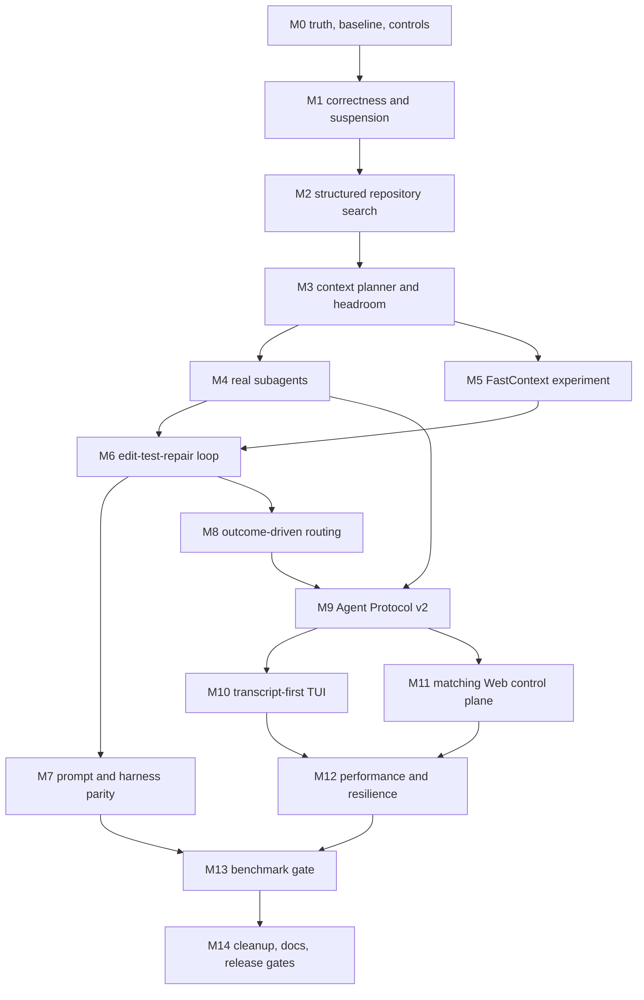

# ExecuteSpec 2.0 / CLI 1.0 master execution plan

Status: ACTIVE  
Owner: Forge  
Implementation branches: `codex/executespec-2.0`, `codex/cli-1.0`, `codex/executespec-2.0-docs`  
Canonical scope: the goal prompt attached to the active Codex task. This document is its operational index, not a substitute for its acceptance criteria.

## Release contract

- ExecuteSpec backend and Web: `2.0.0`.
- CLI/TUI: `1.0.0`.
- Agent Protocol: v2, shared by Web, CLI, and VS Code.
- TypeScript remains the CLI implementation language for 1.0. A Rust rewrite is not authorized without a measured hotspot that cannot be fixed within the current architecture.
- No permanent fork. Work happens on isolated integration branches and linked worktrees.
- No push, pull request, merge, deployment, package publication, benchmark publication, or production mutation without a later explicit instruction. Forge owns all ExecuteSpec PR merges.
- Main-program live LLM spend is capped at $10 per authorized provider and $60 total. Sarvam is forbidden from the main program and must be absent from the released product.

## Current truth

The three release worktrees were cut from the user-selected current states without absorbing dirty files:

| Surface | Worktree | Base | Dirty source preserved |
|---|---|---|---|
| Backend/Web | `../executespec-2.0` | `dev@9861f68f0` | Website and benchmark/marketing artifacts |
| CLI/TUI | `../executespec-cli-1.0` | `main@5ee52d51` | untracked `ANALYSIS.md` |
| Docs | `../executespec-docs-2.0` | `docs/harness-resolution-2026-07-04@ba972e5` | June reason-log edit in original worktree |

Audit findings that change execution order:

1. The approval gate blocks a fixed orchestration pool for up to 24 hours. Non-blocking persisted suspension is P0.
2. Production routing does not feed its outcomes into the model-performance tracker; the deprecated router records API-call success instead of task quality. Outcome storage precedes adaptive routing.
3. The model-visible `spawn_subagent` tool does not spawn a model. It must be deleted and replaced by persisted child runs.
4. Repository search is fast in places but returns flat strings, lacks stable fingerprints and has two inconsistent local implementations.
5. Web carries roughly 40 protected route concepts. CLI carries four interaction implementations and about 21K lines of renderer-adjacent code. Both require semantic state consolidation before visual redesign.
6. The docs repository has broken canonical navigation, duplicate reason-log IDs, stale release facts, and legacy TUI documentation presented as current truth.
7. The current best benchmark evidence is exploratory SWE-bench Pro sample-20, k=1. It cannot support a SOTA parity claim.

## Dependency graph

## Execution milestones

| Milestone | Required outcome | Evidence gate | State |
|---|---|---|---|
| 0. Truth and controls | Reproducible inventory/baseline, canonical plan, deletion/risk/readiness registers, durable spend guard, unauthorized-call test guard | Regeneration and control tests pass | IN PROGRESS |
| 1. Critical correctness | NUL removed and gated; structured intent route; non-blocking approval; reconnectable local hands; Sarvam production removal | Focused tests plus migration upgrade | PENDING |
| 2. Deterministic search | One typed search contract using git inventory, rg, symbols/tests, SHA/fingerprint, freshness and citations | Recall/latency corpus | PENDING |
| 3. Context planner | Server-owned journal, headroom, compaction and evidence bundles; no client-owned canonical history | Long-session and overflow tests | PENDING |
| 4. Real subagents | Persisted parent/child runs, bounded role/budget/depth, cancellation, hot handoff; scout and verifier roles | Integration and failure tests | PENDING |
| 5. FastContext | Isolated, licensed, measured experiment behind an adapter | Paired recall/latency/cost decision | PENDING |
| 6. Core loop | Evidence-driven localize/edit/verify/repair; automatic verification default; lean tools | Deterministic task corpus | PENDING |
| 7. Prompt/harness | Prompt manifest, capability overlays, frozen comparator, ablations and adversarial cases | Comparable-budget parity or explicit evidence blocker | PENDING |
| 8. Routing | One outcome-driven routing service with availability, quality, cost, latency, switch limits and audit trail | Replay and degradation tests | PENDING |
| 9. Protocol v2 | Semantic resumable event/state contract shared across all clients | Contract tests and old-client compatibility | PENDING |
| 10. CLI/TUI 1.0 | Transcript-first OpenTUI plus one plain renderer; no route shell/Inspector/Ink/split-footer | Workflow and 60/80/100/140-column visual QA | PENDING |
| 11. Web 2.0 | Same semantic transcript and control states as CLI, accessible and responsive | Browser workflow/visual/a11y QA | PENDING |
| 12. Performance | Measured startup, event overhead, search, rendering, memory, provider isolation and recovery | Published local performance report | PENDING |
| 13. Benchmarks | Versioned manifests, repeated comparable runs and honest provider readiness | Benchmark acceptance table | PENDING |
| 14. Cleanup/release | Delete replacements, graduate flags, upgrade schemas/docs, synchronize versions, run complete gates | Release-readiness table all green or explicitly blocked | PENDING |

## Sequencing rules

- Do not tune prompts around broken mechanics. Structured search, context headroom, lean tools, progress semantics and automatic verification land first.
- Do not build the new TUI or Web shell against transport enums. Agent Protocol v2 semantic state lands first.
- Do not enable adaptive provider switching until task outcomes are persisted and attributable to prompt/tool/harness versions.
- Delete old paths immediately after their replacement passes its compatibility gate. Compatibility paths are time-boxed and receive no new behavior.
- Every live provider call must reserve budget before dispatch and reconcile immediately after. A missing key produces `NOT_VERIFIED`, not a workaround.
- Every benchmark claim carries repository, provider/model slug, prompt, tool schema, harness, dataset slice, flags and budget identity.

## Maintained evidence

- Deletion register: [`executespec-2.0-deletion-register.md`](executespec-2.0-deletion-register.md)
- Baseline: [`executespec-2.0-baseline.md`](executespec-2.0-baseline.md)
- Risk register: [`executespec-2.0-risk-register.md`](executespec-2.0-risk-register.md)
- Release readiness: [`executespec-2.0-release-readiness.md`](executespec-2.0-release-readiness.md)
- Provider caps: `config/provider-test-budgets.json`
- Durable non-repository ledger: `~/.local/state/executespec/goals/executespec-2.0-cli-1.0/provider-spend-ledger.json`
- Flyway compatibility policy: [`executespec-2.0-flyway-compatibility.md`](executespec-2.0-flyway-compatibility.md)

Milestone reports must include outcome, changed architecture/files, deleted code, tests, provider spend, benchmark and visual evidence, limitations, compatibility debt, and the next milestone.
